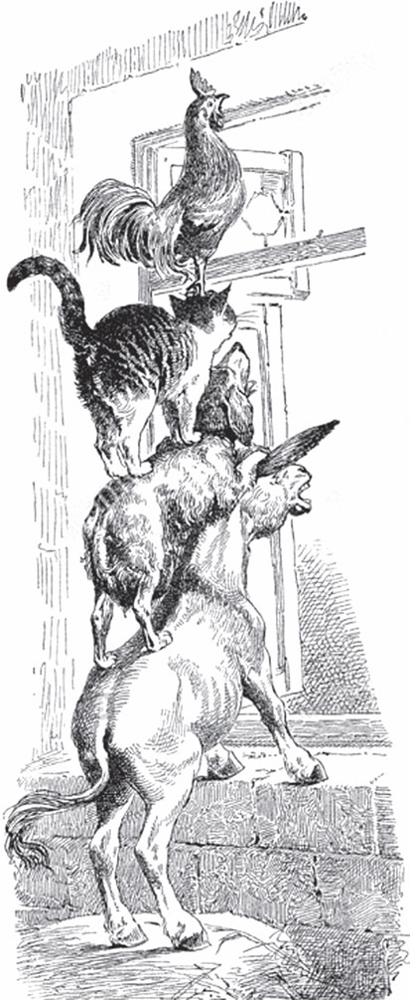

## Die Bremer Stadtmusikanten

Ein Mann hat einen <abbr title="der Esel, die Esel — осёл">Esel</abbr>. Viele Jahre lang hat der Esel geduldig die Säcke zur <abbr title="die Mühle, die Mühlen — мельница">Mühle</abbr> getragen. Aber jetzt ist er alt, und seine Kräfte gehen zu Ende. Er kann immer weniger arbeiten. Da denkt der Herr: «Warum soll ich ihm noch Futter geben?» Er will ihn loswerden.

Aber der Esel merkt, dass <abbr title="es weht kein guter Wind — дело пахнет керосином">kein guter Wind weht</abbr>. Er läuft fort und macht sich auf den Weg nach Bremen. Er denkt: «Dort kann ich ja <abbr title="der Stadtmusikant, die Stadtmusikanten — городской музыкант">Stadtmusikant</abbr> werden.»

Er ist schon ein Stück gegangen, da findet er einen <abbr title="der Jagdhund, die Jagdhunde — охотничья собака, гончая">Jagdhund</abbr>. Der Hund liegt auf dem Weg und <abbr title="hecheln — тяжело дышать, высунув язык">hechelt</abbr>. Er ist ganz <abbr title="erschöpft — измученный">erschöpft</abbr>, wie nach einem langen Lauf.

— Na, warum hechelst du so, <abbr title="Packan (Hundename: «Хватай!») — Хватай (кличка собаки)">Packan</abbr>? — fragt der Esel.

— Ach, — sagt der Hund, — ich bin alt und werde jeden Tag schwächer. Auf der Jagd kann ich nicht mehr mitlaufen. Deshalb wollte mein Herr mich <abbr title="totschlagen (schlug tot, hat totgeschlagen) — убить, забить до смерти">totschlagen</abbr>. Da bin ich abgehauen. Aber wie soll ich jetzt mein Brot verdienen?

— Weißt du was? — sagt der Esel. — Ich gehe nach Bremen und werde dort Stadtmusikant. Komm mit, dann kannst du auch Musik machen. Ich spiele die <abbr title="die Laute, die Lauten — лютня">Laute</abbr>, und du schlägst die Pauke.

Der Hund ist einverstanden, und sie gehen zusammen weiter.

Nach kurzer Zeit sitzt da eine Katze am Weg. Sie macht ein Gesicht wie drei Tage <abbr title="das Regenwetter — дождливая погода">Regenwetter</abbr>.

— Na, was ist dir denn passiert, alter <abbr title="der Bartputzer — чистильщик усов (шутл. о коте)">Bartputzer</abbr>? — fragt der Esel.

— Wer kann da lustig sein, wenn es <abbr title="es geht jemandem an den Kragen / um den Hals — дело идёт о жизни">um den Hals geht</abbr>? — antwortet die Katze. — Ich werde alt, und meine Zähne werden <abbr title="stumpf — тупой">stumpf</abbr>. Ich sitze lieber hinter dem Ofen und schnurre. Ich jage nicht mehr gern Mäuse. Deshalb wollte meine Frau mich <abbr title="ertränken — утопить">ertränken</abbr>. Ich bin noch entkommen. Aber jetzt ist <abbr title="guter Rat ist teuer — не знаю, что делать">guter Rat teuer</abbr>. Wohin soll ich gehen?

— Komm mit uns nach Bremen! Du kennst dich doch mit der <abbr title="die Nachtmusik — ночная серенада">Nachtmusik</abbr> aus. Da kannst du auch Stadtmusikant werden.

Die Katze findet das gut und geht mit.

Dann kommen die drei <abbr title="der Flüchtling, die Flüchtlinge — беглец">Flüchtlinge</abbr> an einem <abbr title="der Bauernhof, die Bauernhöfe — крестьянский двор, ферма">Bauernhof</abbr> vorbei. Da sitzt der Hahn auf dem Tor und schreit, so laut er kann.

— Du schreist ja, dass es einem <abbr title="durch Mark und Bein gehen — пробирать до костей">durch Mark und Bein geht</abbr>, — sagt der Esel. — Was ist denn los?

— Ich habe gutes Wetter <abbr title="vorhersagen — предсказывать">vorhergesagt</abbr>, — sagt der Hahn. — Denn heute ist ein <abbr title="der Feiertag, die Feiertage — праздник">Feiertag</abbr> von der <abbr title="die Mutter Gottes — Богородица">Mutter Gottes</abbr>. An diesem Tag hat sie dem Christkind die <abbr title="das Hemdchen, die Hemdchen — рубашечка">Hemdchen</abbr> gewaschen, und sie will sie trocknen. Aber morgen ist Sonntag, und es kommen Gäste. Deshalb hat die Hausfrau kein Mitleid. Sie hat der <abbr title="die Köchin, die Köchinnen — кухарка">Köchin</abbr> gesagt: «Morgen will ich den Hahn in der Suppe essen.» Heute Abend schneidet sie mir den Kopf ab. Jetzt schreie ich <abbr title="aus vollem Hals — во всё горло">aus vollem Hals</abbr>, so lange ich noch kann.

— Ach was, du <abbr title="der Rotkopf — красная голова (шутл. о петухе)">Rotkopf</abbr>, — sagt der Esel, — komm lieber mit uns! Wir gehen nach Bremen. Etwas Besseres als den Tod findest du überall. Du hast eine gute Stimme. Und wenn wir zusammen <abbr title="musizieren — музицировать">musizieren</abbr>, dann klingt das bestimmt gut.

Der Hahn findet den Vorschlag gut, und alle vier gehen zusammen weiter.

Aber an einem Tag können sie die Stadt Bremen nicht <abbr title="erreichen — достигать, добираться">erreichen</abbr>. Am Abend kommen sie in einen Wald. Dort wollen sie übernachten. Der Esel und der Hund legen sich unter einen großen Baum. Die Katze und der Hahn klettern in die Äste. Der Hahn fliegt ganz nach oben in die Spitze, denn dort ist er am <abbr title="sicher — безопасный">sichersten</abbr>.

Bevor er einschläft, sieht er sich noch einmal in alle vier <abbr title="die Himmelsrichtung, die Himmelsrichtungen — сторона света">Himmelsrichtungen</abbr> um. Da glaubt er, in der <abbr title="die Ferne — даль">Ferne</abbr> einen kleinen Funken zu sehen. Er ruft seinen <abbr title="der Gefährte, die Gefährten — спутник, товарищ">Gefährten</abbr> zu:

— Da ist ein Licht! Nicht weit von hier muss ein Haus sein.

Der Esel sagt:

— Dann müssen wir los und noch dorthin gehen. Denn hier ist die <abbr title="die Unterkunft, die Unterkünfte — ночлег, пристанище">Unterkunft</abbr> schlecht.

Der Hund meint:

— Ein paar Knochen mit etwas Fleisch dran, das tut mir auch gut.

Also machen sie sich auf den Weg zu dem Licht. Bald sehen sie es heller schimmern. Es wird immer größer. Endlich stehen sie vor einem hell <abbr title="beleuchtet — освещённый">beleuchteten</abbr> <abbr title="das Räuberhaus, die Räuberhäuser — разбойничий дом">Räuberhaus</abbr>. Der Esel ist der Größte. Deshalb geht er zum Fenster und schaut hinein.

— Was siehst du, <abbr title="der Grauschimmel — серый (шутл. об осле)">Grauschimmel</abbr>? — fragt der Hahn.

— Was ich sehe? — antwortet der Esel. — Einen <abbr title="gedeckt — накрытый">gedeckten</abbr> Tisch mit gutem Essen und Trinken. Und <abbr title="der Räuber, die Räuber — разбойник">Räuber</abbr> sitzen daran und lassen es sich gut gehen.

— Das ist etwas für uns! — sagt der Hahn.

— Ja, ja, ach, wenn wir nur da drin sind! — sagt der Esel.

Da <abbr title="beraten (beriet, hat beraten) — совещаться">beraten</abbr> die Tiere, wie sie die Räuber <abbr title="verjagen — прогонять">verjagen</abbr> können. Endlich haben sie eine Idee. Der Esel stellt sich mit den <abbr title="der Vorderfuß, die Vorderfüße — передняя нога">Vorderfüßen</abbr> auf das Fenster. Der Hund springt auf den <abbr title="der Rücken, die Rücken — спина">Rücken</abbr> von dem Esel. Die Katze klettert auf den Hund. Und zuletzt fliegt der Hahn hinauf und setzt sich der Katze auf den Kopf.

Dann fangen sie auf ein <abbr title="das Zeichen, die Zeichen — знак, сигнал">Zeichen</abbr> alle zusammen an, Musik zu machen: Der Esel schreit, der Hund bellt, die Katze <abbr title="miauen — мяукать">miaut</abbr>, und der Hahn <abbr title="krähen — кукарекать">kräht</abbr>. Dann stürzen sie durch das Fenster in die Stube hinein. Die <abbr title="die Scheibe, die Scheiben — оконное стекло">Scheiben</abbr> <abbr title="klirren — звенеть, дребезжать">klirren</abbr>.

Die Räuber hören das schreckliche Geschrei und springen auf. Sie glauben, ein Gespenst kommt herein. In großer Angst fliehen sie hinaus in den Wald.

Jetzt setzen sich die vier Gefährten an den Tisch. Sie essen, was übrig ist. Und sie essen so viel, als ob sie danach vier Wochen <abbr title="hungern — голодать">hungern</abbr> müssen.

Als die vier Spielleute fertig sind, machen sie das Licht aus. Jeder sucht sich einen Platz zum Schlafen, so wie er es gern hat. Der Esel legt sich auf den <abbr title="der Mist — навоз">Mist</abbr>. Der Hund legt sich hinter die Tür. Die Katze legt sich auf den Herd bei der warmen Asche. Und der Hahn setzt sich oben auf einen <abbr title="der Balken, die Balken — балка">Balken</abbr>. Sie sind müde von dem langen Weg. Deshalb schlafen sie bald ein.

Es ist schon nach Mitternacht. Die Räuber sehen von weitem: Im Haus brennt kein Licht mehr, und alles ist ruhig. Da sagt der <abbr title="der Hauptmann, die Hauptleute — атаман, главарь">Hauptmann</abbr>:

— Wir haben uns zu schnell <abbr title="sich ins Bockshorn jagen lassen — позволить себя запугать">ins Bockshorn jagen lassen</abbr>!

Er schickt einen Räuber zum Haus. Er soll alles <abbr title="untersuchen — обследовать, осмотреть">untersuchen</abbr>. Der Räuber findet alles still. Er geht in die Küche und will ein Licht anzünden. Er sieht die glühenden, feurigen Augen von der Katze. Er denkt, das sind Kohlen. Deshalb hält er ein <abbr title="das Streichholz, die Streichhölzer — спичка">Streichholz</abbr> daran. Es soll Feuer fangen.

Aber die Katze versteht keinen Spaß. Sie springt ihm ins Gesicht, <abbr title="fauchen — шипеть, фыркать">faucht</abbr> und kratzt. Da erschrickt der Räuber sehr. Er läuft weg und will durch die Hintertür hinaus. Aber da liegt der Hund. Er springt auf und beißt ihn ins Bein. Der Räuber rennt über den Hof, am Mist vorbei. Da gibt ihm der Esel noch einen kräftigen Tritt mit dem <abbr title="der Hinterfuß, die Hinterfüße — задняя нога">Hinterfuß</abbr>. Und der Hahn ist von dem Lärm aufgewacht. Er ruft von seinem Balken herunter:

— Kikeriki!

Da läuft der Räuber, so schnell er kann, zu seinem Hauptmann zurück und sagt:

— Ach, in dem Haus sitzt eine grässliche Hexe! Sie hat mich <abbr title="anhauchen — дохнуть на кого-то">angehaucht</abbr> und mir mit ihren langen Fingern das Gesicht <abbr title="zerkratzen — исцарапать">zerkratzt</abbr>. Und vor der Tür steht ein Mann mit einem Messer. Er hat mich ins Bein gestochen. Und auf dem Hof liegt ein schwarzes Ungeheuer. Es hat mit einer <abbr title="die Holzkeule, die Holzkeulen — деревянная дубина">Holzkeule</abbr> auf mich <abbr title="einschlagen auf + Akk. (schlug ein, hat eingeschlagen) — колотить, бить">eingeschlagen</abbr>. Und oben auf dem Dach sitzt der Richter. Der hat gerufen: «Bringt mir den <abbr title="der Schurke, die Schurken — негодяй, мошенник">Schurken</abbr> her!» Da bin ich schnell weggelaufen.

Von da an trauen sich die Räuber nicht mehr in das Haus. Aber den vier Bremer Stadtmusikanten gefällt es dort so gut, dass sie nicht mehr weggehen wollen.

Und wer das zuletzt erzählt hat, dem ist der Mund noch warm.

---

### Neue Wörter

- **der Esel, die Esel** — осёл
- **die Mühle, die Mühlen** — мельница
- **es weht kein guter Wind** — дело пахнет керосином
- **der Stadtmusikant, die Stadtmusikanten** — городской музыкант
- **der Jagdhund, die Jagdhunde** — охотничья собака, гончая
- **hecheln** — тяжело дышать, высунув язык
- **erschöpft** — измученный
- **Packan (Hundename: «Хватай!»)** — Хватай (кличка собаки)
- **totschlagen (schlug tot, hat totgeschlagen)** — убить, забить до смерти
- **die Laute, die Lauten** — лютня
- **das Regenwetter** — дождливая погода
- **der Bartputzer** — чистильщик усов (шутл. о коте)
- **es geht jemandem an den Kragen / um den Hals** — дело идёт о жизни
- **stumpf** — тупой
- **ertränken** — утопить
- **guter Rat ist teuer** — не знаю, что делать
- **die Nachtmusik** — ночная серенада
- **der Flüchtling, die Flüchtlinge** — беглец
- **der Bauernhof, die Bauernhöfe** — крестьянский двор, ферма
- **durch Mark und Bein gehen** — пробирать до костей
- **vorhersagen** — предсказывать
- **der Feiertag, die Feiertage** — праздник
- **die Mutter Gottes** — Богородица
- **das Hemdchen, die Hemdchen** — рубашечка
- **die Köchin, die Köchinnen** — кухарка
- **aus vollem Hals** — во всё горло
- **der Rotkopf** — красная голова (шутл. о петухе)
- **musizieren** — музицировать
- **erreichen** — достигать, добираться
- **sicher** — безопасный
- **die Himmelsrichtung, die Himmelsrichtungen** — сторона света
- **die Ferne** — даль
- **der Gefährte, die Gefährten** — спутник, товарищ
- **die Unterkunft, die Unterkünfte** — ночлег, пристанище
- **beleuchtet** — освещённый
- **das Räuberhaus, die Räuberhäuser** — разбойничий дом
- **der Grauschimmel** — серый (шутл. об осле)
- **gedeckt** — накрытый
- **der Räuber, die Räuber** — разбойник
- **beraten (beriet, hat beraten)** — совещаться
- **verjagen** — прогонять
- **der Vorderfuß, die Vorderfüße** — передняя нога
- **der Rücken, die Rücken** — спина
- **das Zeichen, die Zeichen** — знак, сигнал
- **miauen** — мяукать
- **krähen** — кукарекать
- **die Scheibe, die Scheiben** — оконное стекло
- **klirren** — звенеть, дребезжать
- **hungern** — голодать
- **der Mist** — навоз
- **der Balken, die Balken** — балка
- **der Hauptmann, die Hauptleute** — атаман, главарь
- **sich ins Bockshorn jagen lassen** — позволить себя запугать
- **untersuchen** — обследовать, осмотреть
- **das Streichholz, die Streichhölzer** — спичка
- **fauchen** — шипеть, фыркать
- **der Hinterfuß, die Hinterfüße** — задняя нога
- **anhauchen** — дохнуть на кого-то
- **zerkratzen** — исцарапать
- **die Holzkeule, die Holzkeulen** — деревянная дубина
- **einschlagen auf + Akk. (schlug ein, hat eingeschlagen)** — колотить, бить
- **der Schurke, die Schurken** — негодяй, мошенник

[← Zurück](kapitel-26.md) · [Inhalt](README.md)
