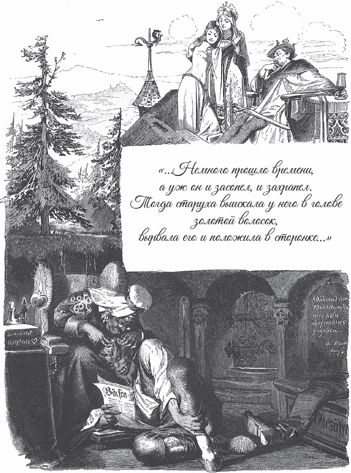

## Der Teufel mit den drei goldenen Haaren

Es war einmal eine arme Frau. Sie bekommt einen kleinen Sohn. Als er zur Welt kommt, hat er eine <abbr title="die Glückshaut — «рубашка» (в которой рождаются счастливцы)">Glückshaut</abbr> um den Kopf. Das ist ein gutes Zeichen. Deshalb <abbr title="voraussagen — предсказывать">sagt</abbr> man ihm voraus: «Mit vierzehn Jahren bekommt er die Tochter vom König zur Frau.»

Bald danach kommt der König in das Dorf. Aber niemand weiß, dass er der König ist. Er fragt die Leute:

— Was gibt es Neues?

Sie antworten:

— In diesen Tagen ist ein Kind mit einer Glückshaut geboren. Alles, was so einer <abbr title="unternehmen (unternahm, hat unternommen) — предпринимать">unternimmt</abbr>, bringt ihm Glück. Man hat ihm auch vorausgesagt: Mit vierzehn Jahren bekommt er die Tochter vom König zur Frau.

Der König hat ein böses Herz. Die <abbr title="die Weissagung, die Weissagungen — пророчество, предсказание">Weissagung</abbr> ärgert ihn sehr. Er geht zu den Eltern und tut ganz freundlich. Er sagt:

— Ihr armen Leute, gebt mir euer Kind. Ich sorge gut für es.

Zuerst weigern sich die Eltern. Aber der fremde Mann bietet ihnen viel Gold für das Kind. Und sie denken: «Es ist ein Glückskind. Es geht ihm bestimmt gut.» Deshalb sagen sie endlich Ja und geben ihm das Kind.

Der König legt das Kind in eine <abbr title="die Schachtel, die Schachteln — коробка, ящик">Schachtel</abbr> und <abbr title="reiten (ritt, ist geritten) — ехать верхом">reitet</abbr> damit weiter. Bald kommt er zu einem tiefen Wasser. Da wirft er die Schachtel hinein und denkt: «So, jetzt ist meine Tochter diesen <abbr title="unerwartet — неожиданный">unerwarteten</abbr> Bräutigam los.»

Aber die Schachtel geht nicht unter. Sie schwimmt wie ein kleines Schiff, und kein Tropfen Wasser kommt hinein. So schwimmt sie bis zu einer Mühle, zwei Meilen von der <abbr title="die Hauptstadt, die Hauptstädte — столица">Hauptstadt</abbr> von dem König. Dort bleibt sie am <abbr title="das Wehr, die Wehre — плотина, запруда">Wehr</abbr> hängen.

Zum Glück steht da gerade ein <abbr title="der Müllerbursche, die Müllerburschen — работник на мельнице">Müllerbursche</abbr>. Er sieht die Schachtel und zieht sie mit einem <abbr title="der Haken, die Haken — крюк, багор">Haken</abbr> heran. Er denkt: «Darin sind bestimmt große Schätze!» Aber als er sie aufmacht, liegt ein schöner kleiner Junge darin. Der Junge ist ganz frisch und munter.

Der Müllerbursche bringt ihn zum Müller und seiner Frau. Die beiden haben keine Kinder. Sie freuen sich und sagen:

— Gott hat ihn uns geschenkt.

Sie pflegen das <abbr title="das Findelkind, die Findelkinder — найдёныш, подкидыш">Findelkind</abbr> gut, und es wird ein guter, tüchtiger junger Mann.

Eines Tages gibt es ein Gewitter. Da kommt der König zufällig in die Mühle. Er fragt den Müller und seine Frau:

— Ist der große Junge euer Sohn?

— Nein, — antworten sie. — Er ist ein Findelkind. Vor vierzehn Jahren ist er in einer Schachtel bis ans Wehr geschwommen. Der Müllerbursche hat ihn aus dem Wasser gezogen.

Da merkt der König: Das ist das Glückskind! Das ist der Junge, den er ins Wasser geworfen hat. Er sagt:

— Ihr guten Leute, kann der Junge einen Brief zur Frau Königin bringen? Ich gebe ihm zwei Goldstücke als Lohn.

— Wie der Herr König befiehlt, — antworten die Leute. Sie sagen dem Jungen, er soll sich fertig machen.

Da schreibt der König einen Brief an die Königin. Im Brief steht: «Sobald der Junge mit diesem Brief ankommt, sollt ihr ihn töten und begraben. Und das muss alles fertig sein, bevor ich zurückkomme.»

Der Junge macht sich mit dem Brief auf den Weg. Aber er <abbr title="sich verirren — заблудиться">verirrt sich</abbr>, und am Abend kommt er in einen großen Wald. In der Dunkelheit sieht er ein kleines Licht. Er geht darauf zu und kommt zu einem kleinen Haus. Er geht hinein. Da sitzt eine alte Frau ganz allein am Feuer. Sie erschrickt, als sie den Jungen sieht, und fragt:

— Woher kommst du, und wohin willst du?

— Ich komme von der Mühle, — antwortet er. — Ich will zur Frau Königin. Ich soll ihr einen Brief bringen. Aber ich habe mich im Wald verirrt. Ich möchte gern hier übernachten.

— Du armer Junge, — sagt die Frau, — du bist in ein Räuberhaus gekommen. Wenn die Räuber nach Hause kommen, dann <abbr title="jemanden umbringen (brachte um, hat umgebracht) — убить">bringen</abbr> sie dich um.

— Egal, wer kommt, — sagt der Junge, — ich habe keine Angst. Aber ich bin so müde, ich kann nicht mehr weiter.

Er legt sich auf eine Bank und schläft ein.

Bald danach kommen die Räuber. Sie fragen zornig:

— Was ist das für ein fremder Junge?

— Ach, — sagt die Alte, — er ist ein unschuldiges Kind. Er hat sich im Wald verirrt, und ich habe ihn aus Mitleid aufgenommen. Er soll einen Brief zur Frau Königin bringen.

Die Räuber reißen den Brief auf und lesen ihn. Im Brief steht: Der Junge soll sofort sterben, wenn er ankommt. Da haben sogar die <abbr title="hartherzig — жестокосердный">hartherzigen</abbr> Räuber Mitleid. Der Anführer zerreißt den Brief und schreibt einen anderen. Darin steht: «Sobald der Junge ankommt, soll er sofort die Königstochter heiraten.»

Sie lassen ihn ruhig bis zum nächsten Morgen auf der Bank liegen. Als er aufwacht, geben sie ihm den Brief und zeigen ihm den richtigen Weg.

Die Königin bekommt den Brief und liest ihn. Sie macht alles so, wie es im Brief steht. Sie lässt ein prächtiges <abbr title="das Hochzeitsfest, die Hochzeitsfeste — свадебный пир">Hochzeitsfest</abbr> vorbereiten, und die Königstochter heiratet das Glückskind. Der junge Mann ist schön und freundlich. Deshalb lebt sie froh und zufrieden mit ihm.

Nach einiger Zeit kommt der König wieder in sein Schloss. Er sieht: Die Weissagung hat sich <abbr title="sich erfüllen — сбыться, исполниться">erfüllt</abbr>. Das Glückskind ist mit seiner Tochter verheiratet.

— Wie ist das passiert? — sagt er. — In meinem Brief habe ich einen ganz anderen <abbr title="der Befehl, die Befehle — приказ">Befehl</abbr> gegeben!

Da gibt ihm die Königin den Brief. Er soll selbst sehen, was darin steht. Der König liest den Brief. Er merkt: Jemand hat den Brief <abbr title="vertauschen — подменить, перепутать">vertauscht</abbr>. Er fragt den jungen Mann:

— Wo ist der Brief, den ich dir gegeben habe? Warum hast du einen anderen gebracht?

— Ich weiß von nichts, — antwortet der junge Mann. — Bestimmt hat ihn jemand in der Nacht vertauscht, als ich im Wald geschlafen habe.

Der König ist voll Zorn und sagt:

— So leicht geht das nicht! Wer meine Tochter haben will, der muss mir aus der <abbr title="die Hölle — ад, преисподняя">Hölle</abbr> drei goldene Haare vom Kopf von dem Teufel holen. Bringst du mir, was ich verlange, dann darfst du meine Tochter behalten.

So hofft der König, dass er den jungen Mann für immer los ist. Aber das Glückskind antwortet:

— Die goldenen Haare hole ich gern. Ich habe keine Angst vor dem Teufel.

Dann verabschiedet er sich und beginnt seine <abbr title="die Wanderschaft — странствие">Wanderschaft</abbr>.

Der Weg führt ihn zu einer großen Stadt. Der Wächter am Tor fragt ihn:

— Was für ein <abbr title="das Handwerk, die Handwerke — ремесло">Handwerk</abbr> kannst du? Was weißt du?

— Ich weiß alles, — antwortet das Glückskind.

— Dann kannst du uns einen Gefallen tun, — sagt der Wächter. — Auf unserem Markt steht ein Brunnen. Früher ist Wein daraus geflossen. Aber jetzt ist er trocken. Er gibt nicht einmal mehr Wasser. Sag uns, warum.

— Das sollt ihr erfahren, — antwortet er. — Wartet nur, bis ich wiederkomme.

Dann geht er weiter und kommt zu einer anderen Stadt. Da fragt der <abbr title="der Torwächter, die Torwächter — привратник, стражник у ворот">Torwächter</abbr> wieder:

— Was für ein Handwerk kannst du? Was weißt du?

— Ich weiß alles, — antwortet er.

— Dann kannst du uns einen Gefallen tun. In unserer Stadt steht ein Baum. Früher hat er goldene Äpfel <abbr title="tragen (trug, hat getragen) — приносить плоды">getragen</abbr>. Aber jetzt bekommt er nicht einmal mehr Blätter. Sag uns, warum.

— Das sollt ihr erfahren, — antwortet er. — Wartet nur, bis ich wiederkomme.

Dann geht er weiter und kommt an ein großes Wasser. Er muss auf die andere Seite. Der <abbr title="der Fährmann, die Fährmänner — паромщик, перевозчик">Fährmann</abbr> fragt ihn:

— Was für ein Handwerk kannst du? Was weißt du?

— Ich weiß alles, — antwortet er.

— Dann kannst du mir einen Gefallen tun, — sagt der Fährmann. — Sag mir, warum ich immer hin und her fahren muss. Warum <abbr title="ablösen — сменять (на посту)">löst</abbr> mich niemand ab?

— Das sollst du erfahren, — antwortet er. — Warte nur, bis ich wiederkomme.

Er fährt über das Wasser. Auf der anderen Seite findet er den Eingang zur Hölle. Drinnen ist es schwarz und <abbr title="rußig — закопчённый">rußig</abbr>. Der Teufel ist nicht zu Hause. Aber seine <abbr title="die Ellermutter — бабушка (чёрта)">Ellermutter</abbr> sitzt da, die Großmutter vom Teufel. Sie sitzt in einem breiten Lehnstuhl.

— Was willst du? — fragt sie. Aber sie sieht gar nicht so böse aus.

— Ich möchte gern drei goldene Haare vom Kopf von dem Teufel, — antwortet er. — Sonst darf ich meine Frau nicht behalten.

— Das ist viel verlangt, — sagt sie. — Wenn der Teufel nach Hause kommt und dich findet, dann <abbr title="es geht jemandem an den Kragen — кому-то не сносить головы">geht es dir an den Kragen</abbr>. Aber du tust mir leid. Ich will sehen, ob ich dir helfen kann.

Sie <abbr title="verwandeln in + Akk. — превращать в">verwandelt</abbr> ihn in eine Ameise und sagt:

— Kriech in die <abbr title="die Falte, die Falten — складка">Falten</abbr> von meinem Rock. Da bist du sicher.

— Ja, — antwortet er, — das ist schon gut. Aber drei Dinge möchte ich noch gern wissen. Warum ist ein Brunnen trocken, aus dem früher Wein geflossen ist? Warum gibt er nicht einmal mehr Wasser? Warum bekommt ein Baum keine Blätter mehr, der früher goldene Äpfel getragen hat? Und warum muss ein Fährmann immer hin und her fahren, und niemand löst ihn ab?

— Das sind schwere Fragen, — antwortet sie. — Aber sei nur still und ruhig. Und pass gut auf, was der Teufel sagt, wenn ich ihm die drei goldenen Haare ausreiße.

Am Abend kommt der Teufel nach Hause. Kaum ist er im Zimmer, da merkt er: Die Luft ist nicht <abbr title="rein — чистый">rein</abbr>.

— Ich rieche, rieche Menschenfleisch, — sagt er. — Hier ist etwas nicht in Ordnung.

Er guckt in alle Ecken und sucht, aber er findet nichts. Die Ellermutter schimpft mit ihm:

— Ich habe gerade gekehrt und alles aufgeräumt. Und jetzt bringst du mir wieder alles <abbr title="durcheinanderbringen (brachte durcheinander, hat durcheinandergebracht) — перевернуть вверх дном">durcheinander</abbr>! Immer hast du Menschenfleisch in der Nase! Setz dich hin und iss dein Abendbrot!

Der Teufel isst und trinkt. Dann ist er müde. Er legt der Ellermutter den Kopf in den Schoß. Sie soll ihn ein bisschen <abbr title="lausen — искать вшей, искаться">lausen</abbr>. Bald <abbr title="einschlummern — задремать">schlummert</abbr> er ein. Er <abbr title="schnaufen — сопеть, пыхтеть">schnauft</abbr> und schnarcht. Da packt die Alte ein goldenes Haar, reißt es aus und legt es neben sich.

— Autsch! — schreit der Teufel. — Was machst du da?

— Ich hatte einen schlimmen Traum, — antwortet die Ellermutter. — Da habe ich dir in die Haare gegriffen.

— Was hast du denn geträumt? — fragt der Teufel.

— Ich habe geträumt: Ein Brunnen auf einem Markt ist <abbr title="versiegen (ist versiegt) — иссякнуть">versiegt</abbr>. Früher ist Wein daraus geflossen, und jetzt kommt nicht einmal mehr Wasser. Was ist wohl schuld daran?

— Ha, das wissen die nicht! — antwortet der Teufel. — Im Brunnen sitzt eine Kröte unter einem Stein. Wenn sie die Kröte töten, dann fließt der Wein schon wieder.

Die Ellermutter laust ihn wieder. Endlich schläft er ein und schnarcht, dass die Fenster zittern. Da reißt sie ihm das zweite Haar aus.

— Hu! Was machst du? — schreit der Teufel zornig.

— <abbr title="jemandem etwas übel nehmen — обижаться на кого-то за что-то">Nimm</abbr> es mir nicht übel, — antwortet sie. — Das habe ich im Traum gemacht.

— Was hast du wieder geträumt? — fragt er.

— Ich habe geträumt: In einem Königreich steht ein Obstbaum. Früher hat er goldene Äpfel getragen, und jetzt bekommt er nicht einmal mehr Blätter. Was ist wohl der Grund dafür?

— Ha, das wissen die nicht! — antwortet der Teufel. — An der Wurzel <abbr title="nagen an + Dat. — грызть">nagt</abbr> eine Maus. Wenn sie die Maus töten, dann trägt er wieder goldene Äpfel. Aber wenn die Maus noch länger nagt, dann <abbr title="verdorren (ist verdorrt) — засохнуть">verdorrt</abbr> der Baum ganz. Und jetzt lass mich mit deinen Träumen in Ruhe! Wenn du mich noch einmal im Schlaf störst, dann bekommst du eine <abbr title="die Ohrfeige, die Ohrfeigen — пощёчина, оплеуха">Ohrfeige</abbr>!

Die Ellermutter spricht freundlich mit ihm und beruhigt ihn. Sie laust ihn wieder, bis er eingeschlafen ist und schnarcht. Da packt sie das dritte goldene Haar und reißt es aus. Der Teufel <abbr title="hochfahren (fuhr hoch, ist hochgefahren) — вскочить, подскочить">fährt hoch</abbr> und schreit. Er will ihr <abbr title="jemandem übel mitspielen — сыграть с кем-то злую шутку, расправиться">übel mitspielen</abbr>. Aber sie beruhigt ihn noch einmal und sagt:

— Wer kann denn etwas für böse Träume!

— Was hast du denn geträumt? — fragt er. Denn er ist doch <abbr title="neugierig — любопытный">neugierig</abbr>.

— Ich habe von einem Fährmann geträumt. Er <abbr title="sich beklagen — жаловаться">beklagt sich</abbr>, dass er immer hin und her fahren muss und dass niemand ihn ablöst. Was ist wohl schuld daran?

— Ha, der Dummkopf! — antwortet der Teufel. — Wenn einer kommt und über das Wasser fahren will, dann muss er ihm die <abbr title="die Stange, die Stangen — шест">Stange</abbr> in die Hand geben. Dann muss der andere fahren, und er ist frei.

Jetzt hat die Ellermutter ihm die drei goldenen Haare ausgerissen, und die drei Fragen sind beantwortet. Deshalb lässt sie den alten <abbr title="der Drache, die Drachen — дракон">Drachen</abbr> in Ruhe, und er schläft, bis der Tag kommt.

Am Morgen geht der Teufel wieder fort. Da holt die Alte die Ameise aus der Falte von ihrem Rock und gibt dem Glückskind seine menschliche Gestalt zurück.

— Da hast du die drei goldenen Haare, — sagt sie. — Und was der Teufel zu deinen drei Fragen gesagt hat, das hast du sicher gehört.

— Ja, — antwortet er, — ich habe es gehört, und ich <abbr title="sich etwas merken — запоминать">merke</abbr> es mir gut.

— Dann ist dir geholfen, — sagt sie. — Jetzt kannst du deinen Weg gehen.

Er bedankt sich bei der Alten für die Hilfe in der Not. Dann verlässt er die Hölle. Er ist froh, dass alles so gut <abbr title="klappen — получаться, удаваться">geklappt</abbr> hat.

Als er zu dem Fährmann kommt, will der Fährmann die versprochene Antwort hören.

— Fahr mich zuerst hinüber, — sagt das Glückskind. — Dann sage ich dir, wie du <abbr title="frei — свободный">frei</abbr> wirst.

Als er auf der anderen Seite am Ufer ist, gibt er ihm den Rat vom Teufel:

— Wenn wieder einer kommt und über das Wasser fahren will, dann gib ihm einfach die Stange in die Hand.

Er geht weiter und kommt zu der Stadt mit dem <abbr title="unfruchtbar — бесплодный">unfruchtbaren</abbr> Baum. Auch hier will der Wächter eine Antwort haben. Er sagt ihm, was er vom Teufel gehört hat:

— Tötet die Maus, die an der Wurzel nagt. Dann trägt der Baum wieder goldene Äpfel.

Da dankt ihm der Wächter. Als Belohnung gibt er ihm zwei Esel, <abbr title="beladen mit + Dat. — нагруженный">beladen</abbr> mit Gold. Die Esel müssen ihm folgen.

Zuletzt kommt er zu der Stadt mit dem trockenen Brunnen. Da sagt er zu dem Wächter, was der Teufel gesagt hat:

— Im Brunnen sitzt eine Kröte unter einem Stein. Ihr müsst sie suchen und töten. Dann gibt der Brunnen wieder viel Wein.

Der Wächter dankt ihm und gibt ihm auch zwei Esel mit Gold.

Endlich kommt das Glückskind nach Hause zu seiner Frau. Sie freut sich sehr, als sie ihn wiedersieht. Und sie hört, wie gut ihm alles <abbr title="gelingen (gelang, ist gelungen) — удаваться">gelungen</abbr> ist. Dem König bringt er, was er verlangt hat: die drei goldenen Haare vom Teufel. Der König sieht die vier Esel mit dem Gold. Da wird er ganz froh und sagt:

— Jetzt hast du alle Bedingungen erfüllt, und du darfst meine Tochter behalten. Aber, lieber <abbr title="der Schwiegersohn, die Schwiegersöhne — зять">Schwiegersohn</abbr>, sag mir doch: Woher hast du das viele Gold? Das sind ja gewaltige Schätze!

— Ich bin über einen Fluss gefahren, — antwortet er. — Da habe ich es mitgenommen. Dort liegt am Ufer Gold statt Sand.

— Kann ich mir auch etwas davon holen? — fragt der König. Er ist ganz gierig.

— So viel Ihr wollt, — antwortet der junge Mann. — Auf dem Fluss ist ein Fährmann. Lasst Euch von ihm hinüberfahren. Dann könnt Ihr drüben Eure Säcke füllen.

Der <abbr title="habgierig — алчный, корыстолюбивый">habgierige</abbr> König macht sich sofort auf den Weg. Er kommt zum Fluss und <abbr title="winken + Dat. — махать (рукой), подзывать">winkt</abbr> dem Fährmann. Der Fährmann soll ihn hinüberfahren. Der Fährmann kommt und sagt: «Steig ein!» Als sie am anderen Ufer ankommen, gibt er dem König die <abbr title="die Ruderstange, die Ruderstangen — шест для лодки, весло">Ruderstange</abbr> in die Hand und springt davon.

Und von da an muss der König fahren, als Strafe für seine Sünden.

— Fährt er wohl noch?

— Na klar! Ihm hat bestimmt niemand die Stange abgenommen.

---

### Neue Wörter

- **die Glückshaut** — «рубашка» (в которой рождаются счастливцы)
- **voraussagen** — предсказывать
- **unternehmen (unternahm, hat unternommen)** — предпринимать
- **die Weissagung, die Weissagungen** — пророчество, предсказание
- **die Schachtel, die Schachteln** — коробка, ящик
- **reiten (ritt, ist geritten)** — ехать верхом
- **unerwartet** — неожиданный
- **die Hauptstadt, die Hauptstädte** — столица
- **das Wehr, die Wehre** — плотина, запруда
- **der Müllerbursche, die Müllerburschen** — работник на мельнице
- **der Haken, die Haken** — крюк, багор
- **das Findelkind, die Findelkinder** — найдёныш, подкидыш
- **sich verirren** — заблудиться
- **jemanden umbringen (brachte um, hat umgebracht)** — убить
- **hartherzig** — жестокосердный
- **das Hochzeitsfest, die Hochzeitsfeste** — свадебный пир
- **sich erfüllen** — сбыться, исполниться
- **der Befehl, die Befehle** — приказ
- **vertauschen** — подменить, перепутать
- **die Hölle** — ад, преисподняя
- **die Wanderschaft** — странствие
- **das Handwerk, die Handwerke** — ремесло
- **der Torwächter, die Torwächter** — привратник, стражник у ворот
- **tragen (trug, hat getragen)** — приносить плоды
- **der Fährmann, die Fährmänner** — паромщик, перевозчик
- **ablösen** — сменять (на посту)
- **rußig** — закопчённый
- **die Ellermutter** — бабушка (чёрта)
- **es geht jemandem an den Kragen** — кому-то не сносить головы
- **verwandeln in + Akk.** — превращать в
- **die Falte, die Falten** — складка
- **rein** — чистый
- **durcheinanderbringen (brachte durcheinander, hat durcheinandergebracht)** — перевернуть вверх дном
- **lausen** — искать вшей, искаться
- **einschlummern** — задремать
- **schnaufen** — сопеть, пыхтеть
- **versiegen (ist versiegt)** — иссякнуть
- **jemandem etwas übel nehmen** — обижаться на кого-то за что-то
- **nagen an + Dat.** — грызть
- **verdorren (ist verdorrt)** — засохнуть
- **die Ohrfeige, die Ohrfeigen** — пощёчина, оплеуха
- **hochfahren (fuhr hoch, ist hochgefahren)** — вскочить, подскочить
- **jemandem übel mitspielen** — сыграть с кем-то злую шутку, расправиться
- **neugierig** — любопытный
- **sich beklagen** — жаловаться
- **die Stange, die Stangen** — шест
- **der Drache, die Drachen** — дракон
- **sich etwas merken** — запоминать
- **klappen** — получаться, удаваться
- **frei** — свободный
- **unfruchtbar** — бесплодный
- **beladen mit + Dat.** — нагруженный
- **gelingen (gelang, ist gelungen)** — удаваться
- **der Schwiegersohn, die Schwiegersöhne** — зять
- **habgierig** — алчный, корыстолюбивый
- **winken + Dat.** — махать (рукой), подзывать
- **die Ruderstange, die Ruderstangen** — шест для лодки, весло

[← Zurück](kapitel-28.md) · [Inhalt](README.md)
