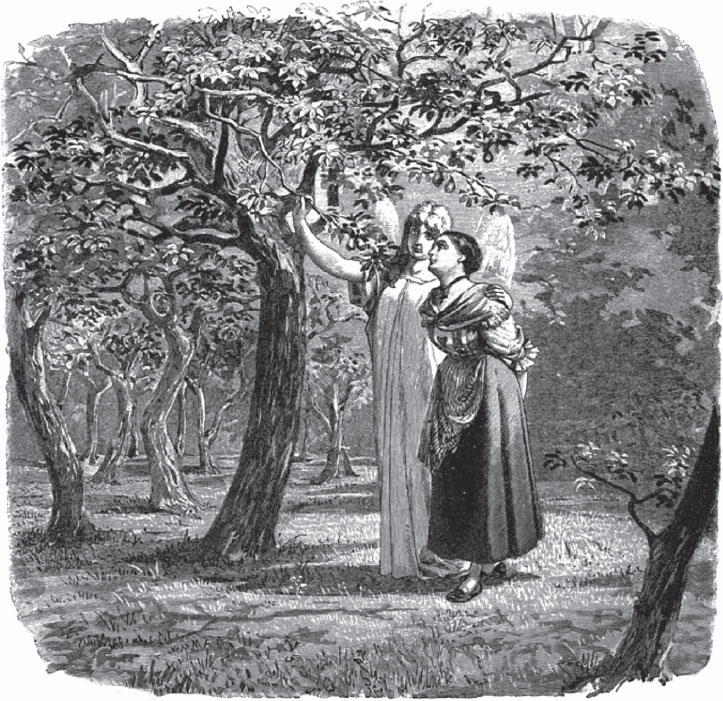

## Das Mädchen ohne Hände

Ein Müller wird langsam immer ärmer. Am Ende hat er nichts mehr, nur seine Mühle und einen großen <abbr title="der Apfelbaum, die Apfelbäume — яблоня">Apfelbaum</abbr> hinter der Mühle. Eines Tages geht er in den Wald und will Holz holen. Da kommt ein alter Mann zu ihm. Der Müller hat ihn noch nie gesehen. Der Mann sagt:

— Warum <abbr title="sich quälen — мучиться">quälst du dich</abbr> mit dem <abbr title="das Holzhacken — рубка дров">Holzhacken</abbr>? Ich mache dich reich. Du musst mir nur versprechen, was hinter deiner Mühle steht.

«Was kann das anderes sein als mein Apfelbaum?», denkt der Müller. Er sagt «Ja» und <abbr title="unterschreiben (unterschrieb, hat unterschrieben) — подписывать">unterschreibt</abbr> es dem fremden Mann. Der Mann aber lacht <abbr title="höhnisch — насмешливо, злорадно">höhnisch</abbr> und sagt:

— In drei Jahren komme ich und hole, was mir <abbr title="gehören + Dat. — принадлежать">gehört</abbr>.

Dann geht er fort.

Der Müller kommt nach Hause. Seine Frau läuft ihm <abbr title="jemandem entgegenlaufen — бежать навстречу">entgegen</abbr> und sagt:

— Sag mir, Müller, woher kommt dieser plötzliche Reichtum? Auf einmal sind alle Kisten und Kästen voll. Niemand hat etwas hereingebracht. Ich <abbr title="verstehen (verstand, hat verstanden) — понимать">verstehe</abbr> das nicht.

Er antwortet:

— Das kommt von einem fremden Mann. Ich habe ihn im Wald getroffen. Er hat mir große Schätze versprochen. Dafür habe ich ihm unterschrieben, was hinter der Mühle steht. Den großen Apfelbaum können wir ihm doch geben.

— Ach, Mann! — sagt die Frau erschrocken. — Das war der Teufel! Er meint nicht den Apfelbaum. Er meint unsere Tochter! Sie hat hinter der Mühle gestanden und den Hof gekehrt.

Die Tochter von dem Müller ist ein schönes und frommes Mädchen. Drei Jahre lang lebt sie <abbr title="gottesfürchtig — богобоязненный">gottesfürchtig</abbr> und ohne Sünde. Dann ist die Zeit <abbr title="um sein — пройти, истечь">um</abbr>. Der Tag kommt, an dem der Böse sie holen will. Da <abbr title="sich waschen (wusch, hat gewaschen) — мыться">wäscht sie sich</abbr> ganz sauber und malt mit Kreide einen <abbr title="der Kreis, die Kreise — круг">Kreis</abbr> um sich herum. Der Teufel kommt ganz früh. Aber er kann nicht nah zu ihr kommen. Wütend sagt er zum Müller:

— Nimm ihr alles Wasser weg! Sie darf sich nicht mehr waschen. Sonst habe ich keine Macht über sie.

Der Müller hat Angst und tut es. Am nächsten Morgen kommt der Teufel wieder. Aber das Mädchen hat auf seine Hände <abbr title="weinen — плакать">geweint</abbr>, und die Hände sind ganz rein. Wieder kann der Teufel nicht zu ihr. Zornig sagt er zu dem Müller:

— Hau ihr die Hände ab! Sonst kann ich ihr nichts tun.

Der Müller erschrickt und antwortet:

— Wie kann ich meinem eigenen Kind die Hände abhauen!

Da <abbr title="drohen + Dat. — угрожать">droht</abbr> ihm der Böse:

— Wenn du es nicht tust, dann gehörst du mir. Dann hole ich dich selbst!

Der Vater bekommt große Angst und verspricht ihm zu gehorchen. Er geht zu dem Mädchen und sagt:

— Mein Kind, wenn ich dir nicht beide Hände abhaue, dann holt mich der Teufel. In meiner Angst habe ich es ihm versprochen. Hilf mir doch in meiner Not! Und <abbr title="verzeihen (verzieh, hat verziehen) — прощать">verzeih</abbr> mir das Böse, das ich dir tue.

Sie antwortet:

— Lieber Vater, macht mit mir, was Ihr wollt. Ich bin Euer Kind.

Dann legt sie beide Hände hin und lässt sie sich abhauen. Der Teufel kommt zum dritten Mal. Aber sie hat so lange und so viel auf die Stümpfe geweint, dass sie wieder ganz rein sind. Da muss er <abbr title="weichen (wich, ist gewichen) — отступить">weichen</abbr>. Er hat alles Recht auf sie verloren.

Der Müller sagt zu ihr:

— Durch dich habe ich so viel <abbr title="das Gut, die Güter — добро, имущество">Gut</abbr> gewonnen. Ich will dich dein ganzes Leben lang <abbr title="aufs Beste — наилучшим образом">aufs Beste</abbr> <abbr title="versorgen — обеспечивать, заботиться">versorgen</abbr>.

Aber sie antwortet:

— Hier kann ich nicht bleiben. Ich will fortgehen. Mitleidige Menschen geben mir schon, was ich brauche.

Sie lässt sich die <abbr title="verstümmelt — изувеченный">verstümmelten</abbr> Arme auf den Rücken binden. Bei <abbr title="der Sonnenaufgang, die Sonnenaufgänge — восход солнца">Sonnenaufgang</abbr> <abbr title="sich auf den Weg machen — отправиться в путь">macht sie sich auf den Weg</abbr>. Sie geht den ganzen Tag, bis es Nacht wird. Da kommt sie zu einem königlichen Garten. Im <abbr title="der Mondschein — лунный свет">Mondschein</abbr> sieht sie dort Bäume voll schöner <abbr title="die Frucht, die Früchte — плод">Früchte</abbr>. Aber sie kann nicht hinein, denn um den Garten herum ist Wasser. Sie ist den ganzen Tag gegangen und hat keinen Bissen gegessen. Der Hunger quält sie. Sie denkt: «Ach, ich möchte so gern in den Garten und ein paar Früchte essen. Sonst verhungere ich.»

Da <abbr title="niederknien — встать на колени">kniet sie nieder</abbr>, ruft Gott, den Herrn, an und betet. Auf einmal kommt ein Engel. Er schließt eine <abbr title="die Schleuse, die Schleusen — шлюз">Schleuse</abbr> im Wasser. Der <abbr title="der Graben, die Gräben — ров, канава">Graben</abbr> wird trocken, und sie kann hindurchgehen. Nun geht sie in den Garten, und der Engel geht mit ihr. Sie sieht einen Baum mit Obst. Es sind schöne Birnen, aber sie sind alle <abbr title="zählen — считать, пересчитывать">gezählt</abbr>. Sie tritt an den Baum und beißt mit dem Mund eine Birne vom Baum ab. Sie will nur ihren Hunger <abbr title="stillen — утолить">stillen</abbr>, mehr nicht. Der <abbr title="der Gärtner, die Gärtner — садовник">Gärtner</abbr> sieht es. Aber der Engel steht daneben, deshalb hat er Angst. Er glaubt, das Mädchen ist ein Geist. Er schweigt. Er traut sich nicht, zu rufen oder den Geist anzusprechen. Das Mädchen isst die Birne und ist satt. Dann geht es und versteckt sich im Gebüsch.

Am nächsten Morgen kommt der König in den Garten. Der Garten gehört ihm. Er zählt die Birnen und sieht: Eine Birne fehlt. Er fragt den Gärtner, wo sie ist. Sie liegt nicht unter dem Baum, und trotzdem ist sie weg. Da antwortet der Gärtner:

— Letzte Nacht ist ein Geist gekommen. Er hatte keine Hände und hat eine Birne mit dem Mund abgegessen.

Der König fragt:

— Wie ist der Geist über das Wasser gekommen? Und wohin ist er gegangen, als er die Birne gegessen hatte?

Der Gärtner antwortet:

— Jemand in einem schneeweißen Kleid ist vom Himmel gekommen. Er hat die Schleuse zugemacht und das Wasser <abbr title="stoppen — остановить">gestoppt</abbr>. So konnte der Geist durch den Graben gehen. Das war bestimmt ein Engel. Deshalb hatte ich Angst. Ich habe nicht gefragt und nicht gerufen. Der Geist hat die Birne gegessen und ist wieder zurückgegangen.

Der König sagt:

— Wenn es so ist, wie du sagst, dann wache ich heute Nacht mit dir.

Als es dunkel wird, kommt der König in den Garten. Er bringt einen <abbr title="der Priester, die Priester — священник">Priester</abbr> mit. Der Priester soll mit dem Geist sprechen. Alle drei setzen sich unter den Baum und passen auf. Um Mitternacht kriecht das Mädchen aus dem Gebüsch. Es tritt an den Baum und isst wieder mit dem Mund eine Birne ab. Neben ihr steht der Engel im weißen Kleid. Da tritt der Priester <abbr title="hervortreten (trat hervor, ist hervorgetreten) — выступить вперёд">hervor</abbr> und sagt:

— Kommst du von Gott oder von der Welt? Bist du ein Geist oder ein Mensch?

Sie antwortet:

— Ich bin kein Geist. Ich bin ein armer Mensch. Alle haben mich verlassen, nur Gott nicht.

Der König sagt:

— Wenn dich die ganze Welt verlassen hat, dann will ich dich nicht verlassen.

Er nimmt sie mit in sein königliches Schloss. Sie ist so schön und fromm, und er liebt sie von Herzen. Er lässt ihr <abbr title="silbern — серебряный">silberne</abbr> Hände machen und nimmt sie zur Frau.

Nach einem Jahr muss der König in den Krieg ziehen. Er gibt die junge Königin in die <abbr title="die Obhut — попечение, опека">Obhut</abbr> von seiner Mutter und sagt:

— Wenn sie ihr Kind bekommt, dann pflegt sie gut und schreibt es mir sofort in einem Brief.

Die Königin bekommt einen schönen Sohn. Die alte Mutter schreibt es schnell und meldet dem König die frohe Nachricht. Aber der <abbr title="der Bote, die Boten — гонец, посыльный">Bote</abbr> ruht sich aus unterwegs an einem Bach. Er ist von dem langen Weg müde und schläft ein. Da kommt der Teufel. Er will der frommen Königin immer <abbr title="schaden + Dat. — вредить">schaden</abbr>. Er tauscht den Brief gegen einen anderen. In dem anderen Brief steht: Die Königin hat ein <abbr title="der Wechselbalg, die Wechselbälger — подменыш, урод">Wechselbalg</abbr> zur Welt gebracht. Der König liest den Brief. Er erschrickt und ist sehr traurig. Trotzdem schreibt er als Antwort: Sie sollen die Königin gut pflegen, bis er zurückkommt.

Der Bote geht mit dem Brief zurück. Er ruht sich an derselben Stelle aus und schläft wieder ein. Da kommt der Teufel noch einmal und steckt ihm einen anderen Brief in die Tasche. Darin steht: Sie sollen die Königin und ihr Kind töten. Die alte Mutter erschrickt <abbr title="furchtbar — ужасно">furchtbar</abbr>, als sie den Brief bekommt. Sie kann es nicht glauben und schreibt dem König noch einmal. Aber sie bekommt keine andere Antwort, denn der Teufel schiebt dem Boten jedes Mal einen <abbr title="falsch — поддельный, ложный">falschen</abbr> Brief <abbr title="unterschieben — подсунуть">unter</abbr>. Und im letzten Brief steht noch: Als Beweis sollen sie die Zunge und die Augen von der Königin aufheben.

Aber die alte Mutter weint, denn so unschuldiges <abbr title="das Blut — кровь">Blut</abbr> soll fließen. In der Nacht lässt sie eine <abbr title="die Hirschkuh, die Hirschkühe — олениха, лань">Hirschkuh</abbr> holen. Sie schneidet ihr Zunge und Augen heraus und hebt sie auf. Dann sagt sie zu der Königin:

— Ich kann dich nicht töten lassen, wie der König befiehlt. Aber hier darfst du nicht länger bleiben. Geh mit deinem Kind in die weite Welt und komm nie wieder zurück.

Sie bindet ihr das Kind auf den Rücken. Die arme Frau geht mit <abbr title="verweint — заплаканный">verweinten</abbr> Augen fort. Sie kommt in einen großen, wilden Wald. Dort kniet sie nieder und betet zu Gott. Da erscheint ihr der Engel des Herrn. Er führt sie zu einem kleinen Haus. Am Haus hängt ein kleines <abbr title="das Schild, die Schilder — табличка, вывеска">Schild</abbr> mit den Worten: «Hier wohnt jeder frei.» Aus dem Häuschen kommt eine schneeweiße Jungfrau. Sie sagt:

— Willkommen, Frau Königin!

Und sie führt sie hinein. Sie bindet ihr den kleinen <abbr title="der Knabe, die Knaben — мальчик">Knaben</abbr> vom Rücken und hält ihn an ihre Brust. So kann er trinken. Dann legt sie ihn in ein schönes, <abbr title="frisch gemacht — свежезастеленный">frisch gemachtes</abbr> Bettchen. Da fragt die arme Frau:

— Woher weißt du, dass ich eine Königin war?

Die weiße Jungfrau antwortet:

— Ich bin ein Engel. Gott hat mich <abbr title="schicken — посылать">geschickt</abbr>. Ich soll für dich und dein Kind sorgen.

So bleibt sie sieben Jahre in dem Haus und hat alles, was sie braucht. Weil sie so fromm ist, lässt Gott ihr in seiner Gnade die abgehauenen Hände wieder <abbr title="wachsen (wuchs, ist gewachsen) — расти">wachsen</abbr>.

Endlich kommt der König aus dem Krieg nach Hause. Zuerst will er seine Frau und das Kind sehen. Da fängt die alte Mutter an zu weinen und sagt:

— Du böser Mann! Warum hast du mir geschrieben, dass ich zwei unschuldige <abbr title="die Seele, die Seelen — душа">Seelen</abbr> töten soll?

Sie zeigt ihm die beiden Briefe, die der Böse <abbr title="fälschen — подделать">gefälscht</abbr> hat. Dann sagt sie:

— Ich habe getan, was du befohlen hast.

Und sie zeigt ihm die Beweise, die Zunge und die Augen. Da fängt der König an, noch viel bitterlicher zu weinen, um seine arme Frau und sein Söhnchen. Die alte Mutter hat Mitleid mit ihm und sagt:

— <abbr title="sich beruhigen — успокоиться">Beruhige dich</abbr>, sie lebt noch. Ich habe heimlich eine Hirschkuh schlachten lassen. Von ihr sind die Beweise. Deiner Frau habe ich ihr Kind auf den Rücken gebunden. Ich habe ihr gesagt, sie soll in die weite Welt gehen. Sie musste versprechen, nie wieder hierherzukommen, weil du so zornig auf sie bist.

Da sagt der König:

— Ich gehe, so weit der Himmel blau ist. Ich esse nicht und ich trinke nicht, bis ich meine liebe Frau und mein Kind wiedergefunden habe. Hoffentlich sind sie in der Zeit nicht umgekommen oder verhungert.

Dann zieht der König umher, fast sieben Jahre lang. Er sucht sie in allen <abbr title="der Felsen, die Felsen — скала">Felsen</abbr> und Höhlen. Aber er findet sie nicht. Er denkt, sie ist verhungert. Die ganze Zeit isst er nicht und trinkt er nicht, aber Gott hält ihn am Leben. Endlich kommt er in einen großen Wald. Dort findet er das kleine Häuschen mit dem Schild: «Hier wohnt jeder frei.» Die weiße Jungfrau kommt heraus. Sie nimmt ihn bei der Hand, führt ihn hinein und sagt:

— Seid willkommen, Herr König!

Sie fragt ihn, woher er kommt. Er antwortet:

— Fast sieben Jahre ziehe ich schon umher. Ich suche meine Frau und ihr Kind, aber ich kann sie nicht finden.

Der Engel bietet ihm Essen und Trinken an. Aber er nimmt nichts. Er will sich nur ein bisschen ausruhen. Er legt sich schlafen und legt ein Tuch über sein Gesicht.

Da geht der Engel in die Kammer. Dort sitzt die Königin mit ihrem Sohn. Sie nennt ihn meistens «Schmerzenreich». Der Engel sagt zu ihr:

— Komm heraus, zusammen mit deinem Kind. Dein Mann ist gekommen.

Sie geht zu der Stelle, wo er liegt. Da fällt ihm das Tuch vom Gesicht. Sie sagt:

— Schmerzenreich, heb deinem Vater das Tuch auf und deck ihm das Gesicht wieder zu.

Das Kind hebt das Tuch auf und legt es wieder über sein Gesicht. Der König hört das im <abbr title="der Halbschlaf — полусон, дремота">Halbschlaf</abbr>. Gern lässt er das Tuch noch einmal fallen. Da wird der kleine Junge ungeduldig und sagt:

— Liebe Mutter, wie kann ich meinem Vater das Gesicht zudecken? Ich habe doch keinen Vater auf der Welt. Ich habe das Beten gelernt: «<abbr title="das Vaterunser — Отче наш">Vater unser</abbr>, der du bist im Himmel.» Da hast du gesagt, mein Vater ist im Himmel, und er ist der liebe Gott. Wie soll ich so einen wilden Mann kennen? Der ist nicht mein Vater.

Als der König das hört, richtet er sich auf und fragt, wer sie ist. Sie sagt:

— Ich bin deine Frau, und das ist dein Sohn Schmerzenreich.

Er sieht ihre lebendigen Hände und sagt:

— Meine Frau hatte silberne Hände.

Sie antwortet:

— Der <abbr title="gnädig — милостивый">gnädige</abbr> Gott hat mir meine richtigen Hände wieder wachsen lassen.

Der Engel geht in die Kammer, holt die silbernen Hände und zeigt sie ihm. Erst jetzt weiß er sicher: Das ist seine liebe Frau, und das ist sein liebes Kind. Er küsst sie und ist froh und sagt:

— Ein schwerer Stein ist mir vom Herzen gefallen.

Der Engel Gottes gibt ihnen noch einmal zusammen zu essen. Dann gehen sie nach Hause zu seiner alten Mutter. Überall ist große <abbr title="die Freude — радость">Freude</abbr>. Der König und die Königin feiern noch einmal Hochzeit. Und sie leben <abbr title="glücklich — счастливо">glücklich</abbr> bis an ihr <abbr title="selig — блаженный">seliges</abbr> Ende.

---

### Neue Wörter

- **der Apfelbaum, die Apfelbäume** — яблоня
- **sich quälen** — мучиться
- **das Holzhacken** — рубка дров
- **unterschreiben (unterschrieb, hat unterschrieben)** — подписывать
- **höhnisch** — насмешливо, злорадно
- **gehören + Dat.** — принадлежать
- **jemandem entgegenlaufen** — бежать навстречу
- **verstehen (verstand, hat verstanden)** — понимать
- **gottesfürchtig** — богобоязненный
- **um sein** — пройти, истечь
- **sich waschen (wusch, hat gewaschen)** — мыться
- **der Kreis, die Kreise** — круг
- **weinen** — плакать
- **drohen + Dat.** — угрожать
- **verzeihen (verzieh, hat verziehen)** — прощать
- **weichen (wich, ist gewichen)** — отступить
- **das Gut, die Güter** — добро, имущество
- **aufs Beste** — наилучшим образом
- **versorgen** — обеспечивать, заботиться
- **verstümmelt** — изувеченный
- **der Sonnenaufgang, die Sonnenaufgänge** — восход солнца
- **sich auf den Weg machen** — отправиться в путь
- **der Mondschein** — лунный свет
- **die Frucht, die Früchte** — плод
- **niederknien** — встать на колени
- **die Schleuse, die Schleusen** — шлюз
- **der Graben, die Gräben** — ров, канава
- **zählen** — считать, пересчитывать
- **stillen** — утолить
- **der Gärtner, die Gärtner** — садовник
- **stoppen** — остановить
- **der Priester, die Priester** — священник
- **hervortreten (trat hervor, ist hervorgetreten)** — выступить вперёд
- **silbern** — серебряный
- **die Obhut** — попечение, опека
- **der Bote, die Boten** — гонец, посыльный
- **schaden + Dat.** — вредить
- **der Wechselbalg, die Wechselbälger** — подменыш, урод
- **furchtbar** — ужасно
- **falsch** — поддельный, ложный
- **unterschieben** — подсунуть
- **das Blut** — кровь
- **die Hirschkuh, die Hirschkühe** — олениха, лань
- **verweint** — заплаканный
- **das Schild, die Schilder** — табличка, вывеска
- **der Knabe, die Knaben** — мальчик
- **frisch gemacht** — свежезастеленный
- **schicken** — посылать
- **wachsen (wuchs, ist gewachsen)** — расти
- **die Seele, die Seelen** — душа
- **fälschen** — подделать
- **sich beruhigen** — успокоиться
- **der Felsen, die Felsen** — скала
- **der Halbschlaf** — полусон, дремота
- **das Vaterunser** — Отче наш
- **gnädig** — милостивый
- **die Freude** — радость
- **glücklich** — счастливо
- **selig** — блаженный

[← Zurück](kapitel-30.md) · [Inhalt](README.md)
