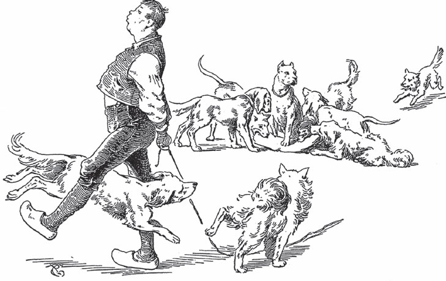

## Der gescheite Hans

Die Mutter von Hans fragt:

— Wohin, Hans?

Hans antwortet:

— Zur Gretel.

— <abbr title="Mach&#x27;s gut! — всего хорошего! смотри не оплошай!">Mach's gut</abbr>, Hans.

— Schon gut machen. <abbr title="adieu! — прощай!">Adieu</abbr>, Mutter.

— Adieu, Hans.

Hans kommt zur Gretel.

— Guten Tag, Gretel.

— Guten Tag, Hans. Was bringst du Gutes?

— Bring nichts. Will was haben.

Gretel schenkt dem Hans eine Nadel.

— Adieu, Gretel.

— Adieu, Hans.

Hans nimmt die Nadel und <abbr title="stecken — втыкать, засовывать">steckt</abbr> sie in einen <abbr title="der Heuwagen, die Heuwagen — воз с сеном">Heuwagen</abbr>. Dann geht er hinter dem Wagen her nach Hause.

— Guten Abend, Mutter.

— Guten Abend, Hans. Wo bist du gewesen?

— Bei der Gretel gewesen.

— Was hast du ihr gebracht?

— Nichts gebracht. Was gekriegt.

— Was hat dir Gretel gegeben?

— Nadel gegeben.

— Wo hast du die Nadel, Hans?

— In den Heuwagen gesteckt.

— Das hast du dumm gemacht, Hans. Du musst die Nadel an den <abbr title="der Ärmel, die Ärmel — рукав">Ärmel</abbr> stecken.

— <abbr title="Macht nichts. — ничего, не беда">Macht nichts</abbr>. Besser machen.

— Wohin, Hans?

— Zur Gretel, Mutter.

— Mach's gut, Hans.

— Schon gut machen. Adieu, Mutter.

— Adieu, Hans.

Hans kommt zur Gretel.

— Guten Tag, Gretel.

— Guten Tag, Hans. Was bringst du Gutes?

— Bring nichts. Will was haben.

Gretel schenkt dem Hans ein Messer.

— Adieu, Gretel.

— Adieu, Hans.

Hans nimmt das Messer, steckt es an den Ärmel und geht nach Hause.

— Guten Abend, Mutter.

— Guten Abend, Hans. Wo bist du gewesen?

— Bei der Gretel gewesen.

— Was hast du ihr gebracht?

— Nichts gebracht. Was gekriegt.

— Was hat dir Gretel gegeben?

— Messer gegeben.

— Wo hast du das Messer, Hans?

— An den Ärmel gesteckt.

— Das hast du dumm gemacht, Hans. Du musst das Messer in die <abbr title="die Tasche, die Taschen — карман; сумка">Tasche</abbr> stecken.

— Macht nichts. Besser machen.

— Wohin, Hans?

— Zur Gretel, Mutter.

— Mach's gut, Hans.

— Schon gut machen. Adieu, Mutter.

— Adieu, Hans.

Hans kommt zur Gretel.

— Guten Tag, Gretel.

— Guten Tag, Hans. Was bringst du Gutes?

— Bring nichts. Will was haben.

Gretel schenkt dem Hans eine junge <abbr title="die Ziege, die Ziegen — коза">Ziege</abbr>.

— Adieu, Gretel.

— Adieu, Hans.

Hans nimmt die Ziege, bindet ihr die Beine zusammen und steckt sie in die Tasche. Als er nach Hause kommt, ist sie erstickt.

— Guten Abend, Mutter.

— Guten Abend, Hans. Wo bist du gewesen?

— Bei der Gretel gewesen.

— Was hast du ihr gebracht?

— Nichts gebracht. Was gekriegt.

— Was hat dir Gretel gegeben?

— Ziege gegeben.

— Wo hast du die Ziege, Hans?

— In die Tasche gesteckt.

— Das hast du dumm gemacht, Hans. Du musst die Ziege an ein Seil binden.

— Macht nichts. Besser machen.

— Wohin, Hans?

— Zur Gretel, Mutter.

— Mach's gut, Hans.

— Schon gut machen. Adieu, Mutter.

— Adieu, Hans.

Hans kommt zur Gretel.

— Guten Tag, Gretel.

— Guten Tag, Hans. Was bringst du Gutes?

— Bring nichts. Will was haben.

Gretel schenkt dem Hans ein Stück <abbr title="der Speck — сало, шпик">Speck</abbr>.

— Adieu, Gretel.

— Adieu, Hans.

Hans nimmt den Speck, bindet ihn an ein Seil und <abbr title="schleifen — волочить, тащить">schleift</abbr> ihn hinter sich her. Die Hunde kommen und fressen den Speck. Als er nach Hause kommt, hat er das Seil in der Hand, aber nichts mehr daran.

— Guten Abend, Mutter.

— Guten Abend, Hans. Wo bist du gewesen?

— Bei der Gretel gewesen.

— Was hast du ihr gebracht?

— Nichts gebracht. Was gekriegt.

— Was hat dir Gretel gegeben?

— Stück Speck gegeben.

— Wo hast du den Speck, Hans?

— Ans Seil gebunden, heimgeführt, Hunde weggeholt.

— Das hast du dumm gemacht, Hans. Du musst den Speck auf dem Kopf tragen.

— Macht nichts. Besser machen.

— Wohin, Hans?

— Zur Gretel, Mutter.

— Mach's gut, Hans.

— Schon gut machen. Adieu, Mutter.

— Adieu, Hans.

Hans kommt zur Gretel.

— Guten Tag, Gretel.

— Guten Tag, Hans. Was bringst du Gutes?

— Bring nichts. Will was haben.

Gretel schenkt dem Hans ein <abbr title="das Kalb, die Kälber — телёнок">Kalb</abbr>.

— Adieu, Gretel.

— Adieu, Hans.

Hans nimmt das Kalb und setzt es sich auf den Kopf. Das Kalb <abbr title="zertreten (zertrat, hat zertreten) — растоптать">zertritt</abbr> ihm das Gesicht.

— Guten Abend, Mutter.

— Guten Abend, Hans. Wo bist du gewesen?

— Bei der Gretel gewesen.

— Was hast du ihr gebracht?

— Nichts gebracht. Was gekriegt.

— Was hat dir Gretel gegeben?

— Kalb gegeben.

— Wo hast du das Kalb, Hans?

— Auf den Kopf gesetzt, Gesicht zertreten.

— Das hast du dumm gemacht, Hans. Du musst das Kalb am Seil <abbr title="führen — вести">führen</abbr> und an die <abbr title="die Futterkrippe, die Futterkrippen — кормушка, ясли">Futterkrippe</abbr> stellen.

— Macht nichts. Besser machen.

— Wohin, Hans?

— Zur Gretel, Mutter.

— Mach's gut, Hans.

— Schon gut machen. Adieu, Mutter.

— Adieu, Hans.

Hans kommt zur Gretel.

— Guten Tag, Gretel.

— Guten Tag, Hans. Was bringst du Gutes?

— Bring nichts. Will was haben.

Da sagt Gretel zum Hans:

— Ich will mit dir gehen.

Hans nimmt die Gretel und bindet sie an ein Seil. Er führt sie nach Hause, stellt sie an die Futterkrippe und <abbr title="festknoten — привязать узлом">knotet</abbr> sie fest. Dann geht er zu seiner Mutter.

— Guten Abend, Mutter.

— Guten Abend, Hans. Wo bist du gewesen?

— Bei der Gretel gewesen.

— Was hast du ihr gebracht?

— Nichts gebracht.

— Was hat dir Gretel gegeben?

— Nichts gegeben. Mitgegangen.

— Wo hast du die Gretel gelassen?

— Am Seil geführt, an die Krippe gebunden, Gras <abbr title="vorwerfen (warf vor, hat vorgeworfen) — бросить (корм животному)">vorgeworfen</abbr>.

— Das hast du dumm gemacht, Hans. Du musst ihr <abbr title="jemandem freundliche Augen zuwerfen — бросать ласковые взгляды">freundliche Augen zuwerfen</abbr>.

— Macht nichts. Besser machen.

Hans geht in den Stall. Er sticht allen Kälbern und Schafen die Augen aus und wirft sie der Gretel ins Gesicht. Da wird Gretel böse. Sie <abbr title="sich losreißen (riss los, hat losgerissen) — вырваться">reißt sich los</abbr> und läuft fort. Und so ist sie nicht mehr die Braut von Hans.

---

### Neue Wörter

- **Mach's gut!** — всего хорошего! смотри не оплошай!
- **adieu!** — прощай!
- **stecken** — втыкать, засовывать
- **der Heuwagen, die Heuwagen** — воз с сеном
- **der Ärmel, die Ärmel** — рукав
- **Macht nichts.** — ничего, не беда
- **die Tasche, die Taschen** — карман; сумка
- **die Ziege, die Ziegen** — коза
- **der Speck** — сало, шпик
- **schleifen** — волочить, тащить
- **das Kalb, die Kälber** — телёнок
- **zertreten (zertrat, hat zertreten)** — растоптать
- **führen** — вести
- **die Futterkrippe, die Futterkrippen** — кормушка, ясли
- **festknoten** — привязать узлом
- **vorwerfen (warf vor, hat vorgeworfen)** — бросить (корм животному)
- **jemandem freundliche Augen zuwerfen** — бросать ласковые взгляды
- **sich losreißen (riss los, hat losgerissen)** — вырваться

[← Zurück](kapitel-31.md) · [Inhalt](README.md)
