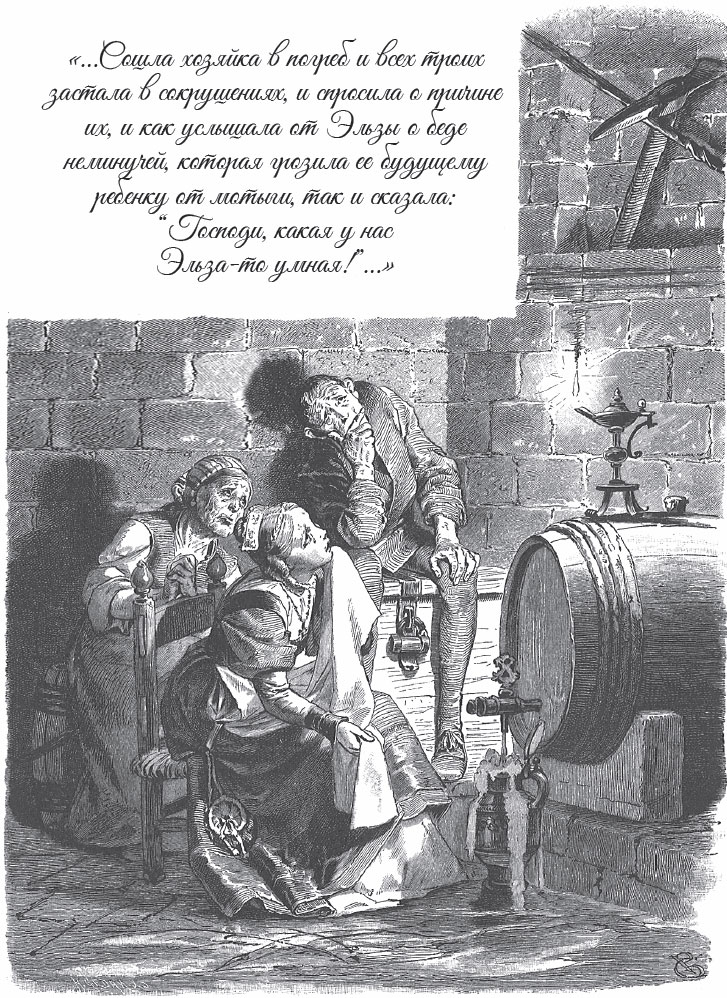

## Die kluge Else

Es war einmal ein Mann, der hatte eine Tochter. Sie heißt die kluge Else. Als sie <abbr title="erwachsen — взрослый">erwachsen</abbr> ist, sagt der Vater:

— Wir wollen sie verheiraten.

— Ja, — sagt die Mutter, — wenn nur einer kommt, der sie haben will.

Endlich kommt einer von weit her. Er heißt Hans und <abbr title="um jemandes Hand anhalten (hielt an, hat angehalten) — просить чьей-то руки, свататься">hält um ihre Hand an</abbr>. Aber er stellt eine Bedingung: Die kluge Else muss auch wirklich gescheit sein.

— Oh, — sagt der Vater, — die hat <abbr title="Zwirn im Kopf haben — быть с головой (досл. «иметь нитки в голове»)">Zwirn im Kopf</abbr>.

Und die Mutter sagt:

— Ach, die sieht den Wind auf der Gasse laufen und hört die Fliegen <abbr title="husten — кашлять">husten</abbr>.

— Gut, — sagt Hans. — Aber wenn sie nicht wirklich gescheit ist, dann nehme ich sie nicht.

Sie sitzen am Tisch und haben gegessen. Da sagt die Mutter:

— Else, geh in den Keller und hol Bier.

Die kluge Else nimmt den Krug von der Wand und geht in den Keller. Unterwegs <abbr title="klappern mit + Dat. — стучать, хлопать">klappert</abbr> sie fleißig mit dem Deckel, denn sie will sich nicht langweilen. Unten holt sie ein kleines Stühlchen und stellt es vor das Fass. So muss sie sich nicht bücken. Sonst tut ihr vielleicht der Rücken weh, und sie bekommt einen unerwarteten Schaden. Dann stellt sie die <abbr title="die Kanne, die Kannen — кувшин, жбан">Kanne</abbr> vor sich und dreht den Hahn auf.

Das Bier läuft in die Kanne. Aber ihre Augen sollen in dieser Zeit nicht faul sein. Deshalb sieht sie oben an die Wand. Sie schaut lange hin und her. Da <abbr title="entdecken — обнаружить">entdeckt</abbr> sie eine <abbr title="die Kreuzhacke, die Kreuzhacken — кирка">Kreuzhacke</abbr> direkt über sich. Die <abbr title="der Maurer, die Maurer — каменщик">Maurer</abbr> haben sie dort <abbr title="aus Versehen — по ошибке, нечаянно">aus Versehen</abbr> stecken lassen. Da fängt die kluge Else an zu weinen und sagt:

— Wenn ich den Hans kriege, und wir kriegen ein Kind, und das ist groß, und wir schicken das Kind in den Keller, und es soll hier Bier <abbr title="zapfen — наливать из бочки, цедить">zapfen</abbr> – dann fällt ihm die Kreuzhacke auf den Kopf und schlägt es tot.

Da sitzt sie und weint und schreit <abbr title="aus Leibeskräften — изо всех сил">aus Leibeskräften</abbr> über das Unglück, das kommen wird.

Oben warten sie auf das Bier, aber die kluge Else kommt nicht und kommt nicht. Da sagt die Frau zur Magd:

— Geh doch hinunter in den Keller und sieh nach, wo die Else bleibt.

Die Magd geht hinunter. Da sitzt Else vor dem Fass und schreit laut.

— Else, warum weinst du? — fragt die Magd.

— Ach, — antwortet Else, — soll ich nicht weinen? Wenn ich den Hans kriege, und wir kriegen ein Kind, und das ist groß, und es soll hier Bier zapfen – dann fällt ihm vielleicht die Kreuzhacke auf den Kopf und schlägt es tot.

Da sagt die Magd:

— Was haben wir für eine kluge Else!

Sie setzt sich zu ihr und fängt auch an, über das Unglück zu weinen.

Nach einer Weile ist die Magd immer noch nicht zurück. Oben haben alle großen Durst. Da sagt der Mann zum Knecht:

— Geh doch hinunter in den Keller und sieh nach, wo die Else und die Magd bleiben.

Der Knecht geht hinunter. Da sitzen die kluge Else und die Magd und weinen beide zusammen. Er fragt:

— Warum weint ihr denn?

— Ach, — sagt Else, — soll ich nicht weinen? Wenn ich den Hans kriege, und wir kriegen ein Kind, und das ist groß, und es soll hier Bier zapfen – dann fällt ihm die Kreuzhacke auf den Kopf und schlägt es tot.

Da sagt der Knecht:

— Was haben wir für eine kluge Else!

Er setzt sich zu ihr und fängt auch an, laut zu heulen.

Oben warten sie auf den Knecht. Aber er kommt nicht und kommt nicht. Da sagt der Mann zur Frau:

— Geh doch hinunter in den Keller und sieh nach, wo die Else bleibt.

Die Frau geht hinunter. Alle drei jammern. Sie fragt nach dem Grund. Da erzählt Else auch ihr: Vielleicht schlägt die Kreuzhacke ihr <abbr title="zukünftig — будущий">zukünftiges</abbr> Kind tot. Wenn es nämlich groß ist und Bier zapfen soll und die Kreuzhacke herunterfällt. Da sagt die Mutter auch:

— Ach, was haben wir für eine kluge Else!

Sie setzt sich hin und weint mit.

Der Mann oben wartet noch ein Weilchen. Aber seine Frau kommt nicht zurück, und sein Durst wird immer stärker. Da sagt er:

— Ich muss wohl selbst in den Keller gehen und nachsehen, wo die Else bleibt.

Er kommt in den Keller. Da sitzen alle zusammen und weinen. Er hört den Grund: Schuld ist das Kind von Else. Vielleicht bringt sie es einmal zur Welt. Und vielleicht sitzt es genau dann unter der Kreuzhacke und zapft Bier, wenn sie herunterfällt. Dann schlägt sie es tot. Da ruft er:

— Was für eine kluge Else!

Er setzt sich und weint auch mit.

Der Bräutigam bleibt lange allein oben. Niemand kommt wieder. Da denkt er: «Sie warten bestimmt unten auf dich. Du musst auch hingehen und sehen, was sie da machen.» Er geht hinunter. Da sitzen fünf Leute und schreien und jammern ganz <abbr title="erbärmlich — жалобно, жалко">erbärmlich</abbr>, einer immer lauter als der andere.

— Was für ein Unglück ist denn passiert? — fragt er.

— Ach, lieber Hans, — sagt Else, — wenn wir heiraten und ein Kind haben, und es ist groß, und wir schicken es vielleicht hierher zum Bierzapfen – dann kann ihm doch die Kreuzhacke den Kopf <abbr title="zerschlagen (zerschlug, hat zerschlagen) — разбить">zerschlagen</abbr>. Die steckt da oben. Wenn sie herunterfällt, dann bleibt das Kind tot liegen. Sollen wir da nicht weinen?

— Nun, — sagt Hans, — mehr <abbr title="der Verstand — ум, рассудок">Verstand</abbr> brauche ich für meinen Haushalt nicht. Weil du so eine kluge Else bist, will ich dich haben.

Er packt sie bei der Hand, nimmt sie mit nach oben und feiert Hochzeit mit ihr.

Eine Weile ist sie schon mit Hans verheiratet. Da sagt er:

— Frau, ich gehe arbeiten und verdiene uns Geld. Geh du auf das Feld und schneide das Korn. Dann haben wir Brot.

— Ja, mein lieber Hans, das mache ich.

Hans geht fort. Else kocht sich einen guten Brei und nimmt ihn mit auf das Feld. Vor dem Acker sagt sie zu sich selbst:

— Was tu ich? Schneid ich zuerst, oder ess ich zuerst? <abbr title="hei! — эх! ну!">Hei</abbr>, ich will zuerst essen.

Sie isst den ganzen Topf mit Brei leer. Als sie <abbr title="dick satt sein — наесться до отвала">dick satt</abbr> ist, sagt sie wieder:

— Was tu ich? Schneid ich zuerst, oder schlaf ich zuerst? Hei, ich will zuerst schlafen.

Da legt sie sich ins Korn und schläft ein.

Hans ist längst zu Hause. Aber Else kommt nicht. Da sagt er:

— Was habe ich für eine kluge Else! Sie ist so fleißig, dass sie nicht einmal zum Essen nach Hause kommt.

Aber sie kommt immer noch nicht, und es wird Abend. Da geht Hans hinaus. Er will sehen, wie viel sie geschnitten hat. Aber nichts ist geschnitten. Sie liegt im Korn und schläft. Da eilt Hans schnell nach Hause und holt ein <abbr title="das Vogelnetz, die Vogelnetze — птичья сеть, силок">Vogelnetz</abbr> mit kleinen <abbr title="das Glöckchen, die Glöckchen — колокольчик, бубенчик">Glöckchen</abbr>. Er hängt es um sie herum. Sie schläft immer weiter. Dann läuft er nach Hause, <abbr title="zuschließen (schloss zu, hat zugeschlossen) — запереть">schließt</abbr> die Haustür zu, setzt sich auf seinen Stuhl und arbeitet.

Endlich, als es schon ganz dunkel ist, wacht die kluge Else auf. Sie steht auf. Da <abbr title="rasseln — греметь, бренчать">rasselt</abbr> es um sie herum, und die Glöckchen <abbr title="klingeln — звенеть">klingeln</abbr> bei jedem Schritt. Da erschrickt sie. Sie ist <abbr title="verwirrt — сбитый с толку, растерянный">verwirrt</abbr>: Ist sie wirklich die kluge Else? Sie sagt:

— Bin ich's, oder bin ich's nicht?

Aber sie weiß keine Antwort. Eine Zeit lang steht sie da und zweifelt. Endlich denkt sie: «Ich gehe nach Hause und frage, ob ich's bin oder ob ich's nicht bin. Die wissen es bestimmt.»

Sie läuft zu ihrer Haustür, aber die ist verschlossen. Da klopft sie an das Fenster und ruft:

— Hans, ist die Else drinnen?

— Ja, — antwortet Hans, — sie ist drinnen.

Da erschrickt sie und sagt:

— Ach Gott, dann bin ich's nicht!

Sie geht zu einer anderen Tür. Aber die Leute hören das Klingeln von den Glöckchen und wollen nicht aufmachen. Nirgends findet sie einen Platz. Da läuft sie aus dem Dorf hinaus, und niemand hat sie je wiedergesehen.

---

### Neue Wörter

- **erwachsen** — взрослый
- **um jemandes Hand anhalten (hielt an, hat angehalten)** — просить чьей-то руки, свататься
- **Zwirn im Kopf haben** — быть с головой (досл. «иметь нитки в голове»)
- **husten** — кашлять
- **klappern mit + Dat.** — стучать, хлопать
- **die Kanne, die Kannen** — кувшин, жбан
- **entdecken** — обнаружить
- **die Kreuzhacke, die Kreuzhacken** — кирка
- **der Maurer, die Maurer** — каменщик
- **aus Versehen** — по ошибке, нечаянно
- **zapfen** — наливать из бочки, цедить
- **aus Leibeskräften** — изо всех сил
- **zukünftig** — будущий
- **erbärmlich** — жалобно, жалко
- **zerschlagen (zerschlug, hat zerschlagen)** — разбить
- **der Verstand** — ум, рассудок
- **hei!** — эх! ну!
- **dick satt sein** — наесться до отвала
- **das Vogelnetz, die Vogelnetze** — птичья сеть, силок
- **das Glöckchen, die Glöckchen** — колокольчик, бубенчик
- **zuschließen (schloss zu, hat zugeschlossen)** — запереть
- **rasseln** — греметь, бренчать
- **klingeln** — звенеть
- **verwirrt** — сбитый с толку, растерянный

[← Zurück](kapitel-33.md) · [Inhalt](README.md)
