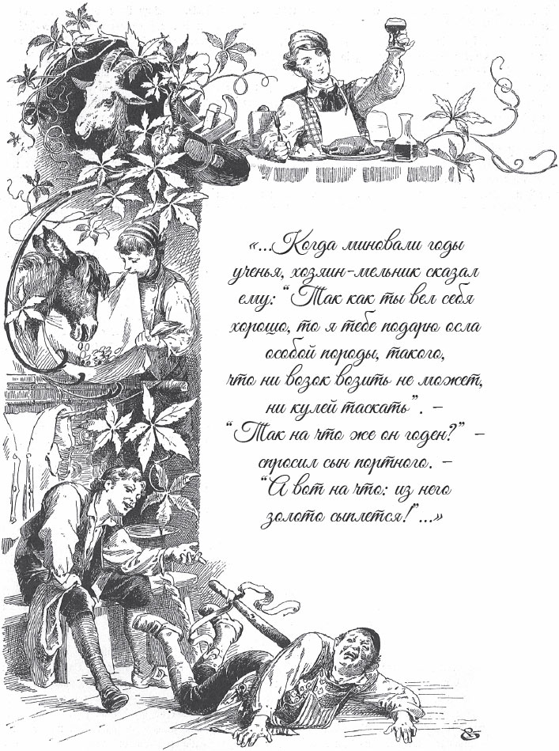
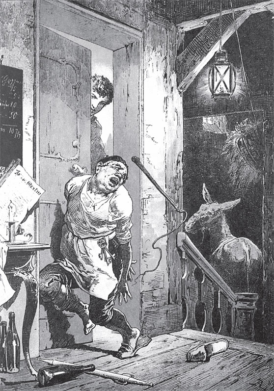

## Tischchen deck dich, Goldesel und Knüppel aus dem Sack

Vor langer Zeit lebt ein Schneider. Er hat drei Söhne und nur eine einzige Ziege. Die Ziege ernährt alle mit ihrer Milch. Deshalb muss sie gutes Futter bekommen. Jeden Tag muss man sie hinaus auf die <abbr title="die Weide, die Weiden — пастбище">Weide</abbr> führen. Das machen die Söhne <abbr title="der Reihe nach — по очереди">der Reihe nach</abbr>.

Einmal bringt der älteste Sohn sie auf den Friedhof. Dort wachsen die schönsten Kräuter. Er lässt sie dort fressen und <abbr title="herumspringen (sprang herum, ist herumgesprungen) — прыгать вокруг, скакать">herumspringen</abbr>. Am Abend ist es Zeit, nach Hause zu gehen. Da fragt er:

— Ziege, bist du satt?

Die Ziege antwortet:

«Ich bin so satt,

ich mag kein Blatt: meh! meh!»

— Dann komm nach Hause, — sagt der Junge. Er <abbr title="fassen — хватать, брать">fasst</abbr> sie am Strick, führt sie in den Stall und bindet sie fest.

— Nun, — sagt der alte Schneider, — hat die Ziege ihr ordentliches Futter bekommen?

— Oh, — antwortet der Sohn, — die ist so satt, sie mag kein Blatt.

Aber der Vater will es selbst sehen. Er geht hinunter in den Stall, streichelt das liebe Tier und fragt:

— Ziege, bist du auch satt?

Die Ziege antwortet:

«Wovon soll ich satt sein?

Ich sprang nur über <abbr title="das Gräbelein (der Graben) — канавка">Gräbelein</abbr>

und fand kein einzig <abbr title="das Blättelein (das Blatt) — листочек">Blättelein</abbr>: meh! meh!»

— Was muss ich hören! — ruft der Schneider. Er läuft hinauf und sagt zu dem Jungen: — Du <abbr title="der Lügner, die Lügner — лжец, врун">Lügner</abbr>! Du sagst, die Ziege ist satt, und dabei hast du sie hungern lassen?

In seinem Zorn nimmt er die Elle von der Wand. Er schlägt den Sohn und jagt ihn aus dem Haus.

Am nächsten Tag ist der zweite Sohn an der Reihe. Er sucht an der <abbr title="die Gartenhecke, die Gartenhecken — садовая изгородь">Gartenhecke</abbr> einen Platz mit lauter guten Kräutern. Die Ziege frisst alles <abbr title="kahl — голый, дочиста">kahl</abbr>. Am Abend will er nach Hause. Er fragt:

— Ziege, bist du satt?

Die Ziege antwortet:

«Ich bin so satt,

ich mag kein Blatt: meh! meh!»

— Dann komm nach Hause, — sagt der Junge. Er zieht sie heim und bindet sie im Stall fest.

— Nun, — sagt der alte Schneider, — hat die Ziege ihr ordentliches Futter bekommen?

— Oh, — antwortet der Sohn, — die ist so satt, sie mag kein Blatt.

Aber der Schneider will sich nicht darauf verlassen. Er geht hinunter in den Stall und fragt:

— Ziege, bist du auch satt?

Die Ziege antwortet:

«Wovon soll ich satt sein?

Ich sprang nur über Gräbelein

und fand kein einzig Blättelein: meh! meh!»

— Dieser gottlose Bösewicht! — schreit der Schneider. — So ein frommes Tier hungern zu lassen!

Er läuft hinauf und schlägt den Jungen mit der Elle aus der Haustür hinaus.

Jetzt ist der dritte Sohn an der Reihe. Er will seine Sache gut machen. Er sucht Büsche mit den schönsten Blättern und lässt die Ziege dort fressen. Am Abend will er nach Hause. Er fragt:

— Ziege, bist du auch satt?

Die Ziege antwortet:

«Ich bin so satt,

ich mag kein Blatt: meh! meh!»

— Dann komm nach Hause, — sagt der Junge. Er führt sie in den Stall und bindet sie fest.

— Nun, — sagt der alte Schneider, — hat die Ziege ihr ordentliches Futter bekommen?

— Oh, — antwortet der Sohn, — die ist so satt, sie mag kein Blatt.

Der Schneider <abbr title="trauen + Dat. — доверять">traut</abbr> ihm nicht. Er geht hinunter und fragt:

— Ziege, bist du auch satt?

Das boshafte Tier antwortet:

«Wovon soll ich satt sein?

Ich sprang nur über Gräbelein

und fand kein einzig Blättelein: meh! meh!»

— Oh, diese <abbr title="die Lügenbande — шайка лгунов">Lügenbande</abbr>! — ruft der Schneider. — Einer ist so gottlos und faul wie der andere! Ihr sollt mich nicht länger <abbr title="jemanden zum Narren halten — дурачить кого-либо">zum Narren halten</abbr>!

Er ist vor Zorn ganz <abbr title="außer sich sein — быть вне себя">außer sich</abbr>. Er springt hinauf und <abbr title="verprügeln — отколотить, избить">verprügelt</abbr> dem armen Jungen mit der Elle so stark den Rücken, dass der Junge aus dem Haus springt.

Jetzt ist der alte Schneider mit seiner Ziege allein. Am nächsten Morgen geht er hinunter in den Stall. Er streichelt die Ziege und sagt:

— Komm, mein liebes Tierchen, heute führe ich dich selbst auf die Weide.

Er nimmt sie am Strick. Er bringt sie zu grünen <abbr title="die Hecke, die Hecken — живая изгородь">Hecken</abbr>, zu <abbr title="die Schafgarbe — тысячелистник">Schafgarbe</abbr> und zu allem, was Ziegen gern fressen.

— Da kannst du einmal <abbr title="nach Herzenslust — вволю, сколько душе угодно">nach Herzenslust</abbr> fressen, — sagt er zu ihr. Er lässt sie bis zum Abend <abbr title="weiden — пастись">weiden</abbr>. Dann fragt er:

— Ziege, bist du satt?

Sie antwortet:

«Ich bin so satt,

ich mag kein Blatt: meh! meh!»

— Dann komm nach Hause, — sagt der Schneider. Er führt sie in den Stall und bindet sie fest. Beim Weggehen dreht er sich um und sagt:

— Nun bist du doch einmal satt!

Aber die Ziege macht es bei ihm nicht besser. Sie ruft:

«Wie soll ich satt sein?

Ich sprang nur über Gräbelein

und fand kein einzig Blättelein: meh! meh!»

Als der Schneider das hört, <abbr title="stutzen — опешить, остановиться в недоумении">stutzt</abbr> er. Er sieht: Er hat seine drei Söhne ohne Grund verstoßen.

— Warte, — ruft er, — du <abbr title="undankbar — неблагодарный">undankbares</abbr> <abbr title="das Geschöpf, die Geschöpfe — создание, тварь">Geschöpf</abbr>! Dich nur <abbr title="fortjagen — прогнать">fortzujagen</abbr> ist noch zu wenig. Ich <abbr title="zeichnen — пометить, заклеймить">zeichne</abbr> dich so, dass du dich bei <abbr title="ehrbar — почтенный, порядочный">ehrbaren</abbr> Schneidern nicht mehr zeigen darfst!

<abbr title="hastig — поспешно">Hastig</abbr> springt er hinauf und holt sein <abbr title="das Rasiermesser, die Rasiermesser — бритва">Rasiermesser</abbr>. Er <abbr title="einseifen — намыливать">seift</abbr> der Ziege den Kopf ein und <abbr title="rasieren — брить">rasiert</abbr> sie so glatt wie seine flache Hand. Die Elle ist für sie zu <abbr title="ehrenvoll — почётный">ehrenvoll</abbr>. Deshalb holt er die <abbr title="die Peitsche, die Peitschen — кнут, плеть">Peitsche</abbr> und gibt ihr so harte Hiebe, dass sie in großen Sprüngen davonläuft.

Jetzt sitzt der Schneider ganz einsam in seinem Haus. Er wird sehr traurig. Er möchte seine Söhne gern wiederhaben. Aber niemand weiß, wohin sie gegangen sind.

Der älteste ist bei einem <abbr title="der Schreiner, die Schreiner — столяр">Schreiner</abbr> in die <abbr title="die Lehre, die Lehren — обучение ремеслу, ученичество">Lehre</abbr> gegangen. Er lernt fleißig und unermüdlich. Als seine Lehrzeit um ist, soll er <abbr title="auf Wanderschaft gehen — отправиться странствовать (о подмастерье)">auf Wanderschaft gehen</abbr>. Da schenkt ihm der Meister ein Tischchen. Es sieht gar nicht <abbr title="besonders — особенный, особо">besonders</abbr> aus und ist aus <abbr title="gewöhnlich — обыкновенный">gewöhnlichem</abbr> Holz. Aber es hat eine gute <abbr title="die Eigenschaft, die Eigenschaften — свойство">Eigenschaft</abbr>. Man stellt es hin und sagt: «Tischchen, deck dich!» Und sofort liegt ein sauberes <abbr title="das Tischtuch, die Tischtücher — скатерть">Tischtuch</abbr> auf dem Tischchen. Ein Teller steht da, Messer und Gabel daneben. Es gibt Schüsseln mit Gekochtem und Gebratenem, so viele, wie Platz haben. Und ein großes Glas mit rotem Wein leuchtet, dass einem das Herz lacht.

Der junge Geselle denkt: «Damit hast du genug für dein ganzes Leben.» Fröhlich zieht er durch die Welt. Ob ein Wirtshaus gut oder schlecht ist, ob man dort etwas bekommt oder nicht – das ist ihm ganz egal. Oft geht er gar nicht ins Wirtshaus. Im Feld, im Wald, auf einer Wiese, wo er Lust hat, nimmt er sein Tischchen vom Rücken. Er stellt es vor sich und sagt: «Deck dich!» Und schon ist alles da, was sein Herz <abbr title="begehren — желать">begehrt</abbr>.

Endlich denkt er: «Ich will zu meinem Vater zurückkehren. Sein Zorn ist bestimmt vorbei. Mit dem Tischchen-deck-dich nimmt er mich gern wieder auf.»

Auf dem Heimweg kommt er am Abend in ein Wirtshaus. Es ist voll mit Gästen. Sie <abbr title="begrüßen — приветствовать">begrüßen</abbr> ihn und laden ihn ein: Er soll sich zu ihnen setzen und mit ihnen essen. Sonst bekommt er bestimmt nichts mehr.

— Nein, — antwortet der Schreiner, — die paar Bissen will ich euch nicht wegnehmen. Lieber sollt ihr meine Gäste sein.

Sie lachen und glauben, er macht einen Spaß. Er aber stellt sein <abbr title="hölzern — деревянный">hölzernes</abbr> Tischchen mitten in die Stube und sagt:

— Tischchen, deck dich!

Sofort steht Essen darauf, so gut, wie es der Wirt nie bringen kann. Der <abbr title="der Duft, die Düfte — аромат">Duft</abbr> steigt den Gästen lieblich in die Nase.

— <abbr title="zugreifen (griff zu, hat zugegriffen) — угощаться, брать (еду)">Greift zu</abbr>, liebe Freunde! — sagt der Schreiner.

Die Gäste sehen, dass er es ernst meint. Sie lassen sich nicht zweimal bitten. Sie <abbr title="heranrücken — придвинуться">rücken</abbr> heran, ziehen ihre Messer und greifen tapfer zu. Und das <abbr title="wundern — удивлять">wundert</abbr> sie am meisten: Wenn eine Schüssel leer ist, steht sofort von selbst eine volle an ihrem Platz.

Der Wirt steht in einer Ecke und sieht zu. Er weiß gar nicht, was er sagen soll. Aber er denkt: «So einen Koch kann ich in meinem Wirtshaus gut brauchen.»

Der Schreiner und seine <abbr title="die Gesellschaft, die Gesellschaften — компания, общество">Gesellschaft</abbr> sind lustig bis spät in die Nacht. Endlich legen sie sich schlafen. Auch der junge Geselle geht ins Bett. Sein <abbr title="das Wünschtischchen — волшебный столик (исполняющий желания)">Wünschtischchen</abbr> stellt er an die Wand. Aber der Wirt hat keine Ruhe. Er denkt an ein altes Tischchen in seiner <abbr title="die Rumpelkammer, die Rumpelkammern — чулан для хлама">Rumpelkammer</abbr>. Es sieht genauso aus. Er holt es ganz leise und vertauscht es mit dem Wünschtischchen.

Am nächsten Morgen bezahlt der Schreiner sein <abbr title="das Schlafgeld — плата за ночлег">Schlafgeld</abbr>. Er packt sein Tischchen auf den Rücken. Er denkt gar nicht daran, dass er ein falsches hat, und geht seinen Weg. Am Mittag kommt er bei seinem Vater an. Der Vater empfängt ihn mit großer Freude.

— Nun, mein lieber Sohn, was hast du gelernt? — fragt er.

— Vater, ich bin Schreiner geworden.

— Ein gutes Handwerk, — antwortet der Alte. — Aber was hast du von deiner Wanderschaft mitgebracht?

— Vater, das Beste, was ich mitgebracht habe, ist das Tischchen.

Der Schneider betrachtet es von allen Seiten und sagt:

— Daran hast du kein <abbr title="das Meisterstück, die Meisterstücke — шедевр, образцовая работа">Meisterstück</abbr> gemacht. Das ist ein altes, schlechtes Tischchen.

— Aber es ist ein Tischchen-deck-dich, — antwortet der Sohn. — Wenn ich es hinstelle und ihm sage, es soll sich decken, dann stehen sofort die schönsten Gerichte darauf. Und ein Wein dazu, der das Herz froh macht. Ladet nur alle <abbr title="der/die Verwandte, die Verwandten — родственник">Verwandten</abbr> und Freunde ein. Sie sollen sich einmal richtig <abbr title="sich stärken — подкрепиться">stärken</abbr>, denn das Tischchen macht alle satt.

Die Gesellschaft ist zusammen. Da stellt er sein Tischchen mitten in die Stube und sagt:

— Tischchen, deck dich!

Aber das Tischchen rührt sich nicht. Es bleibt so leer wie jeder andere Tisch, der die Sprache nicht versteht. Da merkt der arme Geselle: Man hat ihm das Tischchen vertauscht. Er schämt sich, denn er steht da wie ein Lügner. Die Verwandten lachen ihn aus. Ohne Essen und ohne Trinken müssen sie wieder nach Hause gehen. Der Vater holt wieder seine <abbr title="der Stoffrest, die Stoffreste — лоскут, обрезок ткани">Stoffreste</abbr> und näht weiter. Der Sohn aber arbeitet bei einem Meister.

Der zweite Sohn ist zu einem Müller gekommen und bei ihm in die Lehre gegangen. Als seine Jahre um sind, sagt der Meister:

— Du hast dich so gut <abbr title="sich benehmen (benahm, hat benommen) — вести себя">benommen</abbr>. Deshalb schenke ich dir einen Esel von einer besonderen Art. Er zieht keinen Wagen und trägt auch keine Säcke.

— Wozu ist er dann <abbr title="nütze sein — быть полезным, годиться">nütze</abbr>? — fragt der junge Geselle.

— Er <abbr title="spucken — плевать, выплёвывать">spuckt</abbr> Gold, — antwortet der Müller. — Du stellst ihn auf ein Tuch und sagst «Bricklebrit!». Dann spuckt dir das gute Tier Goldstücke aus, hinten und vorn.

— Das ist eine schöne Sache, — sagt der Geselle. Er <abbr title="sich bedanken — благодарить">bedankt sich</abbr> bei dem Meister und zieht in die Welt.

Wenn er Gold braucht, muss er nur zu seinem Esel «Bricklebrit!» sagen. Dann regnet es Goldstücke, und er muss sie nur noch vom Boden aufheben. Wo er hinkommt, ist für ihn das Beste gerade gut genug. Je <abbr title="teuer — дорогой">teurer</abbr>, desto lieber, denn er hat immer einen vollen <abbr title="der Geldbeutel, die Geldbeutel — кошелёк">Geldbeutel</abbr>.

Eine Zeit lang sieht er sich die Welt an. Dann denkt er: «Du musst deinen Vater <abbr title="besuchen — навестить">besuchen</abbr>. Wenn du mit dem Goldesel kommst, vergisst er seinen Zorn und nimmt dich gut auf.»

Nun kommt er zufällig in dasselbe Wirtshaus, wo man seinem Bruder das Tischchen vertauscht hat. Er führt seinen Esel an der Hand. Der Wirt will ihm das Tier abnehmen und anbinden. Aber der junge Geselle sagt:

— Macht Euch keine Mühe. Meinen Grauschimmel führe ich selbst in den Stall. Ich binde ihn auch selbst an, denn ich muss wissen, wo er steht.

Das findet der Wirt seltsam. Er denkt: «Wer seinen Esel selbst versorgen muss, der hat nicht viel Geld zum Ausgeben.» Aber dann greift der Fremde in die Tasche. Er holt zwei Goldstücke heraus und sagt, der Wirt soll etwas Gutes für ihn einkaufen. Da macht der Wirt große Augen. Er läuft und sucht das Beste, was er finden kann.

Nach dem Essen fragt der Gast, was er <abbr title="schuldig sein — быть должным">schuldig</abbr> ist. Der Wirt will ordentlich verdienen und rechnet <abbr title="doppelt — вдвойне">doppelt</abbr>. Er sagt, der Gast muss noch ein paar Goldstücke <abbr title="drauflegen — доплатить">drauflegen</abbr>. Der Geselle greift in die Tasche, aber sein Gold ist gerade zu Ende.

— Wartet einen Augenblick, Herr Wirt, — sagt er. — Ich gehe nur schnell und hole Gold.

Aber er nimmt das Tischtuch mit. Der Wirt weiß nicht, was das bedeuten soll. Er ist neugierig und schleicht ihm nach. Der Gast verriegelt die Stalltür. Da guckt der Wirt durch ein <abbr title="das Astloch, die Astlöcher — дырка от сучка">Astloch</abbr>. Der Fremde breitet das Tuch unter dem Esel aus und ruft:

— Bricklebrit!

Sofort fängt das Tier an, Gold zu spucken, hinten und vorn. Es regnet richtig auf den Boden.

— <abbr title="Donnerwetter! — вот это да! чёрт возьми!">Donnerwetter</abbr>! — sagt der Wirt. — Da sind die <abbr title="der Dukaten, die Dukaten — дукат (золотая монета)">Dukaten</abbr> schnell gemacht! So ein Geldbeutel ist nicht schlecht!

Der Gast bezahlt seine Rechnung und legt sich schlafen. Der Wirt aber schleicht in der Nacht hinunter in den Stall. Er führt den <abbr title="der Goldmacher — делатель золота, чеканщик">Goldmacher</abbr> weg und bindet einen anderen Esel an seinen Platz.

Früh am nächsten Morgen zieht der Geselle mit seinem Esel los. Er glaubt, er hat seinen Goldesel. Am Mittag kommt er bei seinem Vater an. Der Vater freut sich, als er ihn wiedersieht, und nimmt ihn gern auf.

— Was ist aus dir geworden, mein Sohn? — fragt der Alte.

— Ein Müller, lieber Vater, — antwortet er.

— Was hast du von deiner Wanderschaft mitgebracht?

— Nur einen Esel.

— Esel gibt es hier genug, — sagt der Vater. — Eine gute Ziege habe ich lieber.

— Ja, — antwortet der Sohn, — aber das ist kein gewöhnlicher Esel. Das ist ein Goldesel. Wenn ich «Bricklebrit!» sage, dann spuckt euch das gute Tier ein ganzes Tuch voll Goldstücke. Ruft nur alle Verwandten her. Ich mache sie alle zu reichen Leuten.

— Das gefällt mir, — sagt der Schneider. — Dann muss ich mich nicht mehr mit der Nadel quälen.

Er läuft selbst los und ruft die Verwandten. Sobald sie zusammen sind, sagt der Müller, sie sollen Platz machen. Er breitet sein Tuch aus und bringt den Esel in die Stube.

— Jetzt passt auf! — sagt er und ruft: — Bricklebrit!

Aber was herunterfällt, sind keine Goldstücke. Das Tier versteht nichts von dieser Kunst. Denn nicht jeder Esel bringt es so weit. Da macht der arme Müller ein <abbr title="ein langes Gesicht machen — скорчить кислую мину">langes Gesicht</abbr>. Er sieht, dass man ihn betrogen hat. Er bittet die Verwandten um <abbr title="die Verzeihung — прощение">Verzeihung</abbr>. Sie gehen so arm nach Hause, wie sie gekommen sind. Da bleibt nichts anderes übrig: Der Alte muss wieder zur Nadel greifen, und der Junge muss bei einem Müller arbeiten.

Der dritte Bruder ist zu einem <abbr title="der Drechsler, die Drechsler — токарь (по дереву)">Drechsler</abbr> in die Lehre gegangen. Das ist ein kunstvolles Handwerk, deshalb muss er am längsten lernen. Aber seine Brüder schreiben ihm einen Brief. Darin erzählen sie, wie schlecht es ihnen gegangen ist. Der Wirt hat ihnen am letzten Abend ihre schönen <abbr title="das Wunschding, die Wunschdinge — волшебная вещь">Wunschdinge</abbr> gestohlen.

Der Drechsler hat <abbr title="auslernen — закончить обучение">ausgelernt</abbr> und soll auf Wanderschaft gehen. Weil er sich so gut benommen hat, schenkt ihm sein Meister einen Sack und sagt:

— Da liegt ein <abbr title="der Knüppel, die Knüppel — дубинка">Knüppel</abbr> drin.

— Den Sack kann ich <abbr title="umhängen — повесить на себя">umhängen</abbr>, er kann mir gute Dienste leisten. Aber wozu ist der Knüppel darin? Der macht ihn nur schwer.

— Das sage ich dir, — antwortet der Meister. — Wenn dir jemand etwas Böses getan hat, dann sag nur: «Knüppel, aus dem Sack!» Dann springt der Knüppel heraus zu den Leuten. Er tanzt ihnen so lustig auf dem Rücken herum, dass sie sich acht Tage lang nicht mehr bewegen können. Und er hört erst auf, wenn du sagst: «Knüppel, in den Sack!»

Der Geselle bedankt sich und hängt den Sack um. Wenn ihm jemand zu nah kommt und ihn angreifen will, sagt er: «Knüppel, aus dem Sack!» Sofort springt der Knüppel heraus. Er <abbr title="ausklopfen — выколачивать, выбивать">klopft</abbr> einem nach dem anderen den Rock oder die <abbr title="die Jacke, die Jacken — куртка">Jacke</abbr> direkt auf dem Rücken aus. Er wartet nicht, bis der Mann sie ausgezogen hat. Und das geht so schnell: Bevor einer es merkt, ist er schon an der Reihe.

Am Abend kommt der junge Drechsler in das Wirtshaus, wo man seine Brüder betrogen hat. Er legt seinen <abbr title="der Ranzen, die Ranzen — котомка, ранец">Ranzen</abbr> vor sich auf den Tisch. Dann fängt er an zu erzählen, was er alles Merkwürdiges in der Welt gesehen hat.

— Ja, — sagt er, — man findet schon ein Tischchen-deck-dich, einen Goldesel und so etwas. Lauter gute Dinge, die ich nicht verachte. Aber das ist alles nichts gegen den Schatz, den ich <abbr title="erwerben (erwarb, hat erworben) — приобрести">erworben</abbr> habe. Den trage ich hier in meinem Sack.

Der Wirt <abbr title="die Ohren spitzen — навострить уши">spitzt die Ohren</abbr>. «Was in aller Welt kann das sein?», denkt er. «Der Sack ist bestimmt voll mit Edelsteinen. Den muss ich auch noch haben. Denn <abbr title="aller guten Dinge sind drei — Бог троицу любит">aller guten Dinge sind drei</abbr>.»

Es ist Schlafenszeit. Der Gast legt sich auf die Bank und legt seinen Sack als <abbr title="das Kopfkissen, die Kopfkissen — подушка">Kopfkissen</abbr> unter den Kopf. Der Wirt glaubt, der Gast schläft tief. Er kommt näher und zieht ganz leise und vorsichtig an dem Sack. Vielleicht kann er ihn wegziehen und einen anderen darunterlegen. Aber der Drechsler hat schon lange darauf gewartet. Gerade als der Wirt einen kräftigen <abbr title="der Ruck, die Rucke — рывок">Ruck</abbr> machen will, ruft er:

— Knüppel, aus dem Sack!

Sofort fährt das Knüppelchen heraus, auf den Wirt los, und verprügelt ihn nach allen Regeln der Kunst. Der Wirt schreit <abbr title="zum Erbarmen — жалобно, так, что жалко слушать">zum Erbarmen</abbr>. Aber je lauter er schreit, desto kräftiger schlägt ihm der Knüppel den <abbr title="der Takt, die Takte — такт, ритм">Takt</abbr> dazu auf dem Rücken. Endlich fällt der Wirt erschöpft auf den Boden. Da sagt der Drechsler:

— Wenn du das Tischchen-deck-dich und den Goldesel nicht <abbr title="herausgeben (gab heraus, hat herausgegeben) — выдать, вернуть">herausgibst</abbr>, dann fängt der Tanz von vorn an.

— Ach nein, — ruft der Wirt ganz <abbr title="kleinlaut — присмиревший, тихо">kleinlaut</abbr>. — Ich gebe alles gern wieder heraus. Lasst nur den verwünschten <abbr title="der Kobold, die Kobolde — домовой, бесёнок">Kobold</abbr> wieder in den Sack kriechen!

Da sagt der Geselle:

— Ich lasse <abbr title="Gnade vor Recht ergehen lassen — помиловать, сменить гнев на милость">Gnade vor Recht ergehen</abbr>. Aber hüte dich!

Dann ruft er: «Knüppel, in den Sack!», und lässt ihn ruhen.

Am nächsten Morgen zieht der Drechsler mit dem Tischchen-deck-dich und dem Goldesel nach Hause zu seinem Vater. Der Schneider freut sich, als er ihn wiedersieht. Auch ihn fragt er, was er in der <abbr title="die Fremde — чужбина">Fremde</abbr> gelernt hat.

— Lieber Vater, — antwortet er, — ich bin Drechsler geworden.

— Ein kunstvolles Handwerk, — sagt der Vater. — Was hast du von der Wanderschaft mitgebracht?

— Ein kostbares Stück, lieber Vater, — antwortet der Sohn. — Einen Knüppel im Sack.

— Was! — ruft der Vater. — Einen Knüppel! Das ist ja <abbr title="der Mühe wert sein — стоить труда (ирон.)">der Mühe wert</abbr>! Den kannst du dir von jedem Baum abschneiden.

— Aber nicht so einen, lieber Vater. Wenn ich sage: «Knüppel, aus dem Sack!», dann springt der Knüppel heraus. Mit jedem, der es nicht gut mit mir meint, tanzt er einen bösen Tanz. Und er hört erst auf, wenn der Mann auf dem Boden liegt und um <abbr title="um gut Wetter bitten — просить пощады">gut Wetter bittet</abbr>. Seht Ihr, mit diesem Knüppel habe ich das Tischchen-deck-dich und den Goldesel wiedergeholt. Der <abbr title="diebisch — вороватый">diebische</abbr> Wirt hat sie meinen Brüdern weggenommen. Jetzt ruft beide her und ladet alle Verwandten ein. Ich gebe ihnen zu essen und zu trinken. Und ich fülle ihnen noch die Taschen mit Gold.

Der alte Schneider <abbr title="einer Sache nicht trauen — не доверять чему-либо">traut der Sache nicht</abbr>. Aber er holt trotzdem die Verwandten zusammen. Da legt der Drechsler ein Tuch in die Stube, führt den Goldesel herein und sagt zu seinem Bruder:

— Nun, lieber Bruder, sprich mit ihm.

Der Müller sagt: «Bricklebrit!» Sofort springen die Goldstücke auf das Tuch herunter wie bei einem <abbr title="der Platzregen, die Platzregen — ливень">Platzregen</abbr>. Und der Esel hört erst auf, als alle so viel haben, dass sie nicht mehr tragen können. (Ich sehe es dir an: Da möchtest du auch gern dabei sein!)

Dann holt der Drechsler das Tischchen und sagt:

— Lieber Bruder, nun sprich du mit ihm.

Kaum hat der Schreiner «Tischchen, deck dich!» gesagt, da ist es schon gedeckt. Die schönsten Schüsseln stehen <abbr title="reichlich — обильно">reichlich</abbr> darauf. Dann gibt es ein <abbr title="das Festessen, die Festessen — пир">Festessen</abbr>, wie es der gute Schneider in seinem Haus noch nie erlebt hat. Die ganze Verwandtschaft bleibt bis in die Nacht zusammen, und alle sind lustig und vergnügt. Der Schneider schließt Nadel und Zwirn, Elle und <abbr title="das Bügeleisen, die Bügeleisen — утюг">Bügeleisen</abbr> in einen Schrank. Und er lebt mit seinen drei Söhnen in Freude und Herrlichkeit.

Wo ist aber die Ziege geblieben? Sie ist doch schuld, dass der Schneider seine drei Söhne fortgejagt hat. Das sage ich dir. Sie schämt sich, weil sie einen kahlen Kopf hat. Deshalb läuft sie in eine <abbr title="die Fuchshöhle, die Fuchshöhlen — лисья нора">Fuchshöhle</abbr> und <abbr title="sich verkriechen (verkroch, hat verkrochen) — забиться, спрятаться">verkriecht sich</abbr> darin. Der <abbr title="der Fuchs, die Füchse — лиса">Fuchs</abbr> kommt nach Hause. Da <abbr title="funkeln — сверкать">funkeln</abbr> ihm aus der Dunkelheit zwei große Augen entgegen. Er erschrickt und läuft wieder weg.

Der <abbr title="der Bär, die Bären — медведь">Bär</abbr> trifft ihn. Der Fuchs sieht ganz <abbr title="verstört — потрясённый, растерянный">verstört</abbr> aus. Da sagt der Bär:

— Was hast du, Bruder Fuchs? Was machst du für ein Gesicht?

— Ach, — antwortet der Rote, — ein <abbr title="grimmig — свирепый, лютый">grimmiges</abbr> Tier sitzt in meiner Höhle. Es hat mich mit feurigen Augen <abbr title="anglotzen — таращиться на">angeglotzt</abbr>.

— Das jagen wir bald hinaus, — sagt der Bär. Er geht mit zu der Höhle und schaut hinein. Aber als er die feurigen Augen sieht, bekommt er auch Angst. Mit dem grimmigen Tier will er nichts zu tun haben. Er <abbr title="Reißaus nehmen — дать дёру, удрать">nimmt Reißaus</abbr>.

Die <abbr title="die Biene, die Bienen — пчела">Biene</abbr> trifft ihn. Sie merkt, dass er sich nicht wohl in seiner Haut fühlt. Sie sagt:

— Bär, du machst ja ein furchtbar <abbr title="mürrisch — угрюмый, ворчливый">mürrisches</abbr> Gesicht. Wo ist deine gute Laune geblieben?

— Du hast gut reden, — antwortet der Bär. — Ein grimmiges Tier mit Glotzaugen sitzt im Haus von dem Roten. Wir können es nicht hinausjagen.

Die Biene sagt:

— Du tust mir leid, Bär. Ich bin ein armes, schwaches Geschöpf. Ihr seht mich unterwegs gar nicht an. Aber ich glaube trotzdem, dass ich euch helfen kann.

Sie fliegt in die Fuchshöhle. Sie setzt sich der Ziege auf den glatt <abbr title="scheren (schor, hat geschoren) — стричь, брить">geschorenen</abbr> Kopf und sticht sie so stark, dass die Ziege aufspringt. «Meh! Meh!», schreit sie und läuft wie verrückt in die Welt hinaus. Und bis heute weiß niemand, wohin sie gelaufen ist.

---

### Neue Wörter

- **die Weide, die Weiden** — пастбище
- **der Reihe nach** — по очереди
- **herumspringen (sprang herum, ist herumgesprungen)** — прыгать вокруг, скакать
- **fassen** — хватать, брать
- **das Gräbelein (der Graben)** — канавка
- **das Blättelein (das Blatt)** — листочек
- **der Lügner, die Lügner** — лжец, врун
- **die Gartenhecke, die Gartenhecken** — садовая изгородь
- **kahl** — голый, дочиста
- **trauen + Dat.** — доверять
- **die Lügenbande** — шайка лгунов
- **jemanden zum Narren halten** — дурачить кого-либо
- **außer sich sein** — быть вне себя
- **verprügeln** — отколотить, избить
- **die Hecke, die Hecken** — живая изгородь
- **die Schafgarbe** — тысячелистник
- **nach Herzenslust** — вволю, сколько душе угодно
- **weiden** — пастись
- **stutzen** — опешить, остановиться в недоумении
- **undankbar** — неблагодарный
- **das Geschöpf, die Geschöpfe** — создание, тварь
- **fortjagen** — прогнать
- **zeichnen** — пометить, заклеймить
- **ehrbar** — почтенный, порядочный
- **hastig** — поспешно
- **das Rasiermesser, die Rasiermesser** — бритва
- **einseifen** — намыливать
- **rasieren** — брить
- **ehrenvoll** — почётный
- **die Peitsche, die Peitschen** — кнут, плеть
- **der Schreiner, die Schreiner** — столяр
- **die Lehre, die Lehren** — обучение ремеслу, ученичество
- **auf Wanderschaft gehen** — отправиться странствовать (о подмастерье)
- **besonders** — особенный, особо
- **gewöhnlich** — обыкновенный
- **die Eigenschaft, die Eigenschaften** — свойство
- **das Tischtuch, die Tischtücher** — скатерть
- **begehren** — желать
- **begrüßen** — приветствовать
- **hölzern** — деревянный
- **der Duft, die Düfte** — аромат
- **zugreifen (griff zu, hat zugegriffen)** — угощаться, брать (еду)
- **heranrücken** — придвинуться
- **wundern** — удивлять
- **die Gesellschaft, die Gesellschaften** — компания, общество
- **das Wünschtischchen** — волшебный столик (исполняющий желания)
- **die Rumpelkammer, die Rumpelkammern** — чулан для хлама
- **das Schlafgeld** — плата за ночлег
- **das Meisterstück, die Meisterstücke** — шедевр, образцовая работа
- **der/die Verwandte, die Verwandten** — родственник
- **sich stärken** — подкрепиться
- **der Stoffrest, die Stoffreste** — лоскут, обрезок ткани
- **sich benehmen (benahm, hat benommen)** — вести себя
- **nütze sein** — быть полезным, годиться
- **spucken** — плевать, выплёвывать
- **sich bedanken** — благодарить
- **teuer** — дорогой
- **der Geldbeutel, die Geldbeutel** — кошелёк
- **besuchen** — навестить
- **schuldig sein** — быть должным
- **doppelt** — вдвойне
- **drauflegen** — доплатить
- **das Astloch, die Astlöcher** — дырка от сучка
- **Donnerwetter!** — вот это да! чёрт возьми!
- **der Dukaten, die Dukaten** — дукат (золотая монета)
- **der Goldmacher** — делатель золота, чеканщик
- **ein langes Gesicht machen** — скорчить кислую мину
- **die Verzeihung** — прощение
- **der Drechsler, die Drechsler** — токарь (по дереву)
- **das Wunschding, die Wunschdinge** — волшебная вещь
- **auslernen** — закончить обучение
- **der Knüppel, die Knüppel** — дубинка
- **umhängen** — повесить на себя
- **ausklopfen** — выколачивать, выбивать
- **die Jacke, die Jacken** — куртка
- **der Ranzen, die Ranzen** — котомка, ранец
- **erwerben (erwarb, hat erworben)** — приобрести
- **die Ohren spitzen** — навострить уши
- **aller guten Dinge sind drei** — Бог троицу любит
- **das Kopfkissen, die Kopfkissen** — подушка
- **der Ruck, die Rucke** — рывок
- **zum Erbarmen** — жалобно, так, что жалко слушать
- **der Takt, die Takte** — такт, ритм
- **herausgeben (gab heraus, hat herausgegeben)** — выдать, вернуть
- **kleinlaut** — присмиревший, тихо
- **der Kobold, die Kobolde** — домовой, бесёнок
- **Gnade vor Recht ergehen lassen** — помиловать, сменить гнев на милость
- **die Fremde** — чужбина
- **der Mühe wert sein** — стоить труда (ирон.)
- **um gut Wetter bitten** — просить пощады
- **diebisch** — вороватый
- **einer Sache nicht trauen** — не доверять чему-либо
- **der Platzregen, die Platzregen** — ливень
- **reichlich** — обильно
- **das Festessen, die Festessen** — пир
- **das Bügeleisen, die Bügeleisen** — утюг
- **die Fuchshöhle, die Fuchshöhlen** — лисья нора
- **sich verkriechen (verkroch, hat verkrochen)** — забиться, спрятаться
- **der Fuchs, die Füchse** — лиса
- **funkeln** — сверкать
- **der Bär, die Bären** — медведь
- **verstört** — потрясённый, растерянный
- **grimmig** — свирепый, лютый
- **anglotzen** — таращиться на
- **Reißaus nehmen** — дать дёру, удрать
- **die Biene, die Bienen** — пчела
- **mürrisch** — угрюмый, ворчливый
- **scheren (schor, hat geschoren)** — стричь, брить

[← Zurück](kapitel-35.md) · [Inhalt](README.md)
