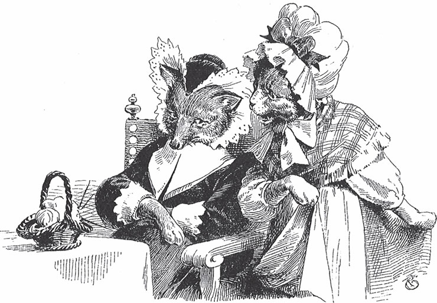

## Die Hochzeit der Frau Füchsin

### Erstes Märchen

Es war einmal ein alter Fuchs mit neun Schwänzen. Er glaubt, seine Frau ist ihm nicht treu. Deshalb will er sie <abbr title="jemanden auf die Probe stellen — испытать кого-либо">auf die Probe stellen</abbr>. Er legt sich unter die Bank, bewegt kein Glied und <abbr title="sich stellen + Adj. — притворяться">stellt sich</abbr> <abbr title="mausetot — мёртвый-премёртвый">mausetot</abbr>. Frau <abbr title="die Füchsin, die Füchsinnen — лиса (самка)">Füchsin</abbr> geht in ihre Kammer und <abbr title="sich einschließen (schloss ein, hat eingeschlossen) — запереться">schließt sich ein</abbr>. Ihre Magd, die Jungfer Katze, sitzt am Herd und kocht.

Bald wissen alle, dass der alte Fuchs gestorben ist. Da kommen die Freier. Die Magd hört, dass jemand vor der Haustür steht und klopft. Sie geht und macht auf. Da steht ein junger Fuchs. Er sagt:

«Was macht sie, Jungfer Katze?

Schläft se oder wacht se?»

Sie antwortet:

«Ich schlafe nicht, ich wache.

Will er wissen, was ich mache?

Ich koche warm Bier, tu Butter hinein:

Will der Herr mein Gast sein?»

— Ich danke schön, Jungfer, — sagt der Fuchs. — Was macht die Frau Füchsin?

Die Magd antwortet:

«Sie sitzt auf ihrer Kammer,

sie <abbr title="beklagen — оплакивать">beklagt</abbr> ihren Jammer,

weint ihre Äuglein <abbr title="seidenrot — красный как шёлк">seidenrot</abbr>,

weil der alte Herr Fuchs ist tot.»

— Sag Sie ihr doch, Jungfer: Ein junger Fuchs ist da. Er möchte sie gern heiraten.

— Schon gut, junger Herr.

Da ging die Katz die <abbr title="tripp, trapp — топ-топ">Tripp die Trapp</abbr>,

da schlug die Tür die <abbr title="klipp, klapp — хлоп-хлоп">Klipp die Klapp</abbr>.

«Frau Füchsin, sind Sie da?»

«Ach ja, mein Kätzchen, ja.»

«Es ist ein Freier draus.»

«Mein Kind, wie sieht er aus?»

— Hat er denn auch neun so schöne <abbr title="der Zeiselschwanz (veraltet) — пушистый хвост (досл. «хвост как у чижа»)">Zeiselschwänze</abbr> wie der selige Herr Fuchs?

— Ach nein, — antwortet die Katze, — er hat nur einen.

— Dann will ich ihn nicht haben.

Die Jungfer Katze geht hinunter und schickt den Freier fort. Bald darauf klopft es wieder. Ein anderer Fuchs steht vor der Tür. Er will die Frau Füchsin heiraten. Er hat zwei Schwänze. Aber es geht ihm nicht besser als dem ersten. Danach kommen noch andere, jeder mit einem Schwanz mehr. Alle schickt sie weg. Zuletzt kommt einer, der hat neun Schwänze, wie der alte Herr Fuchs. Als die Witwe das hört, sagt sie voller Freude zu der Katze:

«Nun macht mir Tor und Türe auf

und kehrt den alten Herrn Fuchs hinaus.»

Aber gerade als sie Hochzeit feiern wollen, rührt sich der alte Herr Fuchs unter der Bank. Er verprügelt das ganze Gesindel und jagt es zusammen mit der Frau Füchsin aus dem Haus.

### Zweites Märchen

Der alte Herr Fuchs ist gestorben. Da kommt der Wolf als Freier und klopft an die Tür. Die Katze dient als Magd bei der Frau Füchsin. Sie macht auf. Der Wolf grüßt sie und sagt:

«Guten Tag, Frau Katz von <abbr title="Kehrewitz — Метельская (шутливая «фамилия» от kehren — мести)">Kehrewitz</abbr>,

wie kommt's, dass Sie alleine sitzt?

Was macht Sie Gutes da?»

Die Katze antwortet:

«<abbr title="einbrocken — накрошить (хлеб в молоко)">Brock</abbr> mir <abbr title="der Weck, die Wecke — булочка (диал.)">Wecke</abbr> und Milch ein:

Will der Herr mein Gast sein?»

— Danke schön, Frau Katze, — antwortet der Wolf. — Ist die Frau Füchsin nicht zu Hause?

Die Katze sagt:

«Sie sitzt droben in der Kammer,

<abbr title="beweinen — оплакивать">beweint</abbr> ihren Jammer,

beweint ihre große Not,

dass der alte Herr Fuchs ist tot.»

Der Wolf antwortet:

«Will sie haben einen andern Mann,

so soll sie nur herunter <abbr title="gan (veraltet/Dialekt = gehen) — идти, сходить">gan</abbr>.»

Die Katz, die lief die Trepp hinan

und ließ ihr <abbr title="das Zeilchen (veraltet) — хвостик">Zeilchen</abbr> <abbr title="rummer (Dialekt = herum) — туда-сюда, кругом">rummer</abbr> gan,

bis sie kam vor den langen Saal:

Klopft an mit ihren fünf goldenen Ringen.

«Frau Füchsin, ist Sie drinnen?

Will Sie haben einen andern Mann,

so soll Sie nur herunter gan.»

Die Frau Füchsin fragt:

— Hat der Herr rote <abbr title="das Höslein (die Hose) — штанишки">Höslein</abbr> an, und hat er ein spitzes <abbr title="das Mäulchen (das Maul) — мордочка">Mäulchen</abbr>?

— Nein, — antwortet die Katze.

— Dann kann er mir nicht dienen.

Der Wolf muss gehen. Danach kommen ein Hund, ein Hirsch, ein Hase, ein Bär, ein <abbr title="der Löwe, die Löwen — лев">Löwe</abbr> und nacheinander alle Tiere aus dem Wald. Aber immer fehlt eine von den guten Eigenschaften, die der alte Herr Fuchs hatte. Jedes Mal muss die Katze den Freier wegschicken. Endlich kommt ein junger Fuchs. Da fragt die Frau Füchsin:

— Hat der Herr rote Höslein an, und hat er ein spitzes Mäulchen?

— Ja, — sagt die Katze, — das hat er.

— Dann soll er heraufkommen, — sagt die Frau Füchsin. Und sie sagt der Magd, sie soll das Hochzeitsfest vorbereiten:

«Katze, kehr die Stube aus

und <abbr title="schmeißen (schmiss, hat geschmissen) — швырнуть, выбросить">schmeiß</abbr> den alten Fuchs zum Fenster hinaus.

Bracht so manche dicke, fette Maus,

fraß sie immer alleine,

gab mir aber keine.»

Dann feiern sie Hochzeit mit dem jungen Herrn Fuchs. Alle <abbr title="jubeln — ликовать">jubeln</abbr> und tanzen. Und wenn sie nicht aufgehört haben, dann tanzen sie noch heute.

---

### Neue Wörter

- **jemanden auf die Probe stellen** — испытать кого-либо
- **sich stellen + Adj.** — притворяться
- **mausetot** — мёртвый-премёртвый
- **die Füchsin, die Füchsinnen** — лиса (самка)
- **sich einschließen (schloss ein, hat eingeschlossen)** — запереться
- **beklagen** — оплакивать
- **seidenrot** — красный как шёлк
- **tripp, trapp** — топ-топ
- **klipp, klapp** — хлоп-хлоп
- **der Zeiselschwanz (veraltet)** — пушистый хвост (досл. «хвост как у чижа»)
- **Kehrewitz** — Метельская (шутливая «фамилия» от kehren — мести)
- **einbrocken** — накрошить (хлеб в молоко)
- **der Weck, die Wecke** — булочка (диал.)
- **beweinen** — оплакивать
- **gan (veraltet/Dialekt = gehen)** — идти, сходить
- **das Zeilchen (veraltet)** — хвостик
- **rummer (Dialekt = herum)** — туда-сюда, кругом
- **das Höslein (die Hose)** — штанишки
- **das Mäulchen (das Maul)** — мордочка
- **der Löwe, die Löwen** — лев
- **schmeißen (schmiss, hat geschmissen)** — швырнуть, выбросить
- **jubeln** — ликовать

[← Zurück](kapitel-37.md) · [Inhalt](README.md)
