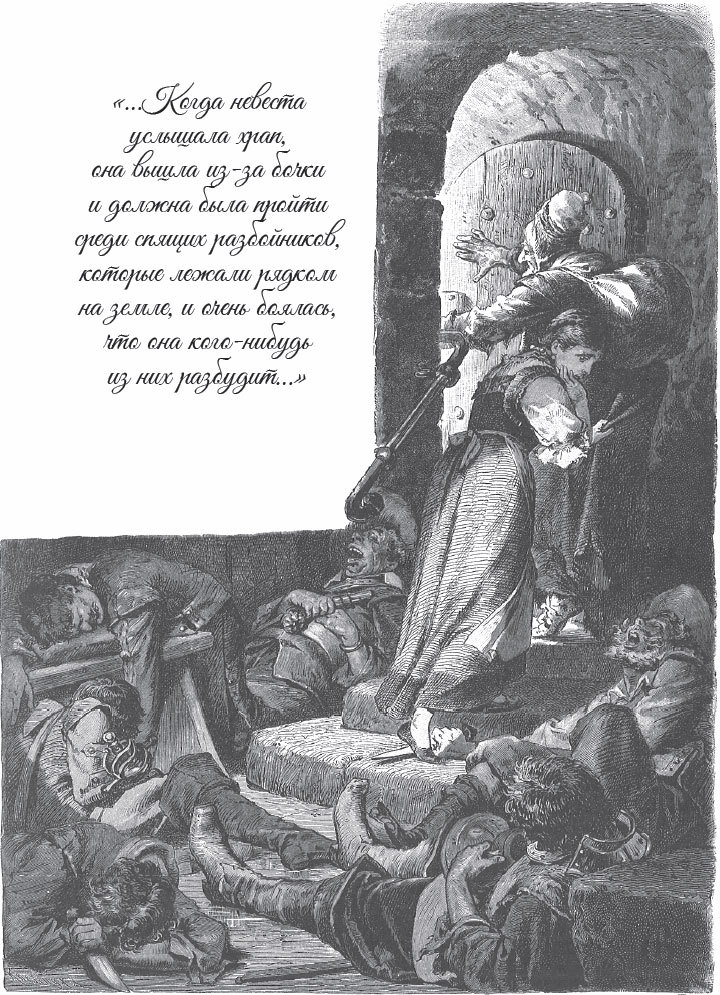

## Der Räuberbräutigam

Es war einmal ein Müller. Er hatte eine schöne Tochter. Als die Tochter groß ist, denkt der Müller: «Sie soll gut heiraten. Dann ist sie <abbr title="versorgt sein — быть обеспеченным, пристроенным">versorgt</abbr>. Wenn ein <abbr title="anständig — порядочный">anständiger</abbr> <abbr title="der Bewerber, die Bewerber — жених, претендент">Bewerber</abbr> kommt und um ihre Hand anhält, dann gebe ich sie ihm.»

Bald kommt ein Bewerber. Er scheint sehr reich zu sein. Der Müller findet keinen <abbr title="der Fehler, die Fehler — недостаток, ошибка">Fehler</abbr> an ihm, deshalb verspricht er ihm seine Tochter.

Aber das Mädchen liebt ihn nicht so, wie eine Braut ihren Bräutigam lieben soll. Sie <abbr title="vertrauen (+ Dat.) — доверять">vertraut</abbr> ihm nicht. Immer wenn sie ihn ansieht oder an ihn denkt, fühlt sie ein Grauen im Herzen.

Einmal sagt er zu ihr:

— Du bist meine Braut, und du besuchst mich nicht einmal.

— Ich weiß nicht, wo dein Haus ist, — antwortet das Mädchen.

— Mein Haus ist draußen im dunklen Wald, — sagt der Bräutigam.

Das Mädchen sucht Ausreden. Es sagt, es kann den Weg nicht finden. Aber der Bräutigam sagt:

— Nächsten Sonntag musst du zu mir kommen. Ich habe die Gäste schon eingeladen. Damit du den Weg durch den Wald findest, streue ich dir Asche auf den Weg.

Der Sonntag kommt. Das Mädchen soll losgehen, aber es hat große Angst und weiß selbst nicht, warum. Es will den Weg <abbr title="markieren — отмечать, помечать">markieren</abbr>. Deshalb steckt es sich beide Taschen voll mit Erbsen und Linsen. Am Eingang vom Wald liegt Asche auf der Erde. Das Mädchen geht der Asche nach. Aber bei jedem <abbr title="der Schritt, die Schritte — шаг">Schritt</abbr> wirft es rechts und links ein paar Erbsen auf die Erde.

Es geht fast den ganzen Tag. Endlich kommt es mitten in den Wald, wo er am dunkelsten ist. Dort steht ein einsames Haus. Das Haus gefällt dem Mädchen nicht, denn es sieht so finster und unheimlich aus. Es geht hinein. Aber niemand ist da, und es ist ganz still. Plötzlich ruft eine Stimme:

«Kehr um, kehr um, du junge Braut, du bist in einem <abbr title="das Mörderhaus — дом убийц">Mörderhaus</abbr>.»

Das Mädchen sieht nach oben. Die Stimme kommt von einem Vogel. Er sitzt in einem Käfig an der Wand. Noch einmal ruft er:

«Kehr um, kehr um, du junge Braut, du bist in einem Mörderhaus.»

Die schöne Braut geht weiter, von einem Zimmer ins andere, durch das ganze Haus. Aber alles ist leer, sie findet keine <abbr title="die Menschenseele — ни души, ни живой души">Menschenseele</abbr>. Endlich kommt sie in den Keller. Dort sitzt eine steinalte Frau. Sie <abbr title="wackeln mit + Dat. — трясти, качать">wackelt</abbr> immer mit dem Kopf.

— Können Sie mir sagen, ob mein Bräutigam hier wohnt? — fragt das Mädchen.

— Ach, du armes Kind, — antwortet die Alte, — wohin bist du gekommen! Du bist in einer <abbr title="die Mördergrube, die Mördergruben — логово убийц, разбойничий притон">Mördergrube</abbr>. Du glaubst, du bist eine Braut und hast bald Hochzeit. Aber deine Hochzeit feierst du mit dem Tod. Siehst du den großen Kessel mit Wasser? Den musste ich auf das Feuer stellen. Wenn sie dich fangen, dann <abbr title="zerhacken — разрубать на куски">zerhacken</abbr> sie dich ohne <abbr title="das Erbarmen — жалость, милосердие">Erbarmen</abbr>. Sie kochen dich und essen dich, denn sie sind <abbr title="der Menschenfresser, die Menschenfresser — людоед">Menschenfresser</abbr>. Wenn ich kein Mitleid mit dir habe und dich nicht rette, dann bist du verloren.

Die Alte führt das Mädchen hinter ein großes Fass. Dort kann es niemand sehen.

— Sei still wie ein <abbr title="das Mäuschen, die Mäuschen — мышка">Mäuschen</abbr>, — sagt sie. — Rühr dich nicht und beweg dich nicht, sonst bist du tot. In der Nacht, wenn die Räuber schlafen, fliehen wir zusammen. Darauf warte ich schon lange.

Kaum ist das Mädchen hinter dem Fass, da kommt die gottlose <abbr title="die Bande, die Banden — банда, шайка">Bande</abbr> nach Hause. Die Räuber schleppen eine andere junge Frau mit. Sie sind <abbr title="betrunken — пьяный">betrunken</abbr> und hören nicht auf ihr Schreien und Jammern. Sie geben ihr Wein zu trinken, drei Gläser voll: ein Glas weißen, ein Glas roten und ein Glas gelben. Davon zerspringt ihr das Herz. Dann <abbr title="reißen (riss, hat gerissen) — рвать, срывать">reißen</abbr> sie ihr die feinen Kleider herunter. Sie legen sie auf einen Tisch, zerhacken ihren schönen Körper in Stücke und streuen <abbr title="das Salz — соль">Salz</abbr> darüber.

Die arme Braut hinter dem Fass zittert und bebt. Denn jetzt sieht sie, was die Räuber auch mit ihr machen wollen.

Einer von den Räubern sieht einen goldenen Ring am kleinen Finger von der Toten. Der Ring geht nicht gleich ab. Da nimmt der Räuber ein Beil und <abbr title="abhacken — отрубать">hackt</abbr> den Finger ab. Aber der Finger springt hoch, über das Fass, und fällt der Braut genau in den Schoß. Der Räuber nimmt eine Kerze und sucht den Finger. Aber er kann ihn nicht finden. Da sagt ein anderer:

— Hast du auch hinter dem großen Fass gesucht?

Aber die Alte ruft:

— Kommt jetzt essen! Sucht morgen weiter. Der Finger läuft euch nicht weg.

— Die Alte hat recht, — sagen die Räuber. Sie hören auf zu suchen und setzen sich zum Essen.

Die Alte <abbr title="träufeln — капать, накапать">träufelt</abbr> ihnen einen <abbr title="der Schlaftrunk — сонное зелье, снотворное питьё">Schlaftrunk</abbr> in den Wein. Bald legen sich die Räuber im Keller hin, schlafen und schnarchen. Als die Braut das hört, kommt sie hinter dem Fass hervor. Sie muss über die Schlafenden steigen. Sie liegen in <abbr title="die Reihe, die Reihen — ряд">Reihen</abbr> auf dem Boden. Das Mädchen hat große Angst, dass einer aufwacht. Aber Gott hilft ihr, und sie kommt glücklich durch.

Die Alte geht mit ihr nach oben und öffnet die Tür. So schnell sie können, eilen sie weg von der Mördergrube. Die Asche hat der Wind <abbr title="wegwehen — сдуть, унести ветром">weggeweht</abbr>. Aber die Erbsen und Linsen sind <abbr title="aufgehen (ging auf, ist aufgegangen) — взойти, прорасти">aufgegangen</abbr>. Kleine grüne <abbr title="der Keim, die Keime — росток">Keime</abbr> zeigen im Mondschein den Weg. Die beiden gehen die ganze Nacht. Am Morgen kommen sie bei der Mühle an. Dort erzählt das Mädchen seinem Vater alles, was passiert ist.

Dann kommt der Tag von der Hochzeit. Der Bräutigam kommt. Der Müller hat alle seine Verwandten und <abbr title="der/die Bekannte, die Bekannten — знакомый">Bekannten</abbr> eingeladen. Sie sitzen am Tisch, und jeder soll etwas erzählen. Die Braut sitzt still und sagt nichts. Da sagt der Bräutigam zu ihr:

— Nun, mein Herz, weißt du nichts? Erzähl uns auch etwas.

— Gut, dann erzähle ich einen Traum, — antwortet sie. — Ich gehe allein durch einen Wald und komme endlich zu einem Haus. Da ist keine Menschenseele. Aber an der Wand hängt ein Vogel in einem Käfig, und er ruft:

«Kehr um, kehr um, du junge Braut, du bist in einem Mörderhaus.»

— Und er ruft es noch einmal. Mein Schatz, das habe ich nur geträumt. Dann gehe ich durch alle Zimmer. Alle sind leer, und es ist so unheimlich. Endlich gehe ich hinunter in den Keller. Da sitzt eine steinalte Frau und wackelt mit dem Kopf. Ich frage sie: «Wohnt mein Bräutigam in diesem Haus?» Sie antwortet: «Ach, du armes Kind, du bist in eine Mördergrube gekommen. Dein Bräutigam wohnt hier. Aber er will dich zerhacken und töten, und dann will er dich kochen und essen.» Mein Schatz, das habe ich nur geträumt. Aber die alte Frau versteckt mich hinter einem großen Fass. Kaum bin ich dort, da kommen die Räuber nach Hause. Sie schleppen eine junge Frau mit. Sie geben ihr dreierlei Wein zu trinken, weißen, roten und gelben. Davon zerspringt ihr das Herz. Mein Schatz, das habe ich nur geträumt. Dann reißen sie ihr die feinen Kleider herunter. Sie zerhacken ihren schönen Körper auf einem Tisch in Stücke und streuen Salz darüber. Mein Schatz, das habe ich nur geträumt. Und einer von den Räubern sieht: An ihrem Finger steckt noch ein Ring. Der Ring geht schwer ab. Deshalb nimmt der Räuber ein Beil und hackt den Finger ab. Aber der Finger springt hoch, hinter das große Fass, und fällt mir in den Schoß. Und hier ist der Finger mit dem Ring!

Bei diesen Worten zieht sie den Finger heraus und zeigt ihn allen Gästen.

Der Räuber ist bei der Geschichte <abbr title="kreideweiß — белый как мел">kreideweiß</abbr> geworden. Er springt auf und will fliehen. Aber die Gäste halten ihn fest und bringen ihn zum Gericht. Dort verurteilt man ihn und seine ganze Bande für ihre Verbrechen.

---

### Neue Wörter

- **versorgt sein** — быть обеспеченным, пристроенным
- **anständig** — порядочный
- **der Bewerber, die Bewerber** — жених, претендент
- **der Fehler, die Fehler** — недостаток, ошибка
- **vertrauen (+ Dat.)** — доверять
- **markieren** — отмечать, помечать
- **der Schritt, die Schritte** — шаг
- **das Mörderhaus** — дом убийц
- **die Menschenseele** — ни души, ни живой души
- **wackeln mit + Dat.** — трясти, качать
- **die Mördergrube, die Mördergruben** — логово убийц, разбойничий притон
- **zerhacken** — разрубать на куски
- **das Erbarmen** — жалость, милосердие
- **der Menschenfresser, die Menschenfresser** — людоед
- **das Mäuschen, die Mäuschen** — мышка
- **die Bande, die Banden** — банда, шайка
- **betrunken** — пьяный
- **reißen (riss, hat gerissen)** — рвать, срывать
- **das Salz** — соль
- **abhacken** — отрубать
- **träufeln** — капать, накапать
- **der Schlaftrunk** — сонное зелье, снотворное питьё
- **die Reihe, die Reihen** — ряд
- **wegwehen** — сдуть, унести ветром
- **aufgehen (ging auf, ist aufgegangen)** — взойти, прорасти
- **der Keim, die Keime** — росток
- **der/die Bekannte, die Bekannten** — знакомый
- **kreideweiß** — белый как мел

[← Zurück](kapitel-39.md) · [Inhalt](README.md)
