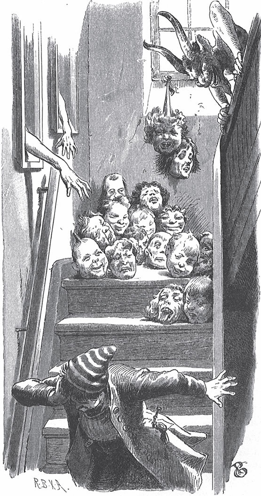

## Der Herr Gevatter

Ein armer Mann hat sehr viele Kinder. Für jedes Kind braucht er einen <abbr title="der Pate, die Paten — крёстный">Paten</abbr> oder eine Patin. Früher sagte man dazu «<abbr title="der Gevatter, die Gevattern — кум, крёстный (устар.)">Gevatter</abbr>». Der Mann hat schon alle Leute auf der Welt <abbr title="bitten (bat, hat gebeten) — просить">gebeten</abbr>. Jetzt bekommt er noch ein Kind, aber niemand ist mehr da, den er bitten kann. Er weiß nicht, was er machen soll. Traurig legt er sich hin und schläft ein.

Da träumt er: Er soll vor das Stadttor gehen. Der erste Mensch, den er dort trifft, soll Gevatter werden. Als er aufwacht, beschließt er: «Ich mache, was der Traum sagt.» Er geht vor das Tor. Den ersten Menschen, den er trifft, bittet er, Gevatter zu sein.

Der Fremde schenkt ihm ein kleines Glas mit Wasser und sagt:

— Das ist ein <abbr title="das Wunderwasser — чудесная вода">Wunderwasser</abbr>. Damit kannst du die Kranken gesund machen. Du musst nur sehen, wo der Tod steht. Steht er beim Kopf, dann gib dem Kranken von dem Wasser, und er wird gesund. Steht der Tod aber bei den Füßen, dann ist alle <abbr title="die Mühe, die Mühen — старание, труд">Mühe</abbr> umsonst. Dann muss der Kranke sterben.

Von jetzt an kann der Mann immer sagen, ob man einen Kranken retten kann oder nicht. Er wird berühmt und verdient viel Geld. Einmal ruft man ihn zum Kind vom König. Er kommt ins Zimmer und sieht den Tod beim Kopf stehen. Er <abbr title="heilen — лечить, исцелять">heilt</abbr> das Kind mit dem Wasser. Beim zweiten Mal ist es genauso. Aber beim dritten Mal steht der Tod bei den Füßen. Da muss das Kind sterben.

Eines Tages will der Mann seinen Gevatter besuchen. Er möchte ihm erzählen, was er mit dem Wasser erlebt hat. Aber als er ins Haus kommt, ist dort alles sehr seltsam.

Auf der ersten Treppe streiten sich die <abbr title="die Schaufel, die Schaufeln — лопата">Schaufel</abbr> und der Besen. Sie schlagen heftig aufeinander <abbr title="losschlagen auf + Akk. — набрасываться с кулаками">los</abbr>. Der Mann fragt:

— Wo wohnt der Herr Gevatter?

— Eine Treppe höher, — antwortet der Besen.

Auf der zweiten Treppe sieht er viele tote Finger liegen. Er fragt:

— Wo wohnt der Herr Gevatter?

— Eine Treppe höher, — antwortet einer von den Fingern.

Auf der dritten Treppe liegt ein Haufen tote Köpfe. Auch sie schicken ihn eine Treppe höher.

Auf der vierten Treppe stehen Fische über dem Feuer. Sie <abbr title="brutzeln — шкворчать, жариться">brutzeln</abbr> in der <abbr title="die Pfanne, die Pfannen — сковорода">Pfanne</abbr> und braten sich selbst. Auch sie sagen:

— Eine Treppe höher.

Er steigt die fünfte Treppe hinauf und kommt zu einer Tür. Er guckt durch das <abbr title="das Schlüsselloch, die Schlüssellöcher — замочная скважина">Schlüsselloch</abbr>. Da sieht er den Gevatter. Der Gevatter hat zwei lange Hörner! Der Mann macht die Tür auf und geht hinein. Schnell legt sich der Gevatter ins Bett und <abbr title="sich zudecken — укрываться">deckt sich zu</abbr>.

— Herr Gevatter, — sagt der Mann, — was ist das für ein seltsames Haus? Auf Ihrer ersten Treppe streiten sich Schaufel und Besen und schlagen heftig aufeinander los.

— Wie dumm Sie sind! — sagt der Gevatter. — Das waren der Knecht und die Magd. Die haben nur miteinander geredet.

— Aber auf der zweiten Treppe habe ich tote Finger gesehen.

— Ei, wie <abbr title="albern — глупый, нелепый">albern</abbr> Sie sind! Das waren <abbr title="die Schwarzwurzel, die Schwarzwurzeln — козелец, «чёрный корень» (овощ)">Schwarzwurzeln</abbr>.

— Auf der dritten Treppe lag ein Haufen Totenköpfe.

— Dummer Mann, das waren <abbr title="der Kohlkopf, die Kohlköpfe — кочан капусты">Kohlköpfe</abbr>.

— Auf der vierten Treppe habe ich Fische in der Pfanne gesehen. Sie haben gebrutzelt und sich selbst gebraten.

Kaum hat er das gesagt, da kommen die Fische herein und tragen sich selbst auf.

— Und als ich die fünfte Treppe heraufgekommen bin, habe ich durch das Schlüsselloch von einer Tür geguckt. Da habe ich Sie gesehen, Gevatter, und Sie hatten lange, lange Hörner.

— Ei, das ist nicht wahr.

Da bekommt der Mann Angst, und er läuft weg. Wer weiß, was der Herr Gevatter sonst noch mit ihm gemacht hat!

---

### Neue Wörter

- **der Pate, die Paten** — крёстный
- **der Gevatter, die Gevattern** — кум, крёстный (устар.)
- **bitten (bat, hat gebeten)** — просить
- **das Wunderwasser** — чудесная вода
- **die Mühe, die Mühen** — старание, труд
- **heilen** — лечить, исцелять
- **die Schaufel, die Schaufeln** — лопата
- **losschlagen auf + Akk.** — набрасываться с кулаками
- **brutzeln** — шкворчать, жариться
- **die Pfanne, die Pfannen** — сковорода
- **das Schlüsselloch, die Schlüssellöcher** — замочная скважина
- **sich zudecken** — укрываться
- **albern** — глупый, нелепый
- **die Schwarzwurzel, die Schwarzwurzeln** — козелец, «чёрный корень» (овощ)
- **der Kohlkopf, die Kohlköpfe** — кочан капусты

[← Zurück](kapitel-41.md) · [Inhalt](README.md)
