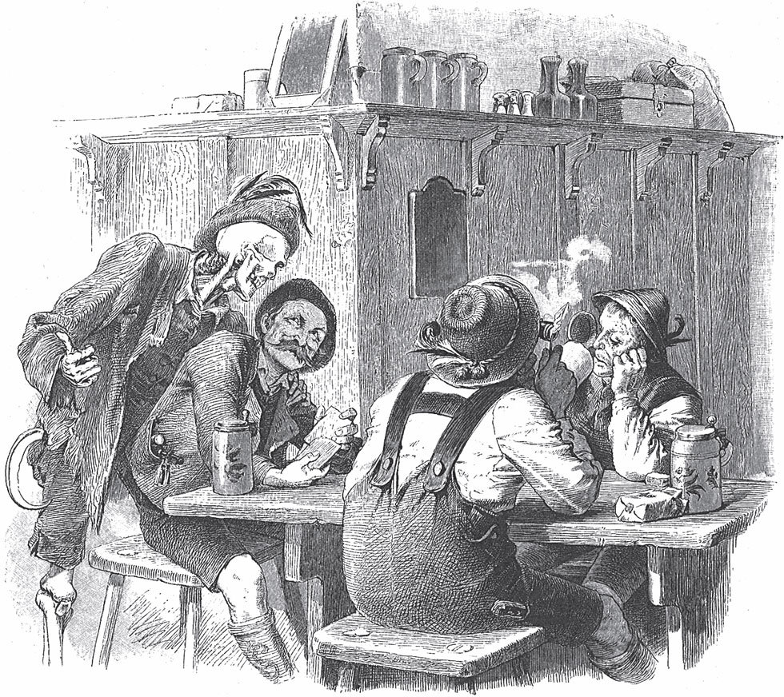

## Der Gevatter Tod

Ein armer Mann hat zwölf Kinder. Er muss Tag und Nacht arbeiten. Sonst haben die Kinder nicht einmal Brot. Dann kommt das dreizehnte Kind auf die Welt. Der Mann ist in großer Not und weiß nicht, was er tun soll. Er läuft hinaus auf die große Landstraße. Den ersten Menschen, den er trifft, will er als Gevatter haben. So sagte man früher zu einem Paten.

Der Erste, den er trifft, ist der liebe Gott. Gott weiß schon, was der Mann auf dem Herzen hat. Er sagt zu ihm:

— Armer Mann, du <abbr title="leidtun (tat leid, hat leidgetan) — быть жалко">tust mir leid</abbr>. Ich will der Pate von deinem Kind sein. Ich will für das Kind sorgen und es auf der Erde glücklich machen.

— Wer bist du? — fragt der Mann.

— Ich bin der liebe Gott.

— Dann will ich dich nicht als Gevatter, — sagt der Mann. — Du gibst den Reichen, und die Armen lässt du hungern.

Das sagt der Mann, weil er nicht weiß, wie <abbr title="weise — мудро">weise</abbr> Gott Reichtum und <abbr title="die Armut — бедность">Armut</abbr> <abbr title="verteilen — распределять">verteilt</abbr>. Er <abbr title="sich abwenden (wandte ab, hat abgewandt) — отворачиваться">wendet sich</abbr> von Gott ab und geht weiter.

Da kommt der Teufel zu ihm und sagt:

— Was suchst du? Nimm mich als Paten für dein Kind! Dann gebe ich ihm Gold in <abbr title="in Hülle und Fülle — в изобилии, вдоволь">Hülle und Fülle</abbr> und dazu alle Freuden von der Welt.

— Wer bist du? — fragt der Mann.

— Ich bin der Teufel.

— Dann will ich dich nicht als Gevatter, — sagt der Mann. — Du betrügst die Menschen und <abbr title="verführen — соблазнять, совращать">verführst</abbr> sie.

Er geht weiter. Da kommt der Tod mit seinen dürren Beinen auf ihn zu und sagt:

— Nimm mich als Gevatter.

— Wer bist du? — fragt der Mann.

— Ich bin der Tod. Ich mache alle gleich.

Da sagt der Mann:

— Du bist der Richtige. Du holst den Reichen und den Armen, ohne <abbr title="der Unterschied, die Unterschiede — разница, различие">Unterschied</abbr>. Du sollst mein Gevatter sein.

Der Tod antwortet:

— Ich mache dein Kind reich und berühmt. Denn wer mich zum Freund hat, dem kann nichts fehlen.

— Nächsten Sonntag ist die Taufe, — sagt der Mann. — Komm <abbr title="pünktlich — вовремя, пунктуально">pünktlich</abbr>.

Der Tod kommt, wie er versprochen hat, und ist ganz ordentlich Pate.

Der Junge wird groß. Eines Tages kommt der Pate und sagt: «Komm mit.» Er führt ihn hinaus in den Wald und zeigt ihm ein Kraut. Das Kraut wächst dort. Der Tod sagt:

— Jetzt bekommst du dein <abbr title="das Patengeschenk, die Patengeschenke — подарок от крёстного">Patengeschenk</abbr>. Ich mache dich zu einem berühmten <abbr title="der Arzt, die Ärzte — врач">Arzt</abbr>. Wenn man dich zu einem Kranken ruft, dann erscheine ich dir jedes Mal. Stehe ich beim Kopf vom Kranken, dann kannst du mutig sagen: «Ich mache ihn wieder gesund.» Dann gibst du ihm von dem Kraut, und er wird gesund. Stehe ich aber bei den Füßen vom Kranken, dann gehört er mir. Dann musst du sagen: «Alle Hilfe ist umsonst. Kein Arzt auf der Welt kann ihn retten.» Aber pass auf: Benutz das Kraut nie gegen meinen <abbr title="der Wille — воля">Willen</abbr>! Sonst geht es dir schlecht.

Bald ist der junge Mann der berühmteste Arzt auf der ganzen Welt. Die Leute sagen über ihn: «Er muss den Kranken nur ansehen, dann weiß er schon alles. Er weiß, ob der Kranke wieder gesund wird oder ob er sterben muss.» Von nah und fern kommen die Leute und holen ihn zu ihren Kranken. Sie geben ihm so viel Gold, dass er bald ein reicher Mann ist.

Eines Tages wird der König krank. Man ruft den Arzt. Er soll sagen, ob der König wieder gesund werden kann. Aber als er zum Bett kommt, steht der Tod bei den Füßen vom König. Gegen den Tod hilft kein Kraut mehr.

«Vielleicht kann ich den Tod einmal <abbr title="überlisten — перехитрить">überlisten</abbr>», denkt der Arzt. «Er wird natürlich <abbr title="böse sein — сердиться">böse</abbr> sein. Aber ich bin ja sein Patenkind. Bestimmt <abbr title="ein Auge zudrücken — закрыть глаза (на что-то), простить">drückt</abbr> er ein Auge zu. Ich wage es.»

Er nimmt den Kranken und legt ihn <abbr title="umgekehrt — наоборот, задом наперёд">umgekehrt</abbr> ins Bett. Jetzt steht der Tod beim Kopf vom König. Dann gibt der Arzt ihm von dem Kraut. Der König erholt sich und wird wieder gesund.

Aber der Tod kommt zum Arzt. Er macht ein böses, finsteres Gesicht, droht mit dem Finger und sagt:

— Du hast mich hinters Licht geführt. Dieses Mal verzeihe ich dir, weil du mein Patenkind bist. Aber wenn du das noch einmal machst, dann geht es dir an den Kragen. Dann nehme ich dich selbst mit.

Bald danach wird die Tochter vom König schwer krank. Sie ist sein einziges Kind. Er weint Tag und Nacht, bis seine Augen blind werden. Er lässt <abbr title="bekannt machen — объявить">bekannt machen</abbr>: «Wer sie vom Tod rettet, der wird ihr Mann und bekommt nach mir die Krone.»

Der Arzt kommt zum Bett von der Kranken. Er sieht den Tod bei ihren Füßen. Er muss an die <abbr title="die Warnung, die Warnungen — предупреждение">Warnung</abbr> von seinem Paten denken! Aber die Königstochter ist so schön, und er möchte so gern ihr Mann werden. Das macht ihn ganz blind, und er vergisst alles. Er sieht nicht, dass der Tod ihn zornig ansieht. Er sieht nicht, dass der Tod die Hand hebt und mit der dürren <abbr title="die Faust, die Fäuste — кулак">Faust</abbr> droht. Er hebt die Kranke hoch und legt ihren Kopf dorthin, wo vorher die Füße waren. Dann gibt er ihr von dem Kraut. Sofort werden ihre <abbr title="die Wange, die Wangen — щека">Wangen</abbr> rot, und das Leben kommt zurück.

Jetzt hat der Arzt den Tod zum zweiten Mal um sein Eigentum betrogen. Mit langen Schritten geht der Tod auf den Arzt zu und sagt:

— Jetzt ist es aus mit dir. Jetzt bist du an der Reihe.

Er packt ihn mit seiner <abbr title="eiskalt — ледяной">eiskalten</abbr> Hand. Er packt so hart, dass der Arzt sich nicht wehren kann. Der Tod führt ihn in eine Höhle unter der Erde.

Dort sieht der Arzt tausend und tausend <abbr title="das Licht, die Lichter — свеча, огонёк">Lichter</abbr>. Sie brennen in <abbr title="endlos — бесконечный">endlosen</abbr> Reihen. Manche sind groß, manche halb groß, manche klein. Jeden Augenblick gehen einige aus, und andere brennen neu an. So sieht es aus, als ob die kleinen Flammen immer hin und her hüpfen.

— Siehst du, — sagt der Tod, — das sind die <abbr title="das Lebenslicht, die Lebenslichter — свеча жизни">Lebenslichter</abbr> von den Menschen. Die großen gehören Kindern. Die halb großen gehören <abbr title="das Ehepaar, die Ehepaare — супружеская пара">Ehepaaren</abbr> in ihren besten Jahren. Die kleinen gehören alten Leuten. Aber auch Kinder und junge Leute haben oft nur ein kleines Licht.

— Zeig mir mein Lebenslicht, — sagt der Arzt. Er glaubt, es ist noch sehr groß.

Der Tod zeigt auf ein ganz kleines <abbr title="das Endchen, die Endchen — огарок, кончик">Endchen</abbr>. Es geht gleich aus.

— Siehst du, da ist es.

— Ach, lieber Pate, — sagt der Arzt. Er ist sehr erschrocken. — Zündet mir ein neues an! Tut es mir zuliebe! Ich möchte mein Leben <abbr title="genießen (genoss, hat genossen) — наслаждаться">genießen</abbr>, König werden und die schöne Königstochter heiraten.

— Das kann ich nicht, — antwortet der Tod. — Erst muss ein Licht ausgehen. Dann kann ein neues anbrennen.

— Dann setzt das alte Licht auf ein neues, — bittet der Arzt. — Wenn das alte zu Ende ist, brennt das neue gleich weiter.

Der Tod tut so, als ob er den Wunsch erfüllt. Er holt ein frisches, großes Licht. Aber er will sich rächen. Beim <abbr title="umstecken — переставлять">Umstecken</abbr> macht er <abbr title="absichtlich — нарочно, намеренно">absichtlich</abbr> einen Fehler. Das kleine Stück fällt um und geht aus.

Sofort sinkt der Arzt zu Boden. Jetzt ist er selbst in der Hand vom Tod.

---

### Neue Wörter

- **leidtun (tat leid, hat leidgetan)** — быть жалко
- **weise** — мудро
- **die Armut** — бедность
- **verteilen** — распределять
- **sich abwenden (wandte ab, hat abgewandt)** — отворачиваться
- **in Hülle und Fülle** — в изобилии, вдоволь
- **verführen** — соблазнять, совращать
- **der Unterschied, die Unterschiede** — разница, различие
- **pünktlich** — вовремя, пунктуально
- **das Patengeschenk, die Patengeschenke** — подарок от крёстного
- **der Arzt, die Ärzte** — врач
- **der Wille** — воля
- **überlisten** — перехитрить
- **böse sein** — сердиться
- **ein Auge zudrücken** — закрыть глаза (на что-то), простить
- **umgekehrt** — наоборот, задом наперёд
- **bekannt machen** — объявить
- **die Warnung, die Warnungen** — предупреждение
- **die Faust, die Fäuste** — кулак
- **die Wange, die Wangen** — щека
- **eiskalt** — ледяной
- **das Licht, die Lichter** — свеча, огонёк
- **endlos** — бесконечный
- **das Lebenslicht, die Lebenslichter** — свеча жизни
- **das Ehepaar, die Ehepaare** — супружеская пара
- **das Endchen, die Endchen** — огарок, кончик
- **genießen (genoss, hat genossen)** — наслаждаться
- **umstecken** — переставлять
- **absichtlich** — нарочно, намеренно

[← Zurück](kapitel-43.md) · [Inhalt](README.md)
