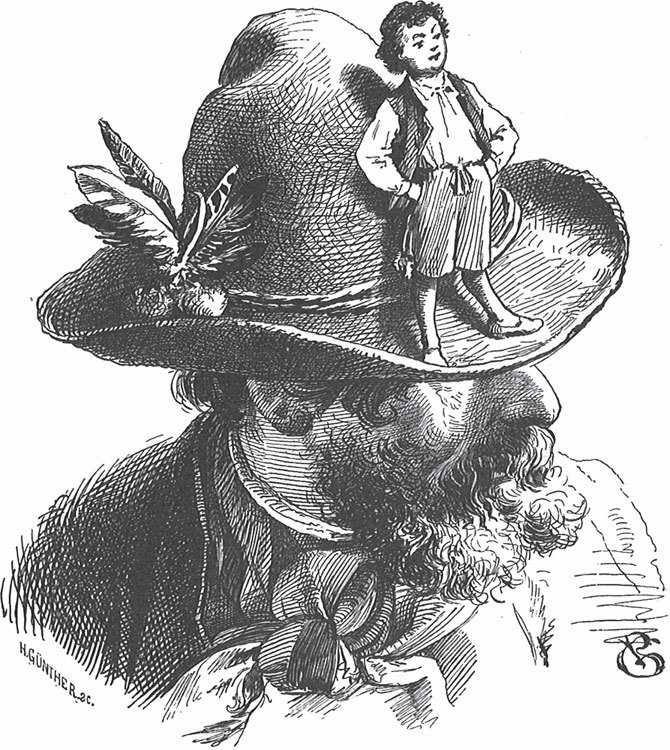

## Daumerlings Wanderschaft

Ein Schneider hat einen Sohn. Der Sohn ist sehr klein, nicht größer als ein Daumen. Deshalb heißt er auch «der Daumerling». Aber er hat viel Mut im Bauch. Eines Tages sagt er zu seinem Vater:

— Vater, ich will und muss <abbr title="hinaus — наружу, вон">hinaus</abbr> in die Welt.

— Recht so, mein Sohn, — sagt der Alte. Er nimmt eine lange <abbr title="die Stopfnadel, die Stopfnadeln — штопальная игла">Stopfnadel</abbr>. Über einer Kerze macht er einen <abbr title="der Knopf, die Knöpfe — шарик, головка; пуговица">Knopf</abbr> aus <abbr title="der Siegellack — сургуч">Siegellack</abbr> daran. — Hier hast du auch einen Degen für den Weg.

Vor der Reise will der kleine Schneider noch einmal mit der Familie essen. Er hüpft in die Küche. Er will sehen, was die Frau Mutter zum letzten Mal gekocht hat. Das Essen ist gerade fertig, und die Schüssel steht auf dem Herd.

— Frau Mutter, was gibt es heute zu essen? — fragt er.

— Sieh doch selbst nach, — sagt die Mutter.

Da springt der Daumerling auf den Herd und guckt in die Schüssel. Aber er streckt den Hals zu weit hinein. Da packt ihn der <abbr title="der Dampf — пар">Dampf</abbr> vom Essen und treibt ihn durch den Schornstein hinaus. Eine Weile reitet er auf dem Dampf durch die Luft. Endlich sinkt er wieder auf die Erde.

Jetzt ist der kleine Schneider draußen in der weiten Welt. Er wandert herum und arbeitet auch bei einem Meister. Aber das Essen ist ihm nicht gut genug.

— Frau <abbr title="die Meisterin, die Meisterinnen — хозяйка (жена мастера)">Meisterin</abbr>, — sagt der Daumerling, — wenn Sie uns kein besseres Essen geben, dann gehe ich weg. Und morgen früh schreibe ich mit Kreide an Ihre Haustür: «<abbr title="die Kartoffel, die Kartoffeln — картофель">Kartoffeln</abbr> zu viel, Fleisch zu wenig, <abbr title="adieu — прощай(те)">adieu</abbr>, Herr Kartoffelkönig!»

— Was willst du denn, du Grashüpfer? — sagt die Meisterin. Sie wird böse, nimmt einen Lappen und will nach ihm schlagen. Aber unser kleiner Schneider kriecht schnell unter den <abbr title="der Fingerhut, die Fingerhüte — напёрсток">Fingerhut</abbr>. Er guckt unten heraus und <abbr title="die Zunge herausstrecken — показать язык">streckt</abbr> der Frau Meisterin die Zunge heraus. Sie hebt den Fingerhut hoch und will ihn packen. Aber der kleine Daumerling hüpft in die Lappen. Die Meisterin wirft die Lappen <abbr title="auseinander — в разные стороны">auseinander</abbr> und sucht ihn. Da schlüpft er in einen <abbr title="der Ritz, die Ritze — щель, трещина">Ritz</abbr> im Tisch.

— He, he, Frau Meisterin! — ruft er und streckt den Kopf heraus. Und immer wenn sie zuschlagen will, springt er hinunter in die <abbr title="die Schublade, die Schubladen — выдвижной ящик">Schublade</abbr>. Aber am Ende <abbr title="erwischen — поймать, схватить">erwischt</abbr> sie ihn doch und jagt ihn aus dem Haus.

Der kleine Schneider wandert weiter und kommt in einen großen Wald. Dort trifft er eine Gruppe Räuber. Sie haben einen Plan: Sie wollen den Schatz vom König stehlen. Als sie den kleinen Schneider sehen, denken sie: «So ein kleiner Kerl kann durch ein Schlüsselloch kriechen. Er kann für uns wie ein <abbr title="der Dietrich, die Dietriche — отмычка">Dietrich</abbr> sein.»

— Heda! — ruft einer. — Du Riese Goliath! Willst du mit zur Schatzkammer kommen? Du kannst dich <abbr title="sich hineinschleichen (schlich hinein, ist hineingeschlichen) — прокрасться внутрь">hineinschleichen</abbr> und das Geld herauswerfen.

Der Daumerling überlegt. Endlich sagt er «Ja» und geht mit zur Schatzkammer. Dort untersucht er die Tür von oben bis unten. Gibt es einen Ritz? Bald findet er einen, der breit genug für ihn ist. Gleich will er hindurch. Aber vor der Tür stehen zwei Wachen. Eine von ihnen sieht ihn und sagt zur anderen:

— Was kriecht denn da für eine hässliche <abbr title="die Spinne, die Spinnen — паук">Spinne</abbr>? Die trete ich tot.

— Lass das arme Tier gehen, — sagt die andere. — Es hat dir doch nichts getan.

So kommt der Daumerling glücklich durch den Ritz in die Schatzkammer. Er öffnet das Fenster. Unter dem Fenster stehen die Räuber. Er wirft ihnen einen Taler nach dem anderen hinaus.

Mitten in der besten Arbeit hört der kleine Schneider: Der König kommt! Der König will seine Schatzkammer <abbr title="ansehen (sah an, hat angesehen) — осматривать">ansehen</abbr>. Schnell versteckt sich der Daumerling. Der König merkt, dass viele Taler fehlen. Aber er versteht nicht, wer sie gestohlen hat. Denn die Schlösser und Riegel sind in Ordnung, und alles scheint gut verschlossen. Er geht wieder und sagt zu den zwei Wachen:

— Passt auf! Jemand ist hinter dem Geld her.

Der Daumerling fängt wieder mit der Arbeit an. Da hören die Wachen, wie sich drinnen das Geld bewegt und <abbr title="klingen (klang, hat geklungen) — звенеть">klingt</abbr>: klipp, klapp, klipp, klapp. Schnell springen sie hinein und wollen den Dieb fangen. Aber der kleine Schneider hört sie kommen, und er ist noch schneller. Er springt in eine Ecke und legt einen Taler über sich. So kann man nichts von ihm sehen. Dabei neckt er die Wachen noch und ruft:

— Hier bin ich!

Die Wachen laufen hin. Aber als sie ankommen, ist er schon in eine andere Ecke unter einen Taler gehüpft und ruft:

— He, hier bin ich!

Die Wachen springen schnell hin. Aber der Daumerling ist längst in einer dritten Ecke und ruft:

— He, hier bin ich!

So <abbr title="zum Narren halten (hielt, hat gehalten) — водить за нос, дурачить">hält</abbr> er sie zum Narren. Er jagt sie so lange in der Schatzkammer herum, bis sie müde sind und weggehen. Jetzt wirft er alle Taler nacheinander hinaus. Den letzten Taler schleudert er mit aller Kraft. Dann hüpft er selbst schnell darauf und fliegt mit ihm durch das Fenster hinunter.

Die Räuber loben ihn sehr.

— Du bist ein großer <abbr title="der Held, die Helden — герой">Held</abbr>, — sagen sie. — Willst du unser Hauptmann werden?

Aber der Daumerling sagt: «Danke, nein. Ich will zuerst die Welt sehen.» Dann teilen die Räuber die Beute. Der kleine Schneider will nur einen <abbr title="der Kreuzer, die Kreuzer — крейцер (мелкая монета)">Kreuzer</abbr>, denn mehr kann er nicht tragen.

Dann <abbr title="umschnallen — пристёгивать, надевать (ремень)">schnallt</abbr> er seinen Degen wieder um, sagt den Räubern «Guten Tag» und <abbr title="die Beine unter den Arm nehmen — пуститься в путь, припуститься">nimmt die Beine unter den Arm</abbr>. Er arbeitet bei ein paar Meistern, aber die Arbeit schmeckt ihm nicht. Endlich wird er <abbr title="der Hausknecht, die Hausknechte — работник, слуга в доме">Hausknecht</abbr> in einem <abbr title="der Gasthof, die Gasthöfe — постоялый двор, трактир">Gasthof</abbr>.

Aber die Mägde können ihn nicht leiden. Denn sie sehen ihn nicht, aber er sieht alles, was sie heimlich tun. Und er sagt der Herrschaft alles: was sie von den Tellern genommen haben und was sie aus dem Keller für sich geholt haben. Da sagen die Mägde:

— Warte nur, das <abbr title="heimzahlen — отплатить, отомстить">zahlen</abbr> wir dir heim!

Sie verabreden untereinander: «Wir spielen ihm einen bösen Streich.»

Bald danach <abbr title="mähen — косить">mäht</abbr> eine Magd im Garten Gras. Da sieht sie den Daumerling. Er springt herum und kriecht an den Kräutern hoch und runter. Schnell mäht sie ihn mit dem Gras zusammen. Sie bindet alles in ein großes Tuch und wirft es heimlich den Kühen hin. Eine große schwarze Kuh ist dabei. Sie schluckt ihn hinunter, aber sie tut ihm nicht weh.

Unten im Bauch gefällt es ihm gar nicht. Es ist ganz finster, und es brennt auch kein Licht. Dann melkt man die Kuh. Da ruft er:

«Strip, strap, stroll, ist der Eimer bald voll?»

Aber beim Melken ist es zu laut, und niemand versteht ihn. Später kommt der Hausherr in den Stall und sagt:

— Morgen schlachten wir diese Kuh.

Da bekommt der Daumerling große Angst. Mit heller Stimme ruft er:

— Lasst mich erst heraus! Ich sitze doch drin!

Der Herr hört das, aber er weiß nicht, woher die Stimme kommt.

— Wo bist du? — fragt er.

— In der Schwarzen, — antwortet der Daumerling.

Aber der Herr versteht nicht, was das heißen soll, und geht weg.

Am nächsten Morgen schlachtet man die Kuh. Zum Glück trifft den Daumerling beim Zerhacken und <abbr title="zerlegen — разделывать">Zerlegen</abbr> kein Hieb. Aber er kommt unter das <abbr title="das Wurstfleisch — фарш для колбасы">Wurstfleisch</abbr>. Der Metzger kommt und fängt mit der Arbeit an. Da schreit der Daumerling so laut er kann:

— Hackt nicht zu tief, hackt nicht zu tief! Ich stecke doch darunter!

Aber die <abbr title="das Hackmesser, die Hackmesser — тесак, сечка">Hackmesser</abbr> machen so viel Lärm, dass ihn kein Mensch hört. Jetzt ist der arme Daumerling in großer Not. Aber Not macht Beine! Er springt so geschickt zwischen den Hackmessern durch, dass ihn keins berührt. So kommt er mit heiler Haut davon. Aber entkommen kann er auch nicht. Es gibt keinen anderen Weg: Mit den <abbr title="das Speckstück, die Speckstücke — кусочек сала">Speckstücken</abbr> <abbr title="stopfen — набивать, запихивать">stopft</abbr> man ihn in eine <abbr title="die Blutwurst, die Blutwürste — кровяная колбаса">Blutwurst</abbr>. Dort ist es ziemlich eng. Und dann hängt man ihn noch in den Schornstein zum <abbr title="räuchern — коптить">Räuchern</abbr>. Da wird ihm die Zeit schrecklich lang.

Endlich, im Winter, holt man ihn herunter. Ein Gast soll die Wurst zu essen bekommen. Die Frau Wirtin schneidet die Wurst in Scheiben. Der Daumerling passt gut auf und streckt den Kopf nicht zu weit vor. Er will ja nicht, dass sie ihm auch den Hals abschneidet. Endlich sieht er seine <abbr title="die Chance, die Chancen — шанс">Chance</abbr>. Er macht sich Luft und springt heraus.

In diesem Haus ist es ihm so schlecht gegangen. Da will der kleine Schneider nicht länger bleiben. Sofort macht er sich wieder auf die Wanderschaft.

Aber seine Freiheit dauert nicht lange. Auf dem offenen Feld kommt ihm ein Fuchs in den Weg. Der Fuchs ist in Gedanken und schnappt ihn einfach.

— Ei, Herr Fuchs, — ruft der kleine Schneider, — ich bin es doch, ich stecke in Ihrem Hals! Lassen Sie mich wieder frei!

— Du hast recht, — antwortet der Fuchs. — An dir habe ich sowieso fast nichts. Wenn du mir die Hühner vom Hof von deinem Vater versprichst, dann lasse ich dich los.

— Von Herzen gern, — antwortet der Daumerling. — Du sollst alle Hühner haben, das schwöre ich dir.

Da lässt ihn der Fuchs wieder los und trägt ihn selbst nach Hause. Der Vater sieht sein liebes <abbr title="das Söhnchen, die Söhnchen — сыночек">Söhnchen</abbr> wieder. Er ist so froh, dass er dem Fuchs gern alle seine Hühner gibt.

— Dafür bringe ich dir auch ein schönes Stück Geld mit, — sagt der Daumerling. Und er gibt ihm den Kreuzer, den er auf seiner Wanderschaft verdient hat.

«Aber warum hat der Fuchs die armen <abbr title="das Piephuhn, die Piephühner — цыплёнок, курочка (детск.)">Piephühner</abbr> zu fressen bekommen?»

«Ei, du Narr! Dein Vater hat sein Kind doch bestimmt lieber als die Hühner auf dem Hof.»

---

### Neue Wörter

- **hinaus** — наружу, вон
- **die Stopfnadel, die Stopfnadeln** — штопальная игла
- **der Knopf, die Knöpfe** — шарик, головка; пуговица
- **der Siegellack** — сургуч
- **der Dampf** — пар
- **die Meisterin, die Meisterinnen** — хозяйка (жена мастера)
- **die Kartoffel, die Kartoffeln** — картофель
- **adieu** — прощай(те)
- **der Fingerhut, die Fingerhüte** — напёрсток
- **die Zunge herausstrecken** — показать язык
- **auseinander** — в разные стороны
- **der Ritz, die Ritze** — щель, трещина
- **die Schublade, die Schubladen** — выдвижной ящик
- **erwischen** — поймать, схватить
- **der Dietrich, die Dietriche** — отмычка
- **sich hineinschleichen (schlich hinein, ist hineingeschlichen)** — прокрасться внутрь
- **die Spinne, die Spinnen** — паук
- **ansehen (sah an, hat angesehen)** — осматривать
- **klingen (klang, hat geklungen)** — звенеть
- **zum Narren halten (hielt, hat gehalten)** — водить за нос, дурачить
- **der Held, die Helden** — герой
- **der Kreuzer, die Kreuzer** — крейцер (мелкая монета)
- **umschnallen** — пристёгивать, надевать (ремень)
- **die Beine unter den Arm nehmen** — пуститься в путь, припуститься
- **der Hausknecht, die Hausknechte** — работник, слуга в доме
- **der Gasthof, die Gasthöfe** — постоялый двор, трактир
- **heimzahlen** — отплатить, отомстить
- **mähen** — косить
- **zerlegen** — разделывать
- **das Wurstfleisch** — фарш для колбасы
- **das Hackmesser, die Hackmesser** — тесак, сечка
- **das Speckstück, die Speckstücke** — кусочек сала
- **stopfen** — набивать, запихивать
- **die Blutwurst, die Blutwürste** — кровяная колбаса
- **räuchern** — коптить
- **die Chance, die Chancen** — шанс
- **das Söhnchen, die Söhnchen** — сыночек
- **das Piephuhn, die Piephühner** — цыплёнок, курочка (детск.)

[← Zurück](kapitel-44.md) · [Inhalt](README.md)
