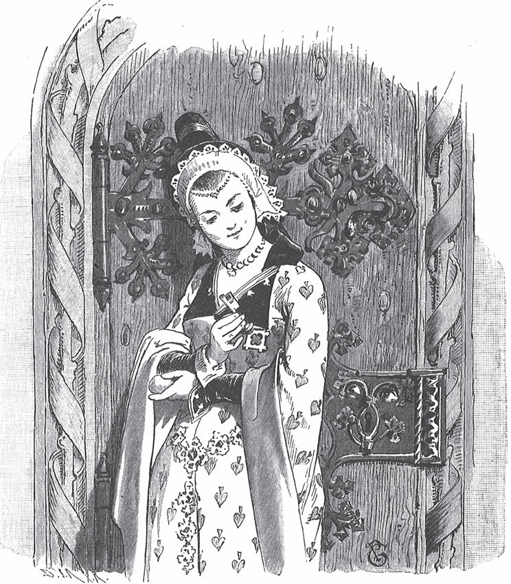

## Fitchers Vogel

Es war einmal ein <abbr title="der Hexenmeister, die Hexenmeister — колдун, чародей">Hexenmeister</abbr>. Er verwandelt sich oft in einen armen Mann. Dann geht er von Haus zu Haus, <abbr title="betteln — просить милостыню">bettelt</abbr> und fängt die schönen Mädchen. Kein Mensch weiß, wohin er sie bringt, denn sie kommen nie wieder zurück.

Eines Tages steht er vor der Tür von einem Mann. Der Mann hat drei schöne Töchter. Der Hexenmeister sieht aus wie ein armer, schwacher <abbr title="der Bettler, die Bettler — нищий">Bettler</abbr>. Auf dem Rücken trägt er eine <abbr title="die Kiepe, die Kiepen — заплечная корзина">Kiepe</abbr>, so als ob er darin <abbr title="das Almosen, die Almosen — милостыня, подаяние">Almosen</abbr> sammelt. Er bittet um ein bisschen Essen. Die älteste Tochter kommt heraus und will ihm ein Stück Brot geben. Da berührt er sie nur, und sie muss in seine Kiepe springen. Mit starken Schritten eilt er davon. Er trägt sie in einen finsteren Wald. Mitten im Wald steht sein Haus.

Im Haus ist alles prächtig. Er gibt ihr alles, was sie sich wünscht, und sagt:

— Mein Schatz, bei mir wird es dir gut gefallen. Du hast alles, was dein Herz begehrt.

So geht es ein paar Tage. Dann sagt er:

— Ich muss <abbr title="verreisen — уезжать (в поездку)">verreisen</abbr> und dich kurze Zeit allein lassen. Hier sind die <abbr title="der Hausschlüssel, die Hausschlüssel — ключ от дома">Hausschlüssel</abbr>. Du kannst überall hingehen und dir alles ansehen. Nur in ein Zimmer darfst du nicht gehen. Dieser kleine Schlüssel schließt es auf. Das verbiete ich dir. Wenn du es trotzdem tust, musst du sterben.

Er gibt ihr auch ein Ei und sagt:

— Bewahre das Ei sorgfältig für mich auf. Am besten trägst du es immer bei dir. Denn wenn es verloren geht, dann passiert ein großes Unglück.

Sie nimmt die Schlüssel und das Ei und verspricht: «Ich mache alles richtig.»

Als er weg ist, geht sie durch das ganze Haus, von unten bis oben, und sieht sich alles an. Die Zimmer glänzen von Silber und Gold. Sie glaubt, so eine Pracht hat sie noch nie gesehen. Endlich kommt sie auch zu der verbotenen Tür. Sie will <abbr title="vorbeigehen (ging vorbei, ist vorbeigegangen) — проходить мимо">vorbeigehen</abbr>. Aber die Neugier lässt ihr keine Ruhe. Sie sieht sich den Schlüssel an. Er sieht aus wie jeder andere Schlüssel. Sie steckt ihn ins Schloss und dreht ein bisschen. Da springt die Tür auf.

Aber was sieht sie, als sie hineingeht? In der Mitte steht ein großes, blutiges <abbr title="das Becken, die Becken — чан, таз">Becken</abbr>. Darin liegen tote Menschen, in Stücke gehackt. Daneben steht ein Holzklotz, und darauf liegt ein blitzendes Beil. Das Mädchen erschrickt so sehr, dass das Ei aus ihrer Hand <abbr title="plumpsen — плюхнуться, шлёпнуться">plumpst</abbr>. Es fällt in das Becken. Sie holt es wieder heraus und wischt das Blut ab. Aber es hilft nichts. Sofort ist das Blut wieder da. Sie wischt und kratzt, aber sie bekommt es nicht ab.

Bald kommt der Mann von der Reise zurück. Er verlangt sofort den Schlüssel und das Ei. Sie gibt ihm beides, aber sie zittert dabei. An den roten Flecken sieht er gleich: Sie war in der <abbr title="die Blutkammer — кровавая комната">Blutkammer</abbr>.

— Du bist gegen meinen Willen in die Kammer gegangen, — sagt er. — Jetzt sollst du gegen deinen Willen wieder hinein. Dein Leben ist zu Ende.

Er wirft sie zu Boden und schleift sie an den Haaren hinter sich her. Auf dem Holzklotz schlägt er ihr den Kopf ab. Er zerhackt sie, und ihr Blut fließt über den Boden. Dann wirft er sie zu den anderen ins Becken.

— Jetzt hole ich mir die zweite, — sagt der Hexenmeister. Wieder geht er als armer Mann zu dem Haus und bettelt. Die zweite Tochter bringt ihm ein Stück Brot. Er fängt sie wie die erste: Er berührt sie nur und trägt sie weg. Ihr geht es nicht besser als ihrer Schwester. Die Neugier verführt auch sie. Sie öffnet die Blutkammer und sieht hinein. Und als er zurückkommt, muss sie mit dem Leben <abbr title="bezahlen — платить">bezahlen</abbr>.

Dann holt er die dritte Tochter. Aber die ist klug und listig. Er gibt ihr die Schlüssel und das Ei und reist ab. Zuerst versteckt sie das Ei an einem sicheren Ort. Dann sieht sie sich das Haus an. Zuletzt geht sie in die verbotene Kammer. Ach, was sieht sie da! Ihre beiden lieben Schwestern liegen im Becken, <abbr title="grausam — жестоко">grausam</abbr> <abbr title="ermorden — убивать">ermordet</abbr> und zerhackt. Aber sie fängt an und sucht alle Glieder zusammen. Sie legt alles an den richtigen Platz: Kopf, Körper, Arme und Beine. Als nichts mehr fehlt, fangen die Glieder an, sich zu bewegen. Sie wachsen wieder zusammen. Beide Mädchen öffnen die Augen und sind wieder lebendig. Da freuen sie sich sehr, <abbr title="küssen — целовать">küssen</abbr> und umarmen einander.

Der Mann kommt zurück und verlangt gleich den Schlüssel und das Ei. Er findet keine <abbr title="die Spur, die Spuren — след">Spur</abbr> von Blut daran. Da sagt er:

— Du hast die <abbr title="die Prüfung, die Prüfungen — испытание">Prüfung</abbr> <abbr title="bestehen (bestand, hat bestanden) — выдержать (испытание)">bestanden</abbr>. Du sollst meine Braut sein.

Jetzt hat er keine Macht mehr über sie. Er muss tun, was sie will.

— Gut, — antwortet sie. — Aber vorher sollst du einen Korb voll Gold zu meinem Vater und meiner Mutter bringen. Du musst ihn selbst auf deinem Rücken hintragen. In der Zeit bereite ich die Hochzeit vor.

Dann läuft sie zu ihren Schwestern. Sie hat sie in einer kleinen Kammer versteckt.

— Jetzt ist der Augenblick da: Jetzt kann ich euch retten. Der Bösewicht selbst soll euch nach Hause tragen. Aber sobald ihr zu Hause seid, schickt mir Hilfe!

Sie setzt beide in einen Korb und deckt sie ganz mit Gold zu. Man kann nichts von ihnen sehen. Dann ruft sie den Hexenmeister herein und sagt:

— Jetzt trag den Korb weg. Aber bleib unterwegs nicht stehen und ruh dich nicht aus! Ich schaue durch mein <abbr title="das Fensterlein, die Fensterlein — окошечко">Fensterlein</abbr> und passe auf.

Der Hexenmeister hebt den Korb auf seinen Rücken und geht los. Aber der Korb ist so schwer, dass ihm der Schweiß über das Gesicht läuft. Da setzt er sich hin und will sich ein bisschen ausruhen. Aber sofort ruft eine im Korb:

— Ich schaue durch mein Fensterlein und sehe, dass du ruhst. Willst du gleich weiter!

Er glaubt, die Braut ruft ihm das zu. Er steht auf und geht weiter. Noch einmal will er sich setzen. Aber gleich ruft es wieder:

— Ich schaue durch mein Fensterlein und sehe, dass du ruhst. Willst du gleich weiter!

Und immer, wenn er stehen bleibt, ruft es. Da muss er weiter. Endlich bringt er den Korb mit dem Gold und den beiden Mädchen zum Haus von ihren Eltern. Er <abbr title="stöhnen — стонать">stöhnt</abbr> und ist ganz <abbr title="außer Atem — запыхавшийся">außer Atem</abbr>.

Zu Hause aber bereitet die Braut das Hochzeitsfest vor. Sie lädt die Freunde vom Hexenmeister ein. Dann nimmt sie einen Totenkopf mit <abbr title="grinsen — скалиться, ухмыляться">grinsenden</abbr> Zähnen. Sie setzt ihm Schmuck und einen <abbr title="der Blumenkranz, die Blumenkränze — венок из цветов">Blumenkranz</abbr> auf. Sie trägt ihn nach oben an die <abbr title="die Dachluke, die Dachluken — чердачное окно">Dachluke</abbr> und lässt ihn dort hinausschauen.

Als alles fertig ist, steigt sie in ein Fass mit <abbr title="der Honig — мёд">Honig</abbr>. Dann schneidet sie das <abbr title="das Federbett, die Federbetten — перина">Federbett</abbr> auf und wälzt sich in den Federn. Jetzt sieht sie aus wie ein seltsamer Vogel, und kein Mensch kann sie erkennen. So geht sie aus dem Haus.

Unterwegs trifft sie einige von den <abbr title="der Hochzeitsgast, die Hochzeitsgäste — свадебный гость">Hochzeitsgästen</abbr>. Die fragen:

«Du Fitchers Vogel, wo kommst du her?»

«Ich komme von Fitze Fitchers Hause her.»

«Was macht denn da die junge Braut?»

«Hat gekehrt von unten bis oben das Haus und guckt zum <abbr title="das Bodenloch, die Bodenlöcher — чердачное окно, лаз на чердак">Bodenloch</abbr> heraus.»

Endlich trifft sie den Bräutigam. Er wandert langsam zurück. Er fragt wie die anderen:

«Du Fitchers Vogel, wo kommst du her?»

«Ich komme von Fitze Fitchers Hause her.»

«Was macht denn da meine junge Braut?»

«Hat gekehrt von unten bis oben das Haus und guckt zum Bodenloch heraus.»

Der Bräutigam sieht nach oben und sieht den geschmückten Totenkopf. Er glaubt, das ist seine Braut. Er nickt ihr zu und grüßt sie freundlich. Dann geht er mit seinen Gästen ins Haus.

Da kommen die Brüder und die Verwandten von der Braut an. Die Schwestern haben sie zur Rettung geschickt. Sie schließen alle Türen vom Haus zu. So kann niemand fliehen. Dann zünden sie das Haus an. So verbrennt der Hexenmeister mit seinem ganzen Gesindel.

---

### Neue Wörter

- **der Hexenmeister, die Hexenmeister** — колдун, чародей
- **betteln** — просить милостыню
- **der Bettler, die Bettler** — нищий
- **die Kiepe, die Kiepen** — заплечная корзина
- **das Almosen, die Almosen** — милостыня, подаяние
- **verreisen** — уезжать (в поездку)
- **der Hausschlüssel, die Hausschlüssel** — ключ от дома
- **vorbeigehen (ging vorbei, ist vorbeigegangen)** — проходить мимо
- **das Becken, die Becken** — чан, таз
- **plumpsen** — плюхнуться, шлёпнуться
- **die Blutkammer** — кровавая комната
- **bezahlen** — платить
- **grausam** — жестоко
- **ermorden** — убивать
- **küssen** — целовать
- **die Spur, die Spuren** — след
- **die Prüfung, die Prüfungen** — испытание
- **bestehen (bestand, hat bestanden)** — выдержать (испытание)
- **das Fensterlein, die Fensterlein** — окошечко
- **stöhnen** — стонать
- **außer Atem** — запыхавшийся
- **grinsen** — скалиться, ухмыляться
- **der Blumenkranz, die Blumenkränze** — венок из цветов
- **die Dachluke, die Dachluken** — чердачное окно
- **der Honig** — мёд
- **das Federbett, die Federbetten** — перина
- **der Hochzeitsgast, die Hochzeitsgäste** — свадебный гость
- **das Bodenloch, die Bodenlöcher** — чердачное окно, лаз на чердак

[← Zurück](kapitel-45.md) · [Inhalt](README.md)
