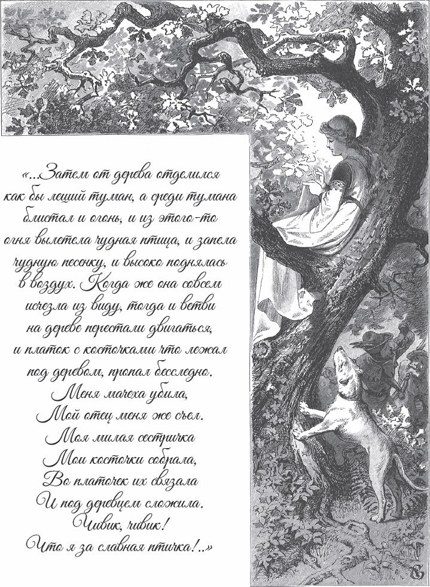

## Vom Wacholderbaum

Das ist nun schon lange her, wohl zweitausend Jahre. Da war ein reicher Mann, der hatte eine schöne, fromme Frau. Sie hatten sich beide sehr lieb, aber sie hatten keine Kinder. Sie wünschen sich so sehr Kinder! Die Frau betet Tag und Nacht darum, aber sie bekommen keins und bekommen keins.

Vor ihrem Haus ist ein Hof. Dort steht ein <abbr title="der Wacholderbaum, die Wacholderbäume — можжевельник">Wacholderbaum</abbr>. Auf Plattdeutsch, der alten Sprache von Norddeutschland, heißt er «Machandelboom». Eines Tages im Winter steht die Frau unter dem Baum und <abbr title="schälen — чистить (от кожуры)">schält</abbr> einen Apfel. Beim Schälen schneidet sie sich in den Finger, und das Blut fällt in den <abbr title="der Schnee — снег">Schnee</abbr>.

— Ach, — sagt die Frau und seufzt tief. Sie sieht das Blut vor sich an und ist ganz <abbr title="wehmütig — печальный, тоскливый">wehmütig</abbr>. — Ich möchte so gern ein Kind haben, so rot wie Blut und so weiß wie Schnee!

Als sie das sagt, wird ihr ganz froh <abbr title="zumute sein — быть на душе">zumute</abbr>. Sie hat das <abbr title="das Gefühl, die Gefühle — чувство">Gefühl</abbr>: Der Wunsch wird <abbr title="wahr werden — сбываться">wahr</abbr>. Dann geht sie ins Haus.

Ein Monat geht vorbei, und der Schnee schmilzt. Zwei Monate, und alles ist grün. Drei Monate, und die Blumen kommen aus der Erde. Vier Monate, und alle Bäume im Wald werden <abbr title="dicht — густой">dicht</abbr>. Die grünen Zweige wachsen ineinander. Die Vögel singen, dass der ganze Wald schallt, und die <abbr title="die Blüte, die Blüten — цветок, цвет (дерева)">Blüten</abbr> fallen von den Bäumen. Dann ist der fünfte Monat vorbei. Die Frau steht unter dem Wacholderbaum. Er <abbr title="duften — благоухать">duftet</abbr> so schön. Da springt ihr das Herz vor Freude, und sie fällt auf die Knie und ist ganz außer sich.

Als der sechste Monat vorbei ist, werden die Früchte dick und fest. Da wird die Frau ganz still. Im siebten Monat greift sie nach den <abbr title="die Wacholderbeere, die Wacholderbeeren — ягода можжевельника">Wacholderbeeren</abbr> und isst sie ganz gierig. Da wird sie traurig und krank. Dann geht der achte Monat vorbei. Sie ruft ihren Mann, weint und sagt:

— Wenn ich sterbe, dann begrab mich unter dem Wacholderbaum.

Danach ist sie ganz <abbr title="getröstet — утешенный, успокоенный">getröstet</abbr> und froh. Dann ist der neunte Monat vorbei. Sie bekommt ein Kind, so weiß wie Schnee und so rot wie Blut. Als sie das Kind sieht, freut sie sich so sehr, dass sie stirbt.

Ihr Mann begräbt sie unter dem Wacholderbaum. Er weint sehr, sehr lange. Nach einer Zeit weint er schon etwas weniger. Nach noch mehr Zeit hört er ganz auf. Und nach noch einer Zeit nimmt er sich eine neue Frau.

Mit der zweiten Frau bekommt er eine Tochter. Das Kind von der ersten Frau ist ein kleiner Sohn. Er ist so rot wie Blut und so weiß wie Schnee. Wenn die Frau ihre Tochter ansieht, dann hat sie sie sehr lieb. Aber wenn sie den kleinen Jungen ansieht, dann tut es ihr im Herzen weh. Sie hat das Gefühl, er steht ihr überall im Weg. Sie denkt immer nur daran: Wie kann ihre Tochter das ganze <abbr title="das Vermögen — состояние, богатство">Vermögen</abbr> bekommen? Und der Böse gibt ihr den Gedanken ein, dass sie den kleinen Jungen hasst. Sie stößt ihn von einer Ecke in die andere. Sie <abbr title="puffen — пихать, тузить">pufft</abbr> ihn hier und <abbr title="knuffen — толкать, пихать (кулаком)">knufft</abbr> ihn dort. So hat das arme Kind immer Angst. Wenn er aus der Schule kommt, hat er keinen ruhigen Platz.

Einmal ist die Frau oben in der Kammer. Da kommt die kleine Tochter auch herauf und sagt:

— Mutter, gib mir einen Apfel.

— Ja, mein Kind, — sagt die Frau und gibt ihr einen schönen Apfel aus der Truhe. Die Truhe hat einen großen, schweren Deckel mit einem großen, scharfen Schloss aus Eisen.

— Mutter, — sagt die kleine Tochter, — soll der Bruder nicht auch einen haben?

Das ärgert die Frau. Trotzdem sagt sie:

— Ja, wenn er aus der Schule kommt.

Da sieht sie durch das Fenster, dass er kommt. Und es ist so, als ob der Böse über sie kommt. Sie reißt ihrer Tochter den Apfel wieder aus der Hand und sagt:

— Du bekommst keinen Apfel vor dem Bruder.

Sie wirft den Apfel in die Truhe und macht die Truhe zu. Da kommt der kleine Junge zur Tür herein. Der Böse gibt ihr ein, dass sie freundlich zu ihm sagt:

— Mein Sohn, willst du einen Apfel haben?

Dabei sieht sie ihn so wild an.

— Mutter, — sagt der kleine Junge, — wie grässlich du aussiehst! Ja, gib mir einen Apfel.

Da hat sie das Gefühl, sie muss ihn <abbr title="überreden — уговорить">überreden</abbr>.

— Komm mit mir, — sagt sie und macht den Deckel auf. — Hol dir einen Apfel heraus.

Der kleine Junge bückt sich in die Truhe. Da packt sie der Böse, und – <abbr title="ratsch! — бах! хрясь!">ratsch</abbr>! – sie schlägt den Deckel zu. Der Kopf fliegt ab und fällt unter die roten Äpfel.

Da bekommt sie große Angst und denkt: «Wie kann ich das loswerden? Niemand darf es wissen!» Sie geht nach oben in ihr Zimmer zu ihrer <abbr title="die Kommode, die Kommoden — комод">Kommode</abbr>. Aus der obersten Schublade holt sie ein weißes Tuch. Sie setzt den Kopf wieder auf den Hals und bindet das <abbr title="das Halstuch, die Halstücher — шейный платок">Halstuch</abbr> so herum, dass man nichts sehen kann. Dann setzt sie den Jungen vor die Tür auf einen Stuhl und gibt ihm den Apfel in die Hand.

Danach kommt Marlenchen zu ihrer Mutter in die Küche. Die Mutter steht am Feuer. Vor ihr steht ein Topf mit heißem Wasser, und sie <abbr title="umrühren — помешивать">rührt</abbr> immer um.

— Mutter, — sagt Marlenchen, — der Bruder sitzt vor der Tür. Er sieht ganz weiß aus und hat einen Apfel in der Hand. Ich habe ihn gebeten: «Gib mir den Apfel.» Aber er antwortet mir nicht. Da ist mir ganz unheimlich geworden.

— Geh noch einmal hin, — sagt die Mutter. — Und wenn er dir nicht antwortet, dann gib ihm eine Ohrfeige.

Da geht Marlenchen hin und sagt:

— Bruder, gib mir den Apfel.

Aber er schweigt. Da gibt sie ihm eine Ohrfeige, und der Kopf fällt herunter. Marlenchen erschrickt und fängt an zu weinen und zu schreien. Sie läuft zu ihrer Mutter und sagt:

— Ach, Mutter, ich habe meinem Bruder den Kopf abgeschlagen!

Und sie weint und weint und will sich nicht beruhigen.

— Marlenchen, — sagt die Mutter, — was hast du getan! Aber sei still! Kein Mensch darf es merken. Ändern kann man es jetzt sowieso nicht mehr. Wir kochen ihn als <abbr title="das Schwarzsauer — «чёрная кислая похлёбка» (блюдо с кровью и уксусом)">Schwarzsauer</abbr>.

Da nimmt die Mutter den kleinen Jungen und hackt ihn in Stücke. Sie tut die Stücke in den Topf und kocht ihn als Schwarzsauer. Aber Marlenchen steht dabei und weint und weint. Die Tränen fallen alle in den Topf, und sie brauchen gar kein Salz.

Da kommt der Vater nach Hause, setzt sich an den Tisch und sagt:

— Wo ist denn mein Sohn?

Die Mutter bringt eine große, große Schüssel mit Schwarzsauer. Marlenchen weint und kann nicht aufhören. Wieder sagt der Vater:

— Wo ist denn mein Sohn?

— Ach, — sagt die Mutter, — er ist über Land gegangen, zum <abbr title="der Großonkel, die Großonkel — двоюродный дед">Großonkel</abbr> von Mütten. Er will eine Weile dort bleiben.

— Was macht er denn dort? Und er hat mir nicht einmal <abbr title="tschüs — пока, до свидания">Tschüs</abbr> gesagt!

— Oh, er wollte so gern hin. Er hat mich gefragt, ob er sechs Wochen dort bleiben kann. Er ist dort ja gut <abbr title="gut aufgehoben sein — быть в надёжных руках">aufgehoben</abbr>.

— Ach, — sagt der Mann, — ich bin so traurig. Das ist doch nicht richtig. Er muss mir doch Tschüs sagen!

Dabei fängt er an zu essen und sagt:

— Marlenchen, warum weinst du? Der Bruder kommt bestimmt wieder.

Dann sagt er:

— Ach, Frau, wie gut mir das Essen schmeckt! Gib mir mehr!

Und je mehr er isst, desto mehr will er haben. Er sagt:

— Gebt mir mehr, ihr sollt nichts davon bekommen. Es ist so, als ob das alles mir gehört.

Und er isst und isst, und die Knochen wirft er alle unter den Tisch, bis er alles aufgegessen hat.

Marlenchen aber geht zu ihrer Kommode. Aus der untersten Schublade nimmt sie ihr bestes seidenes Tuch. Sie holt alle <abbr title="das Beinchen, die Beinchen — косточка (букв. ножка)">Beinchen</abbr> und Knochen unter dem Tisch hervor und bindet sie in das seidene Tuch. Sie trägt sie vor die Tür und weint blutige Tränen. Dort legt sie die Knochen unter den Wacholderbaum ins grüne Gras. Als sie sie dort hingelegt hat, ist ihr auf einmal ganz leicht ums Herz, und sie weint nicht mehr.

Da fängt der Wacholderbaum an, sich zu bewegen. Seine Zweige gehen immer auseinander und dann wieder zusammen. Es sieht aus, als ob sich jemand richtig freut und in die Hände klatscht. Dann kommt ein <abbr title="der Nebel — туман">Nebel</abbr> aus dem Baum. Mitten im Nebel brennt es wie Feuer. Und aus dem Feuer fliegt ein schöner Vogel heraus. Er singt so herrlich und fliegt hoch in die Luft. Als er weg ist, ist der Wacholderbaum wieder wie vorher. Aber das Tuch mit den Knochen ist weg. Marlenchen ist so leicht ums Herz und so vergnügt, als ob der Bruder noch lebt. Ganz fröhlich geht sie wieder ins Haus, setzt sich an den Tisch und isst.

Der Vogel aber fliegt weg. Er setzt sich auf das Haus von einem Goldschmied und fängt an zu singen:

> «Mein Mutter, der mich schlacht,  
> mein Vater, der mich aß,  
> mein Schwester, der Marlenichen,  
> sucht alle meine Benichen,  
> bindt sie in ein seiden Tuch,  
> legt's unter den <abbr title="der Machandelbaum (= der Wacholderbaum) — можжевельник">Machandelbaum</abbr>.  
> <abbr title="kiwitt — кивитт (птичий крик)">Kywitt</abbr>, kywitt, wat vör'n schöön Vagel bün ik!»

Die letzte Zeile ist Plattdeutsch. Sie heißt: «Kiwitt, kiwitt, was für ein schöner Vogel bin ich!»

Der Goldschmied sitzt in seiner Werkstatt und macht eine goldene Kette. Da hört er den Vogel. Der Vogel sitzt auf seinem Dach und singt, und das findet er so schön. Er steht auf. Als er über die Schwelle geht, verliert er einen Pantoffel. Aber er geht trotzdem mitten auf die Straße, mit einem Pantoffel und einer <abbr title="die Socke, die Socken — носок">Socke</abbr>. Er hat seine Schürze um. In der einen Hand hat er die goldene Kette, in der anderen die <abbr title="die Zange, die Zangen — щипцы, клещи">Zange</abbr>. Die Sonne scheint so hell auf die Straße. Da bleibt er stehen und sieht den Vogel an.

— Vogel, — sagt er, — wie schön kannst du singen! Sing mir das Stück noch einmal.

— Nein, — sagt der Vogel, — zweimal singe ich nicht umsonst. Gib mir die goldene Kette, dann singe ich es dir noch einmal.

— Da, — sagt der Goldschmied, — da hast du die goldene Kette. Jetzt sing mir das noch einmal.

Da kommt der Vogel und nimmt die goldene Kette in die rechte Kralle. Er setzt sich vor den Goldschmied und singt:

> «Mein Mutter, der mich schlacht,  
> mein Vater, der mich aß,  
> mein Schwester, der Marlenichen,  
> sucht alle meine Benichen,  
> bindt sie in ein seiden Tuch,  
> legt's unter den Machandelbaum.  
> Kywitt, kywitt, wat vör'n schöön Vagel bün ik!»

Dann fliegt der Vogel weg zu einem Schuster. Er setzt sich auf sein Dach und singt:

> «Mein Mutter, der mich schlacht,  
> mein Vater, der mich aß,  
> mein Schwester, der Marlenichen,  
> sucht alle meine Benichen,  
> bindt sie in ein seiden Tuch,  
> legt's unter den Machandelbaum.  
> Kywitt, kywitt, wat vör'n schöön Vagel bün ik!»

Der Schuster hört das. Er läuft in <abbr title="die Hemdsärmel (Pl.); in Hemdsärmeln — в одной рубашке (без сюртука)">Hemdsärmeln</abbr> vor seine Tür und sieht zu seinem Dach hinauf. Die Sonne blendet ihn, deshalb muss er die Hand vor die Augen halten.

— Vogel, — sagt er, — wie schön kannst du singen!

Dann ruft er in seine Tür hinein:

— Frau, komm mal heraus! Da ist ein Vogel. Sieh mal den Vogel an, der kann wirklich schön singen.

Dann ruft er seine Tochter und die Kinder, die Gesellen, den <abbr title="der Lehrjunge, die Lehrjungen — ученик (ремесленника)">Lehrjungen</abbr> und die Magd. Alle kommen auf die Straße und sehen den Vogel an. Wie schön er ist! Er hat ganz rote und grüne Federn. Um den Hals ist er wie aus reinem Gold. Und die Augen in seinem Kopf funkeln wie Sterne.

— Vogel, — sagt der Schuster, — jetzt sing mir das Stück noch einmal.

— Nein, — sagt der Vogel, — zweimal singe ich nicht umsonst. Du musst mir etwas schenken.

— Frau, — sagt der Mann, — geh auf den Dachboden. Auf dem obersten Brett steht ein Paar rote Schuhe. Bring sie herunter.

Die Frau geht hin und holt die Schuhe.

— Da, Vogel, — sagt der Mann, — jetzt sing mir das Stück noch einmal.

Da kommt der Vogel und nimmt die Schuhe in die linke Kralle. Er fliegt wieder auf das Dach und singt:

> «Mein Mutter, der mich schlacht,  
> mein Vater, der mich aß,  
> mein Schwester, der Marlenichen,  
> sucht alle meine Benichen,  
> bindt sie in ein seiden Tuch,  
> legt's unter den Machandelbaum.  
> Kywitt, kywitt, wat vör'n schöön Vagel bün ik!»

Als er <abbr title="fertig singen — допеть">fertig gesungen</abbr> hat, fliegt er weg. Die Kette hat er in der rechten Kralle und die Schuhe in der linken. Er fliegt weit weg zu einer Mühle. Die Mühle macht: «Klippe klappe, klippe klappe, klippe klappe.» In der Mühle sitzen zwanzig <abbr title="der Müllergeselle, die Müllergesellen — работник мельника">Müllergesellen</abbr>. Sie <abbr title="behauen — обтёсывать">behauen</abbr> einen Stein und hacken: «Hick hack, hick hack, hick hack.» Und die Mühle macht: «Klippe klappe, klippe klappe, klippe klappe.»

Da setzt sich der Vogel auf eine Linde vor der Mühle und singt:

«Mein Mutter, der mich schlacht,»

Da hört einer auf zu arbeiten.

«mein Vater, der mich aß,»

Da hören noch zwei auf und hören zu.

«mein Schwester, der Marlenichen,»

Da hören wieder vier auf.

> «sucht alle meine Benichen,  
> bindt sie in ein seiden Tuch,»

Jetzt hacken nur noch acht.

«legt's unter»

Jetzt nur noch fünf.

«den Machandelbaum.»

Jetzt nur noch einer.

«Kywitt, kywitt, wat vör'n schöön Vagel bün ik!»

Da hört auch der letzte auf. Er hat gerade noch das Ende gehört.

— Vogel, — sagt er, — wie schön du singst! Lass mich das auch hören. Sing es mir noch einmal.

— Nein, — sagt der Vogel, — zweimal singe ich nicht umsonst. Gib mir den Mühlstein, dann singe ich es noch einmal.

— Ja, — sagt er, — wenn er nur mir gehört, dann sollst du ihn haben.

— Ja, — sagen die anderen, — wenn er noch einmal singt, dann soll er ihn haben.

Da kommt der Vogel herunter. Alle zwanzig Müller fassen mit Balken an und <abbr title="hochheben (hob hoch, hat hochgehoben) — поднимать">heben</abbr> den Stein hoch: «Hu uh uhp, hu uh uhp, hu uh uhp!» Da steckt der Vogel den Hals durch das Loch in der Mitte und trägt den Stein wie einen Kragen. Er fliegt wieder auf den Baum und singt:

> «Mein Mutter, der mich schlacht,  
> mein Vater, der mich aß,  
> mein Schwester, der Marlenichen,  
> sucht alle meine Benichen,  
> bindt sie in ein seiden Tuch,  
> legt's unter den Machandelbaum.  
> Kywitt, kywitt, wat vör'n schöön Vagel bün ik!»

Als er fertig gesungen hat, breitet er die Flügel aus. In der rechten Kralle hat er die Kette, in der linken die Schuhe und um den Hals den Mühlstein. So fliegt er weit weg zum Haus von seinem Vater.

In der Stube sitzen der Vater, die Mutter und Marlenchen am Tisch. Der Vater sagt:

— Ach, wie leicht wird mir! Mir ist so richtig gut zumute.

— Nein, — sagt die Mutter, — mir ist so <abbr title="angst sein (+ Dat.) — быть страшно">angst</abbr>, so wie vor einem schweren Gewitter.

Marlenchen aber sitzt da und weint und weint. Da kommt der Vogel <abbr title="anfliegen (flog an, ist angeflogen) — подлетать">angeflogen</abbr>. Als er sich auf das Dach setzt, sagt der Vater:

— Ach, ich bin so <abbr title="froh — радостный">froh</abbr>, und die Sonne scheint draußen so schön. Mir ist, als ob ich einen alten Bekannten wiedersehe.

— Nein, — sagt die Frau, — mir ist so angst! Meine Zähne <abbr title="klappern — стучать (зубами)">klappern</abbr>, und in meinen Adern ist es wie Feuer.

Und sie reißt ihr Mieder auf. Marlenchen aber sitzt in einer Ecke und weint. Sie hält ihre Schürze vor die Augen und weint die Schürze ganz nass.

Da setzt sich der Vogel auf den Wacholderbaum und singt:

«Mein Mutter, der mich schlacht,»

Da hält die Mutter sich die Ohren zu und <abbr title="zukneifen (kniff zu, hat zugekniffen) — зажмуривать">kneift</abbr> die Augen zu. Sie will nichts sehen und nichts hören. Aber in ihren Ohren braust es wie der stärkste Sturm, und ihre Augen brennen und <abbr title="zucken — вспыхивать, дёргаться">zucken</abbr> wie <abbr title="der Blitz, die Blitze — молния">Blitze</abbr>.

«mein Vater, der mich aß,»

— Ach, Mutter, — sagt der Mann, — da ist ein schöner Vogel. Der singt so herrlich, die Sonne scheint so warm, und es riecht wie lauter <abbr title="der Zimt — корица">Zimt</abbr>.

«mein Schwester, der Marlenichen,»

Da legt Marlenchen den Kopf auf die Knie und weint <abbr title="ununterbrochen — не переставая">ununterbrochen</abbr>. Der Mann aber sagt:

— Ich gehe hinaus. Ich muss den Vogel aus der Nähe sehen.

— Ach, geh nicht! — sagt die Frau. — Mir ist, als ob das ganze Haus bebt und in Flammen steht.

Aber der Mann geht hinaus und sieht den Vogel an.

> «sucht alle meine Benichen,  
> bindt sie in ein seiden Tuch,  
> legt's unter den Machandelbaum.  
> Kywitt, kywitt, wat vör'n schöön Vagel bün ik!»

Dabei lässt der Vogel die goldene Kette fallen. Sie fällt dem Mann genau um den Hals und passt wunderbar.

Da geht er hinein und sagt:

— Sieh mal, was für ein schöner Vogel das ist! Er hat mir so eine schöne goldene Kette geschenkt, und er sieht so schön aus.

Die Frau aber hat solche Angst, dass sie der Länge nach in der Stube hinfällt. Ihre Haube fällt ihr vom Kopf. Da singt der Vogel wieder:

«Mein Mutter, der mich schlacht,»

— Ach, ich möchte tausend <abbr title="der Klafter, die Klafter — сажень (мера длины)">Klafter</abbr> tief unter der Erde sein! Dann muss ich das nicht hören!

«mein Vater, der mich aß,»

Da fällt die Frau wie tot zu Boden.

«mein Schwester, der Marlenichen,»

— Ach, — sagt Marlenchen, — ich gehe auch hinaus. Vielleicht schenkt mir der Vogel auch etwas.

Und sie geht hinaus.

> «sucht alle meine Benichen,  
> bindt sie in ein seiden Tuch,»

Da wirft er ihr die Schuhe herunter.

> «legt's unter den Machandelbaum.  
> Kywitt, kywitt, wat vör'n schöön Vagel bün ik!»

Da wird Marlenchen so leicht und fröhlich. Sie zieht die neuen roten Schuhe an und tanzt und springt ins Haus hinein.

— Ach, — sagt sie, — ich war so traurig, als ich hinausgegangen bin. Und jetzt ist mir so leicht! Das ist wirklich ein herrlicher Vogel. Er hat mir ein Paar rote Schuhe geschenkt.

— Nein, — sagt die Frau und springt auf. Ihre Haare <abbr title="zu Berge stehen — вставать дыбом">stehen</abbr> ihr zu Berge wie <abbr title="die Feuerflamme, die Feuerflammen — языки пламени">Feuerflammen</abbr>. — Mir ist, als ob die Welt untergeht. Ich gehe auch hinaus. Vielleicht wird mir dann leichter.

Und als sie aus der Tür kommt – ratsch! – wirft ihr der Vogel den Mühlstein auf den Kopf, und sie ist ganz <abbr title="zerquetschen — раздавить">zerquetscht</abbr>.

Der Vater und Marlenchen hören das und gehen hinaus. Da steigen <abbr title="der Rauch — дым">Rauch</abbr>, Flammen und Feuer von der Stelle auf. Und als alles vorbei ist, steht der kleine Bruder da. Er nimmt seinen Vater und Marlenchen an der Hand. Alle drei sind so richtig froh. Sie gehen ins Haus, setzen sich an den Tisch und essen.

---

### Neue Wörter

- **der Wacholderbaum, die Wacholderbäume** — можжевельник
- **schälen** — чистить (от кожуры)
- **der Schnee** — снег
- **wehmütig** — печальный, тоскливый
- **zumute sein** — быть на душе
- **das Gefühl, die Gefühle** — чувство
- **wahr werden** — сбываться
- **dicht** — густой
- **die Blüte, die Blüten** — цветок, цвет (дерева)
- **duften** — благоухать
- **die Wacholderbeere, die Wacholderbeeren** — ягода можжевельника
- **getröstet** — утешенный, успокоенный
- **das Vermögen** — состояние, богатство
- **puffen** — пихать, тузить
- **knuffen** — толкать, пихать (кулаком)
- **überreden** — уговорить
- **ratsch!** — бах! хрясь!
- **die Kommode, die Kommoden** — комод
- **das Halstuch, die Halstücher** — шейный платок
- **umrühren** — помешивать
- **das Schwarzsauer** — «чёрная кислая похлёбка» (блюдо с кровью и уксусом)
- **der Großonkel, die Großonkel** — двоюродный дед
- **tschüs** — пока, до свидания
- **gut aufgehoben sein** — быть в надёжных руках
- **das Beinchen, die Beinchen** — косточка (букв. ножка)
- **der Nebel** — туман
- **der Machandelbaum (= der Wacholderbaum)** — можжевельник
- **kiwitt** — кивитт (птичий крик)
- **die Socke, die Socken** — носок
- **die Zange, die Zangen** — щипцы, клещи
- **die Hemdsärmel (Pl.); in Hemdsärmeln** — в одной рубашке (без сюртука)
- **der Lehrjunge, die Lehrjungen** — ученик (ремесленника)
- **fertig singen** — допеть
- **der Müllergeselle, die Müllergesellen** — работник мельника
- **behauen** — обтёсывать
- **hochheben (hob hoch, hat hochgehoben)** — поднимать
- **angst sein (+ Dat.)** — быть страшно
- **anfliegen (flog an, ist angeflogen)** — подлетать
- **froh** — радостный
- **klappern** — стучать (зубами)
- **zukneifen (kniff zu, hat zugekniffen)** — зажмуривать
- **zucken** — вспыхивать, дёргаться
- **der Blitz, die Blitze** — молния
- **der Zimt** — корица
- **ununterbrochen** — не переставая
- **der Klafter, die Klafter** — сажень (мера длины)
- **zu Berge stehen** — вставать дыбом
- **die Feuerflamme, die Feuerflammen** — языки пламени
- **zerquetschen** — раздавить
- **der Rauch** — дым

[← Zurück](kapitel-46.md) · [Inhalt](README.md)
