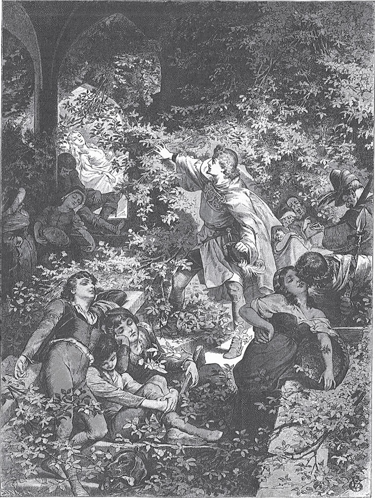

## Dornröschen

Vor langer Zeit gab es einen König und eine Königin. Jeden Tag sagen sie:

— Ach, wir hätten so gern ein Kind!

Aber sie bekommen keins. Einmal sitzt die Königin im Bad. Da kriecht ein Frosch aus dem Wasser <abbr title="ans Land — на берег">ans Land</abbr> und sagt zu ihr:

— Dein Wunsch <abbr title="in Erfüllung gehen (ging, ist gegangen) — сбываться, исполняться">geht in Erfüllung</abbr>. In einem Jahr bringst du eine Tochter zur Welt.

Und wirklich: Was der Frosch gesagt hat, das passiert. Die Königin bekommt ein Mädchen. Das Mädchen ist so schön, dass der König vor Freude außer sich ist. Er <abbr title="veranstalten — устраивать">veranstaltet</abbr> ein großes Fest. Er lädt nicht nur seine Verwandten, Freunde und Bekannten ein. Er lädt auch die <abbr title="die weise Frau, die weisen Frauen — мудрая женщина, волшебница">weisen Frauen</abbr> ein. Denn sie sollen dem Kind <abbr title="freundlich gesinnt sein — быть благосклонным">freundlich gesinnt</abbr> sein. Im Königreich gibt es dreizehn weise Frauen. Aber der König hat nur zwölf goldene <abbr title="der Teller, die Teller — тарелка">Teller</abbr>. Deshalb muss eine von ihnen zu Hause bleiben.

Das Fest ist prächtig. Am Ende <abbr title="beschenken — одаривать">beschenken</abbr> die weisen Frauen das Kind mit ihren <abbr title="die Wundergabe, die Wundergaben — чудесный дар">Wundergaben</abbr>. Die eine schenkt ihm <abbr title="die Tugend, die Tugenden — добродетель">Tugend</abbr>, die zweite Schönheit, die dritte Reichtum. So bekommt das Kind alles, was man sich auf der Welt wünschen kann. Elf Frauen haben ihre <abbr title="der Spruch, die Sprüche — изречение, заклинание">Sprüche</abbr> gerade gesagt. Da kommt plötzlich die dreizehnte herein. Sie will sich rächen, weil man sie nicht eingeladen hat. Sie grüßt niemanden, sie sieht niemanden an. Sie ruft mit lauter Stimme:

— Die Königstochter soll sich in ihrem fünfzehnten Jahr an einer <abbr title="die Spindel, die Spindeln — веретено">Spindel</abbr> <abbr title="sich stechen (stach, hat gestochen) — уколоться">stechen</abbr> und tot <abbr title="hinfallen (fiel hin, ist hingefallen) — упасть">hinfallen</abbr>!

Dann sagt sie kein Wort mehr. Sie dreht sich um und verlässt den Saal. Alle sind erschrocken. Da tritt die zwölfte weise Frau nach vorn. Sie hat ihren Wunsch noch nicht gesagt. Den bösen Spruch kann sie nicht aufheben. Sie kann ihn nur <abbr title="mildern — смягчать">mildern</abbr>. Deshalb sagt sie:

— Es soll aber kein Tod sein. Die Königstochter soll nur in einen tiefen Schlaf fallen, und der Schlaf soll hundert Jahre dauern.

Der König möchte sein liebes Kind vor diesem Unglück schützen. Er gibt den Befehl: Man soll alle Spindeln im ganzen Königreich verbrennen.

Die Gaben von den weisen Frauen gehen alle in Erfüllung. Das Mädchen ist schön, bescheiden, freundlich und klug. Jeder Mensch, der es ansieht, muss es lieb haben.

An dem Tag, an dem es fünfzehn Jahre alt wird, sind der König und die Königin nicht zu Hause. Das Mädchen ist ganz allein im Schloss. Es geht überall herum und sieht sich alle Stuben und Kammern an, wie es Lust hat. Am Ende kommt es zu einem alten Turm. Es steigt die enge <abbr title="die Wendeltreppe, die Wendeltreppen — винтовая лестница">Wendeltreppe</abbr> hinauf und kommt zu einer kleinen Tür. Im Schloss steckt ein <abbr title="verrostet — ржавый">verrosteter</abbr> Schlüssel. Das Mädchen dreht ihn um, und die Tür springt auf. In einem kleinen Zimmer sitzt eine alte Frau mit einer Spindel. Fleißig spinnt sie ihren Flachs.

— Guten Tag, altes Mütterchen, — sagt die Königstochter. — Was machst du da?

— Ich spinne, — sagt die Alte und nickt mit dem Kopf.

— Was ist das für ein Ding, das so lustig herumspringt? — fragt das Mädchen.

Sie nimmt die Spindel und will auch spinnen. Aber kaum hat sie die Spindel berührt, da geht der <abbr title="der Zauberspruch, die Zaubersprüche — заклятие">Zauberspruch</abbr> in Erfüllung. Sie sticht sich in den Finger.

In dem Augenblick, in dem sie den Stich fühlt, fällt sie auf das Bett, das dort steht. Sie liegt da und schläft tief. Und dieser Schlaf <abbr title="sich verbreiten — распространяться">verbreitet sich</abbr> über das ganze Schloss. Der König und die Königin sind gerade nach Hause gekommen und in den Saal gegangen. Jetzt schlafen sie ein, und der ganze Hofstaat mit ihnen. Es schlafen auch die Pferde im Stall, die Hunde im Hof, die Tauben auf dem Dach und die Fliegen an der Wand. Sogar das Feuer, das auf dem Herd <abbr title="flackern — мерцать, колыхаться">flackert</abbr>, wird still und schläft ein. Der Braten hört auf zu brutzeln. Der Koch will gerade den Küchenjungen an den Haaren ziehen, weil der Junge einen Fehler gemacht hat. Aber jetzt lässt er ihn los und schläft. Und der Wind <abbr title="sich legen — утихать">legt sich</abbr>, und auf den Bäumen vor dem Schloss bewegt sich kein <abbr title="das Blättchen, die Blättchen — листочек">Blättchen</abbr> mehr.

Rund um das Schloss beginnt eine Dornenhecke zu wachsen. Jedes Jahr wird sie höher. Am Ende <abbr title="umgeben (umgab, hat umgeben) — окружать">umgibt</abbr> sie das ganze Schloss und wächst sogar darüber hinaus. Man sieht nichts mehr vom Schloss, nicht einmal die Fahne auf dem Dach. Im Land erzählt man sich aber die <abbr title="die Sage, die Sagen — предание, легенда">Sage</abbr> von dem schönen, schlafenden Dornröschen. So nennt man nämlich die Königstochter. Deshalb kommen von Zeit zu Zeit Königssöhne. Sie wollen durch die Hecke in das Schloss <abbr title="eindringen (drang ein, ist eingedrungen) — проникать">eindringen</abbr>. Aber das ist nicht möglich. Die Dornen halten fest zusammen, wie Hände. Die <abbr title="der junge Mann, die jungen Männer — юноша">jungen Männer</abbr> bleiben darin hängen. Sie können sich nicht mehr <abbr title="sich befreien — освобождаться">befreien</abbr> und sterben einen elenden Tod.

Nach langen, langen Jahren kommt wieder einmal ein Königssohn in das Land. Er hört, wie ein alter Mann von der Dornenhecke erzählt. Hinter der Hecke soll ein Schloss stehen. In dem Schloss schläft schon seit hundert Jahren eine wunderschöne Königstochter. Sie heißt Dornröschen. Und mit ihr schlafen der König, die Königin und der ganze Hofstaat. Der alte Mann weiß auch von seinem <abbr title="der Großvater, die Großväter — дедушка">Großvater</abbr>: Schon viele Königssöhne sind gekommen und haben es versucht. Aber sie sind in der Dornenhecke hängen geblieben und einen traurigen Tod gestorben. Da sagt der junge Mann:

— Ich fürchte mich nicht. Ich will hinaus und das schöne Dornröschen sehen.

Der gute Alte <abbr title="abraten (riet ab, hat abgeraten) — отговаривать">rät</abbr> ihm ab, so viel er kann. Aber der Königssohn hört nicht auf ihn.

Nun sind aber gerade die hundert Jahre <abbr title="vorbei sein — пройти, закончиться">vorbei</abbr>. Heute ist der Tag, an dem Dornröschen wieder aufwachen soll. Der Königssohn <abbr title="sich nähern + Dat. — приближаться">nähert sich</abbr> der Dornenhecke. Da sind es nur große, schöne Blumen. Sie gehen von selbst <abbr title="auseinandergehen (ging auseinander, ist auseinandergegangen) — расходиться">auseinander</abbr> und lassen ihn unverletzt hindurch. Hinter ihm schließen sie sich wieder zu einer Hecke.

Im Schlosshof sieht er die Pferde und die <abbr title="gefleckt — пятнистый, пегий">gefleckten</abbr> Jagdhunde. Sie liegen da und schlafen. Auf dem Dach sitzen die Tauben und haben das <abbr title="das Köpfchen, die Köpfchen — головка">Köpfchen</abbr> unter den Flügel gesteckt. Er geht ins Haus. Dort schlafen die Fliegen an der Wand. Der Koch in der Küche hält noch die Hand <abbr title="hoch — вверх, поднятый">hoch</abbr>, als ob er den Jungen packen will. Und die Magd sitzt vor dem schwarzen Huhn. Sie wollte es gerade rupfen.

Er geht weiter. Im Saal sieht er den ganzen Hofstaat. Alle liegen da und schlafen. Und oben beim Thron liegen der König und die Königin. Er geht noch weiter. Alles ist so still, dass man seinen eigenen Atem hören kann. Endlich kommt er zu dem Turm. Er öffnet die Tür zu dem kleinen Zimmer, in dem Dornröschen schläft. Da liegt sie. Sie ist so schön, dass er die Augen nicht von ihr <abbr title="abwenden (wandte ab, hat abgewandt) — отводить">abwenden</abbr> kann. Er bückt sich und gibt ihr einen <abbr title="der Kuss, die Küsse — поцелуй">Kuss</abbr>.

Kaum hat er sie mit dem Kuss berührt, da <abbr title="die Augen aufschlagen (schlug auf, hat aufgeschlagen) — открыть глаза">schlägt</abbr> Dornröschen die Augen auf. Sie wacht auf und sieht ihn ganz freundlich an. Zusammen gehen sie die Treppe hinunter. Und der König wacht auf, und die Königin, und der ganze Hofstaat. Alle sehen sich mit großen Augen an. Die Pferde im Hof stehen auf und schütteln sich. Die Jagdhunde springen und <abbr title="wedeln (mit dem Schwanz) — вилять (хвостом)">wedeln</abbr> mit dem Schwanz. Die Tauben auf dem Dach ziehen das Köpfchen unter dem Flügel hervor, sehen sich um und fliegen ins Feld. Die Fliegen an den Wänden kriechen weiter. Das Feuer in der Küche <abbr title="sich erheben (erhob, hat erhoben) — подниматься">erhebt sich</abbr>, flackert und kocht das Essen. Der Braten fängt wieder an zu brutzeln. Der Koch gibt dem Jungen eine Ohrfeige, und der Junge schreit. Und die Magd rupft das Huhn <abbr title="fertig — до конца, готовый">fertig</abbr>.

Dann feiern der Königssohn und Dornröschen eine prächtige Hochzeit. Und sie leben glücklich <abbr title="bis an sein Lebensende — до конца своих дней">bis an ihr Ende</abbr>.

---

### Neue Wörter

- **ans Land** — на берег
- **in Erfüllung gehen (ging, ist gegangen)** — сбываться, исполняться
- **veranstalten** — устраивать
- **die weise Frau, die weisen Frauen** — мудрая женщина, волшебница
- **freundlich gesinnt sein** — быть благосклонным
- **der Teller, die Teller** — тарелка
- **beschenken** — одаривать
- **die Wundergabe, die Wundergaben** — чудесный дар
- **die Tugend, die Tugenden** — добродетель
- **der Spruch, die Sprüche** — изречение, заклинание
- **die Spindel, die Spindeln** — веретено
- **sich stechen (stach, hat gestochen)** — уколоться
- **hinfallen (fiel hin, ist hingefallen)** — упасть
- **mildern** — смягчать
- **die Wendeltreppe, die Wendeltreppen** — винтовая лестница
- **verrostet** — ржавый
- **der Zauberspruch, die Zaubersprüche** — заклятие
- **sich verbreiten** — распространяться
- **flackern** — мерцать, колыхаться
- **sich legen** — утихать
- **das Blättchen, die Blättchen** — листочек
- **umgeben (umgab, hat umgeben)** — окружать
- **die Sage, die Sagen** — предание, легенда
- **eindringen (drang ein, ist eingedrungen)** — проникать
- **der junge Mann, die jungen Männer** — юноша
- **sich befreien** — освобождаться
- **der Großvater, die Großväter** — дедушка
- **abraten (riet ab, hat abgeraten)** — отговаривать
- **vorbei sein** — пройти, закончиться
- **sich nähern + Dat.** — приближаться
- **auseinandergehen (ging auseinander, ist auseinandergegangen)** — расходиться
- **gefleckt** — пятнистый, пегий
- **das Köpfchen, die Köpfchen** — головка
- **hoch** — вверх, поднятый
- **abwenden (wandte ab, hat abgewandt)** — отводить
- **der Kuss, die Küsse** — поцелуй
- **die Augen aufschlagen (schlug auf, hat aufgeschlagen)** — открыть глаза
- **wedeln (mit dem Schwanz)** — вилять (хвостом)
- **sich erheben (erhob, hat erhoben)** — подниматься
- **fertig** — до конца, готовый
- **bis an sein Lebensende** — до конца своих дней

[← Zurück](kapitel-49.md) · [Inhalt](README.md)
