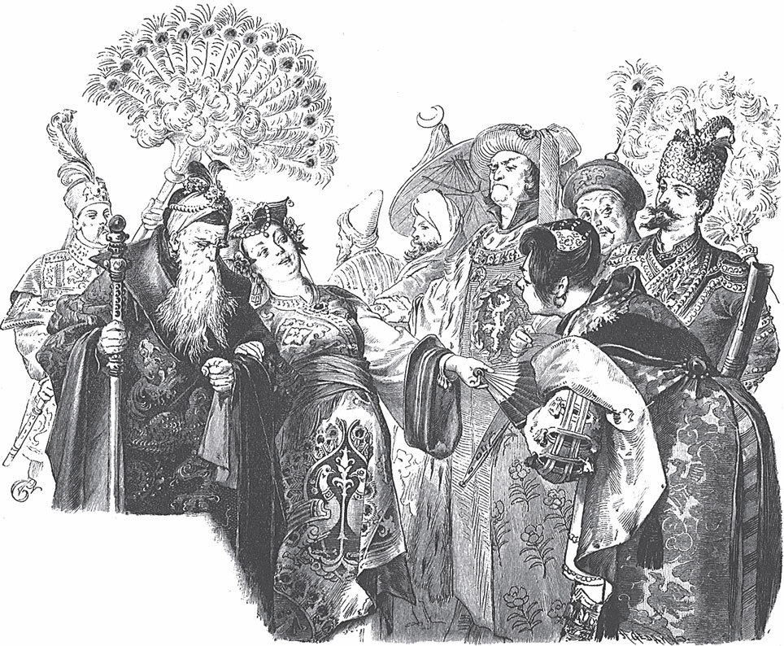

## König Drosselbart

Ein König hat eine Tochter. Sie ist <abbr title="über alle Maßen — сверх всякой меры, необычайно">über alle Maßen</abbr> schön. Aber sie ist auch so stolz und hochmütig, dass ihr kein Freier gut genug ist. Sie <abbr title="abweisen (wies ab, hat abgewiesen) — отвергать, отказывать">weist</abbr> einen nach dem anderen ab, und sie <abbr title="sich lustig machen über + Akk. — насмехаться над">macht sich</abbr> auch noch über sie lustig.

Einmal veranstaltet der König ein großes Fest. Er lädt alle Männer aus der Nähe und aus der Ferne ein, die heiraten möchten. Sie stehen alle in einer Reihe, nach ihrem <abbr title="der Rang, die Ränge — чин, ранг">Rang</abbr>: zuerst die Könige, dann die Herzöge, die Fürsten, die Grafen und die <abbr title="der Freiherr, die Freiherren — барон">Freiherren</abbr>, und am Ende die <abbr title="die Edelleute (Pl.) — дворяне">Edelleute</abbr>. Man führt die Königstochter durch die Reihen. Aber an jedem hat sie etwas zu <abbr title="kritisieren — критиковать, находить изъяны">kritisieren</abbr>. Der eine ist ihr zu dick.

— Das <abbr title="das Weinfass, die Weinfässer — винная бочка">Weinfass</abbr>! — sagt sie.

Der zweite ist zu lang.

— Lang und <abbr title="schwank (alt) — гибкий, шаткий">schwank</abbr> hat keinen Gang.

Der dritte ist zu kurz.

— Kurz und dick hat kein <abbr title="das Geschick — ловкость, сноровка">Geschick</abbr>.

Der vierte ist zu blass.

— Der <abbr title="bleich — бледный">bleiche</abbr> Tod!

Der fünfte ist zu rot.

— Der <abbr title="der Zinshahn, die Zinshähne — петух, которого отдают в уплату подати">Zinshahn</abbr>!

Der sechste ist nicht gerade genug.

— Grünes Holz, hinterm Ofen getrocknet!

So findet sie an jedem etwas Schlechtes. Besonders lacht sie über einen guten König. Er steht ganz oben in der Reihe, und sein Kinn ist ein bisschen <abbr title="krumm — кривой">krumm</abbr> gewachsen.

— Ha! — ruft sie und lacht. — Der hat ja ein Kinn wie die <abbr title="die Drossel, die Drosseln — дрозд">Drossel</abbr> einen Schnabel!

Seit dieser Zeit heißt er Drosselbart.

Der alte König sieht: Seine Tochter macht nichts anderes, als über die Leute zu <abbr title="spotten über + Akk. — насмехаться, издеваться">spotten</abbr>. Alle Freier, die gekommen sind, verachtet sie. Da wird er zornig. Er schwört: Sie soll den ersten Bettler heiraten, der an seine Tür kommt.

Ein paar Tage später singt ein Spielmann unter dem Fenster. Er möchte ein kleines Almosen bekommen. Der König hört ihn und sagt:

— Lasst ihn heraufkommen!

Da kommt der Spielmann in seinen schmutzigen, <abbr title="zerlumpt — оборванный, в лохмотьях">zerlumpten</abbr> Kleidern herein. Er singt vor dem König und seiner Tochter. Als er fertig ist, <abbr title="bitten um + Akk. (bat, hat gebeten) — просить о">bittet</abbr> er um eine kleine <abbr title="die Gabe, die Gaben — дар, подаяние">Gabe</abbr>. Der König sagt:

— Dein Lied hat mir so gut gefallen, dass ich dir meine Tochter zur Frau gebe.

Die Königstochter erschrickt. Aber der König sagt:

— Ich habe einen <abbr title="der Eid, die Eide — клятва">Eid</abbr> geschworen: Ich gebe dich dem ersten Bettler, der kommt. Und diesen Eid will ich auch halten.

Da hilft kein <abbr title="der Widerspruch, die Widersprüche — возражение">Widerspruch</abbr>. Man holt den Pfarrer, und sie muss den Spielmann sofort heiraten. Danach sagt der König:

— Jetzt bist du eine <abbr title="die Bettlerfrau, die Bettlerfrauen — нищенка">Bettlerfrau</abbr>. Es gehört sich nicht, dass du noch länger in meinem Schloss bleibst. Geh nur mit deinem Mann fort.

Der Bettler nimmt sie an der Hand und führt sie hinaus. Sie muss mit ihm zu Fuß gehen. Sie kommen in einen großen Wald. Da fragt sie:

> «Ach, wem gehört der schöne Wald?»  
> «Der gehört dem König Drosselbart;  
> hättst du'n genommen, so wär er dein.»  
> «Ich arme Jungfer zart,  
> ach, hätt ich genommen den König Drosselbart!»

Dann gehen sie über eine Wiese. Da fragt sie wieder:

> «Wem gehört die schöne grüne Wiese?»  
> «Sie gehört dem König Drosselbart;  
> hättst du'n genommen, so wär sie dein.»  
> «Ich arme Jungfer zart,  
> ach, hätt ich genommen den König Drosselbart!»

Dann kommen sie durch eine große Stadt. Da fragt sie wieder:

> «Wem gehört diese schöne große Stadt?»  
> «Sie gehört dem König Drosselbart;  
> hättst du'n genommen, so wär sie dein.»  
> «Ich arme Jungfer zart,  
> ach, hätt ich genommen den König Drosselbart!»

— Das gefällt mir gar nicht, — sagt der Spielmann. — Immer wünschst du dir einen anderen Mann. Bin ich dir nicht gut genug?

Endlich kommen sie zu einem ganz kleinen Häuschen. Da sagt sie:

> «Ach Gott, was ist das Haus so klein!  
> Wem mag das elende, <abbr title="winzig — крошечный">winzige</abbr> Häuschen sein?»

Der Spielmann antwortet:

— Das ist mein und dein Haus. Hier wohnen wir zusammen.

Die Tür ist so <abbr title="niedrig — низкий">niedrig</abbr>, dass sie sich bücken muss. Dann fragt die Königstochter:

— Wo sind die Diener?

— Was, Diener! — antwortet der Bettler. — Was du haben willst, musst du selbst machen. Mach gleich Feuer an und stell Wasser auf. Du sollst mir mein Essen kochen. Ich bin ganz müde.

Aber die Königstochter weiß nichts vom Feuermachen und vom Kochen. Der Bettler muss selbst <abbr title="mithelfen (half mit, hat mitgeholfen) — помогать">mithelfen</abbr>, und so geht es <abbr title="einigermaßen — кое-как, более-менее">einigermaßen</abbr>. Sie essen das <abbr title="karg — скудный">karge</abbr> Essen und gehen ins Bett. Aber am Morgen jagt er sie schon ganz früh aus dem Bett. Denn sie soll das Haus <abbr title="in Ordnung halten — содержать в порядке">in Ordnung halten</abbr>.

Ein paar Tage leben sie so, <abbr title="schlecht und recht — кое-как, худо-бедно">schlecht und recht</abbr>. Dann haben sie ihren Vorrat aufgegessen. Da sagt der Mann:

— Frau, so geht es nicht weiter. Wir essen hier und verdienen nichts. Du sollst Körbe flechten.

Er geht hinaus, schneidet <abbr title="die Weidenrute, die Weidenruten — ивовый прут">Weidenruten</abbr> und bringt sie nach Hause. Sie fängt an zu flechten. Aber die harten Ruten zerstechen ihr die zarten Hände.

— Ich sehe, das geht nicht, — sagt der Mann. — Spinn lieber. Vielleicht kannst du das besser.

Sie setzt sich hin und versucht zu spinnen. Aber der harte Faden schneidet ihr bald in die weichen Finger, und das Blut läuft herunter.

— Siehst du, — sagt der Mann, — du <abbr title="taugen zu + Dat. — годиться для">taugst</abbr> zu keiner Arbeit. Mit dir habe ich Pech gehabt. Jetzt versuche ich es mit einem Handel. Ich verkaufe Töpfe und Geschirr aus <abbr title="der Ton — глина">Ton</abbr>. Du sollst dich auf den Markt setzen und die Ware verkaufen.

«Ach», denkt sie, «wenn Leute aus dem Reich von meinem Vater auf den Markt kommen! Sie sehen mich da sitzen und Töpfe verkaufen. Wie werden sie über mich lachen!»

Aber es hilft nichts. Sie muss gehorchen, denn sie wollen nicht verhungern. Beim ersten Mal geht es gut. Die Frau ist schön, und deshalb kaufen die Leute gern bei ihr. Sie bezahlen, was sie verlangt. Viele geben ihr sogar das Geld und lassen ihr die Töpfe noch dazu. Von diesem Geld leben die beiden, solange es reicht. Dann kauft der Mann wieder eine Menge neues Geschirr. Sie setzt sich damit an eine Ecke vom Markt und stellt alles um sich herum.

Da kommt plötzlich ein betrunkener <abbr title="der Husar, die Husaren — гусар">Husar</abbr> <abbr title="angeritten kommen — прискакать">angeritten</abbr>. Er reitet direkt in die Töpfe hinein, und alles zerspringt in tausend Scherben. Sie fängt an zu weinen. Vor Angst weiß sie nicht, was sie tun soll.

— Ach, was wird jetzt mit mir? — ruft sie. — Was wird mein Mann dazu sagen!

Sie läuft nach Hause und erzählt ihm von dem Unglück.

— Wer setzt sich denn mit Geschirr aus Ton an die Ecke vom Markt! — sagt der Mann. — Hör auf zu weinen. Ich sehe schon, du bist für keine ordentliche Arbeit zu gebrauchen. Ich war im Schloss von unserem König. Ich habe gefragt, ob sie eine Küchenmagd brauchen. Sie haben mir versprochen, dass sie dich nehmen. Dafür bekommst du dein Essen umsonst.

So wird die Königstochter eine Küchenmagd. Sie muss dem Koch helfen und die <abbr title="schwer — тяжёлый">schwerste</abbr> Arbeit machen. In ihren beiden Taschen bindet sie ein Töpfchen fest. Darin trägt sie die <abbr title="der Rest, die Reste — остаток, объедки">Reste</abbr> nach Hause, die sie bekommt. Davon leben die beiden.

Eines Tages feiert man die Hochzeit vom ältesten Königssohn. Die arme Frau geht hinauf und stellt sich vor die Tür vom Saal. Sie will zusehen. Man zündet die Lichter an. Die Gäste kommen herein, einer schöner als der andere. Alles ist voller Pracht und Herrlichkeit. Da denkt sie mit traurigem Herzen an ihr Schicksal. Sie <abbr title="verfluchen — проклинать">verflucht</abbr> ihren Stolz und ihren Hochmut. Denn ihr Hochmut hat sie so tief <abbr title="erniedrigen — унижать">erniedrigt</abbr> und so arm gemacht.

Die Diener tragen <abbr title="köstlich — изысканный, вкусный">köstliche</abbr> <abbr title="die Speise, die Speisen — кушанье, блюдо">Speisen</abbr> hinein und hinaus. Der Duft steigt bis zu ihr hinauf. Manchmal werfen ihr die Diener ein paar <abbr title="der Brocken, die Brocken — кусок, объедок">Brocken</abbr> zu. Sie tut sie in ihr Töpfchen und will sie nach Hause tragen.

Auf einmal kommt der Königssohn herein. Er trägt Samt und Seide und hat goldene Ketten um den Hals. Er sieht die schöne Frau in der Tür stehen. Er nimmt sie bei der Hand und will mit ihr tanzen. Aber sie weigert sich und erschrickt. Denn sie sieht: Das ist König Drosselbart! Er hat um sie <abbr title="werben um + Akk. (warb, hat geworben) — свататься к">geworben</abbr>, und sie hat ihn mit Spott abgewiesen. Sie wehrt sich, aber es hilft nichts. Er zieht sie in den Saal. Da reißt das Band, an dem die Taschen hängen. Die Töpfe fallen heraus, die Suppe fließt auf den Boden, und die Brocken springen herum. Die Leute sehen das, und alle fangen an zu lachen und zu spotten. Sie schämt sich so sehr. Am liebsten möchte sie tausend Klafter tief unter der Erde sein.

Sie springt zur Tür hinaus und will fliehen. Aber auf der Treppe holt ein Mann sie ein und bringt sie zurück. Sie sieht ihn an, und es ist wieder König Drosselbart. Er spricht freundlich mit ihr:

— Hab keine Angst. Ich und der Spielmann, der mit dir in dem elenden Häuschen gewohnt hat, wir sind <abbr title="ein und derselbe — один и тот же">ein und derselbe</abbr>. Dir <abbr title="jemandem zuliebe — ради кого-то">zuliebe</abbr> habe ich mich <abbr title="sich verkleiden — переодеваться">verkleidet</abbr>. Und der Husar, der dir die Töpfe kaputt geritten hat, war auch ich. Das alles habe ich getan, weil dein stolzer <abbr title="der Sinn — нрав">Sinn</abbr> sich beugen sollte. Ich wollte dich für deinen Hochmut bestrafen, denn du hast mich verspottet.

Da weint sie bitterlich und sagt:

— Ich war sehr ungerecht. Ich bin es nicht <abbr title="wert sein — быть достойным">wert</abbr>, deine Frau zu sein.

Er aber sagt:

— Tröste dich. Die bösen Tage sind vorbei. Jetzt feiern wir unsere Hochzeit.

Da kommen die Kammerfrauen und ziehen ihr die prächtigsten Kleider an. Ihr Vater kommt, und der ganze Hof. Alle wünschen ihr Glück zu ihrer Hochzeit mit König Drosselbart. Und jetzt erst fängt die richtige Freude an. Schade, dass du und ich nicht auch dabei waren!

---

### Neue Wörter

- **über alle Maßen** — сверх всякой меры, необычайно
- **abweisen (wies ab, hat abgewiesen)** — отвергать, отказывать
- **sich lustig machen über + Akk.** — насмехаться над
- **der Rang, die Ränge** — чин, ранг
- **der Freiherr, die Freiherren** — барон
- **die Edelleute (Pl.)** — дворяне
- **kritisieren** — критиковать, находить изъяны
- **das Weinfass, die Weinfässer** — винная бочка
- **schwank (alt)** — гибкий, шаткий
- **das Geschick** — ловкость, сноровка
- **bleich** — бледный
- **der Zinshahn, die Zinshähne** — петух, которого отдают в уплату подати
- **krumm** — кривой
- **die Drossel, die Drosseln** — дрозд
- **spotten über + Akk.** — насмехаться, издеваться
- **zerlumpt** — оборванный, в лохмотьях
- **bitten um + Akk. (bat, hat gebeten)** — просить о
- **die Gabe, die Gaben** — дар, подаяние
- **der Eid, die Eide** — клятва
- **der Widerspruch, die Widersprüche** — возражение
- **die Bettlerfrau, die Bettlerfrauen** — нищенка
- **winzig** — крошечный
- **niedrig** — низкий
- **mithelfen (half mit, hat mitgeholfen)** — помогать
- **einigermaßen** — кое-как, более-менее
- **karg** — скудный
- **in Ordnung halten** — содержать в порядке
- **schlecht und recht** — кое-как, худо-бедно
- **die Weidenrute, die Weidenruten** — ивовый прут
- **taugen zu + Dat.** — годиться для
- **der Ton** — глина
- **der Husar, die Husaren** — гусар
- **angeritten kommen** — прискакать
- **schwer** — тяжёлый
- **der Rest, die Reste** — остаток, объедки
- **verfluchen** — проклинать
- **erniedrigen** — унижать
- **köstlich** — изысканный, вкусный
- **die Speise, die Speisen** — кушанье, блюдо
- **der Brocken, die Brocken** — кусок, объедок
- **werben um + Akk. (warb, hat geworben)** — свататься к
- **ein und derselbe** — один и тот же
- **jemandem zuliebe** — ради кого-то
- **sich verkleiden** — переодеваться
- **der Sinn** — нрав
- **wert sein** — быть достойным

[← Zurück](kapitel-51.md) · [Inhalt](README.md)
