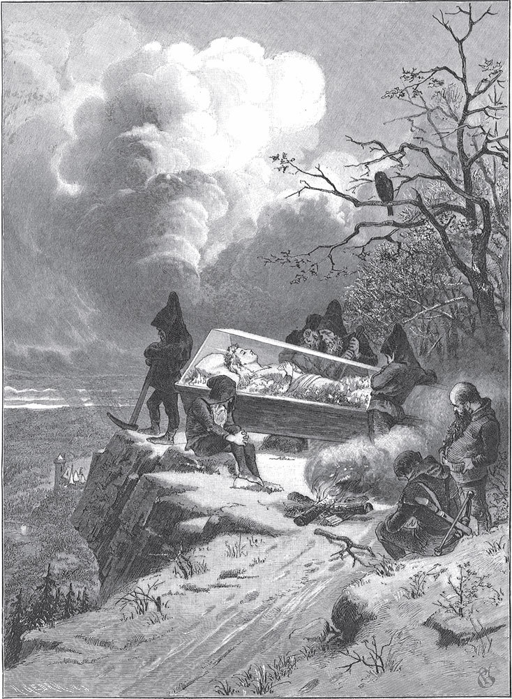

## Schneewittchen

Es war einmal mitten im Winter. Die Schneeflocken fallen wie Federn vom Himmel. Eine Königin sitzt an einem Fenster und näht. Das Fenster hat einen <abbr title="der Rahmen, die Rahmen — рама">Rahmen</abbr> aus schwarzem Ebenholz. Während sie näht, sieht sie zum Schnee hinaus. Da sticht sie sich mit der Nadel in den Finger. Drei Tropfen Blut fallen in den Schnee. Das Rot sieht im weißen Schnee so schön aus! Da denkt sie: «Ich hätte so gern ein Kind, so weiß wie Schnee, so rot wie Blut und so schwarz wie das Holz an dem Rahmen.»

Bald danach bekommt sie eine kleine Tochter. Das Mädchen ist so weiß wie Schnee, so rot wie Blut, und seine Haare sind so schwarz wie Ebenholz. Deshalb nennt man es Schneewittchen. Aber als das Kind geboren ist, stirbt die Königin.

Nach einem Jahr nimmt sich der König eine neue Frau. Sie ist schön, aber sie ist stolz und hochmütig. Sie erträgt es nicht, wenn jemand schöner ist als sie. Sie hat einen wunderbaren <abbr title="der Spiegel, die Spiegel — зеркало">Spiegel</abbr>. Sie stellt sich davor, betrachtet sich darin und fragt:

> «<abbr title="das Spieglein, die Spieglein — зеркальце">Spieglein</abbr>, Spieglein an der Wand,  
> wer ist die Schönste im ganzen Land?»

Dann antwortet der Spiegel:

«Frau Königin, Ihr seid die Schönste im Land.»

Da ist sie zufrieden. Denn sie weiß: Der Spiegel sagt immer die Wahrheit.

Schneewittchen aber wächst und wird immer schöner. Mit sieben Jahren ist sie so schön wie der klare Tag, und schöner als die Königin selbst. Einmal fragt die Königin wieder ihren Spiegel:

> «Spieglein, Spieglein an der Wand,  
> wer ist die Schönste im ganzen Land?»

Da antwortet er:

> «Frau Königin, Ihr seid die Schönste hier,  
> aber Schneewittchen ist tausendmal schöner als Ihr.»

Da erschrickt die Königin. Sie wird gelb und grün vor Neid. Von dieser Stunde an dreht sich ihr das Herz im Leib um, wenn sie Schneewittchen sieht. So sehr hasst sie das Mädchen. Der Neid und der Hochmut wachsen in ihrem Herzen wie <abbr title="das Unkraut — сорняк">Unkraut</abbr>, immer höher. Tag und Nacht hat sie keine Ruhe mehr. Da ruft sie einen Jäger und sagt:

— Bring das Kind hinaus in den Wald. Ich will es nicht mehr sehen. Du sollst es töten. Und als Beweis bringst du mir seine <abbr title="die Lunge, die Lungen — лёгкое">Lunge</abbr> und seine <abbr title="die Leber, die Lebern — печень">Leber</abbr> mit.

Der Jäger gehorcht und führt das Kind hinaus. Er zieht sein <abbr title="das Jagdmesser, die Jagdmesser — охотничий нож">Jagdmesser</abbr>. Er will gerade das unschuldige Herz von Schneewittchen <abbr title="durchbohren — пронзать">durchbohren</abbr>. Da fängt sie an zu weinen und sagt:

— Ach, lieber Jäger, lass mich leben! Ich laufe in den wilden Wald und komme nie mehr nach Hause.

Sie ist so schön, dass der Jäger Mitleid hat. Er sagt:

— Dann lauf, du armes Kind!

«Die wilden Tiere fressen dich ja doch bald», denkt er. Und trotzdem fällt ihm ein Stein vom Herzen, weil er sie nicht töten muss. Gerade kommt ein junges Wildschwein vorbeigesprungen. Der Jäger <abbr title="abstechen (stach ab, hat abgestochen) — заколоть">sticht</abbr> es ab, nimmt Lunge und Leber heraus und bringt sie der Königin als Beweis. Der Koch muss sie in Salz kochen. Und die boshafte Frau isst sie auf. Sie glaubt, sie isst die Lunge und die Leber von Schneewittchen.

Nun ist das arme Kind in dem großen Wald <abbr title="mutterseelenallein — совсем одна, одна-одинёшенька">mutterseelenallein</abbr>. Sie hat solche Angst, dass sie jedes Blatt an den Bäumen ansieht. Sie weiß nicht, was sie tun soll. Da fängt sie an zu laufen. Sie läuft über spitze Steine und durch Dornen. Die wilden Tiere springen an ihr vorbei, aber sie tun ihr nichts. Sie läuft, so lange ihre Füße sie tragen. Es ist schon fast Abend, da sieht sie ein kleines Häuschen. Sie geht hinein, denn sie will sich ausruhen.

In dem Häuschen ist alles klein, aber so zierlich und sauber – man kann es gar nicht sagen. Da steht ein Tischlein mit einer weißen <abbr title="die Tischdecke, die Tischdecken — скатерть">Tischdecke</abbr>. Darauf stehen sieben kleine Teller, und neben jedem Tellerlein liegt ein <abbr title="das Löffelchen, die Löffelchen — ложечка">Löffelchen</abbr>. Dazu gibt es sieben <abbr title="das Messerlein, die Messerlein — ножичек">Messerlein</abbr> und <abbr title="das Gäbelchen, die Gäbelchen — вилочка">Gäbelchen</abbr> und sieben Becherlein. An der Wand stehen sieben Bettchen nebeneinander, mit schneeweißen <abbr title="das Laken, die Laken — простыня">Laken</abbr> darauf.

Schneewittchen ist sehr hungrig und <abbr title="durstig — испытывающий жажду">durstig</abbr>. Sie isst von jedem Tellerlein ein bisschen Gemüse und Brot. Aus jedem Becherlein trinkt sie einen Tropfen Wein. Denn sie will nicht einem allein alles wegnehmen. Danach ist sie sehr müde. Sie legt sich in ein Bettchen, aber keins passt. Das eine ist zu lang, das andere zu kurz. Endlich ist das siebte richtig. Darin bleibt sie liegen. Sie betet zu Gott und schläft ein.

Als es ganz dunkel ist, kommen die <abbr title="der Herr, die Herren — хозяин, господин">Herren</abbr> von dem Häuschen nach Hause. Das sind die sieben Zwerge. Sie hacken und graben in den Bergen nach <abbr title="das Erz, die Erze — руда">Erz</abbr>. Sie zünden ihre sieben Lichtlein an. Jetzt ist es hell im Häuschen, und sie sehen: Jemand ist hier gewesen. Denn nicht alles steht so ordentlich da, wie sie es verlassen haben.

Der erste sagt:

— Wer hat auf meinem Stühlchen gesessen?

Der zweite:

— Wer hat von meinem Tellerchen gegessen?

Der dritte:

— Wer hat von meinem Brötchen genommen?

Der vierte:

— Wer hat von meinem <abbr title="das Gemüschen — овощи (ласк.)">Gemüschen</abbr> gegessen?

Der fünfte:

— Wer hat mit meinem Gäbelchen gestochen?

Der sechste:

— Wer hat mit meinem <abbr title="das Messerchen, die Messerchen — ножичек">Messerchen</abbr> geschnitten?

Der siebte:

— Wer hat aus meinem Becherlein getrunken?

Dann sieht sich der erste um. Auf seinem Bett ist eine kleine <abbr title="die Delle, die Dellen — вмятина">Delle</abbr>. Da sagt er:

— Wer ist in mein Bettchen getreten?

Die anderen kommen gelaufen und rufen:

— In meinem hat auch jemand gelegen!

Der siebte aber sieht in sein Bett, und da liegt Schneewittchen und schläft. Er ruft die anderen. Sie kommen herbeigelaufen und schreien vor Staunen. Sie holen ihre sieben Lichtlein und leuchten Schneewittchen ins Gesicht.

— Ach du lieber Gott! Ach du lieber Gott! — rufen sie. — Wie schön ist dieses Kind!

Sie freuen sich so sehr, dass sie Schneewittchen nicht aufwecken. Sie lassen sie im Bettchen weiterschlafen. Der siebte Zwerg aber schläft bei seinen Kameraden, bei jedem eine Stunde. Und dann ist die Nacht vorbei.

Am Morgen wacht Schneewittchen auf. Sie sieht die sieben Zwerge und erschrickt. Aber die Zwerge sind freundlich und fragen:

— Wie heißt du?

— Ich heiße Schneewittchen, — antwortet sie.

— Wie bist du in unser Haus gekommen? — fragen die Zwerge weiter.

Da erzählt sie ihnen alles: Ihre Stiefmutter wollte sie töten lassen. Aber der Jäger hat ihr das Leben geschenkt. Dann ist sie den ganzen Tag gelaufen, und endlich hat sie ihr Häuschen gefunden. Die Zwerge sagen:

— Willst du für uns den Haushalt machen? Willst du kochen, die Betten machen, waschen, nähen und stricken? Und willst du alles ordentlich und sauber halten? Dann kannst du bei uns bleiben, und es soll dir an nichts fehlen.

— Ja, — sagt Schneewittchen, — <abbr title="von Herzen gern — от всей души, с радостью">von Herzen gern</abbr>!

Sie bleibt bei ihnen und hält ihnen das Haus in Ordnung. Morgens gehen die Zwerge in die Berge und suchen Erz und Gold. Abends kommen sie zurück, und dann muss ihr Essen fertig sein. Den ganzen Tag ist das Mädchen allein. Deshalb <abbr title="warnen vor + Dat. — предупреждать о">warnen</abbr> die guten Zwerge sie:

— <abbr title="sich hüten vor + Dat. — остерегаться">Hüte dich</abbr> vor deiner Stiefmutter! Sie weiß bald, dass du hier bist. Lass bloß niemanden herein!

Die Königin aber glaubt, sie hat die Lunge und die Leber von Schneewittchen gegessen. Sie denkt, sie ist wieder die Erste und die Allerschönste. Sie stellt sich vor ihren Spiegel und fragt:

> «Spieglein, Spieglein an der Wand,  
> wer ist die Schönste im ganzen Land?»

Da antwortet der Spiegel:

> «Frau Königin, Ihr seid die Schönste hier,  
> aber Schneewittchen über den Bergen  
> bei den sieben Zwergen  
> ist noch tausendmal schöner als Ihr.»

Da erschrickt sie. Denn sie weiß: Der Spiegel lügt nicht. Sie merkt, dass der Jäger sie betrogen hat und dass Schneewittchen noch lebt. Sie denkt und denkt wieder nach: Wie kann sie Schneewittchen umbringen? Denn solange sie nicht die Schönste im ganzen Land ist, lässt ihr der Neid keine Ruhe.

Endlich hat sie eine Idee. Sie <abbr title="färben — красить">färbt</abbr> sich das Gesicht und zieht sich an wie eine alte <abbr title="die Händlerin, die Händlerinnen — торговка">Händlerin</abbr>. Niemand kann sie erkennen. So geht sie über die sieben Berge zu den sieben Zwergen. Sie klopft an die Tür und ruft:

— Schöne Ware! Kauft, kauft!

Schneewittchen guckt aus dem Fenster und ruft:

— Guten Tag, liebe Frau! Was habt Ihr zu verkaufen?

— Gute Ware, schöne Ware, — antwortet sie. — <abbr title="das Schnürband, die Schnürbänder — шнурок для корсета">Schnürbänder</abbr> in allen Farben!

Und sie holt eins heraus, das aus <abbr title="bunt — пёстрый, разноцветный">bunter</abbr> Seide geflochten ist. «Diese ehrliche Frau kann ich hereinlassen», denkt Schneewittchen. Sie schiebt den Riegel zurück und kauft sich das hübsche Schnürband.

— Kind, wie du aussiehst! — sagt die Alte. — Komm, ich <abbr title="schnüren — шнуровать, затягивать">schnüre</abbr> dich einmal richtig.

Schneewittchen denkt an nichts Böses. Sie stellt sich vor die Alte und lässt sich mit dem neuen Schnürband schnüren. Aber die Alte schnürt schnell und so fest, dass Schneewittchen keine Luft mehr bekommt. Sie fällt hin wie tot.

— Jetzt bist du die Schönste gewesen, — sagt die Alte und eilt hinaus.

Nicht lange danach, am Abend, kommen die sieben Zwerge nach Hause. Wie erschrecken sie! Ihr liebes Schneewittchen liegt auf dem Boden. Sie bewegt sich nicht, sie ist wie tot. Die Zwerge heben sie hoch. Sie sehen, dass sie zu fest geschnürt ist, und schneiden das Schnürband <abbr title="entzwei — пополам, надвое">entzwei</abbr>. Da fängt sie ein bisschen an zu atmen, und langsam wird sie wieder lebendig. Die Zwerge hören, was passiert ist, und sagen:

— Die alte Händlerin war niemand anders als die gottlose Königin. Hüte dich und lass keinen Menschen herein, wenn wir nicht bei dir sind!

Die böse Frau aber kommt nach Hause, geht vor den Spiegel und fragt:

> «Spieglein, Spieglein an der Wand,  
> wer ist die Schönste im ganzen Land?»

Da antwortet er wie immer:

> «Frau Königin, Ihr seid die Schönste hier,  
> aber Schneewittchen über den Bergen  
> bei den sieben Zwergen  
> ist noch tausendmal schöner als Ihr.»

Als sie das hört, <abbr title="laufen (lief, ist gelaufen) — бежать, приливать">läuft</abbr> ihr alles Blut zum Herzen, so sehr erschrickt sie. Denn sie sieht: Schneewittchen ist wieder lebendig.

— Aber jetzt, — sagt sie, — denke ich mir etwas aus, das dich <abbr title="vernichten — уничтожать, губить">vernichtet</abbr>!

Sie kennt sich mit Hexenkünsten aus. Damit macht sie einen giftigen <abbr title="der Kamm, die Kämme — гребень, расчёска">Kamm</abbr>. Dann verkleidet sie sich wieder und sieht aus wie eine andere alte Frau. So geht sie über die sieben Berge zu den sieben Zwergen, klopft an die Tür und ruft:

— Gute Ware! Kauft, kauft!

Schneewittchen schaut heraus und sagt:

— Geht nur weiter. Ich darf niemanden hereinlassen.

— Ansehen darfst du doch wohl, — sagt die Alte. Sie zieht den giftigen Kamm heraus und hält ihn hoch.

Der Kamm gefällt dem Kind so gut, dass sie sich verführen lässt und die Tür öffnet. Sie werden sich über den Preis <abbr title="sich einig werden — договориться">einig</abbr>. Dann sagt die Alte:

— Jetzt kämme ich dich einmal richtig.

Das arme Schneewittchen denkt an nichts und lässt die Alte machen. Aber kaum steckt der Kamm in den Haaren, da <abbr title="wirken — действовать">wirkt</abbr> das Gift. Das Mädchen fällt <abbr title="bewusstlos — без сознания">bewusstlos</abbr> um.

— Du <abbr title="das Wunder, die Wunder — чудо">Wunder</abbr> an Schönheit, — sagt die boshafte Frau, — jetzt ist es aus mit dir!

Und sie geht fort. Zum Glück ist es bald Abend, und die sieben Zwerge kommen nach Hause. Sie sehen Schneewittchen wie tot auf dem Boden liegen. Sofort haben sie die Stiefmutter im Verdacht. Sie suchen und finden den giftigen Kamm. Kaum haben sie ihn herausgezogen, da kommt Schneewittchen wieder zu sich. Sie erzählt, was passiert ist. Da warnen die Zwerge sie noch einmal: Sie soll <abbr title="auf der Hut sein — быть начеку">auf der Hut</abbr> sein und niemandem die Tür öffnen.

Die Königin stellt sich zu Hause vor den Spiegel und fragt:

> «Spieglein, Spieglein an der Wand,  
> wer ist die Schönste im ganzen Land?»

Da antwortet er wie vorher:

> «Frau Königin, Ihr seid die Schönste hier,  
> aber Schneewittchen über den Bergen  
> bei den sieben Zwergen  
> ist doch noch tausendmal schöner als Ihr.»

Als sie den Spiegel so sprechen hört, zittert und bebt sie vor Zorn.

— Schneewittchen soll sterben, — ruft sie, — auch wenn es mein eigenes Leben kostet!

Dann geht sie in eine ganz <abbr title="versteckt — скрытый, потайной">versteckte</abbr>, einsame Kammer. Dort kommt niemand hin. Und dort macht sie einen giftigen, giftigen Apfel. Von außen sieht er schön aus: weiß, mit roten Backen. Jeder, der ihn sieht, bekommt Appetit darauf. Aber wer ein Stückchen davon isst, muss sterben. Als der Apfel fertig ist, färbt sie sich das Gesicht. Sie verkleidet sich als Bäuerin, und so geht sie über die sieben Berge zu den sieben Zwergen.

Sie klopft an. Schneewittchen streckt den Kopf aus dem Fenster und sagt:

— Ich darf keinen Menschen hereinlassen. Die sieben Zwerge haben es mir verboten.

— Auch gut, — antwortet die Bäuerin. — Meine Äpfel werde ich schon los. Da, einen schenke ich dir.

— Nein, — sagt Schneewittchen, — ich darf nichts annehmen.

— Hast du Angst vor Gift? — fragt die Alte. — Sieh mal, ich schneide den Apfel in zwei Hälften. Die rote Backe isst du, die weiße esse ich.

Aber der Apfel ist so geschickt gemacht, dass nur die rote Backe giftig ist. Schneewittchen hat große Lust auf den schönen Apfel. Sie sieht, dass die Bäuerin davon isst. Da kann sie nicht länger widerstehen. Sie streckt die Hand hinaus und nimmt die giftige Hälfte. Aber kaum hat sie einen Bissen im Mund, da fällt sie tot auf den Boden.

Die Königin betrachtet sie mit grausamen Blicken. Sie lacht laut und sagt:

— Weiß wie Schnee, rot wie Blut, schwarz wie Ebenholz! Diesmal können die Zwerge dich nicht wieder aufwecken!

Zu Hause fragt sie den Spiegel:

> «Spieglein, Spieglein an der Wand,  
> wer ist die Schönste im ganzen Land?»

Und endlich antwortet er:

«Frau Königin, Ihr seid die Schönste im Land.»

Da hat ihr neidisches Herz Ruhe, so gut ein neidisches Herz Ruhe haben kann.

Am Abend kommen die Zwerge nach Hause. Sie finden Schneewittchen auf dem Boden. Kein Atem kommt mehr aus ihrem Mund. Sie ist tot. Die Zwerge heben sie auf. Sie suchen, ob sie etwas Giftiges finden. Sie <abbr title="aufschnüren — расшнуровывать">schnüren</abbr> sie auf, sie kämmen ihr die Haare, sie waschen sie mit Wasser und Wein. Aber nichts hilft. Das liebe Kind ist tot und bleibt tot. Sie legen sie auf eine <abbr title="die Bahre, die Bahren — носилки, одр">Bahre</abbr>. Alle sieben setzen sich daneben und beweinen sie. Drei Tage lang weinen sie.

Dann wollen sie Schneewittchen begraben. Aber sie sieht noch so frisch aus wie ein lebender Mensch. Sie hat noch ihre schönen roten Backen. Die Zwerge sagen:

— Wir können sie nicht in die schwarze Erde legen.

Sie lassen einen <abbr title="durchsichtig — прозрачный">durchsichtigen</abbr> Sarg aus Glas machen. So kann man Schneewittchen von allen Seiten sehen. Sie legen sie hinein. Mit goldenen Buchstaben schreiben sie ihren Namen darauf, und dass sie eine Königstochter ist. Dann stellen sie den Sarg hinaus auf den Berg. Einer von ihnen bleibt immer dabei und bewacht ihn. Auch die Tiere kommen und weinen um Schneewittchen: zuerst eine <abbr title="die Eule, die Eulen — сова">Eule</abbr>, dann ein Rabe, und zuletzt ein Täubchen.

Nun liegt Schneewittchen lange, lange Zeit in dem Sarg. Sie <abbr title="verwesen — разлагаться, тлеть">verwest</abbr> nicht. Sie sieht aus, als ob sie schläft. Denn sie ist noch immer so weiß wie Schnee, so rot wie Blut und so schwarzhaarig wie Ebenholz.

Eines Tages kommt ein Königssohn in den Wald. Er kommt zum Haus der Zwerge und will dort übernachten. Er sieht den Sarg auf dem Berg und das schöne Schneewittchen darin. Er liest, was mit goldenen Buchstaben darauf steht. Da sagt er zu den Zwergen:

— Gebt mir den Sarg. Ich gebe euch dafür, was ihr wollt.

Aber die Zwerge antworten:

— Wir geben ihn nicht her, nicht für alles Gold der Welt.

Da sagt er:

— Dann schenkt ihn mir. Denn ich kann nicht leben, ohne Schneewittchen zu sehen. Ich will sie <abbr title="ehren — чтить">ehren</abbr> und <abbr title="achten — уважать">achten</abbr> wie das Liebste, was ich habe.

So spricht er, und die guten Zwerge haben Mitleid mit ihm. Sie geben ihm den Sarg. Der Königssohn lässt ihn von seinen Dienern auf den Schultern forttragen. Da <abbr title="stolpern über + Akk. — спотыкаться о">stolpern</abbr> die Diener über einen Strauch. Der Sarg wackelt, und von dem Stoß rutscht das giftige Stück Apfel aus ihrem Hals. Schneewittchen hat es ja abgebissen. Bald öffnet sie die Augen. Sie hebt den Deckel vom Sarg hoch, richtet sich auf und ist wieder lebendig.

— Ach Gott, wo bin ich? — ruft sie.

Der Königssohn sagt voller Freude:

— Du bist bei mir.

Er erzählt, was passiert ist, und sagt:

— Ich habe dich lieber als alles auf der Welt. Komm mit mir in das Schloss von meinem Vater. Du sollst meine Frau werden.

Schneewittchen hat ihn auch gern und geht mit ihm. Man bereitet eine Hochzeit mit großer Pracht und Herrlichkeit vor.

Zu dem Fest lädt man aber auch die gottlose Stiefmutter von Schneewittchen ein. Sie zieht ihre schönen Kleider an. Dann tritt sie vor den Spiegel und fragt:

> «Spieglein, Spieglein an der Wand,  
> wer ist die Schönste im ganzen Land?»

Der Spiegel antwortet:

> «Frau Königin, Ihr seid die Schönste hier,  
> aber die junge Königin ist tausendmal schöner als Ihr.»

Da <abbr title="fluchen — ругаться, проклинать">flucht</abbr> die böse Frau. Sie bekommt solche Angst, solche Angst, dass sie nicht mehr weiß, was sie tun soll. Zuerst will sie gar nicht zu der Hochzeit gehen. Aber es lässt ihr keine Ruhe. Sie muss hin und die junge Königin sehen. Sie tritt in den Saal und erkennt Schneewittchen. Vor Angst und <abbr title="der Schrecken — ужас">Schrecken</abbr> steht sie da und kann sich nicht bewegen. Aber man hat schon eiserne Pantoffeln über ein <abbr title="das Kohlenfeuer, die Kohlenfeuer — огонь из углей">Kohlenfeuer</abbr> gestellt. Jetzt trägt man sie mit Zangen herein und stellt sie vor die Königin. Da muss sie in die glühenden Schuhe steigen. Und sie muss so lange tanzen, bis sie tot auf den Boden fällt.

---

### Neue Wörter

- **der Rahmen, die Rahmen** — рама
- **der Spiegel, die Spiegel** — зеркало
- **das Spieglein, die Spieglein** — зеркальце
- **das Unkraut** — сорняк
- **die Lunge, die Lungen** — лёгкое
- **die Leber, die Lebern** — печень
- **das Jagdmesser, die Jagdmesser** — охотничий нож
- **durchbohren** — пронзать
- **abstechen (stach ab, hat abgestochen)** — заколоть
- **mutterseelenallein** — совсем одна, одна-одинёшенька
- **die Tischdecke, die Tischdecken** — скатерть
- **das Löffelchen, die Löffelchen** — ложечка
- **das Messerlein, die Messerlein** — ножичек
- **das Gäbelchen, die Gäbelchen** — вилочка
- **das Laken, die Laken** — простыня
- **durstig** — испытывающий жажду
- **der Herr, die Herren** — хозяин, господин
- **das Erz, die Erze** — руда
- **das Gemüschen** — овощи (ласк.)
- **das Messerchen, die Messerchen** — ножичек
- **die Delle, die Dellen** — вмятина
- **von Herzen gern** — от всей души, с радостью
- **warnen vor + Dat.** — предупреждать о
- **sich hüten vor + Dat.** — остерегаться
- **färben** — красить
- **die Händlerin, die Händlerinnen** — торговка
- **das Schnürband, die Schnürbänder** — шнурок для корсета
- **bunt** — пёстрый, разноцветный
- **schnüren** — шнуровать, затягивать
- **entzwei** — пополам, надвое
- **laufen (lief, ist gelaufen)** — бежать, приливать
- **vernichten** — уничтожать, губить
- **der Kamm, die Kämme** — гребень, расчёска
- **sich einig werden** — договориться
- **wirken** — действовать
- **bewusstlos** — без сознания
- **das Wunder, die Wunder** — чудо
- **auf der Hut sein** — быть начеку
- **versteckt** — скрытый, потайной
- **aufschnüren** — расшнуровывать
- **die Bahre, die Bahren** — носилки, одр
- **durchsichtig** — прозрачный
- **die Eule, die Eulen** — сова
- **verwesen** — разлагаться, тлеть
- **ehren** — чтить
- **achten** — уважать
- **stolpern über + Akk.** — спотыкаться о
- **fluchen** — ругаться, проклинать
- **der Schrecken** — ужас
- **das Kohlenfeuer, die Kohlenfeuer** — огонь из углей

[← Zurück](kapitel-52.md) · [Inhalt](README.md)
