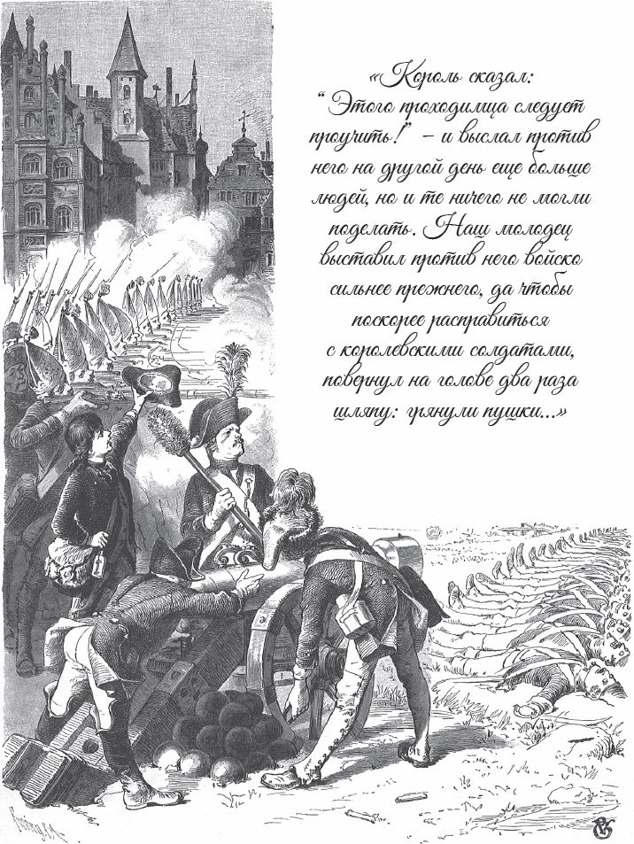

## Der Ranzen, das Hütlein und das Hörnlein

Es waren einmal drei Brüder. Sie werden immer ärmer, und am Ende ist die Not so groß, dass sie hungern müssen. Sie haben nichts mehr zu beißen und zu brechen. Da sagen sie:

— So kann es nicht bleiben. Wir gehen lieber in die Welt und suchen unser Glück.

Sie machen sich also auf den Weg. Sie gehen weite Wege, über viele, viele <abbr title="der Grashalm, die Grashalme — травинка">Grashalme</abbr>, aber das Glück begegnet ihnen nicht. Eines Tages kommen sie in einen großen Wald. Mitten im Wald steht ein Berg. Sie kommen näher und sehen: Der Berg ist ganz aus <abbr title="das Silber — серебро">Silber</abbr>. Da sagt der älteste Bruder:

— Jetzt habe ich mein Glück gefunden. Ein größeres verlange ich nicht.

Er nimmt so viel Silber, wie er tragen kann. Dann kehrt er um und geht wieder nach Hause. Die anderen beiden aber sagen:

— Wir wollen vom Glück noch etwas mehr als nur Silber.

Sie rühren das Silber nicht an und gehen weiter. Wieder gehen sie ein paar Tage. Dann kommen sie zu einem Berg, der ganz aus Gold ist. Der zweite Bruder bleibt stehen. Er denkt nach und ist unsicher.

— Was soll ich tun? — sagt er. — Soll ich mir so viel Gold nehmen, dass ich mein Leben lang genug habe? Oder soll ich weitergehen?

Endlich entscheidet er sich. Er füllt seine Taschen, so voll es geht. Er sagt seinem Bruder <abbr title="Lebewohl sagen — прощаться">Lebewohl</abbr> und geht nach Hause. Der dritte aber sagt:

— Silber und Gold, das rührt mich nicht. Ich will auf mein Glück nicht <abbr title="verzichten auf + Akk. — отказываться от">verzichten</abbr>. Vielleicht wartet etwas Besseres auf mich.

Er geht weiter. Nach drei Tagen kommt er in einen Wald. Der Wald ist noch größer als die anderen und hat gar kein Ende. Er findet nichts zu essen und nichts zu trinken, und er ist fast verhungert. Da steigt er auf einen hohen Baum. Vielleicht sieht er von oben, wo der Wald aufhört? Aber so weit er sehen kann, sieht er nur die Spitzen von den Bäumen. Er will wieder vom Baum klettern. Aber der Hunger <abbr title="quälen — мучить">quält</abbr> ihn, und er denkt: «Ach, wenn ich nur noch einmal satt werde!»

Unten unter dem Baum sieht er <abbr title="zu seinem Erstaunen — к своему удивлению">zu seinem Erstaunen</abbr> einen Tisch. Der Tisch ist voll mit Speisen, und sie <abbr title="dampfen — дымиться, источать пар">dampfen</abbr> ihm entgegen.

— Diesmal, — sagt er, — ist mein Wunsch genau zur richtigen Zeit in Erfüllung gegangen.

Er fragt nicht, wer das Essen gebracht hat und wer es gekocht hat. Er setzt sich an den Tisch und isst mit Lust, bis er satt ist. Danach denkt er: «Es ist doch schade, wenn dieses feine Tischtuch hier im Wald <abbr title="verderben (verdarb, ist verdorben) — портиться, пропадать">verdirbt</abbr>.» Er <abbr title="zusammenfalten — складывать">faltet</abbr> es ordentlich zusammen und steckt es ein.

Dann geht er weiter. Am Abend bekommt er wieder Hunger. Er will sein <abbr title="das Tüchlein, die Tüchlein — платочек, скатёрочка">Tüchlein</abbr> <abbr title="ausprobieren — испытывать, пробовать">ausprobieren</abbr>. Er breitet es aus und sagt:

— Ich wünsche mir, dass wieder gutes Essen auf dir steht.

Kaum hat er das gesagt, da stehen schon viele Schüsseln mit dem schönsten Essen darauf, so viele, wie Platz haben.

— Jetzt verstehe ich, — sagt er, — in welcher Küche man für mich kocht. Du bist mir lieber als der Berg aus Silber und Gold.

Denn er sieht: Das ist ein Tüchlein-deck-dich. Aber das Tüchlein ist ihm noch nicht genug. Er will sich noch nicht zu Hause <abbr title="sich zur Ruhe setzen — уйти на покой">zur Ruhe setzen</abbr>. Er will lieber noch in der Welt <abbr title="herumwandern — странствовать">herumwandern</abbr> und sein Glück weiter versuchen.

Eines Abends trifft er in einem einsamen Wald einen Köhler. Der Köhler ist ganz schwarz vom Staub. Er brennt dort Kohlen. Am Feuer stehen Kartoffeln, das ist sein Abendessen.

— Guten Abend, du <abbr title="die Schwarzamsel, die Schwarzamseln — чёрный дрозд">Schwarzamsel</abbr>! — sagt der junge Mann. — Wie geht es dir in deiner <abbr title="die Einsamkeit — одиночество">Einsamkeit</abbr>?

— Ein Tag wie der andere, — antwortet der Köhler, — und jeden Abend Kartoffeln. Hast du Lust darauf? Willst du mein Gast sein?

— Vielen Dank, — antwortet der <abbr title="der Wanderer, die Wanderer — путник, странник">Wanderer</abbr>. — Ich will dir dein Essen nicht wegnehmen. Du hast nicht mit einem Gast gerechnet. Aber wenn du mit mir zufrieden bist, dann lade ich dich ein.

— Wer soll dir denn kochen? — fragt der Köhler. — Ich sehe, du hast nichts bei dir. Und ein paar Stunden weit <abbr title="im Umkreis — в округе">im Umkreis</abbr> wohnt niemand, der dir etwas geben kann.

— Und trotzdem gibt es ein Essen, — antwortet er, — so gut, wie du noch keins gekostet hast.

Er holt sein Tüchlein aus dem Ranzen, breitet es auf der Erde aus und sagt:

— Tüchlein, deck dich!

Sofort steht da Gekochtes und Gebratenes. Es ist so warm, als ob es gerade aus der Küche kommt. Der Köhler macht große Augen. Aber er lässt sich nicht lange bitten. Er greift zu und schiebt immer größere Bissen in sein schwarzes Maul. Als sie fertig gegessen haben, <abbr title="schmunzeln — ухмыляться, улыбаться">schmunzelt</abbr> der Köhler und sagt:

— Hör mal, dein Tüchlein gefällt mir. Das ist genau das Richtige für mich hier im Wald. Hier kocht mir niemand etwas Gutes. Ich <abbr title="vorschlagen (schlug vor, hat vorgeschlagen) — предлагать">schlage</abbr> dir einen <abbr title="der Tausch — обмен">Tausch</abbr> vor. Da in der Ecke hängt ein <abbr title="der Soldatenranzen, die Soldatenranzen — солдатский ранец">Soldatenranzen</abbr>. Er ist alt und sieht nach nichts aus. Aber in ihm stecken wunderbare Kräfte. Ich brauche ihn nicht mehr. Ich gebe ihn dir für das Tüchlein.

— Zuerst muss ich wissen, was das für wunderbare Kräfte sind, — antwortet der Wanderer.

— Das sage ich dir, — antwortet der Köhler. — Wenn du mit der Hand darauf klopfst, kommt jedes Mal ein <abbr title="der Gefreite, die Gefreiten — ефрейтор">Gefreiter</abbr> mit sechs Mann. Sie haben Gewehre und Säbel. Und was du befiehlst, das tun sie.

— <abbr title="meinetwegen — пожалуй, ладно">Meinetwegen</abbr>, — sagt er. — Wenn es nicht anders geht, dann tauschen wir.

Er gibt dem Köhler das Tüchlein, nimmt den Ranzen vom Haken und hängt ihn sich um. Dann verabschiedet er sich. Er geht ein Stück. Dann will er die Wunderkräfte von seinem Ranzen ausprobieren und klopft darauf. Sofort stehen die sieben <abbr title="der Krieger, die Krieger — воин">Krieger</abbr> vor ihm, und der Gefreite sagt:

— Was <abbr title="wünschen — желать">wünscht</abbr> mein Herr und <abbr title="der Gebieter, die Gebieter — повелитель">Gebieter</abbr>?

— Marschiert im <abbr title="der Eilschritt — ускоренный шаг">Eilschritt</abbr> zum Köhler und holt mein Wunschtüchlein zurück!

Sie machen «<abbr title="links um! — налево кругом!">Links um</abbr>!», und gar nicht lange danach bringen sie das Tüchlein. Sie haben es dem Köhler einfach weggenommen, ohne viel zu fragen. Er schickt sie wieder weg und geht weiter. Er hofft, dass das Glück noch heller für ihn scheint.

Bei <abbr title="der Sonnenuntergang, die Sonnenuntergänge — закат">Sonnenuntergang</abbr> kommt er zu einem anderen Köhler. Der kocht sich am Feuer sein Abendessen.

— Willst du mit mir essen? — sagt der rußige Kerl. — Kartoffeln mit Salz, aber ohne <abbr title="das Schmalz — топлёный жир, сало">Schmalz</abbr>. Dann setz dich zu mir.

— Nein, — antwortet er, — diesmal sollst du mein Gast sein.

Er breitet sein Tüchlein aus, und sofort stehen die schönsten Gerichte darauf. Sie essen und trinken zusammen und sind fröhlich. Nach dem Essen sagt der Köhler:

— Da oben auf dem Brett liegt ein altes, <abbr title="abgegriffen — потёртый, засаленный">abgegriffenes</abbr> Hütlein. Das hat seltsame Eigenschaften. Wenn man es aufsetzt und auf dem Kopf <abbr title="herumdrehen — поворачивать">herumdreht</abbr>, dann schießen <abbr title="die Kanone, die Kanonen — пушка">Kanonen</abbr>, wie zwölf Stück nebeneinander. Sie schießen alles nieder, und niemand kann <abbr title="dagegen — против этого">dagegen</abbr> etwas tun. Mir <abbr title="nützen — приносить пользу">nützt</abbr> das Hütlein nichts. Für dein Tischtuch gebe ich es dir gern.

— Das <abbr title="das lässt sich hören — это другое дело, звучит неплохо">lässt sich hören</abbr>, — antwortet er.

Er nimmt das Hütlein, setzt es auf und lässt sein Tüchlein da. Aber kaum ist er ein Stück gegangen, da klopft er auf seinen Ranzen. Seine Soldaten müssen ihm das Tüchlein wieder holen. «Eins kommt zum anderen», denkt er. «Ich glaube, mein Glück ist noch nicht zu Ende.»

Und er hat recht. Er geht wieder einen Tag lang. Dann kommt er zu einem dritten Köhler. Der lädt ihn genauso wie die anderen zu Kartoffeln ohne Fett ein. Aber der Wanderer lässt ihn von seinem Wunschtüchlein mitessen. Das schmeckt dem Köhler so gut, dass er ihm am Ende ein <abbr title="das Hörnlein, die Hörnlein — рожок">Hörnlein</abbr> dafür anbietet. Das Hörnlein hat noch ganz andere Eigenschaften als das Hütlein. Wenn man hineinbläst, fallen alle Mauern und <abbr title="die Festung, die Festungen — крепость">Festungen</abbr> um, und am Ende alle Städte und Dörfer. Er gibt dem Köhler das Tüchlein dafür. Aber danach schickt er wieder seine Soldaten, und sie holen es zurück. So hat er endlich den Ranzen, das Hütlein und das Hörnlein zusammen.

— Jetzt, — sagt er, — bin ich ein <abbr title="ein gemachter Mann — человек, добившийся успеха">gemachter Mann</abbr>. Es ist Zeit, dass ich nach Hause gehe und sehe, wie es meinen Brüdern geht.

Als er nach Hause kommt, haben seine Brüder sich von ihrem Silber und Gold ein schönes Haus gebaut. Sie leben in Saus und Braus. Er geht zu ihnen hinein. Aber er trägt einen halb zerrissenen Rock, das <abbr title="schäbig — потрёпанный, убогий">schäbige</abbr> Hütlein auf dem Kopf und den alten Ranzen auf dem Rücken. Deshalb wollen sie ihn nicht als ihren Bruder <abbr title="anerkennen (erkannte an, hat anerkannt) — признавать">anerkennen</abbr>. Sie spotten und sagen:

— Du sagst, du bist unser Bruder? Unser Bruder wollte kein Silber und kein Gold. Er wollte ein besseres Glück. Der kommt bestimmt in voller Pracht als mächtiger König angefahren, nicht als Bettler!

Und sie jagen ihn aus dem Haus. Da wird er wütend. Er klopft so lange auf seinen Ranzen, bis hundertfünfzig Mann <abbr title="in Reih und Glied — в строю, шеренгами">in Reih und Glied</abbr> vor ihm stehen. Er befiehlt ihnen, das Haus von seinen Brüdern zu umzingeln. Zwei Soldaten sollen <abbr title="die Haselrute, die Haselruten — ореховый прут">Haselruten</abbr> mitnehmen. Mit den Ruten sollen sie den beiden hochmütigen Brüdern so lange das <abbr title="jemandem das Fell gerben — отлупить, выдубить шкуру">Fell gerben</abbr>, bis sie wissen, wer er ist.

Es gibt einen gewaltigen Lärm. Die Leute laufen zusammen und wollen den beiden helfen. Aber gegen die Soldaten können sie nichts tun. Endlich erfährt der König davon. Er ist verärgert und schickt einen Hauptmann mit seinen Leuten los. Der Hauptmann soll den <abbr title="der Ruhestörer, die Ruhestörer — нарушитель спокойствия">Ruhestörer</abbr> aus der Stadt jagen. Aber der Mann mit dem Ranzen hat bald noch mehr Soldaten zusammen. Sie <abbr title="zurückschlagen (schlug zurück, hat zurückgeschlagen) — отбивать, отражать">schlagen</abbr> den Hauptmann und seine Leute zurück, und sie müssen mit blutigen Nasen abziehen. Der König sagt:

— Mit diesem <abbr title="dahergelaufen — пришлый, бродяга">dahergelaufenen</abbr> Kerl werden wir schon fertig.

Am nächsten Tag schickt er noch mehr Soldaten gegen ihn. Aber sie können noch weniger tun. Der Mann stellt ihnen noch mehr Leute entgegen. Und damit er schneller fertig wird, dreht er ein paarmal sein Hütlein auf dem Kopf herum. Da fangen die schweren Kanonen an zu schießen. Die Kanonen besiegen die Leute vom König, und sie fliehen.

— Jetzt mache ich erst dann Frieden, — sagt er, — wenn der König mir seine Tochter zur Frau gibt. Und ich will in seinem Namen über das ganze Reich <abbr title="herrschen über + Akk. — властвовать, править">herrschen</abbr>.

Das lässt er dem König <abbr title="ausrichten — передавать (сообщение)">ausrichten</abbr>. Der König sagt zu seiner Tochter:

— <abbr title="Muss ist eine harte Nuss — «надо» — твёрдый орешек; против неизбежного не попрёшь">Muss ist eine harte Nuss</abbr>. Was bleibt mir anderes übrig? Ich muss tun, was er will. Wenn ich Frieden haben und die Krone auf meinem Kopf behalten will, dann muss ich dich hergeben.

Man feiert also die Hochzeit. Aber die Königstochter ist verärgert. Ihr Mann ist ein <abbr title="einfach — простой">einfacher</abbr> Mann. Er trägt einen schäbigen Hut und hat einen alten Ranzen umgehängt. Sie möchte ihn gern wieder loswerden. Tag und Nacht denkt sie nach, wie sie das machen kann. Da denkt sie: «Stecken seine Wunderkräfte vielleicht in dem Ranzen?» Sie verstellt sich und ist ganz <abbr title="zärtlich — нежный, ласковый">zärtlich</abbr> zu ihm. Als sein Herz weich geworden ist, sagt sie:

— Ach, leg doch diesen schäbigen Ranzen ab! Er macht dich so hässlich, dass ich mich für dich schämen muss.

— Liebes Kind, — antwortet er, — dieser Ranzen ist mein größter Schatz. Solange ich ihn habe, habe ich vor keiner Macht der Welt Angst.

Und er verrät ihr, welche Wunderkräfte der Ranzen hat. Da fällt sie ihm um den Hals, als ob sie ihn küssen will. Aber blitzschnell nimmt sie ihm den Ranzen von der Schulter und läuft damit fort. Sobald sie allein ist, klopft sie darauf. Sie befiehlt den Soldaten: Sie sollen ihren früheren Herrn <abbr title="festnehmen (nahm fest, hat festgenommen) — арестовывать, хватать">festnehmen</abbr> und aus dem königlichen Palast fortbringen. Die Soldaten gehorchen. Und die falsche Frau schickt noch mehr Leute hinter ihm her. Sie sollen ihn ganz aus dem Land jagen.

Jetzt ist er fast <abbr title="verloren sein — пропасть, погибнуть">verloren</abbr>. Aber er hat ja noch das Hütlein! Kaum sind seine Hände frei, da <abbr title="schwenken — махать, поворачивать">schwenkt</abbr> er es ein paarmal. Sofort fangen die Kanonen an zu donnern und schießen alles nieder. Die Königstochter muss selbst kommen und um Gnade bitten. Sie bittet so <abbr title="rührend — трогательно">rührend</abbr> und verspricht, dass sie sich <abbr title="sich bessern — исправляться">bessert</abbr>. Da lässt er sich überreden und schließt Frieden mit ihr.

Sie ist freundlich zu ihm und tut so, als ob sie ihn sehr lieb hat. Nach einiger Zeit hat sie ihn so <abbr title="betören — околдовывать, обольщать">betört</abbr>, dass er ihr ein Geheimnis verrät: Auch wenn jemand den Ranzen hat, kann er nichts gegen ihn tun, solange er das alte Hütlein noch hat. Jetzt kennt sie das Geheimnis. Sie wartet, bis er eingeschlafen ist. Dann nimmt sie ihm das Hütlein weg und lässt ihn hinaus auf die Straße werfen.

Aber er hat noch das Hörnlein. In großem Zorn bläst er mit aller Kraft hinein. Sofort fällt alles <abbr title="zusammenfallen (fiel zusammen, ist zusammengefallen) — рушиться">zusammen</abbr>: Mauern, Festungen, Städte und Dörfer. Die Steine erschlagen den König und die Königstochter. Zum Glück hört er bald auf. Denn noch ein bisschen länger, und alles liegt in <abbr title="die Trümmer (Pl.) — обломки, руины">Trümmern</abbr>, und kein Stein bleibt auf dem anderen. Jetzt wagt niemand mehr, gegen ihn zu kämpfen. Und er wird König über das ganze Reich.

---

### Neue Wörter

- **der Grashalm, die Grashalme** — травинка
- **das Silber** — серебро
- **Lebewohl sagen** — прощаться
- **verzichten auf + Akk.** — отказываться от
- **quälen** — мучить
- **zu seinem Erstaunen** — к своему удивлению
- **dampfen** — дымиться, источать пар
- **verderben (verdarb, ist verdorben)** — портиться, пропадать
- **zusammenfalten** — складывать
- **das Tüchlein, die Tüchlein** — платочек, скатёрочка
- **ausprobieren** — испытывать, пробовать
- **sich zur Ruhe setzen** — уйти на покой
- **herumwandern** — странствовать
- **die Schwarzamsel, die Schwarzamseln** — чёрный дрозд
- **die Einsamkeit** — одиночество
- **der Wanderer, die Wanderer** — путник, странник
- **im Umkreis** — в округе
- **schmunzeln** — ухмыляться, улыбаться
- **vorschlagen (schlug vor, hat vorgeschlagen)** — предлагать
- **der Tausch** — обмен
- **der Soldatenranzen, die Soldatenranzen** — солдатский ранец
- **der Gefreite, die Gefreiten** — ефрейтор
- **meinetwegen** — пожалуй, ладно
- **der Krieger, die Krieger** — воин
- **wünschen** — желать
- **der Gebieter, die Gebieter** — повелитель
- **der Eilschritt** — ускоренный шаг
- **links um!** — налево кругом!
- **der Sonnenuntergang, die Sonnenuntergänge** — закат
- **das Schmalz** — топлёный жир, сало
- **abgegriffen** — потёртый, засаленный
- **herumdrehen** — поворачивать
- **die Kanone, die Kanonen** — пушка
- **dagegen** — против этого
- **nützen** — приносить пользу
- **das lässt sich hören** — это другое дело, звучит неплохо
- **das Hörnlein, die Hörnlein** — рожок
- **die Festung, die Festungen** — крепость
- **ein gemachter Mann** — человек, добившийся успеха
- **schäbig** — потрёпанный, убогий
- **anerkennen (erkannte an, hat anerkannt)** — признавать
- **in Reih und Glied** — в строю, шеренгами
- **die Haselrute, die Haselruten** — ореховый прут
- **jemandem das Fell gerben** — отлупить, выдубить шкуру
- **der Ruhestörer, die Ruhestörer** — нарушитель спокойствия
- **zurückschlagen (schlug zurück, hat zurückgeschlagen)** — отбивать, отражать
- **dahergelaufen** — пришлый, бродяга
- **herrschen über + Akk.** — властвовать, править
- **ausrichten** — передавать (сообщение)
- **Muss ist eine harte Nuss** — «надо» — твёрдый орешек; против неизбежного не попрёшь
- **einfach** — простой
- **zärtlich** — нежный, ласковый
- **festnehmen (nahm fest, hat festgenommen)** — арестовывать, хватать
- **verloren sein** — пропасть, погибнуть
- **schwenken** — махать, поворачивать
- **rührend** — трогательно
- **sich bessern** — исправляться
- **betören** — околдовывать, обольщать
- **zusammenfallen (fiel zusammen, ist zusammengefallen)** — рушиться
- **die Trümmer (Pl.)** — обломки, руины

[← Zurück](kapitel-53.md) · [Inhalt](README.md)
