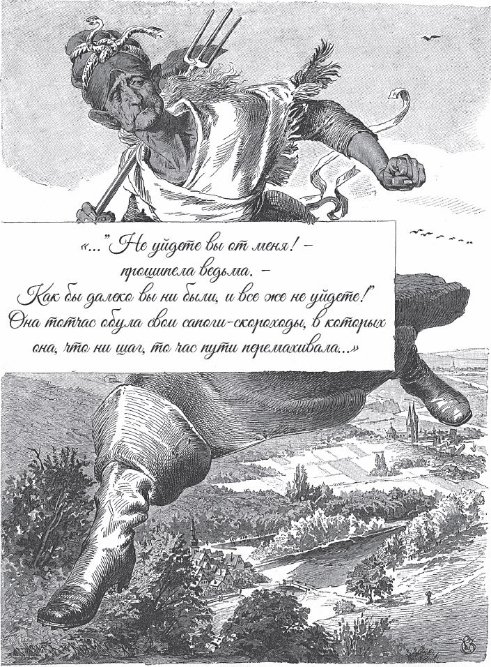

## Der Liebste Roland

Es war einmal eine Frau. Sie ist eine richtige Hexe. Sie hat zwei Töchter. Die eine ist hässlich und böse, und die liebt sie, weil sie ihre eigene Tochter ist. Die andere ist schön und gut, und die hasst sie, weil sie ihre Stieftochter ist.

Einmal hat die Stieftochter eine schöne Schürze. Die gefällt der anderen Tochter. Sie ist neidisch und sagt zu ihrer Mutter: Ich will diese Schürze haben, ich muss sie haben!

— Sei still, mein Kind, — sagt die Alte. — Du bekommst sie. Deine Stiefschwester hat schon lange den Tod verdient. Heute Nacht, wenn sie schläft, komme ich und haue ihr den Kopf ab. Pass nur auf, dass du hinten im Bett liegst, an der Wand. Und schieb sie ganz nach vorne.

Zum Glück steht das arme Mädchen gerade in einer Ecke und hört alles. Sonst ist es aus mit ihr. Den ganzen Tag darf sie nicht aus dem Haus. Und als es Zeit zum Schlafen ist, muss sie zuerst ins Bett steigen. So kann sich die andere hinten hinlegen. Aber als die andere eingeschlafen ist, schiebt das Mädchen sie <abbr title="sachte — осторожно, тихонько">sachte</abbr> nach vorne. Sie selbst nimmt den Platz hinten an der Wand.

In der Nacht schleicht die Alte herein. In der rechten Hand hält sie eine Axt. Mit der linken tastet sie zuerst: Liegt auch jemand vorne? Dann fasst sie die Axt mit beiden Händen und schlägt ihrem eigenen Kind den Kopf ab.

Als die Alte fort ist, steht das Mädchen auf. Sie geht zu ihrem <abbr title="der/die Liebste, die Liebsten — любимый, возлюбленный">Liebsten</abbr>, der Roland heißt, und klopft an seine Tür. Er kommt heraus, und sie sagt zu ihm:

— Hör zu, liebster Roland, wir müssen schnell fliehen. Die Stiefmutter wollte mich totschlagen, aber sie hat ihr eigenes Kind getroffen. Wenn der Tag kommt und sie sieht, was sie getan hat, dann sind wir verloren.

— Aber ich <abbr title="raten (riet, hat geraten) — советовать">rate</abbr> dir, — sagt Roland, — nimm ihr zuerst ihren <abbr title="der Zauberstab, die Zauberstäbe — волшебная палочка">Zauberstab</abbr> weg. Sonst können wir uns nicht <abbr title="sich retten — спасаться">retten</abbr>, wenn sie uns verfolgt.

Das Mädchen holt den Zauberstab. Dann nimmt sie den toten Kopf und lässt drei <abbr title="der Blutstropfen, die Blutstropfen — капля крови">Blutstropfen</abbr> auf den Boden tropfen: einen vor das Bett, einen in die Küche und einen auf die Treppe. Dann eilt sie mit ihrem Liebsten fort.

Am Morgen steht die alte Hexe auf. Sie ruft ihre Tochter und will ihr die Schürze geben. Aber die Tochter kommt nicht. Da ruft sie:

— Wo bist du?

— Hier auf der Treppe, ich kehre, — antwortet der erste Blutstropfen.

Die Alte geht hinaus, aber sie sieht niemanden auf der Treppe. Sie ruft wieder:

— Wo bist du?

— Hier in der Küche, ich wärme mich, — ruft der zweite Blutstropfen.

Sie geht in die Küche, aber sie findet niemanden. Da ruft sie noch einmal:

— Wo bist du?

— Ach, hier im Bett, ich schlafe, — ruft der dritte Blutstropfen.

Sie geht in die Kammer zum Bett. Und was sieht sie da? Ihr eigenes Kind liegt in seinem Blut. Sie selbst hat ihm den Kopf abgeschlagen.

Die Hexe wird wütend. Sie springt ans Fenster. Sie kann weit in die Welt schauen, und sie sieht ihre Stieftochter. Die eilt mit ihrem Liebsten Roland davon.

— Das hilft euch nichts! — ruft sie. — Auch wenn ihr schon weit weg seid, ihr entkommt mir nicht!

Sie zieht ihre <abbr title="der Meilenstiefel, die Meilenstiefel — сапоги-скороходы">Meilenstiefel</abbr> an. Mit jedem Schritt macht sie eine Stunde Weg. Es dauert nicht lange, da hat sie beide eingeholt. Aber das Mädchen sieht die Alte kommen. Mit dem Zauberstab verwandelt sie ihren Liebsten Roland in einen <abbr title="der See, die Seen — озеро">See</abbr>. Sich selbst verwandelt sie in eine Ente, die mitten auf dem See schwimmt. Die Hexe stellt sich ans Ufer. Sie wirft <abbr title="der Brotkrumen, die Brotkrumen — хлебная крошка">Brotkrumen</abbr> ins Wasser und gibt sich große Mühe, die Ente anzulocken. Aber die Ente lässt sich nicht <abbr title="locken — манить, приманивать">locken</abbr>. Am Abend muss die Alte <abbr title="unverrichteter Dinge — не солоно хлебавши, ни с чем">unverrichteter Dinge</abbr> wieder umkehren.

Dann nehmen das Mädchen und ihr Liebster Roland wieder ihre <abbr title="natürlich — естественный">natürliche</abbr> Gestalt an. Sie gehen die ganze Nacht weiter, bis zum <abbr title="der Tagesanbruch — рассвет">Tagesanbruch</abbr>. Da verwandelt sich das Mädchen in eine schöne Blume mitten in einer Dornenhecke. Ihren Liebsten Roland aber verwandelt sie in einen <abbr title="der Geigenspieler, die Geigenspieler — скрипач">Geigenspieler</abbr>.

Bald kommt die Hexe <abbr title="herangeschritten kommen — подходить (широким шагом)">herangeschritten</abbr> und sagt zu dem Spielmann:

— Lieber Spielmann, darf ich mir die schöne Blume abbrechen?

— Oh ja, — antwortet er. — Ich spiele dazu.

Hastig kriecht sie in die Hecke und will die Blume abbrechen. Denn sie weiß genau, wer die Blume ist. Da fängt er an zu spielen. Und ob sie will oder nicht, sie muss tanzen. Denn es ist ein <abbr title="der Zaubertanz, die Zaubertänze — волшебный танец">Zaubertanz</abbr>. Je schneller er spielt, desto wildere Sprünge muss sie machen. Die Dornen reißen ihr die Kleider vom Leib und stechen sie, bis sie blutig und <abbr title="wund — израненный">wund</abbr> ist. Und weil er nicht aufhört, muss sie so lange tanzen, bis sie tot liegen bleibt.

Jetzt sind die beiden erlöst. Roland sagt:

— Jetzt gehe ich zu meinem Vater und bereite die Hochzeit vor.

— Dann bleibe ich <abbr title="inzwischen — тем временем">inzwischen</abbr> hier, — sagt das Mädchen, — und warte auf dich. Und damit mich niemand erkennt, verwandle ich mich in einen roten <abbr title="der Feldstein, die Feldsteine — полевой камень, валун">Feldstein</abbr>.

Roland geht fort, und das Mädchen steht als roter Stein auf dem Feld und wartet auf ihren Liebsten. Aber als Roland nach Hause kommt, gerät er in die Falle von einer anderen Frau. Sie <abbr title="dazu bringen (brachte, hat gebracht) — заставить, довести до">bringt</abbr> ihn dazu, dass er das Mädchen vergisst. Das arme Mädchen steht lange Zeit da. Aber er kommt einfach nicht wieder. Da wird sie traurig und verwandelt sich in eine Blume. Sie denkt: «Irgendwann kommt bestimmt jemand vorbei und tritt mich tot.»

Aber dann <abbr title="hüten — пасти, стеречь">hütet</abbr> ein <abbr title="der Schäfer, die Schäfer — пастух (овец)">Schäfer</abbr> auf dem Feld seine Schafe. Er sieht die Blume. Sie ist so schön, dass er sie abbricht. Er nimmt sie mit und legt sie in seine Truhe.

Von da an passieren seltsame Dinge im Haus von dem Schäfer. Wenn er morgens aufsteht, ist schon alle Arbeit gemacht. Die Stube ist gefegt, Tisch und Bänke sind abgewischt, das Feuer im Herd brennt, und das Wasser ist geholt. Und wenn er mittags nach Hause kommt, ist der Tisch <abbr title="decken — накрывать (на стол)">gedeckt</abbr> und ein gutes Essen steht darauf. Er kann nicht begreifen, wie das passiert. Denn er sieht nie einen Menschen in seinem Haus. Und in der kleinen <abbr title="die Hütte, die Hütten — хижина">Hütte</abbr> kann sich auch niemand verstecken. Die gute <abbr title="die Bedienung — обслуживание, уход">Bedienung</abbr> gefällt ihm natürlich. Aber am Ende bekommt er doch Angst. Deshalb geht er zu einer weisen Frau und fragt sie um Rat. Die weise Frau sagt:

— Da steckt <abbr title="die Zauberei, die Zaubereien — колдовство">Zauberei</abbr> dahinter. Pass einmal ganz früh am Morgen auf, ob sich etwas in der Stube bewegt. Und wenn du etwas siehst, egal was es ist, dann wirf schnell ein weißes Tuch darüber. Dann ist der Zauber gebrochen.

Der Schäfer macht es so, wie sie gesagt hat. Am nächsten Morgen, gerade als der Tag beginnt, sieht er: Die Truhe geht auf, und die Blume kommt heraus. Schnell springt er hin und wirft ein weißes Tuch darüber. Sofort ist die <abbr title="die Verwandlung, die Verwandlungen — превращение">Verwandlung</abbr> vorbei, und ein schönes Mädchen steht vor ihm. Sie gesteht ihm: Sie war die Blume, und sie hat bis jetzt seinen Haushalt gemacht. Sie erzählt ihm ihr Schicksal. Sie gefällt ihm, und er fragt, ob sie ihn heiraten will. Aber sie antwortet:

— Nein.

Denn sie will ihrem Liebsten Roland treu bleiben. Er hat sie zwar verlassen, aber sie liebt ihn noch. Aber sie verspricht, dass sie nicht weggeht. Sie will ihm auch weiter den Haushalt machen.

Nun kommt die Zeit, in der Roland Hochzeit feiern soll. Nach altem <abbr title="der Brauch, die Bräuche — обычай">Brauch</abbr> verkündet man im ganzen Land: Alle Mädchen sollen kommen und zu Ehren von dem Brautpaar singen. Das treue Mädchen hört davon. Sie ist so traurig, dass sie glaubt, ihr Herz zerspringt. Sie will nicht hingehen. Aber die anderen kommen und holen sie. Immer wenn sie an der Reihe ist, tritt sie zurück. Am Ende ist sie die Letzte, und jetzt muss sie singen.

Sie fängt an zu singen, und ihre Stimme kommt zu den Ohren von Roland. Da springt er auf und ruft:

— Diese Stimme kenne ich! Das ist die richtige Braut! Eine andere will ich nicht!

Alles, was er vergessen hat, was aus seinem Kopf verschwunden war, das ist plötzlich wieder da, in seinem Herzen. Da feiert das treue Mädchen Hochzeit mit ihrem Liebsten Roland. Ihr Leid ist zu Ende, und ihre Freude fängt an.

---

### Neue Wörter

- **sachte** — осторожно, тихонько
- **der/die Liebste, die Liebsten** — любимый, возлюбленный
- **raten (riet, hat geraten)** — советовать
- **der Zauberstab, die Zauberstäbe** — волшебная палочка
- **sich retten** — спасаться
- **der Blutstropfen, die Blutstropfen** — капля крови
- **der Meilenstiefel, die Meilenstiefel** — сапоги-скороходы
- **der See, die Seen** — озеро
- **der Brotkrumen, die Brotkrumen** — хлебная крошка
- **locken** — манить, приманивать
- **unverrichteter Dinge** — не солоно хлебавши, ни с чем
- **natürlich** — естественный
- **der Tagesanbruch** — рассвет
- **der Geigenspieler, die Geigenspieler** — скрипач
- **herangeschritten kommen** — подходить (широким шагом)
- **der Zaubertanz, die Zaubertänze** — волшебный танец
- **wund** — израненный
- **inzwischen** — тем временем
- **der Feldstein, die Feldsteine** — полевой камень, валун
- **dazu bringen (brachte, hat gebracht)** — заставить, довести до
- **hüten** — пасти, стеречь
- **der Schäfer, die Schäfer** — пастух (овец)
- **decken** — накрывать (на стол)
- **die Hütte, die Hütten** — хижина
- **die Bedienung** — обслуживание, уход
- **die Zauberei, die Zaubereien** — колдовство
- **die Verwandlung, die Verwandlungen** — превращение
- **der Brauch, die Bräuche** — обычай

[← Zurück](kapitel-55.md) · [Inhalt](README.md)
