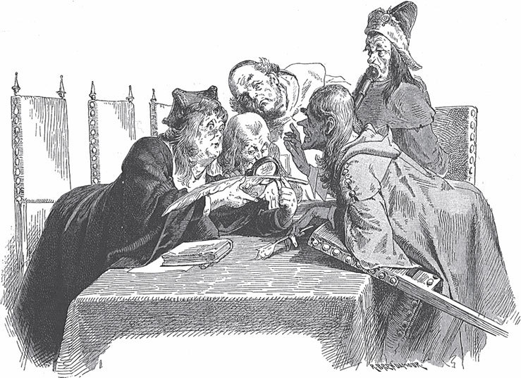

## Der goldene Vogel

Vor langer Zeit gab es einen König. Hinter seinem Schloss hat er einen schönen <abbr title="der Lustgarten, die Lustgärten — сад для прогулок">Lustgarten</abbr>. Darin steht ein Baum, der goldene Äpfel trägt. Als die Äpfel reif werden, zählt man sie. Aber gleich am nächsten Morgen fehlt einer. Man meldet es dem König. Er befiehlt: Jede Nacht soll jemand unter dem Baum Wache halten.

Der König hat drei Söhne. Den ältesten schickt er bei <abbr title="der Einbruch der Nacht — наступление ночи">Einbruch der Nacht</abbr> in den Garten. Aber um Mitternacht kann er sich nicht mehr gegen den Schlaf <abbr title="sich wehren gegen + Akk. — сопротивляться">wehren</abbr>. Am nächsten Morgen fehlt wieder ein Apfel. In der nächsten Nacht muss der zweite Sohn wachen. Aber ihm geht es nicht besser. Als die Uhr zwölf schlägt, schläft er ein, und am Morgen fehlt ein Apfel.

Jetzt ist der dritte Sohn an der Reihe. Er will auch gern wachen. Aber der König <abbr title="jemandem etwas zutrauen — считать кого-то способным на что-то">traut</abbr> ihm nicht viel zu. Er glaubt, der Jüngste schafft noch weniger als seine Brüder. Am Ende erlaubt er es aber doch. Der junge Mann legt sich also unter den Baum. Er wacht und lässt den Schlaf nicht <abbr title="Herr werden über + Akk. — одолеть">Herr werden</abbr>.

Als es zwölf schlägt, rauscht etwas durch die Luft. Im Mondschein sieht er einen Vogel heranfliegen. Seine Federn glänzen ganz aus Gold. Der Vogel setzt sich auf den Baum und <abbr title="abpicken — склёвывать">pickt</abbr> gerade einen Apfel ab. Da schießt der junge Mann einen <abbr title="der Pfeil, die Pfeile — стрела">Pfeil</abbr> auf ihn. Der Vogel fliegt davon. Aber der Pfeil hat sein <abbr title="das Gefieder — оперение">Gefieder</abbr> getroffen, und eine von seinen goldenen Federn fällt herunter. Der junge Mann hebt sie auf. Am nächsten Morgen bringt er sie dem König und erzählt ihm, was er in der Nacht gesehen hat.

Der König <abbr title="versammeln — собирать">versammelt</abbr> seine Ratgeber. Alle sagen: So eine Feder ist mehr wert als das ganze Königreich.

— Wenn die Feder so kostbar ist, — sagt der König, — dann hilft mir die eine Feder nichts. Ich will und muss den ganzen Vogel haben!

Der älteste Sohn macht sich auf den Weg. Er verlässt sich auf seine <abbr title="die Klugheit — ум">Klugheit</abbr> und glaubt, er findet den goldenen Vogel bestimmt. Er geht ein Stück. Da sieht er am Rand von einem Wald einen Fuchs sitzen. Er <abbr title="anlegen — вскидывать (ружьё)">legt</abbr> seine <abbr title="die Flinte, die Flinten — ружьё">Flinte</abbr> an und <abbr title="zielen auf + Akk. — целиться в">zielt</abbr> auf ihn. Der Fuchs ruft:

— Schieß nicht auf mich! Dafür gebe ich dir einen guten Rat. Du suchst den goldenen Vogel. Heute Abend kommst du in ein Dorf. Dort stehen zwei Wirtshäuser <abbr title="einander — друг друга">einander</abbr> <abbr title="gegenüber — напротив">gegenüber</abbr>. Das eine ist hell beleuchtet, und drinnen geht es lustig zu. Dort kehr aber nicht ein. Geh in das andere, auch wenn es schlecht aussieht.

«Wie kann mir so ein albernes Tier einen <abbr title="vernünftig — разумный">vernünftigen</abbr> Rat geben!», denkt der Königssohn. Er <abbr title="abdrücken — спускать курок">drückt ab</abbr>, aber er <abbr title="verfehlen — промахнуться, не попасть">verfehlt</abbr> den Fuchs. Der Fuchs streckt den Schwanz aus und läuft schnell in den Wald.

Der Königssohn geht weiter und kommt am Abend in das Dorf mit den beiden Wirtshäusern. In dem einen singt und tanzt man. Das andere sieht <abbr title="ärmlich — бедный, убогий">ärmlich</abbr> und traurig aus. «Ich bin doch kein Narr», denkt er. «Warum soll ich in das <abbr title="lumpig — жалкий, паршивый">lumpige</abbr> Wirtshaus gehen und das schöne links liegen lassen?» Er geht also in das lustige. Dort lebt er in Saus und Braus und vergisst den Vogel, seinen Vater und alle guten Lehren.

Eine Zeit vergeht. Der älteste Sohn kommt und kommt nicht nach Hause. Da macht sich der zweite auf den Weg und will den goldenen Vogel suchen. Wie dem ältesten begegnet ihm der Fuchs und gibt ihm den guten Rat. Aber er achtet nicht darauf. Er kommt zu den beiden Wirtshäusern. Sein Bruder steht am Fenster von dem einen, aus dem laute Freude schallt. Der Bruder ruft ihn. Da kann er nicht widerstehen. Er geht hinein und lebt nur noch für sein <abbr title="das Vergnügen, die Vergnügen — удовольствие">Vergnügen</abbr>.

Wieder vergeht eine Zeit. Jetzt will der jüngste Königssohn ausziehen und sein Glück versuchen. Aber der Vater will es nicht <abbr title="zulassen (ließ zu, hat zugelassen) — допускать">zulassen</abbr>.

— Es ist umsonst, — sagt er. — Er findet den goldenen Vogel noch weniger als seine Brüder. Und wenn ihm ein Unglück passiert, dann weiß er sich nicht zu helfen. Er ist nicht besonders klug.

Doch am Ende gibt der Sohn keine Ruhe, und der Vater lässt ihn gehen. Vor dem Wald sitzt wieder der Fuchs. Er bittet um sein Leben und gibt den guten Rat. Der junge Mann ist <abbr title="gutmütig — добродушный">gutmütig</abbr> und sagt:

— Keine Angst, Füchslein, ich tue dir nichts.

— Das sollst du nicht bereuen, — antwortet der Fuchs. — Du willst doch schneller <abbr title="vorwärtskommen (kam vorwärts, ist vorwärtsgekommen) — продвигаться вперёд">vorwärtskommen</abbr>? Dann setz dich hinten auf meinen Schwanz.

Kaum sitzt er, da fängt der Fuchs an zu laufen. Und dann geht es <abbr title="über Stock und Stein — без дороги, напрямик">über Stock und Stein</abbr>, dass die Haare im Wind pfeifen.

Im Dorf steigt der junge Mann ab. Er <abbr title="befolgen — следовать (совету)">befolgt</abbr> den guten Rat. Ohne sich <abbr title="sich umsehen (sah um, hat umgesehen) — оглядываться">umzusehen</abbr>, geht er in das einfache Wirtshaus und übernachtet dort ruhig. Am nächsten Morgen kommt er auf das Feld. Da sitzt schon der Fuchs und sagt:

— Ich sage dir, was du weiter tun musst. Geh immer geradeaus. Am Ende kommst du zu einem Schloss. Davor liegt eine ganze Schar Soldaten. Aber kümmere dich nicht darum. Denn sie schlafen alle und schnarchen. Geh mitten durch sie hindurch, direkt ins Schloss hinein, und geh durch alle Zimmer. Am Ende kommst du in eine Kammer. Dort hängt ein goldener Vogel in einem hölzernen Käfig. Daneben steht ein leerer goldener Käfig, nur für die Pracht. Aber hüte dich! Nimm den Vogel nicht aus seinem schlechten Käfig heraus und setz ihn nicht in den prächtigen. Sonst geht es dir schlecht.

Nach diesen Worten streckt der Fuchs wieder seinen Schwanz aus, und der Königssohn setzt sich darauf. Und dann geht es über Stock und Stein, dass die Haare im Wind pfeifen.

Beim Schloss findet er alles so, wie der Fuchs gesagt hat. Der Königssohn kommt in die Kammer. Da sitzt der goldene Vogel in einem hölzernen Käfig, und ein goldener steht daneben. Auch die drei goldenen Äpfel liegen dort im Zimmer herum. Da denkt er: «Es ist doch lächerlich, wenn ich den schönen Vogel in dem gewöhnlichen, hässlichen Käfig lasse.» Er öffnet die Tür, packt den Vogel und setzt ihn in den goldenen Käfig. Aber in diesem Augenblick stößt der Vogel einen <abbr title="durchdringend — пронзительный">durchdringenden</abbr> <abbr title="der Schrei, die Schreie — крик">Schrei</abbr> aus. Die Soldaten wachen auf, <abbr title="hereinstürzen — врываться">stürzen</abbr> herein und bringen ihn ins Gefängnis.

Am nächsten Morgen kommt er vor Gericht. Er gesteht alles, und die Richter verurteilen ihn zum Tod. Aber der König sagt: Er schenkt ihm das Leben, unter einer Bedingung. Er muss ihm das goldene Pferd bringen, das noch schneller läuft als der Wind. Und dann bekommt er obendrein als Belohnung den goldenen Vogel.

Der Königssohn macht sich auf den Weg. Aber er seufzt und ist traurig. Denn wo soll er das goldene Pferd finden? Da sieht er plötzlich seinen alten Freund, den Fuchs, am Weg sitzen.

— Siehst du, — sagt der Fuchs, — so ist es gekommen, weil du nicht auf mich gehört hast. Aber <abbr title="Kopf hoch! — не вешай нос!">Kopf hoch</abbr>! Ich helfe dir und sage dir, wie du zu dem goldenen Pferd kommst. Geh geradeaus weiter. Dann kommst du zu einem Schloss. Dort steht das Pferd im Stall. Vor dem Stall liegen die <abbr title="der Stallknecht, die Stallknechte — конюх">Stallknechte</abbr>. Aber sie schlafen und schnarchen, und du kannst das goldene Pferd ganz ruhig herausführen. Nur auf eins musst du <abbr title="aufpassen auf + Akk. — следить, остерегаться">aufpassen</abbr>: Leg ihm den schlechten Sattel aus Holz und Leder auf. Nimm bloß nicht den goldenen, der daneben hängt! Sonst geht es dir schlecht.

Dann streckt der Fuchs seinen Schwanz aus, der Königssohn setzt sich darauf, und dann geht es über Stock und Stein, dass die Haare im Wind pfeifen.

Alles ist so, wie der Fuchs gesagt hat. Der junge Mann kommt in den Stall, wo das goldene Pferd steht. Er will ihm den schlechten Sattel auflegen. Aber da denkt er: «So ein schönes Tier! Es sieht schäbig aus, wenn ich ihm nicht den guten Sattel auflege. Der <abbr title="gebühren + Dat. — подобать, полагаться">gebührt</abbr> ihm doch.» Aber kaum berührt der goldene Sattel das Pferd, da fängt es laut an zu <abbr title="wiehern — ржать">wiehern</abbr>. Die Stallknechte wachen auf, packen den jungen Mann und werfen ihn ins Gefängnis. Am nächsten Morgen verurteilt ihn das Gericht zum Tod. Doch der König verspricht ihm: Er schenkt ihm das Leben und dazu das goldene Pferd. Aber dafür muss er die schöne Königstochter vom goldenen Schloss herbringen.

Mit schwerem Herzen macht sich der junge Mann auf den Weg. Doch zum Glück findet er bald den treuen Fuchs.

— Eigentlich soll ich dich deinem Unglück <abbr title="überlassen (überließ, hat überlassen) — оставить, предоставить">überlassen</abbr>, — sagt der Fuchs. — Aber ich habe Mitleid mit dir. Ich helfe dir noch einmal aus deiner Not. Dein Weg führt dich direkt zum goldenen Schloss. Am Abend kommst du dort an. In der Nacht, wenn alles still ist, geht die schöne Königstochter ins <abbr title="das Badehaus, die Badehäuser — купальня">Badehaus</abbr>. Sie will dort baden. Wenn sie hineingeht, spring zu ihr hin und gib ihr einen Kuss. Dann folgt sie dir, und du kannst sie mitnehmen. Aber erlaube ihr nicht, dass sie vorher von ihren Eltern <abbr title="Abschied nehmen von + Dat. (nahm, hat genommen) — прощаться с">Abschied nimmt</abbr>. Sonst kann es dir schlecht gehen.

Dann streckt der Fuchs seinen Schwanz aus, der Königssohn setzt sich darauf, und dann geht es über Stock und Stein, dass die Haare im Wind pfeifen.

Beim goldenen Schloss ist es so, wie der Fuchs gesagt hat. Er wartet bis Mitternacht. Alles liegt in tiefem Schlaf, und die schöne Jungfrau geht ins Badehaus. Da springt er hervor und gibt ihr einen Kuss. Sie sagt, sie geht gern mit ihm. Aber sie <abbr title="flehen — умолять">fleht</abbr> ihn unter Tränen an: Darf sie vorher von ihren Eltern Abschied nehmen? Zuerst sagt er Nein. Aber sie weint immer mehr und fällt ihm zu Füßen. Da gibt er endlich nach. Kaum aber tritt die Jungfrau an das Bett von ihrem Vater, da wacht er auf, und alle anderen im Schloss auch. Man <abbr title="festhalten (hielt fest, hat festgehalten) — задерживать, удерживать">hält</abbr> den jungen Mann fest und steckt ihn ins Gefängnis.

Am nächsten Morgen sagt der König zu ihm:

— Dein Leben ist <abbr title="verwirken — лишиться (права на что-то)">verwirkt</abbr>. Nur in einem Fall gibt es Gnade: Vor meinen Fenstern liegt ein Berg. Ich kann nicht über ihn hinaussehen. Du musst diesen Berg <abbr title="abtragen (trug ab, hat abgetragen) — срывать, сносить">abtragen</abbr>, und zwar <abbr title="innerhalb von + Dat. — в течение">innerhalb</abbr> von acht Tagen. Wenn dir das gelingt, bekommst du meine Tochter als Belohnung.

Der Königssohn fängt an. Er gräbt und <abbr title="schaufeln — копать лопатой">schaufelt</abbr> ohne Pause. Aber nach sieben Tagen sieht er, wie wenig er geschafft hat. Seine ganze Arbeit ist so gut wie nichts. Da wird er sehr traurig und gibt alle Hoffnung auf. Aber am Abend vom siebten Tag erscheint der Fuchs und sagt:

— Eigentlich verdienst du nicht, dass ich dir helfe. Aber geh nur hin und leg dich schlafen. Ich mache die Arbeit für dich.

Am nächsten Morgen wacht er auf und sieht aus dem Fenster. Der Berg ist verschwunden! Voller Freude eilt der junge Mann zum König und meldet ihm: Die Bedingung ist erfüllt. Und ob der König will oder nicht, er muss <abbr title="Wort halten (hielt, hat gehalten) — сдержать слово">Wort halten</abbr> und ihm seine Tochter geben.

Jetzt ziehen die beiden zusammen fort. Es dauert nicht lange, da kommt der treue Fuchs zu ihnen.

— Das Beste hast du zwar, — sagt er. — Aber zu der Jungfrau aus dem goldenen Schloss gehört auch das goldene Pferd.

— Wie soll ich das bekommen? — fragt der junge Mann.

— Das sage ich dir, — antwortet der Fuchs. — Bring zuerst dem König, der dich zum goldenen Schloss geschickt hat, die schöne Jungfrau. Da ist die Freude riesengroß. Sie geben dir gern das goldene Pferd und führen es dir vor. Setz dich sofort darauf und gib allen zum Abschied die Hand, zuletzt der schönen Jungfrau. Und wenn du ihre Hand hast, dann zieh sie mit <abbr title="der Schwung — рывок, размах">Schwung</abbr> zu dir hinauf und reite davon. Niemand kann dich einholen, denn das Pferd läuft schneller als der Wind.

Alles klappt gut, und der Königssohn reitet mit der schönen Jungfrau auf dem goldenen Pferd fort. Der Fuchs bleibt bei ihnen und sagt zu dem jungen Mann:

— Jetzt helfe ich dir auch zu dem goldenen Vogel. Wenn du nahe bei dem Schloss bist, wo der Vogel ist, dann lass die Jungfrau <abbr title="absteigen (stieg ab, ist abgestiegen) — слезать, спешиваться">absteigen</abbr>. Ich passe auf sie auf. Dann reite mit dem goldenen Pferd in den Schlosshof. Wenn sie das Pferd sehen, ist die Freude groß, und sie bringen dir den goldenen Vogel heraus. Sobald du den Käfig in der Hand hast, reite schnell zu uns zurück und hol dir die Jungfrau wieder ab.

Auch dieser Plan gelingt. Der Königssohn will mit seinen Schätzen nach Hause reiten. Da sagt der Fuchs:

— Jetzt sollst du mich für meine Hilfe belohnen.

— Was willst du dafür haben? — fragt der junge Mann.

— Wenn wir dort in den Wald kommen, dann schieß mich tot und hau mir Kopf und Pfoten ab.

— Das ist ja eine schöne <abbr title="die Dankbarkeit — благодарность">Dankbarkeit</abbr>! — sagt der Königssohn. — Das kann ich dir unmöglich geben.

Der Fuchs sagt:

— Wenn du es nicht tun willst, muss ich dich verlassen. Aber vorher gebe ich dir noch einen guten Rat. Vor zwei Dingen hüte dich: Kauf kein <abbr title="das Galgenfleisch — «висельное мясо», висельник">Galgenfleisch</abbr>, und setz dich an keinen <abbr title="der Brunnenrand, die Brunnenränder — край колодца">Brunnenrand</abbr>.

Und damit läuft er in den Wald.

Der junge Mann denkt: «Das ist ein seltsames Tier mit komischen Launen. Wer kauft denn Galgenfleisch! Und ich hatte noch nie Lust, mich an einen Brunnenrand zu setzen.»

Er reitet mit der schönen Jungfrau weiter. Sein Weg führt ihn wieder durch das Dorf, in dem seine beiden Brüder geblieben sind. Dort ist ein großer <abbr title="der Auflauf, die Aufläufe — сборище, толпа">Auflauf</abbr> und viel Lärm. Er fragt, was los ist. Die Leute sagen: Man will zwei Männer <abbr title="aufhängen — повесить">aufhängen</abbr>. Er kommt näher und sieht: Es sind seine Brüder! Sie haben allerlei schlimme Streiche gemacht und ihr ganzes Vermögen verschwendet. Er fragt, ob man sie nicht <abbr title="freilassen (ließ frei, hat freigelassen) — отпускать на свободу">freilassen</abbr> kann.

— Wenn Ihr für sie bezahlt, — antworten die Leute. — Aber warum wollt Ihr Euer Geld für diese schlechten Menschen ausgeben und sie <abbr title="freikaufen — выкупать">freikaufen</abbr>?

Aber er überlegt nicht lange. Er bezahlt für sie. Die Brüder kommen frei, und sie reisen zusammen weiter.

Sie kommen in den Wald, wo ihnen der Fuchs zum ersten Mal begegnet ist. Im Wald ist es kühl und <abbr title="angenehm — приятный">angenehm</abbr>, und draußen brennt die Sonne heiß. Da sagen die beiden Brüder:

— Komm, wir ruhen uns hier am Brunnen ein bisschen aus. Wir essen und trinken etwas.

Er ist einverstanden. Sie reden und reden, und er vergisst den Rat. Er setzt sich an den Brunnenrand und denkt an nichts Böses. Aber die beiden Brüder werfen ihn <abbr title="rückwärts — навзничь, назад">rückwärts</abbr> in den Brunnen. Sie nehmen die Jungfrau, das Pferd und den Vogel und reiten nach Hause zu ihrem Vater.

— Wir bringen nicht nur den goldenen Vogel, — sagen sie. — Wir haben auch das goldene Pferd und die Jungfrau vom goldenen Schloss <abbr title="erbeuten — добыть (как трофей)">erbeutet</abbr>.

Da ist die Freude groß. Aber das Pferd, das frisst nicht. Der Vogel, der pfeift nicht. Und die Jungfrau, die sitzt da und weint.

Der jüngste Bruder ist aber nicht tot. Zum Glück ist der Brunnen trocken. Er fällt auf weiches Moos und <abbr title="sich verletzen — пораниться">verletzt sich</abbr> nicht. Aber er kann nicht wieder heraus. Auch in dieser Not verlässt ihn der treue Fuchs nicht. Er springt zu ihm hinunter und schimpft, weil er seinen Rat vergessen hat.

— Aber ich kann es doch nicht lassen, — sagt der Fuchs. — Ich helfe dir wieder ans Tageslicht.

Er sagt, der junge Mann soll seinen Schwanz packen und sich gut daran festhalten. Dann zieht er ihn hoch.

— Noch bist du nicht <abbr title="außer Gefahr — вне опасности">außer Gefahr</abbr>, — sagt der Fuchs. — Deine Brüder waren nicht sicher, ob du tot bist. Sie haben Wächter rund um den Wald gestellt. Die sollen dich töten, wenn sie dich sehen.

Am Weg sitzt ein armer Mann. Mit ihm tauscht der junge Mann die Kleider. So kommt er an den Hof vom König. Niemand erkennt ihn. Aber da fängt der Vogel an zu pfeifen, das Pferd fängt an zu fressen, und die schöne Jungfrau hört auf zu weinen. Der König fragt <abbr title="verwundert — удивлённо">verwundert</abbr>:

— Was bedeutet das?

Da sagt die Jungfrau:

— Ich weiß es nicht. Aber ich war so traurig, und jetzt bin ich so fröhlich. Mir ist, als ob mein richtiger Bräutigam gekommen ist.

Sie erzählt ihm alles, was passiert ist. Dabei haben die anderen Brüder ihr mit dem Tod gedroht, wenn sie etwas verrät. Der König lässt alle Leute zu sich bringen, die in seinem Schloss sind. Da kommt auch der junge Mann, als armer Mann in seinen Lumpen. Aber die Jungfrau erkennt ihn sofort und fällt ihm um den Hals. Man <abbr title="ergreifen (ergriff, hat ergriffen) — хватать, задерживать">ergreift</abbr> die gottlosen Brüder und <abbr title="hinrichten — казнить">richtet</abbr> sie hin. Er aber heiratet die schöne Jungfrau, und der König macht ihn zu seinem Erben.

Aber was ist mit dem armen Fuchs? Lange Zeit später geht der Königssohn einmal wieder in den Wald. Da begegnet ihm der Fuchs und sagt:

— Du hast jetzt alles, was du dir wünschen kannst. Aber mein Unglück hat einfach kein Ende. Dabei kannst du mich erlösen.

Und wieder bittet er ihn <abbr title="flehentlich — умоляюще">flehentlich</abbr>: Er soll ihn totschießen und ihm Kopf und Pfoten abhauen. Diesmal tut der Königssohn es. Und kaum ist es passiert, da verwandelt sich der Fuchs in einen Menschen. Es ist niemand anders als der Bruder von der schönen Königstochter. Endlich ist er von dem Zauber erlöst, der auf ihm lag. Und jetzt fehlt ihnen nichts mehr zu ihrem Glück, solange sie leben.

---

### Neue Wörter

- **der Lustgarten, die Lustgärten** — сад для прогулок
- **der Einbruch der Nacht** — наступление ночи
- **sich wehren gegen + Akk.** — сопротивляться
- **jemandem etwas zutrauen** — считать кого-то способным на что-то
- **Herr werden über + Akk.** — одолеть
- **abpicken** — склёвывать
- **der Pfeil, die Pfeile** — стрела
- **das Gefieder** — оперение
- **versammeln** — собирать
- **die Klugheit** — ум
- **anlegen** — вскидывать (ружьё)
- **die Flinte, die Flinten** — ружьё
- **zielen auf + Akk.** — целиться в
- **einander** — друг друга
- **gegenüber** — напротив
- **vernünftig** — разумный
- **abdrücken** — спускать курок
- **verfehlen** — промахнуться, не попасть
- **ärmlich** — бедный, убогий
- **lumpig** — жалкий, паршивый
- **das Vergnügen, die Vergnügen** — удовольствие
- **zulassen (ließ zu, hat zugelassen)** — допускать
- **gutmütig** — добродушный
- **vorwärtskommen (kam vorwärts, ist vorwärtsgekommen)** — продвигаться вперёд
- **über Stock und Stein** — без дороги, напрямик
- **befolgen** — следовать (совету)
- **sich umsehen (sah um, hat umgesehen)** — оглядываться
- **durchdringend** — пронзительный
- **der Schrei, die Schreie** — крик
- **hereinstürzen** — врываться
- **Kopf hoch!** — не вешай нос!
- **der Stallknecht, die Stallknechte** — конюх
- **aufpassen auf + Akk.** — следить, остерегаться
- **gebühren + Dat.** — подобать, полагаться
- **wiehern** — ржать
- **überlassen (überließ, hat überlassen)** — оставить, предоставить
- **das Badehaus, die Badehäuser** — купальня
- **Abschied nehmen von + Dat. (nahm, hat genommen)** — прощаться с
- **flehen** — умолять
- **festhalten (hielt fest, hat festgehalten)** — задерживать, удерживать
- **verwirken** — лишиться (права на что-то)
- **abtragen (trug ab, hat abgetragen)** — срывать, сносить
- **innerhalb von + Dat.** — в течение
- **schaufeln** — копать лопатой
- **Wort halten (hielt, hat gehalten)** — сдержать слово
- **der Schwung** — рывок, размах
- **absteigen (stieg ab, ist abgestiegen)** — слезать, спешиваться
- **die Dankbarkeit** — благодарность
- **das Galgenfleisch** — «висельное мясо», висельник
- **der Brunnenrand, die Brunnenränder** — край колодца
- **der Auflauf, die Aufläufe** — сборище, толпа
- **aufhängen** — повесить
- **freilassen (ließ frei, hat freigelassen)** — отпускать на свободу
- **freikaufen** — выкупать
- **angenehm** — приятный
- **rückwärts** — навзничь, назад
- **erbeuten** — добыть (как трофей)
- **sich verletzen** — пораниться
- **außer Gefahr** — вне опасности
- **verwundert** — удивлённо
- **ergreifen (ergriff, hat ergriffen)** — хватать, задерживать
- **hinrichten** — казнить
- **flehentlich** — умоляюще

[← Zurück](kapitel-56.md) · [Inhalt](README.md)
