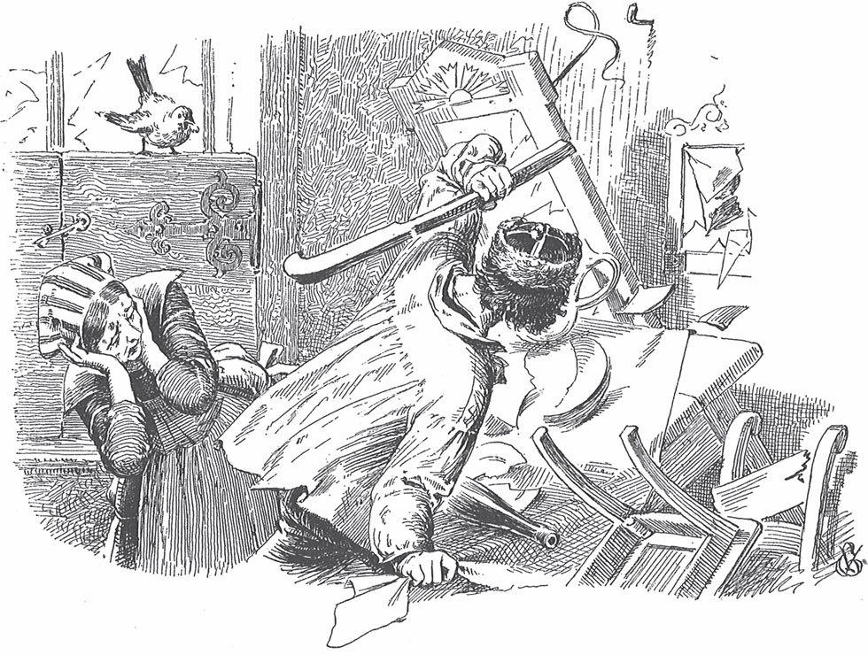

## Der Hund und der Sperling

Ein <abbr title="der Schäferhund, die Schäferhunde — овчарка, пастушья собака">Schäferhund</abbr> hat keinen guten Herrn. Sein Herr lässt ihn hungern. Der Hund kann es bei ihm nicht länger aushalten, und ganz traurig geht er fort. Auf der Straße begegnet ihm ein <abbr title="der Sperling, die Sperlinge — воробей">Sperling</abbr>. Der Sperling sagt:

— Bruder Hund, warum bist du so traurig?

Der Hund antwortet:

— Ich bin hungrig und habe nichts zu fressen.

Da sagt der Sperling:

— Lieber Bruder, komm mit in die Stadt. Ich mache dich satt.

Sie gehen also zusammen in die Stadt. Vor einem <abbr title="der Fleischerladen, die Fleischerläden — мясная лавка">Fleischerladen</abbr> sagt der Sperling zum Hund:

— Bleib hier stehen. Ich picke dir ein Stück Fleisch herunter.

Er setzt sich auf den <abbr title="der Ladentisch, die Ladentische — прилавок">Ladentisch</abbr> und schaut sich um. Sieht ihn auch niemand? Dann pickt er, zieht und zerrt so lange an einem Stück, das am Rand liegt, bis es <abbr title="herunterrutschen — соскальзывать вниз">herunterrutscht</abbr>. Der Hund packt es, läuft in eine Ecke und frisst es auf. Der Sperling sagt:

— Jetzt komm mit zu einem anderen Laden. Dort hole ich dir noch ein Stück herunter, dann wirst du satt.

Der Hund hat auch das zweite Stück gefressen. Da fragt der Sperling:

— Bruder Hund, bist du jetzt satt?

— Ja, Fleisch habe ich genug, — antwortet der Hund. — Aber ich habe noch kein Brot bekommen.

Der Sperling sagt:

— Das bekommst du auch. Komm nur mit.

Er führt ihn zu einer <abbr title="die Bäckerei, die Bäckereien — пекарня, булочная">Bäckerei</abbr> und pickt an ein paar Brötchen, bis sie <abbr title="herunterrollen — скатываться">herunterrollen</abbr>. Der Hund will noch mehr. Da führt der Sperling ihn zu einer anderen Bäckerei und holt ihm noch einmal Brot herunter. Als alles gefressen ist, sagt der Sperling:

— Bruder Hund, bist du jetzt satt?

— Ja, — antwortet der Hund. — Jetzt gehen wir ein bisschen vor die Stadt.

Sie gehen beide hinaus auf die Landstraße. Es ist aber warm. Nach einem kleinen Stück Weg sagt der Hund:

— Ich bin müde und möchte gern schlafen.

— Ja, schlaf nur, — antwortet der Sperling. — Ich setze mich inzwischen auf einen Zweig.

Der Hund legt sich also auf die Straße und schläft fest ein. Er liegt da und schläft. Da kommt ein Fuhrmann <abbr title="angefahren kommen — подъезжать">angefahren</abbr>. Er hat einen Wagen mit drei Pferden, und auf dem Wagen liegen zwei Fässer Wein. Der Sperling sieht: Der Fuhrmann will nicht <abbr title="ausweichen (wich aus, ist ausgewichen) — сворачивать, объезжать">ausweichen</abbr>. Er bleibt in der <abbr title="die Fahrspur, die Fahrspuren — колея">Fahrspur</abbr>, in der der Hund liegt. Da ruft der Sperling:

— Fuhrmann, tu es nicht, sonst mache ich dich arm!

Aber der Fuhrmann brummt vor sich hin:

— Du machst mich nicht arm.

Er <abbr title="knallen — щёлкать">knallt</abbr> mit der Peitsche und fährt mit dem Wagen über den Hund. Die Räder <abbr title="überfahren (überfuhr, hat überfahren) — переезжать, задавить">überfahren</abbr> ihn, und er ist tot. Da ruft der Sperling:

— Du hast meinen Bruder Hund totgefahren! Das kostet dich <abbr title="die Karre, die Karren — телега, тачка">Karre</abbr> und <abbr title="der Gaul, die Gäule — лошадь, кляча">Gaul</abbr>!

— Ja, ja, Karre und Gaul, — sagt der Fuhrmann. — Was kannst du mir schon schaden!

Und er fährt weiter. Da kriecht der Sperling unter die <abbr title="die Plane, die Planen — брезент, полог">Plane</abbr> vom Wagen. Er pickt so lange an einem <abbr title="das Spundloch, die Spundlöcher — отверстие для затычки (в бочке)">Spundloch</abbr>, bis der <abbr title="der Spund, die Spünde — затычка, пробка">Spund</abbr> <abbr title="lose — расшатанный, свободный">lose</abbr> ist. Da läuft der ganze Wein heraus, und der Fuhrmann merkt es nicht. Einmal sieht er hinter sich und merkt, dass der Wagen tropft. Er untersucht die Fässer und findet: Eins ist leer.

— Ach, ich armer Mann! — ruft er.

— Noch nicht arm genug! — sagt der Sperling.

Er fliegt einem von den Pferden auf den Kopf und pickt ihm die Augen aus. Der Fuhrmann sieht das. Er zieht seine Hacke heraus und will den Sperling treffen. Aber der Sperling fliegt hoch, und der Fuhrmann trifft sein Pferd am Kopf. Das Pferd fällt tot um.

— Ach, ich armer Mann! — ruft er.

— Noch nicht arm genug! — sagt der Sperling.

Der Fuhrmann fährt mit den zwei Pferden weiter. Da kriecht der Sperling wieder unter die Plane und pickt auch am zweiten Fass den Spund los. Der ganze Wein <abbr title="schwappen — выплёскиваться">schwappt</abbr> heraus. Der Fuhrmann bemerkt es und ruft wieder:

— Ach, ich armer Mann!

Aber der Sperling antwortet:

— Noch nicht arm genug!

Er setzt sich dem zweiten Pferd auf den Kopf und pickt ihm die Augen aus. Der Fuhrmann läuft herbei und holt mit seiner Hacke aus. Aber der Sperling fliegt hoch, und der Schlag trifft das Pferd. Es fällt um.

— Ach, ich armer Mann!

— Noch nicht arm genug! — sagt der Sperling.

Er setzt sich auch dem dritten Pferd auf den Kopf und pickt nach seinen Augen. Der Fuhrmann ist wütend. Ohne hinzusehen, schlägt er auf den Sperling los. Aber er trifft ihn nicht. Er schlägt auch sein drittes Pferd tot.

— Ach, ich armer Mann! — ruft er.

— Noch nicht arm genug! — antwortet der Sperling. — Jetzt mache ich dich zu Hause arm.

Und er fliegt fort.

Der Fuhrmann muss den Wagen stehen lassen. Voller Zorn und Ärger geht er nach Hause.

— Ach, — sagt er zu seiner Frau, — was für ein Pech ich gehabt habe! Der Wein ist ausgelaufen, und alle drei Pferde sind tot.

— Ach, Mann, — antwortet sie, — was für ein böser Vogel ist zu uns ins Haus gekommen! Er hat alle Vögel auf der Welt <abbr title="zusammenholen — созывать, собирать">zusammengeholt</abbr>. Sie sind oben über unseren <abbr title="der Weizen — пшеница">Weizen</abbr> <abbr title="herfallen über + Akk. (fiel her, ist hergefallen) — набрасываться на">hergefallen</abbr> und fressen ihn auf.

Da steigt er hinauf. Auf dem Dachboden sitzen tausend und tausend Vögel. Sie haben den Weizen aufgefressen, und der Sperling sitzt mitten unter ihnen. Da ruft der Fuhrmann:

— Ach, ich armer Mann!

— Noch nicht arm genug, — antwortet der Sperling. — Fuhrmann, es kostet dich noch dein Leben!

Und er fliegt hinaus.

Jetzt hat der Fuhrmann sein ganzes <abbr title="das Hab und Gut — всё имущество, добро">Hab und Gut</abbr> verloren. Er geht hinunter in die Stube und setzt sich hinter den Ofen. Er ist ganz böse und giftig. Der Sperling aber sitzt draußen vor dem Fenster und ruft:

— Fuhrmann, es kostet dich dein Leben!

Da greift der Fuhrmann die Hacke und wirft sie nach dem Sperling. Aber er schlägt nur die Fensterscheiben kaputt und trifft den Vogel nicht. Jetzt hüpft der Sperling herein, setzt sich auf den Ofen und ruft:

— Fuhrmann, es kostet dich dein Leben!

Der Fuhrmann ist ganz verrückt und blind vor Wut. Er schlägt den Ofen entzwei. Und so geht es weiter: Der Sperling fliegt von einem Ort zum anderen, und der Fuhrmann schlägt alles kaputt, seine ganzen <abbr title="die Möbel (Pl.) — мебель">Möbel</abbr>, den Spiegel, die Bänke, den Tisch, und am Ende die Wände von seinem Haus. Aber den Sperling trifft er nicht. Endlich erwischt er ihn doch mit der Hand. Da sagt seine Frau:

— Soll ich ihn totschlagen?

— Nein! — ruft er. — Das ist zu <abbr title="milde — мягкий, снисходительный">milde</abbr>. Er soll viel grausamer sterben. Ich verschlinge ihn!

Und er nimmt ihn und verschlingt ihn auf einmal. Aber der Sperling fängt an, in seinem Bauch zu flattern. Er flattert wieder hinauf, bis in den Mund von dem Mann. Da streckt er den Kopf heraus und ruft:

— Fuhrmann, es kostet dich doch dein Leben!

Der Fuhrmann gibt seiner Frau die Hacke und sagt:

— Frau, schlag mir den Vogel im Mund tot!

Die Frau schlägt zu. Aber sie verfehlt den Vogel und trifft den Fuhrmann direkt auf den Kopf. Er fällt tot um. Der Sperling aber fliegt <abbr title="auf und davon — прочь, только его и видели">auf und davon</abbr>.

---

### Neue Wörter

- **der Schäferhund, die Schäferhunde** — овчарка, пастушья собака
- **der Sperling, die Sperlinge** — воробей
- **der Fleischerladen, die Fleischerläden** — мясная лавка
- **der Ladentisch, die Ladentische** — прилавок
- **herunterrutschen** — соскальзывать вниз
- **die Bäckerei, die Bäckereien** — пекарня, булочная
- **herunterrollen** — скатываться
- **angefahren kommen** — подъезжать
- **ausweichen (wich aus, ist ausgewichen)** — сворачивать, объезжать
- **die Fahrspur, die Fahrspuren** — колея
- **knallen** — щёлкать
- **überfahren (überfuhr, hat überfahren)** — переезжать, задавить
- **die Karre, die Karren** — телега, тачка
- **der Gaul, die Gäule** — лошадь, кляча
- **die Plane, die Planen** — брезент, полог
- **das Spundloch, die Spundlöcher** — отверстие для затычки (в бочке)
- **der Spund, die Spünde** — затычка, пробка
- **lose** — расшатанный, свободный
- **schwappen** — выплёскиваться
- **zusammenholen** — созывать, собирать
- **der Weizen** — пшеница
- **herfallen über + Akk. (fiel her, ist hergefallen)** — набрасываться на
- **das Hab und Gut** — всё имущество, добро
- **die Möbel (Pl.)** — мебель
- **milde** — мягкий, снисходительный
- **auf und davon** — прочь, только его и видели

[← Zurück](kapitel-57.md) · [Inhalt](README.md)
