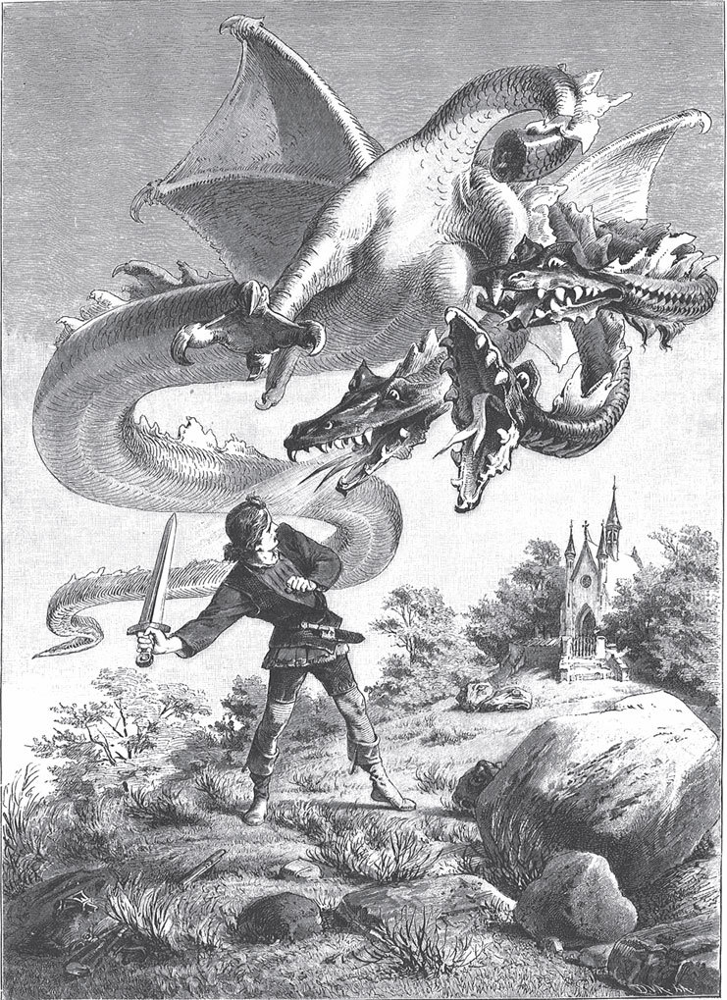
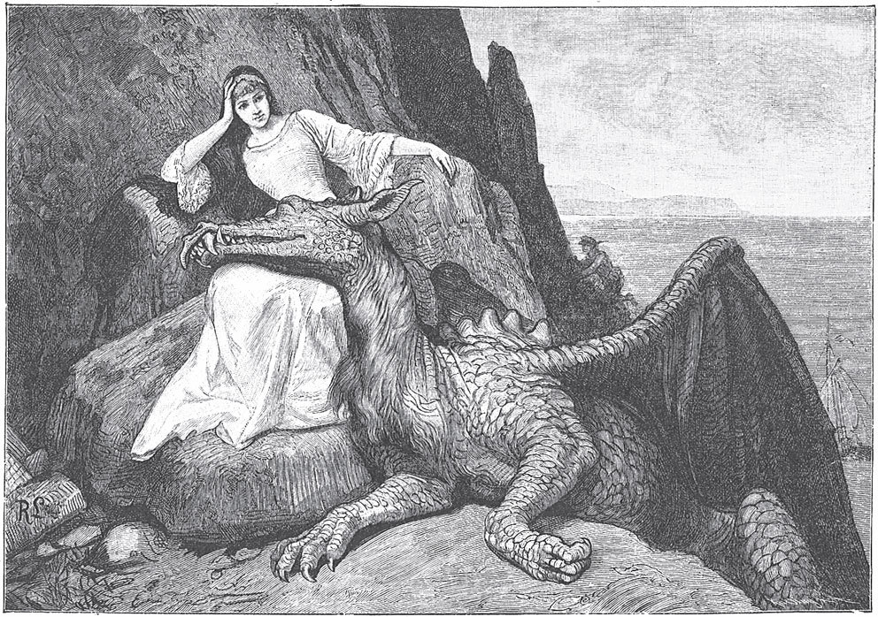
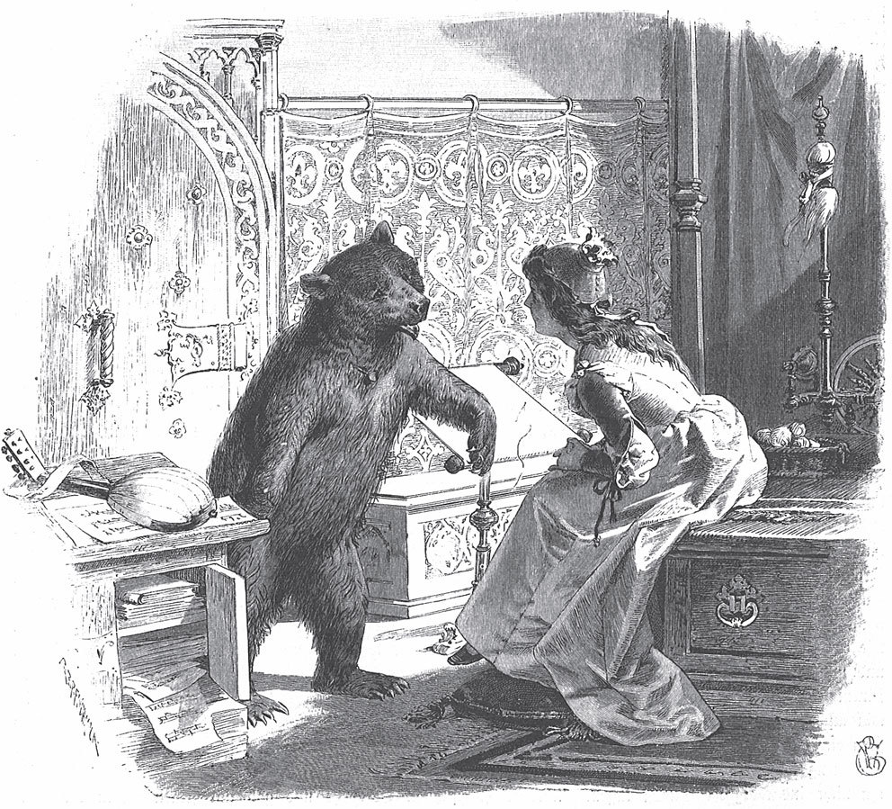
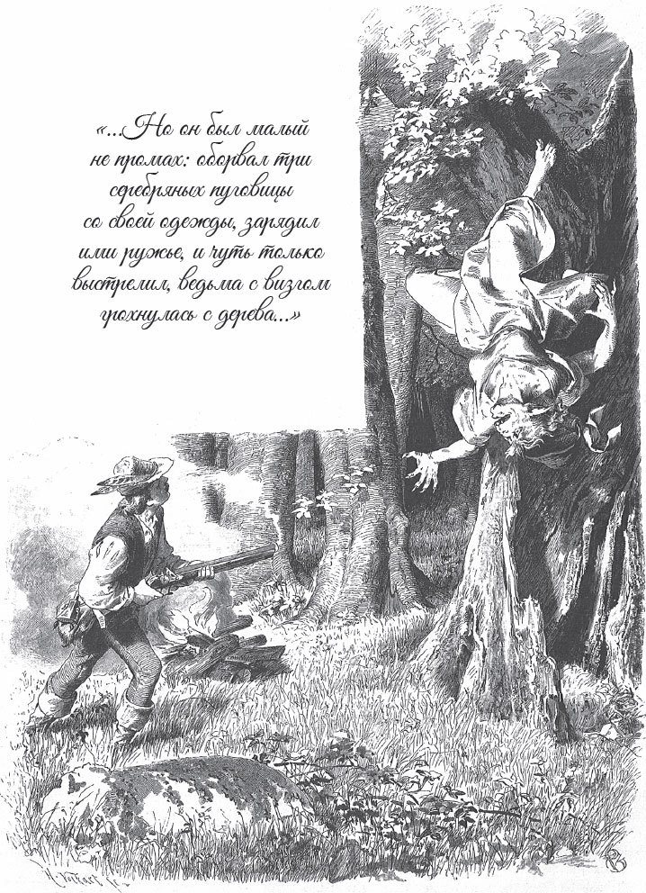

## Die zwei Brüder

Es waren einmal zwei Brüder, ein reicher und ein armer. Der reiche war ein Goldschmied und hatte ein böses Herz. Der arme verdiente sein Brot damit, dass er Besen band. Er war gut und ehrlich. Der arme Bruder hatte zwei Kinder. Das waren Zwillinge, und sie waren sich so <abbr title="ähnlich — похожий">ähnlich</abbr> wie ein Tropfen Wasser dem anderen. Die zwei Jungen gingen oft in das Haus von dem reichen Onkel. Manchmal bekamen sie dort etwas von den Resten zu essen.

Eines Tages ging der arme Mann in den Wald, um Reisig zu holen. Da sah er einen Vogel, der ganz aus Gold war. So einen schönen Vogel hatte er noch nie gesehen. Er hob ein Steinchen auf, warf nach ihm und traf ihn auch. Aber es fiel nur eine goldene Feder herunter, und der Vogel flog fort. Der Mann nahm die Feder und brachte sie seinem Bruder. Der sah sie an und sagte:

— Das ist reines Gold.

Und er gab ihm viel Geld dafür. Am nächsten Tag stieg der Mann auf eine <abbr title="die Birke, die Birken — берёза">Birke</abbr> und wollte ein paar Äste abhauen. Da flog derselbe Vogel heraus. Der Mann suchte und fand ein Nest. Darin lag ein Ei, und das Ei war aus Gold. Er nahm das Ei mit nach Hause und brachte es seinem Bruder. Der sagte wieder:

— Das ist reines Gold.

Und er gab ihm, was es wert war. Zuletzt sagte der Goldschmied:

— Den Vogel selbst hätte ich gern.

Der Arme ging zum dritten Mal in den Wald. Wieder sah er den Goldvogel auf dem Baum sitzen. Er nahm einen Stein, warf ihn herunter und brachte ihn seinem Bruder. Der gab ihm einen großen Haufen Gold dafür. «Jetzt kann ich mir <abbr title="sich weiterhelfen — выкрутиться, поправить дела">weiterhelfen</abbr>», dachte der Arme und ging zufrieden nach Hause.

Der Goldschmied war klug und listig. Er wusste genau, was das für ein Vogel war. Er rief seine Frau und sagte:

— Brat mir den Goldvogel, und pass auf, dass nichts davon wegkommt. Ich will ihn ganz allein essen.

Der Vogel war nämlich kein gewöhnlicher Vogel. Er war so wunderbar: Wer sein Herz und seine Leber aß, der fand jeden Morgen ein Goldstück unter seinem Kopfkissen. Die Frau machte den Vogel fertig, steckte ihn auf einen Spieß und ließ ihn braten.

Nun musste die Frau wegen anderer Arbeit aus der Küche gehen, <abbr title="während — пока, в то время как">während</abbr> der Vogel am Feuer stand. Da liefen die zwei Kinder von dem armen <abbr title="der Besenbinder, die Besenbinder — вязальщик мётел">Besenbinder</abbr> herein. Sie stellten sich vor den Spieß und drehten ihn ein paarmal herum. Gerade da fielen zwei kleine Stücke aus dem Vogel in die Pfanne. Da sagte der eine:

— Die paar Bissen essen wir. Ich bin so hungrig, und es merkt ja niemand.

Da aßen die beiden die Stückchen auf. Aber die Frau kam gerade zurück. Sie sah, dass die Kinder etwas aßen, und fragte:

— Was habt ihr gegessen?

— Ein paar Stückchen, die aus dem Vogel gefallen sind, — antworteten sie.

— Das waren Herz und Leber! — sagte die Frau ganz erschrocken.

Ihr Mann sollte nichts <abbr title="vermissen — недосчитаться, хватиться">vermissen</abbr> und nicht böse werden. Deshalb schlachtete sie schnell ein Hähnchen, nahm Herz und Leber heraus und legte sie zu dem Goldvogel. Als er <abbr title="gar — готовый, прожаренный">gar</abbr> war, brachte sie ihn dem Goldschmied. Der aß ihn ganz allein auf und ließ nichts übrig. Aber am nächsten Morgen griff er unter sein Kopfkissen und wollte das Goldstück hervorholen. Doch da lag keins, genauso wie an jedem anderen Morgen.

Die beiden Kinder aber wussten nicht, was für ein Glück sie bekommen hatten. Am nächsten Morgen standen sie auf, und da fiel etwas auf den Boden und klingelte. Sie hoben es auf: Es waren zwei Goldstücke. Sie brachten sie ihrem Vater. Der wunderte sich und sagte:

— Wie kann das <abbr title="zugehen (ging zu, ist zugegangen) — происходить, случаться">zugegangen sein</abbr>?

Aber am nächsten Morgen fanden sie wieder zwei, und so jeden Tag. Da ging der Vater zu seinem Bruder und erzählte ihm die seltsame Geschichte. Der Goldschmied verstand sofort, was passiert war: Die Kinder hatten Herz und Leber von dem Goldvogel gegessen. Er wollte sich rächen, denn er war neidisch und hartherzig. Deshalb sagte er zum Vater:

— Deine Kinder sind <abbr title="mit dem Bösen im Bund sein — быть в сговоре с нечистым">mit dem Bösen im Bund</abbr>. Nimm das Gold nicht, und lass sie nicht länger in deinem Haus! Der Böse hat Macht über sie, und er kann auch dich noch ins Verderben bringen.

Der Vater hatte Angst vor dem Bösen. Es fiel ihm sehr schwer, aber er führte die Zwillinge doch hinaus in den Wald. Dort verließ er sie mit traurigem Herzen.

Nun liefen die zwei Kinder im Wald herum und suchten den Weg nach Hause. Aber sie fanden ihn nicht, sondern verirrten sich immer mehr. Endlich begegneten sie einem Jäger. Der fragte:

— Zu wem gehört ihr, Kinder?

— Wir sind die Jungen von dem armen Besenbinder, — antworteten sie.

Und sie erzählten ihm, dass ihr Vater sie nicht länger im Haus behalten wollte, weil jeden Morgen ein Goldstück unter ihrem Kopfkissen lag.

— Nun, — sagte der Jäger, — das ist doch nichts Schlimmes. Ihr müsst nur anständig bleiben und dürft nicht faulenzen.

Die Kinder gefielen dem guten Mann, und er selbst hatte keine Kinder. Darum nahm er sie mit nach Hause und sagte:

— Ich will euer Vater sein und euch <abbr title="großziehen (zog groß, hat großgezogen) — вырастить, воспитать">großziehen</abbr>.

Bei ihm lernten sie die Jagd. Und das Goldstück, das jeder beim Aufstehen fand, bewahrte er für sie auf, falls sie es später einmal brauchten.

Als sie erwachsen waren, nahm ihr Pflegevater sie eines Tages mit in den Wald und sagte:

— Heute macht ihr euren <abbr title="der Probeschuss, die Probeschüsse — пробный (экзаменационный) выстрел">Probeschuss</abbr>. Dann kann ich euch <abbr title="freisprechen (sprach frei, hat freigesprochen) — объявить выучившимся (подмастерьем, мастером)">freisprechen</abbr> und zu Jägern machen.

Sie gingen mit ihm auf den <abbr title="der Hochsitz, die Hochsitze — засидка, вышка охотника">Hochsitz</abbr> und warteten lange, aber es kam kein Wild. Da sah der Jäger nach oben. Am Himmel flog eine Reihe von <abbr title="die Schneegans, die Schneegänse — белый гусь">Schneegänsen</abbr> in der Form von einem <abbr title="das Dreieck, die Dreiecke — треугольник">Dreieck</abbr>. Da sagte er zu dem einen:

— Nun schieß von jeder Ecke eine herunter.

Der tat es und hatte damit seinen Probeschuss gemacht. Bald darauf kam noch eine Reihe Gänse geflogen. Sie hatte die Form von der <abbr title="die Ziffer, die Ziffern — цифра">Ziffer</abbr> Zwei. Da sollte der andere auch von jeder Ecke eine herunterholen, und auch ihm gelang der Probeschuss. Nun sagte der Pflegevater:

— Ich spreche euch frei. Ihr seid fertige Jäger.

Danach gingen die zwei Brüder zusammen in den Wald, <abbr title="sich beraten (beriet sich, hat sich beraten) — совещаться">berieten sich</abbr> und verabredeten etwas. Und als sie sich am Abend zum Essen gesetzt hatten, sagten sie zu ihrem Pflegevater:

— Wir rühren das Essen nicht an und nehmen keinen Bissen, bevor du uns eine Bitte erfüllt hast.

— Was ist denn eure Bitte? — fragte er.

— Wir sind jetzt fertig mit dem Lernen, — antworteten sie. — Wir müssen uns auch in der Welt <abbr title="sich versuchen — попробовать свои силы">versuchen</abbr>. Erlaube uns, dass wir fortziehen und wandern.

Da sagte der Alte voller Freude:

— Ihr redet wie tüchtige Jäger. Was ihr euch wünscht, war schon immer mein eigener Wunsch. Zieht los, es wird euch gut gehen.

Danach aßen und tranken sie fröhlich zusammen.

Als der Tag kam, schenkte der Pflegevater jedem eine gute <abbr title="die Büchse, die Büchsen — ружьё">Büchse</abbr> und einen Hund. Und jeder durfte sich von den gesparten Goldstücken so viele nehmen, wie er wollte. Dann begleitete er sie ein Stück weit. Beim Abschied gab er ihnen noch ein blankes Messer und sagte:

— Wenn ihr euch einmal <abbr title="sich trennen — расставаться">trennt</abbr>, dann stoßt dieses Messer an der <abbr title="die Wegkreuzung, die Wegkreuzungen — развилка, перекрёсток">Wegkreuzung</abbr> in einen Baum. Wenn einer von euch zurückkommt, kann er daran sehen, wie es seinem Bruder <abbr title="ergehen (erging, ist ergangen) — приходиться (как кому-то пришлось)">ergangen ist</abbr>. Denn die Seite, in deren Richtung der Bruder gegangen ist, <abbr title="rosten — ржаветь">rostet</abbr>, wenn er stirbt. Aber solange er lebt, bleibt sie blank.

Die zwei Brüder gingen immer weiter und kamen in einen Wald. Er war so groß, dass sie unmöglich an einem Tag wieder herauskommen konnten. Also blieben sie die Nacht darin und aßen, was sie in ihre <abbr title="die Jägertasche, die Jägertaschen — ягдташ, охотничья сумка">Jägertasche</abbr> gesteckt hatten. Sie gingen auch noch den zweiten Tag und kamen nicht heraus. Sie hatten nichts mehr zu essen, und da sagte der eine:

— Wir müssen uns etwas schießen, sonst leiden wir Hunger.

Er lud seine Büchse und sah sich um. Ein alter Hase kam gelaufen, und der Jäger <abbr title="zielen — целиться">zielte</abbr>. Aber der Hase rief:

> «Lieber Jäger, lass mich leben,  
> ich will dir auch zwei <abbr title="das Junge, die Jungen — детёныш">Junge</abbr> geben.»

Er sprang gleich ins Gebüsch und brachte zwei Junge. Die kleinen Tiere spielten so munter und waren so <abbr title="lieb — милый">lieb</abbr>, dass die Jäger <abbr title="etwas nicht übers Herz bringen — не решиться, не хватить духу">es nicht übers Herz brachten</abbr>, sie zu töten. Also behielten sie sie bei sich, und die kleinen Hasen liefen ihnen <abbr title="auf Schritt und Tritt — по пятам">auf Schritt und Tritt</abbr> nach.

Bald darauf schlich ein Fuchs vorbei. Den wollten sie <abbr title="erschießen (erschoss, hat erschossen) — застрелить">erschießen</abbr>, aber der Fuchs rief:

> «Lieber Jäger, lass mich leben,  
> ich will dir auch zwei Junge geben.»

Er brachte auch zwei kleine Füchse. Die Jäger wollten auch sie nicht töten. Sie gaben sie den Hasen als Gesellschaft, und alle liefen ihnen nach. Nicht lange danach kam ein Wolf aus dem Dickicht. Die Jäger zielten auf ihn, aber der Wolf rief:

> «Lieber Jäger, lass mich leben,  
> ich will dir auch zwei Junge geben.»

Die zwei jungen Wölfe taten die Jäger zu den anderen Tieren, und alle liefen ihnen nach. Danach kam ein Bär. Der wollte gern noch länger herumlaufen und rief:

> «Lieber Jäger, lass mich leben,  
> ich will dir auch zwei Junge geben.»

Die zwei jungen Bären kamen zu den anderen, und jetzt waren es schon acht. Und wer kam zuletzt? Ein Löwe kam und schüttelte seine <abbr title="die Mähne, die Mähnen — грива">Mähne</abbr>. Aber die Jäger erschraken nicht und zielten auf ihn. Doch auch der Löwe sagte:

> «Lieber Jäger, lass mich leben,  
> ich will dir auch zwei Junge geben.»

Auch er holte seine Jungen. Nun hatten die Jäger zwei Löwen, zwei Bären, zwei Wölfe, zwei Füchse und zwei Hasen. Die zogen mit ihnen und dienten ihnen. Aber ihr Hunger war damit noch nicht gestillt. Da sagten sie zu den Füchsen:

— Hört mal, ihr <abbr title="der Schleicher, die Schleicher — пройдоха, тихоня">Schleicher</abbr>, besorgt uns etwas zu essen. Ihr seid ja listig und schlau.

Die Füchse antworteten:

— Nicht weit von hier liegt ein Dorf. Dort haben wir schon manches Huhn geholt. Wir zeigen euch den Weg.

Da gingen sie ins Dorf, kauften sich etwas zu essen und ließen auch ihren Tieren Futter geben. Dann zogen sie weiter. Die Füchse kannten sich in der Gegend gut aus. Sie wussten, wo die <abbr title="der Hühnerhof, die Hühnerhöfe — птичий двор">Hühnerhöfe</abbr> waren, und konnten den Jägern überall den Weg zeigen.

Eine Weile zogen sie so herum. Aber sie fanden keine Arbeit, bei der sie zusammenbleiben konnten. Da sagten sie:

— Es geht nicht anders, wir müssen uns trennen.

Sie teilten die Tiere, sodass jeder einen Löwen, einen Bären, einen Wolf, einen Fuchs und einen Hasen bekam. Dann nahmen sie Abschied. Sie versprachen sich <abbr title="brüderlich — братский">brüderliche</abbr> Liebe bis in den Tod. Das Messer von ihrem Pflegevater stießen sie in einen Baum. Dann zog der eine nach <abbr title="der Osten — восток">Osten</abbr> und der andere nach <abbr title="der Westen — запад">Westen</abbr>.

Der jüngere Bruder kam mit seinen Tieren in eine Stadt. Die ganze Stadt war mit schwarzem <abbr title="der Trauerflor — траурный креп">Trauerflor</abbr> <abbr title="behängen — завешивать, увешивать">behängt</abbr>. Er ging in ein Wirtshaus und fragte den Wirt, ob er seine Tiere bei ihm <abbr title="unterbringen (brachte unter, hat untergebracht) — разместить, приютить">unterbringen</abbr> könnte. Der Wirt gab ihnen einen Stall. In der Wand von dem Stall war ein Loch. Da kroch der Hase hinaus und holte sich einen Kohlkopf. Und der Fuchs holte sich ein Huhn, und als er es gefressen hatte, auch noch den Hahn dazu. Aber der Wolf, der Bär und der Löwe waren zu groß und konnten nicht hinaus. Da ließ der Wirt sie zu einer Wiese bringen. Dort lag gerade eine tote Kuh, und sie fraßen sich satt.

Erst als der Jäger für seine Tiere gesorgt hatte, fragte er den Wirt, warum die Stadt so mit Trauerflor behängt war.

— Weil morgen die einzige Tochter von unserem König sterben wird, — sagte der Wirt.

— Ist sie <abbr title="todkrank — смертельно больной">todkrank</abbr>? — fragte der Jäger.

— Nein, — antwortete der Wirt, — sie ist frisch und gesund. Aber sie muss trotzdem sterben.

— Wie kommt das? — fragte der Jäger.

— Draußen vor der Stadt ist ein hoher Berg. Darauf wohnt ein Drache. Er will jedes Jahr eine unschuldige Jungfrau haben, sonst <abbr title="verwüsten — опустошать">verwüstet</abbr> er das ganze Land. Jetzt hat er schon alle Jungfrauen bekommen. Niemand ist mehr übrig außer der Königstochter. Trotzdem gibt es keine Gnade: Sie muss ihm <abbr title="ausliefern — выдавать">ausgeliefert werden</abbr>. Und das soll morgen geschehen.

— Warum tötet man den Drachen nicht? — fragte der Jäger.

— Ach, — antwortete der Wirt, — so viele <abbr title="der Ritter, die Ritter — рыцарь">Ritter</abbr> haben es versucht. Aber alle haben ihr Leben verloren. Der König hat dem, der den Drachen besiegt, seine Tochter zur Frau versprochen. Und nach dem Tod von dem König soll er auch das Reich <abbr title="erben — наследовать">erben</abbr>.

Der Jäger sagte dazu nichts mehr. Aber am nächsten Morgen nahm er seine Tiere und stieg mit ihnen auf den Drachenberg. Oben stand eine kleine Kirche. Auf dem Altar standen drei volle Becher, und daneben war eine <abbr title="die Inschrift, die Inschriften — надпись">Inschrift</abbr>: «Wer die Becher austrinkt, wird der stärkste Mann auf der Welt. Er wird das Schwert führen, das vor der <abbr title="die Türschwelle, die Türschwellen — порог">Türschwelle</abbr> vergraben liegt.»

Der Jäger trank nicht. Er ging hinaus und suchte das Schwert in der Erde. Aber er konnte es nicht von der Stelle bewegen. Da ging er zurück und trank die Becher aus. Jetzt war er stark genug, um das Schwert aufzuheben, und seine Hand konnte es ganz leicht führen.

Dann kam die Stunde, in der die Jungfrau dem Drachen ausgeliefert werden sollte. Der König, der <abbr title="der Marschall, die Marschälle — маршал (высший придворный чин)">Marschall</abbr> und die Hofleute begleiteten sie hinaus. Von Weitem sah sie den Jäger oben auf dem Drachenberg. Sie dachte, das wäre der Drache, der dort stand und auf sie wartete. Darum wollte sie nicht hinaufgehen. Aber sonst wäre die ganze Stadt verloren gewesen. Deshalb musste sie endlich den schweren Weg gehen. Der König und die Hofleute kehrten voller Trauer nach Hause zurück. Nur der Marschall von dem König sollte stehen bleiben und alles aus der Ferne beobachten.

Als die Königstochter oben auf den Berg kam, stand dort nicht der Drache, sondern der junge Jäger. Er tröstete sie und sagte, er wollte sie retten. Er führte sie in die Kirche und schloss sie darin ein. Gar nicht lange danach kam der Drache mit großem <abbr title="das Getöse — грохот, шум">Getöse</abbr> angeflogen. Er hatte sieben Köpfe. Als er den Jäger erblickte, wunderte er sich und sagte:

— Was hast du hier auf dem Berg zu suchen?

— Ich will mit dir kämpfen, — antwortete der Jäger.

— So mancher Ritter hat hier schon sein Leben gelassen, — sagte der Drache. — Mit dir werde ich auch fertig!

Und er atmete Feuer aus sieben Rachen. Das Feuer sollte das trockene Gras anzünden, und der Jäger sollte in der <abbr title="die Glut — жар">Glut</abbr> und dem Rauch ersticken. Aber die Tiere kamen gelaufen und traten das Feuer aus. Da stürzte sich der Drache auf den Jäger. Aber der Jäger schwang sein Schwert, sodass es in der Luft sang, und schlug ihm drei Köpfe ab. Jetzt wurde der Drache erst richtig wütend. Er stieg in die Luft, spuckte Flammen über den Jäger und wollte sich auf ihn stürzen. Aber der Jäger zog noch einmal sein Schwert und hieb ihm wieder drei Köpfe ab. Das Ungeheuer wurde <abbr title="matt — обессиленный, вялый">matt</abbr> und sank zu Boden. Trotzdem wollte es noch einmal auf den Jäger los. Doch der Jäger schlug ihm mit seiner letzten Kraft den Schwanz ab. Weil er selbst nicht mehr kämpfen konnte, rief er seine Tiere. Die zerrissen den Drachen in Stücke.

Als der Kampf vorbei war, schloss der Jäger die Kirche auf. Die Königstochter lag auf dem Boden. Sie war vor Angst und Schrecken während des Kampfes <abbr title="ohnmächtig werden — упасть в обморок">ohnmächtig geworden</abbr>. Er trug sie hinaus. Als sie wieder zu sich kam und die Augen öffnete, zeigte er ihr den zerrissenen Drachen. Er sagte ihr, dass sie jetzt erlöst war. Sie freute sich und sagte:

— Jetzt wirst du mein liebster <abbr title="der Gemahl, die Gemahle — супруг">Gemahl</abbr>. Denn mein Vater hat mich dem versprochen, der den Drachen tötet.

Dann nahm sie ihr Halsband aus <abbr title="die Koralle, die Korallen — коралл">Korallen</abbr> ab und verteilte es unter den Tieren, um sie zu belohnen. Der Löwe bekam das kleine goldene Schloss davon. Ihr <abbr title="das Taschentuch, die Taschentücher — платок">Taschentuch</abbr>, auf dem ihr Name stand, schenkte sie dem Jäger. Der ging hin und schnitt aus den sieben Drachenköpfen die Zungen heraus. Er <abbr title="einwickeln — заворачивать">wickelte</abbr> sie in das Tuch ein und bewahrte sie gut auf.

Danach war er vom Feuer und vom Kampf ganz matt und müde. Er sagte zu der Jungfrau:

— Wir sind beide so matt und müde. Lass uns ein wenig schlafen.

Sie sagte Ja, und sie legten sich auf die Erde. Der Jäger sagte zu dem Löwen:

— Du sollst Wache halten, damit uns niemand im Schlaf <abbr title="überfallen (überfiel, hat überfallen) — нападать">überfällt</abbr>.

Und die beiden schliefen ein. Der Löwe legte sich neben sie, um zu wachen. Aber auch er war vom Kampf so müde, dass er den Bären rief und sagte:

— Leg dich neben mich. Ich muss ein wenig schlafen. Und wenn etwas kommt, dann <abbr title="wecken — будить">weck</abbr> mich.

Da legte sich der Bär neben ihn. Aber auch er war müde. Er rief den Wolf und sagte:

— Leg dich neben mich. Ich muss ein wenig schlafen. Und wenn etwas kommt, dann weck mich.

Da legte sich der Wolf neben ihn. Aber auch er war müde. Er rief den Fuchs und sagte:

— Leg dich neben mich. Ich muss ein wenig schlafen. Und wenn etwas kommt, dann weck mich.

Da legte sich der Fuchs neben ihn. Aber auch er war müde. Er rief den Hasen und sagte:

— Leg dich neben mich. Ich muss ein wenig schlafen. Und wenn etwas kommt, dann weck mich.

Da setzte sich der Hase neben ihn. Aber auch der arme Hase war müde. Und er hatte niemanden, den er zur Wache rufen konnte. So schlief er ein. Nun schliefen die Königstochter, der Jäger, der Löwe, der Bär, der Wolf, der Fuchs und der Hase, und alle schliefen sie tief und fest.

Der Marschall sollte ja von Weitem zuschauen. Er sah nicht, dass der Drache mit der Jungfrau fortflog, und auf dem Berg wurde alles still. Da <abbr title="sich ein Herz fassen — набраться храбрости">fasste</abbr> er sich ein Herz und stieg hinauf. Oben lag der Drache <abbr title="zerstückeln — раскромсать, разрубить на куски">zerstückelt</abbr> und zerrissen auf der Erde. Nicht weit davon lagen die Königstochter und ein Jäger mit seinen Tieren. Sie alle waren in tiefen Schlaf versunken. Der Marschall war böse und gottlos. Darum nahm er sein Schwert und schlug dem Jäger den Kopf ab. Dann nahm er die Jungfrau auf den Arm und trug sie den Berg hinunter. Da wachte sie auf und erschrak. Aber der Marschall sagte:

— Du bist in meiner Hand. Du sollst sagen, dass ich den Drachen getötet habe.

— Das kann ich nicht, — antwortete sie. — Denn ein Jäger mit seinen Tieren hat es getan.

Da zog er sein Schwert und drohte, sie zu töten, wenn sie ihm nicht gehorchte. So <abbr title="zwingen (zwang, hat gezwungen) — заставлять">zwang</abbr> er sie, es zu versprechen. Dann brachte er sie zum König. Der König war <abbr title="außer sich vor Freude sein — быть вне себя от радости">außer sich vor Freude</abbr>, als er sein liebes Kind lebendig sah. Er hatte ja geglaubt, das Ungeheuer hätte sie zerrissen. Der Marschall sagte zu ihm:

— Ich habe den Drachen getötet und die Jungfrau und das ganze Reich befreit. Darum verlange ich sie zur Frau, so wie es versprochen ist.

Der König fragte die Jungfrau:

— Ist das wahr, was er sagt?

— Ach ja, — antwortete sie, — es muss wohl wahr sein. Aber ich <abbr title="sich etwas ausbitten (bat sich aus, hat sich ausgebeten) — выговорить себе условие">bitte mir aus</abbr>, dass die Hochzeit erst nach <abbr title="Jahr und Tag — год и один день, долгий срок">Jahr und Tag</abbr> gefeiert wird.

Denn sie hoffte, dass sie in dieser Zeit etwas von ihrem lieben Jäger hören würde.

Auf dem Drachenberg aber lagen die Tiere immer noch neben ihrem toten Herrn und schliefen. Da kam eine große <abbr title="die Hummel, die Hummeln — шмель">Hummel</abbr> und setzte sich dem Hasen auf die Nase. Aber der Hase wischte sie mit der Pfote weg und schlief weiter. Die Hummel kam zum zweiten Mal. Aber der Hase wischte sie wieder weg und schlief weiter. Da kam sie zum dritten Mal und stach ihn in die Nase. Davon wachte er auf. Sobald der Hase wach war, weckte er den Fuchs, und der Fuchs weckte den Wolf, und der Wolf den Bären, und der Bär den Löwen. Als der Löwe aufwachte, sah er, dass die Jungfrau fort und sein Herr tot war. Da fing er an, fürchterlich zu <abbr title="brüllen — реветь, рычать">brüllen</abbr>, und rief:

— Wer hat das getan? Bär, warum hast du mich nicht geweckt?

Der Bär fragte den Wolf:

— Warum hast du mich nicht geweckt?

Und der Wolf fragte den Fuchs:

— Warum hast du mich nicht geweckt?

Und der Fuchs fragte den Hasen:

— Warum hast du mich nicht geweckt?

Nur der arme Hase wusste keine Antwort, und die Schuld blieb an ihm hängen. Da wollten die anderen über ihn herfallen. Aber er bat:

— Bringt mich nicht um! Ich mache unseren Herrn wieder lebendig. Ich kenne einen Berg, dort wächst eine Wurzel. Wer sie im Mund hat, der wird von jeder Krankheit und jeder Wunde geheilt. Aber der Berg liegt zweihundert Stunden weit von hier.

Da sagte der Löwe:

— In vierundzwanzig Stunden musst du hin- und zurückgelaufen sein und die Wurzel mitbringen.

Da sprang der Hase fort, und nach vierundzwanzig Stunden war er zurück und brachte die Wurzel mit. Der Löwe setzte dem Jäger den Kopf wieder an, und der Hase steckte ihm die Wurzel in den Mund. Sofort wuchs alles wieder zusammen, das Herz schlug, und das Leben kehrte zurück.

Da wachte der Jäger auf. Er erschrak, als er die Jungfrau nicht mehr sah, und dachte: «Sie ist wohl weggegangen, während ich schlief, um mich loszuwerden.»

In der großen Eile hatte der Löwe seinem Herrn den Kopf <abbr title="verkehrt herum — задом наперёд">verkehrt herum</abbr> <abbr title="aufsetzen — насаживать, надевать">aufgesetzt</abbr>. Aber der Jäger merkte es nicht, weil er nur traurig an die Königstochter dachte. Erst am Mittag, als er etwas essen wollte, sah er, dass sein Kopf nach hinten zum Rücken stand. Er konnte es nicht begreifen und fragte die Tiere, was ihm im Schlaf passiert war. Da erzählte ihm der Löwe alles: Sie waren auch alle vor Müdigkeit eingeschlafen. Beim Aufwachen hatten sie ihn tot gefunden, mit abgeschlagenem Kopf. Der Hase hatte die <abbr title="die Lebenswurzel — корень жизни">Lebenswurzel</abbr> geholt. Aber er, der Löwe, hatte in der Eile den Kopf verkehrt herum gehalten. Doch er wollte seinen Fehler wieder <abbr title="gutmachen — исправлять">gutmachen</abbr>. Dann riss er dem Jäger den Kopf wieder ab und drehte ihn herum, und der Hase heilte ihn mit der Wurzel wieder fest.

Der Jäger aber war traurig. Er zog in der Welt herum und ließ seine Tiere vor den Leuten <abbr title="tanzen — танцевать">tanzen</abbr>. Genau nach einem Jahr kam er wieder in dieselbe Stadt, in der er die Königstochter von dem Drachen befreit hatte. Diesmal war die Stadt ganz mit rotem <abbr title="der Scharlach — алая ткань">Scharlach</abbr> behängt. Da sagte er zum Wirt:

— Was soll das bedeuten? Vor einem Jahr war die Stadt mit schwarzem Trauerflor behängt. Was soll heute der rote Scharlach?

Der Wirt antwortete:

— Vor einem Jahr sollte die Tochter von unserem König dem Drachen ausgeliefert werden. Aber der Marschall hat mit ihm gekämpft und ihn getötet. Morgen soll ihre <abbr title="die Vermählung, die Vermählungen — бракосочетание">Vermählung</abbr> gefeiert werden. Darum war die Stadt damals mit schwarzem Trauerflor behängt, zur Trauer, und heute mit rotem Scharlach, zur Freude.

Am nächsten Tag sollte die Hochzeit sein. Am Mittag sagte der Jäger zum Wirt:

— Glauben Sie wohl, Herr Wirt, dass ich heute hier bei Ihnen Brot vom Tisch des Königs esse?

— Darauf wette ich sogar hundert Goldstücke, dass das nicht wahr wird, — sagte der Wirt.

Der Jäger nahm die <abbr title="die Wette, die Wetten — пари, спор">Wette</abbr> an und setzte einen <abbr title="der Beutel, die Beutel — кошелёк, мешочек">Beutel</abbr> mit genauso vielen Goldstücken dagegen. Dann rief er den Hasen und sagte:

— Geh hin, lieber <abbr title="der Springer, die Springer — прыгун">Springer</abbr>, und hol mir von dem Brot, das der König isst.

Nun war das Häschen das <abbr title="gering — самый малый, ничтожный">geringste</abbr> von allen Tieren. Es konnte die Aufgabe keinem anderen geben, sondern musste selbst losgehen. «Ei», dachte es, «wenn ich so allein durch die Straßen springe, dann sind die <abbr title="der Metzgerhund, die Metzgerhunde — мясницкая собака">Metzgerhunde</abbr> hinter mir her.»

Und genau so geschah es. Die Hunde liefen hinter ihm her und wollten ihm sein schönes Fell <abbr title="zerzausen — потрепать">zerzausen</abbr>. Aber der Hase sprang – <abbr title="hast du nicht gesehen — глазом моргнуть не успел, в мгновение ока">hast du nicht gesehen</abbr>! – und <abbr title="flüchten — спасаться бегством">flüchtete</abbr> in ein <abbr title="das Wachhäuschen, die Wachhäuschen — караульная будка">Wachhäuschen</abbr>. Der Soldat darin bemerkte es nicht. Da kamen die Hunde und wollten den Hasen herausholen. Aber der Soldat <abbr title="keinen Spaß verstehen — не понимать шуток">verstand keinen Spaß</abbr> und schlug mit dem <abbr title="der Gewehrkolben, die Gewehrkolben — приклад">Gewehrkolben</abbr> auf sie ein. Da liefen sie schreiend und heulend davon.

Als der Hase merkte, dass <abbr title="die Luft ist rein — путь свободен, опасности нет">die Luft rein war</abbr>, sprang er ins Schloss hinein und direkt zur Königstochter. Er setzte sich unter ihren Stuhl und kratzte sie am Fuß. Da sagte sie:

— Geh weg!

Denn sie dachte, es wäre ihr Hund. Der Hase kratzte zum zweiten Mal am Fuß. Da sagte sie wieder:

— Geh weg!

Und sie dachte wieder, es wäre ihr Hund. Aber der Hase ließ sich nicht <abbr title="sich beirren lassen — сбиться, смутиться">beirren</abbr> und kratzte zum dritten Mal. Da guckte sie hinunter und erkannte den Hasen an seinem Halsband. Sie nahm ihn auf den Schoß, trug ihn in ihre Kammer und sagte:

— Lieber Hase, was willst du?

Er antwortete:

— Mein Herr, der den Drachen getötet hat, ist hier. Er schickt mich. Ich soll um ein Brot bitten, wie es der König isst.

Da war sie voller Freude. Sie ließ den Bäcker kommen und befahl ihm, ein Brot zu bringen, wie es der König aß.

— Aber der Bäcker muss es mir auch hintragen, — sagte das Häschen, — damit mir die Metzgerhunde nichts tun.

Der Bäcker trug es ihm bis an die Tür von der <abbr title="die Gaststube, die Gaststuben — зал трактира">Gaststube</abbr>. Da stellte sich der Hase auf die <abbr title="das Hinterbein, die Hinterbeine — задняя лапа">Hinterbeine</abbr>, nahm das Brot in die Vorderpfoten und brachte es seinem Herrn. Da sagte der Jäger:

— Sehen Sie, Herr Wirt, die hundert Goldstücke gehören mir.

Der Wirt wunderte sich. Aber der Jäger sagte weiter:

— Ja, Herr Wirt, das Brot hätte ich. Jetzt will ich aber auch vom Braten des Königs essen.

— Das möchte ich sehen, — sagte der Wirt. Aber wetten wollte er nicht mehr.

Der Jäger rief den Fuchs und sagte:

— Mein Füchslein, geh hin und hol mir Braten, wie ihn der König isst.

Der <abbr title="der Rotfuchs, die Rotfüchse — рыжая лиса">Rotfuchs</abbr> kannte die <abbr title="der Schlich, die Schliche — уловка, лазейка">Schliche</abbr> besser. Er ging an den Ecken entlang und durch die <abbr title="der Winkel, die Winkel — закоулок, угол">Winkel</abbr>, und kein Hund sah ihn. Er setzte sich unter den Stuhl von der Königstochter und kratzte an ihrem Fuß. Da sah sie hinunter und erkannte den Fuchs am Halsband. Sie nahm ihn mit in ihre Kammer und sagte:

— Lieber Fuchs, was willst du?

Er antwortete:

— Mein Herr, der den Drachen getötet hat, ist hier. Er schickt mich. Ich soll um einen Braten bitten, wie ihn der König isst.

Da ließ sie den Koch kommen. Der musste einen Braten zubereiten, wie ihn der König aß, und dem Fuchs bis an die Tür tragen. Dort nahm der Fuchs ihm die Schüssel ab. Zuerst wedelte er mit seinem Schwanz die Fliegen weg, die sich auf den Braten gesetzt hatten. Dann brachte er ihn seinem Herrn.

— Sehen Sie, Herr Wirt, — sagte der Jäger, — Brot und Fleisch sind da. Jetzt will ich auch Gemüse essen, wie es der König isst.

Er rief den Wolf und sagte:

— Lieber Wolf, geh hin und hol mir Gemüse, wie es der König isst.

Der Wolf ging direkt ins Schloss, denn er hatte vor niemandem Angst. Als er in das Zimmer der Königstochter kam, <abbr title="zupfen — дёргать, теребить">zupfte</abbr> er sie hinten am Kleid, sodass sie sich umdrehen musste. Sie erkannte ihn am Halsband, nahm ihn mit in ihre Kammer und sagte:

— Lieber Wolf, was willst du?

Er antwortete:

— Mein Herr, der den Drachen getötet hat, ist hier. Ich soll um Gemüse bitten, wie es der König isst.

Da ließ sie den Koch kommen. Der musste Gemüse zubereiten, wie es der König aß, und es dem Wolf bis vor die Tür tragen. Dort nahm der Wolf ihm die Schüssel ab und brachte sie seinem Herrn.

— Sehen Sie, Herr Wirt, — sagte der Jäger, — jetzt habe ich Brot, Fleisch und Gemüse. Aber ich will auch <abbr title="die Süßigkeit, die Süßigkeiten — сладости">Süßigkeiten</abbr> essen, wie sie der König isst.

Er rief den Bären und sagte:

— Lieber Bär, du <abbr title="schlecken — лакомиться, лизать сладкое">schleckst</abbr> doch gern etwas Süßes. Geh hin und hol mir Süßigkeiten, wie sie der König isst.

Da trabte der Bär zum Schloss, und alle Leute gingen ihm aus dem Weg. Aber als er zu der Wache kam, hielten die Soldaten ihre Flinten vor und wollten ihn nicht ins königliche Schloss lassen. Da stellte er sich auf und gab mit seinen <abbr title="die Tatze, die Tatzen — лапа (медвежья)">Tatzen</abbr> links und rechts ein paar Ohrfeigen. Da fiel die ganze Wache um. Dann ging er geradewegs zu der Königstochter, stellte sich hinter sie und brummte ein wenig. Da sah sie sich um und erkannte den Bären. Sie bat ihn, mit in ihre Kammer zu kommen, und sagte:

— Lieber Bär, was willst du?

Er antwortete:

— Mein Herr, der den Drachen getötet hat, ist hier. Ich soll um Süßigkeiten bitten, wie sie der König isst.

Da ließ sie den <abbr title="der Zuckerbäcker, die Zuckerbäcker — кондитер">Zuckerbäcker</abbr> kommen. Der musste Süßigkeiten backen, wie sie der König aß, und sie dem Bären vor die Tür tragen. Da leckte der Bär zuerst die <abbr title="die Zuckererbse, die Zuckererbsen — сахарный горошек (драже)">Zuckererbsen</abbr> auf, die heruntergerollt waren. Dann stellte er sich <abbr title="aufrecht — прямо, на задние лапы">aufrecht</abbr> hin, nahm die Schüssel und brachte sie seinem Herrn.

— Sehen Sie, Herr Wirt, — sagte der Jäger, — jetzt habe ich Brot, Fleisch, Gemüse und Süßigkeiten. Aber ich will auch Wein trinken, wie ihn der König trinkt.

Er rief seinen Löwen und sagte:

— Lieber Löwe, du trinkst dir doch gern einen <abbr title="der Rausch, die Räusche — хмель, опьянение">Rausch</abbr> an. Geh und hol mir Wein, wie ihn der König trinkt.

Da <abbr title="schreiten (schritt, ist geschritten) — шагать, ступать">schritt</abbr> der Löwe über die Straße, und die Leute liefen vor ihm weg. Als er zu der Wache kam, wollte sie ihm den Weg <abbr title="versperren — преграждать">versperren</abbr>. Aber er brüllte nur einmal, und alle sprangen davon. Nun ging der Löwe vor das königliche Zimmer und klopfte mit seinem Schwanz an die Tür. Da kam die Königstochter heraus. Fast wäre sie über den Löwen erschrocken. Aber sie erkannte ihn an dem goldenen Schloss von ihrem Halsband. Sie bat ihn, mit in ihre Kammer zu kommen, und sagte:

— Lieber Löwe, was willst du?

Er antwortete:

— Mein Herr, der den Drachen getötet hat, ist hier. Ich soll um Wein bitten, wie ihn der König trinkt.

Da ließ sie den <abbr title="der Mundschenk, die Mundschenke — виночерпий">Mundschenk</abbr> kommen. Der sollte dem Löwen Wein geben, wie ihn der König trank.

— Ich gehe mit, — sagte der Löwe, — und passe auf, dass ich den richtigen bekomme.

Da ging er mit dem Mundschenk hinunter. Unten wollte der Mundschenk ihm von dem gewöhnlichen Wein zapfen, den die Diener des Königs tranken. Aber der Löwe sagte:

— Halt! Ich will den Wein zuerst probieren.

Er zapfte sich einen halben Krug und schluckte ihn auf einmal hinunter.

— Nein, — sagte er, — das ist nicht der richtige.

Der Mundschenk sah ihn <abbr title="schief — косо">schief</abbr> an. Aber er ging und wollte ihm aus einem anderen Fass geben, das für den Marschall des Königs war.

— Halt! — sagte der Löwe. — Zuerst will ich den Wein probieren.

Er zapfte sich einen halben Krug und trank ihn.

— Der ist besser, aber noch nicht der richtige.

Da wurde der Mundschenk böse und sagte:

— Was so ein dummes Vieh vom Wein verstehen will!

Aber der Löwe gab ihm einen Schlag hinter die Ohren, sodass er <abbr title="unsanft — грубо, жёстко">unsanft</abbr> auf den Boden fiel. Als er wieder aufgestanden war, führte er den Löwen ganz still in einen kleinen, besonderen Keller. Dort lag der Wein des Königs. Davon durfte sonst kein Mensch trinken. Der Löwe zapfte sich erst einen halben Krug und probierte den Wein. Dann sagte er:

— Das kann der richtige sein.

Und er ließ den Mundschenk sechs Flaschen füllen. Nun stiegen sie hinauf. Aber als der Löwe aus dem Keller ins Freie kam, <abbr title="schwanken — шататься, покачиваться">schwankte</abbr> er hin und her und war ein bisschen betrunken. Der Mundschenk musste ihm den Wein bis vor die Tür tragen. Da nahm der Löwe den <abbr title="der Henkelkorb, die Henkelkörbe — корзина с ручкой">Henkelkorb</abbr> ins Maul und brachte ihn seinem Herrn.

— Sehen Sie, Herr Wirt, — sagte der Jäger, — da habe ich Brot, Fleisch, Gemüse, Süßigkeiten und Wein, wie sie der König hat. Jetzt will ich mit meinen Tieren eine Mahlzeit halten.

Er setzte sich hin, aß und trank und gab auch dem Hasen, dem Fuchs, dem Wolf, dem Bären und dem Löwen davon zu essen und zu trinken. Er war <abbr title="guter Dinge sein — быть в хорошем настроении">guter Dinge</abbr>, denn er sah, dass die Königstochter ihn noch lieb hatte. Nach dem Essen sagte er:

— Herr Wirt, jetzt habe ich gegessen und getrunken, wie der König isst und trinkt. Jetzt will ich an den Hof des Königs gehen und die Königstochter heiraten.

— Wie soll das gehen? — fragte der Wirt. — Sie hat doch schon einen Bräutigam, und heute wird die Vermählung gefeiert.

Da zog der Jäger das Taschentuch heraus, das ihm die Königstochter auf dem Drachenberg gegeben hatte. Darin waren die sieben Zungen des Ungeheuers eingewickelt. Er sagte:

— Dabei soll mir helfen, was ich hier in der Hand halte.

Da sah der Wirt das Tuch an und sagte:

— Ich glaube ja vieles, aber das glaube ich nicht. Darauf <abbr title="setzen (auf + Akk.) — ставить (в пари)">setze</abbr> ich mein Haus und meinen Hof.

Der Jäger aber nahm einen Beutel mit tausend Goldstücken, stellte ihn auf den Tisch und sagte:

— Das setze ich dagegen.

An der königlichen Tafel sagte der König unterdessen zu seiner Tochter:

— Was wollten all die wilden Tiere, die zu dir gekommen und in meinem Schloss <abbr title="ein und aus gehen — входить и выходить, сновать">ein und aus gegangen</abbr> sind?

Sie antwortete:

— Das darf ich nicht sagen. Aber schick jemanden hin und lass den Herrn von diesen Tieren holen. Dann tust du gut daran.

Der König schickte einen Diener ins Wirtshaus und ließ den fremden Mann einladen. Der Diener kam genau in dem Moment, als der Jäger mit dem Wirt gewettet hatte. Da sagte der Jäger:

— Sehen Sie, Herr Wirt, da schickt der König einen Diener und lässt mich einladen. Aber so gehe ich noch nicht.

Und zu dem Diener sagte er:

— Ich lasse den Herrn König bitten, dass er mir königliche Kleider schickt, einen Wagen mit sechs Pferden und Diener, die mich <abbr title="bedienen — прислуживать, обслуживать">bedienen</abbr>.

Als der König die Antwort hörte, sagte er zu seiner Tochter:

— Was soll ich tun?

— Lass ihn holen, wie er es verlangt, — sagte sie. — Dann tust du gut daran.

Da schickte der König königliche Kleider, einen Wagen mit sechs Pferden und Diener, die ihn bedienen sollten. Als der Jäger sie kommen sah, sagte er:

— Sehen Sie, Herr Wirt, jetzt werde ich <abbr title="abholen — забирать, заезжать за">abgeholt</abbr>, wie ich es verlangt habe.

Er zog die königlichen Kleider an, nahm das Tuch mit den Drachenzungen und fuhr zum König. Als der König ihn kommen sah, fragte er seine Tochter:

— Wie soll ich ihn empfangen?

— Geh ihm <abbr title="entgegengehen (ging entgegen, ist entgegengegangen) — идти навстречу">entgegen</abbr>, — antwortete sie. — Dann tust du gut daran.

Da ging der König ihm entgegen und führte ihn hinauf, und seine Tiere folgten ihm. Der König gab ihm einen Platz neben sich und seiner Tochter. Der Marschall saß als Bräutigam auf der anderen Seite. Aber er erkannte den Jäger nicht mehr.

Gerade wurden die sieben Köpfe des Drachen hereingetragen, damit alle sie sehen konnten. Der König sagte:

— Diese sieben Köpfe hat der Marschall dem Drachen abgeschlagen. Darum gebe ich ihm heute meine Tochter zur Frau.

Da stand der Jäger auf, öffnete die sieben Rachen und fragte:

— Wo sind die sieben Zungen des Drachen?

Da erschrak der Marschall und wurde bleich. Er wusste nicht, was er antworten sollte. Endlich sagte er in seiner Angst:

— Drachen haben keine Zungen.

— Lügner sollten keine haben, — sagte der Jäger. — Aber die Drachenzungen sind das Zeichen des <abbr title="der Sieger, die Sieger — победитель">Siegers</abbr>.

Er wickelte das Tuch auf, und da lagen alle sieben darin. Dann steckte er jede Zunge in den Rachen, in den sie gehörte, und sie passte genau. Dann nahm er das Tuch, in das der Name der Königstochter gestickt war. Er zeigte es der Jungfrau und fragte sie, wem sie es gegeben hatte.

— Dem, der den Drachen getötet hat, — antwortete sie.

Dann rief er seine Tiere, nahm jedem das Halsband ab und dem Löwen das goldene Schloss. Er zeigte es der Jungfrau und fragte, wem es gehörte.

— Das Halsband und das goldene Schloss waren meine, — antwortete sie. — Ich habe sie unter den Tieren verteilt, die geholfen haben, den Drachen zu besiegen.

Da sagte der Jäger:

— Als ich müde vom Kampf war und geschlafen habe, ist der Marschall gekommen und hat mir den Kopf abgeschlagen. Dann hat er die Königstochter fortgetragen und behauptet, er hätte den Drachen getötet. Und dass er gelogen hat, <abbr title="beweisen (bewies, hat bewiesen) — доказывать">beweise</abbr> ich mit den Zungen, dem Tuch und dem Halsband.

Dann erzählte er, wie seine Tiere ihn mit einer wunderbaren Wurzel geheilt hatten. Er erzählte, dass er ein Jahr lang mit ihnen herumgezogen war. Endlich war er wieder hierhergekommen, und hier hatte er vom Wirt von dem Betrug des Marschalls gehört. Da fragte der König seine Tochter:

— Ist es wahr, dass dieser Mann den Drachen getötet hat?

— Ja, es ist wahr, — antwortete sie. — Jetzt darf ich die Schandtat des Marschalls verraten. Denn sie ist ohne mein Zutun ans Licht gekommen. Er hat mich gezwungen, zu schweigen. Darum habe ich mir ausgebeten, dass die Hochzeit erst nach Jahr und Tag gefeiert wird.

Da ließ der König zwölf <abbr title="der Ratsherr, die Ratsherren — советник">Ratsherren</abbr> rufen. Sie sollten über den Marschall <abbr title="urteilen — судить, выносить приговор">urteilen</abbr>. Und sie <abbr title="entscheiden (entschied, hat entschieden) — решать">entschieden</abbr>, dass er von vier Ochsen zerrissen werden musste. So wurde der Marschall bestraft. Der König aber gab seine Tochter dem Jäger und machte ihn zu seinem <abbr title="der Statthalter, die Statthalter — наместник">Statthalter</abbr> im ganzen Reich.

Die Hochzeit wurde mit großer Freude gefeiert. Der junge König ließ seinen Vater und seinen Pflegevater holen und <abbr title="überhäufen — осыпать (дарами)">überhäufte</abbr> sie mit Schätzen. Auch den Wirt vergaß er nicht. Er ließ ihn kommen und sagte zu ihm:

— Sehen Sie, Herr Wirt, ich habe die Königstochter geheiratet. Jetzt gehören Ihr Haus und Ihr Hof mir.

— Ja, — sagte der Wirt, — so wäre es gerecht.

Aber der junge König sagte:

— Es soll nach Gnade gehen: Haus und Hof sollen Sie behalten. Und die tausend Goldstücke schenke ich Ihnen noch dazu.

Nun waren der junge König und die junge Königin guter Dinge und lebten vergnügt zusammen. Er ritt oft auf die Jagd, weil sie ihm Freude machte, und die treuen Tiere mussten ihn begleiten. In der Nähe lag aber ein Wald, von dem man sagte, er wäre nicht <abbr title="nicht geheuer — нечистый, жуткий (о месте)">geheuer</abbr>. Wer erst einmal darin war, der kam nicht so leicht wieder heraus. Aber der junge König hatte große Lust, dort zu jagen. Er ließ dem alten König keine Ruhe, bis der es ihm erlaubte.

Er ritt mit einer großen <abbr title="die Begleitung — свита, сопровождение">Begleitung</abbr> los. Als er zu dem Wald kam, sah er darin eine schneeweiße Hirschkuh. Er sagte zu seinen Leuten:

— Wartet hier, bis ich zurückkomme. Ich will das schöne Wild jagen.

Und er ritt ihr nach in den Wald hinein, und nur seine Tiere folgten ihm. Die Leute warteten bis zum Abend, aber er kam nicht zurück. Da ritten sie nach Hause und erzählten der jungen Königin:

— Der junge König ist im <abbr title="der Zauberwald, die Zauberwälder — заколдованный лес">Zauberwald</abbr> einer weißen Hirschkuh nachgejagt und nicht zurückgekommen.

Da machte sie sich große Sorgen um ihn.

Er aber war dem schönen Wild immer weiter nachgeritten und konnte es nie einholen. Immer wenn er dachte, es wäre nah genug für einen Schuss, sah er es gleich wieder weit weg springen. Endlich verschwand es ganz. Nun merkte er, dass er tief in den Wald <abbr title="geraten (geriet, ist geraten) — попасть, забрести">geraten</abbr> war. Er nahm sein Horn und blies. Aber er bekam keine Antwort, denn seine Leute konnten es nicht hören. Und weil auch die Nacht <abbr title="hereinbrechen (brach herein, ist hereingebrochen) — наступать (о ночи)">hereinbrach</abbr>, sah er, dass er an diesem Tag nicht mehr nach Hause kommen konnte. Er stieg vom Pferd, machte sich bei einem Baum ein Feuer und wollte dort übernachten.

Als er am Feuer saß und seine Tiere sich neben ihn gelegt hatten, glaubte er, eine menschliche Stimme zu hören. Er sah sich um, konnte aber nichts sehen. Bald darauf hörte er wieder ein <abbr title="das Ächzen — кряхтение, стон">Ächzen</abbr>, irgendwo von oben. Da blickte er hinauf und sah eine alte Frau auf dem Baum sitzen. Sie jammerte ohne Pause:

— Hu, hu, hu, wie mich friert!

— Komm herunter und wärm dich, wenn dich friert, — sagte er.

— Nein, — sagte sie, — deine Tiere beißen mich.

— Sie tun dir nichts, altes Mütterchen, — antwortete er. — Komm nur herunter.

Aber sie war eine Hexe und sagte:

— Ich werfe dir eine Rute von dem Baum hinunter. Wenn du sie damit auf den Rücken schlägst, dann tun sie mir nichts.

Da warf sie ihm ein Rütchen hinunter, und er schlug die Tiere damit. Sofort lagen sie still und waren in Stein verwandelt. Als die Hexe vor den Tieren sicher war, sprang sie herunter. Sie berührte auch ihn mit einer Rute und verwandelte ihn in Stein. Dann lachte sie und schleppte ihn und die Tiere in einen Graben. Dort lagen schon mehr solche Steine.

Als der junge König gar nicht zurückkam, wurden die Angst und die Sorge der Königin immer größer. Gerade in dieser Zeit kam der andere Bruder in das Königreich. Er war bei der Trennung nach Osten gezogen. Er hatte Arbeit gesucht und keine gefunden. Dann war er hin und her gezogen und hatte seine Tiere tanzen lassen. Da fiel ihm ein, dass er einmal nach dem Messer sehen wollte. Sie hatten es bei ihrer Trennung in einen <abbr title="der Baumstamm, die Baumstämme — ствол дерева">Baumstamm</abbr> gestoßen. So konnte er erfahren, wie es seinem Bruder ging. Als er dort ankam, war die Seite von seinem Bruder halb <abbr title="verrosten — заржаветь">verrostet</abbr>, und die andere Hälfte war noch blank. Da erschrak er und dachte: «Meinem Bruder muss ein großes Unglück <abbr title="zustoßen (stieß zu, ist zugestoßen) — случиться (с кем-то)">zugestoßen</abbr> sein. Aber vielleicht kann ich ihn noch retten, denn die Hälfte von dem Messer ist noch blank.»

Er zog mit seinen Tieren nach Westen. Als er durch das Stadttor kam, trat ihm die Wache entgegen. Sie fragte, ob sie ihn bei seiner Frau melden sollte. Die junge Königin hätte schon seit ein paar Tagen große Angst, weil er nicht zurückkam. Sie fürchtete, dass er im Zauberwald umgekommen wäre. Die Wache glaubte nämlich, er wäre der junge König selbst. So ähnlich sah er ihm, und auch die wilden Tiere liefen hinter ihm her. Da merkte er, dass von seinem Bruder die Rede war, und dachte: «Am besten <abbr title="sich ausgeben für + Akk. — выдавать себя за">gebe</abbr> ich mich für ihn aus. So kann ich ihn vielleicht leichter retten.»

Also ließ er sich von der Wache ins Schloss begleiten und wurde mit großer Freude empfangen. Die junge Königin glaubte, er wäre ihr Mann, und fragte ihn, warum er so lange weggeblieben war.

— Ich hatte mich in einem Wald verirrt, — antwortete er, — und konnte nicht früher wieder herausfinden.

Am Abend brachte man ihn in das königliche Bett. Aber er legte ein <abbr title="zweischneidig — обоюдоострый">zweischneidiges</abbr> Schwert zwischen sich und die junge Königin. Sie wusste nicht, was das bedeuten sollte, traute sich aber nicht zu fragen.

Er blieb ein paar Tage und <abbr title="erforschen — разузнавать, исследовать">erforschte</abbr> inzwischen alles über den Zauberwald. Endlich sagte er:

— Ich muss noch einmal dort jagen.

Der alte König und die junge Königin wollten es ihm <abbr title="ausreden — отговорить">ausreden</abbr>. Aber er <abbr title="bestehen auf + Dat. (bestand, hat bestanden) — настаивать на">bestand darauf</abbr> und zog mit großer Begleitung hinaus. Als er in den Wald gekommen war, ging es ihm wie seinem Bruder. Er sah eine weiße Hirschkuh und sagte zu seinen Leuten:

— Bleibt hier und wartet, bis ich zurückkomme. Ich will das schöne Wild jagen.

Er ritt in den Wald hinein, und seine Tiere liefen ihm nach. Aber er konnte die Hirschkuh nicht einholen und geriet so tief in den Wald, dass er darin übernachten musste. Als er ein Feuer gemacht hatte, hörte er über sich ein Ächzen:

— Hu, hu, hu, wie mich friert!

Da sah er hinauf, und oben im Baum saß dieselbe Hexe.

— Wenn dich friert, dann komm herunter, altes Mütterchen, und wärm dich, — sagte er.

— Nein, — antwortete sie, — deine Tiere beißen mich.

— Sie tun dir nichts, — sagte er.

Da rief sie:

— Ich werfe dir eine Rute hinunter. Wenn du sie damit schlägst, dann tun sie mir nichts.

Als der Jäger das hörte, traute er der Alten nicht und sagte:

— Meine Tiere schlage ich nicht. Komm du herunter, oder ich hole dich!

Da rief sie:

— Was willst du schon? Du tust mir doch nichts.

— Wenn du nicht kommst, dann schieße ich dich herunter, — antwortete er.

— Schieß nur, — sagte sie. — Vor deinen Kugeln habe ich keine Angst.

Da zielte er und schoss auf sie. Aber gegen <abbr title="die Bleikugel, die Bleikugeln — свинцовая пуля">Bleikugeln</abbr> war die Hexe <abbr title="gefeit sein gegen + Akk. — быть неуязвимым для">gefeit</abbr>. Sie lachte so laut, dass es <abbr title="gellen — пронзительно звучать">gellte</abbr>, und rief:

— Du triffst mich noch lange nicht!

Aber der Jäger wusste <abbr title="Bescheid wissen — знать, быть в курсе">Bescheid</abbr>. Er riss sich drei silberne Knöpfe vom Rock und lud sie in die Büchse. Denn dagegen half ihre <abbr title="die Zauberkunst — колдовство">Zauberkunst</abbr> nichts. Als er abdrückte, stürzte sie sofort mit lautem Geschrei herunter. Da stellte er den Fuß auf sie und sagte:

— Alte Hexe, wenn du nicht sofort gestehst, wo mein Bruder ist, dann packe ich dich mit beiden Händen und werfe dich ins Feuer!

Sie hatte große Angst, bat um Gnade und sagte:

— Er liegt mit seinen Tieren <abbr title="versteinert — окаменевший">versteinert</abbr> in einem Graben.

Da zwang er sie, mit ihm dorthin zu gehen. Er drohte ihr und sagte:

— Alte <abbr title="die Meerkatze, die Meerkatzen — мартышка (ругательство)">Meerkatze</abbr>, jetzt machst du meinen Bruder und alle Geschöpfe, die hier liegen, wieder lebendig, oder du kommst ins Feuer!

Sie nahm eine Rute und berührte die Steine. Da wurden sein Bruder und die Tiere wieder lebendig. Auch viele andere standen auf: <abbr title="die Kaufleute (Pl.) — купцы">Kaufleute</abbr>, <abbr title="der Handwerker, die Handwerker — ремесленник">Handwerker</abbr>, Hirten. Sie dankten für ihre <abbr title="die Befreiung — освобождение">Befreiung</abbr> und gingen nach Hause. Als die Zwillingsbrüder sich wiedersahen, küssten sie sich und freuten sich von Herzen. Dann packten sie die Hexe, fesselten sie und legten sie ins Feuer. Und als sie verbrannt war, öffnete sich der Wald von selbst. Er wurde licht und hell, und man konnte das königliche Schloss sehen, obwohl es drei Stunden weit weg war.

Nun gingen die zwei Brüder zusammen nach Hause und erzählten einander unterwegs ihre Schicksale. Der jüngere erzählte, dass er an Stelle des Königs Herr im ganzen Land war. Da sagte der andere:

— Das habe ich schon gemerkt. Denn als ich in die Stadt kam, hielten mich alle für dich, und man gab mir alle königliche Ehre. Die junge Königin hielt mich für ihren Mann, und ich musste an ihrer Seite essen und in deinem Bett schlafen.

Als der andere das hörte, wurde er so <abbr title="eifersüchtig — ревнивый">eifersüchtig</abbr> und zornig, dass er sein Schwert zog und seinem Bruder den Kopf abschlug. Aber als der Bruder tot dalag und er sein rotes Blut fließen sah, bereute er es schrecklich.

— Mein Bruder hat mich erlöst, — rief er, — und ich habe ihn dafür getötet!

Und er jammerte laut. Da kam sein Hase und bot an, von der Lebenswurzel zu holen. Er sprang fort und brachte sie noch rechtzeitig. Und der Tote wurde wieder lebendig und merkte gar nichts von der Wunde.

Dann zogen sie weiter, und der jüngere sagte:

— Du siehst aus wie ich. Du hast königliche Kleider an wie ich, und die Tiere folgen dir wie mir. Wir gehen durch die <abbr title="entgegengesetzt — противоположный">entgegengesetzten</abbr> Tore in die Stadt und kommen von zwei Seiten <abbr title="zugleich — одновременно">zugleich</abbr> beim alten König an.

Also trennten sie sich. Zur gleichen Zeit kamen beim alten König die Wachen von dem einen und von dem anderen Tor. Sie meldeten, dass der junge König mit den Tieren von der Jagd zurückgekommen war.

— Das ist nicht möglich, — sagte der König. — Die Tore liegen eine Stunde weit auseinander.

Aber da kamen von zwei Seiten die beiden Brüder in den Schlosshof und stiegen beide hinauf. Da sagte der König zu seiner Tochter:

— Sag, welcher ist dein Mann? Einer sieht aus wie der andere. Ich kann es nicht wissen.

Sie hatte große Angst und konnte es nicht sagen. Endlich fiel ihr das Halsband ein, das sie den Tieren gegeben hatte. Sie suchte und fand an dem einen Löwen ihr kleines goldenes Schloss. Da rief sie fröhlich:

— Der, dem dieser Löwe folgt, der ist mein richtiger Mann.

Da lachte der junge König und sagte:

— Ja, das ist der richtige.

Und sie setzten sich zusammen an den Tisch, aßen und tranken und waren fröhlich. Als der junge König am Abend ins Bett ging, sagte seine Frau:

— Warum hast du in den letzten Nächten immer ein zweischneidiges Schwert in unser Bett gelegt? Ich habe geglaubt, du wolltest mich totschlagen.

Da erkannte er, wie treu sein Bruder gewesen war.

---

### Neue Wörter

- **ähnlich** — похожий
- **die Birke, die Birken** — берёза
- **sich weiterhelfen** — выкрутиться, поправить дела
- **während** — пока, в то время как
- **der Besenbinder, die Besenbinder** — вязальщик мётел
- **vermissen** — недосчитаться, хватиться
- **gar** — готовый, прожаренный
- **zugehen (ging zu, ist zugegangen)** — происходить, случаться
- **mit dem Bösen im Bund sein** — быть в сговоре с нечистым
- **großziehen (zog groß, hat großgezogen)** — вырастить, воспитать
- **der Probeschuss, die Probeschüsse** — пробный (экзаменационный) выстрел
- **freisprechen (sprach frei, hat freigesprochen)** — объявить выучившимся (подмастерьем, мастером)
- **der Hochsitz, die Hochsitze** — засидка, вышка охотника
- **die Schneegans, die Schneegänse** — белый гусь
- **das Dreieck, die Dreiecke** — треугольник
- **die Ziffer, die Ziffern** — цифра
- **sich beraten (beriet sich, hat sich beraten)** — совещаться
- **sich versuchen** — попробовать свои силы
- **die Büchse, die Büchsen** — ружьё
- **sich trennen** — расставаться
- **die Wegkreuzung, die Wegkreuzungen** — развилка, перекрёсток
- **ergehen (erging, ist ergangen)** — приходиться (как кому-то пришлось)
- **rosten** — ржаветь
- **die Jägertasche, die Jägertaschen** — ягдташ, охотничья сумка
- **zielen** — целиться
- **das Junge, die Jungen** — детёныш
- **lieb** — милый
- **etwas nicht übers Herz bringen** — не решиться, не хватить духу
- **auf Schritt und Tritt** — по пятам
- **erschießen (erschoss, hat erschossen)** — застрелить
- **die Mähne, die Mähnen** — грива
- **der Schleicher, die Schleicher** — пройдоха, тихоня
- **der Hühnerhof, die Hühnerhöfe** — птичий двор
- **brüderlich** — братский
- **der Osten** — восток
- **der Westen** — запад
- **der Trauerflor** — траурный креп
- **behängen** — завешивать, увешивать
- **unterbringen (brachte unter, hat untergebracht)** — разместить, приютить
- **todkrank** — смертельно больной
- **verwüsten** — опустошать
- **ausliefern** — выдавать
- **der Ritter, die Ritter** — рыцарь
- **erben** — наследовать
- **die Inschrift, die Inschriften** — надпись
- **die Türschwelle, die Türschwellen** — порог
- **der Marschall, die Marschälle** — маршал (высший придворный чин)
- **das Getöse** — грохот, шум
- **die Glut** — жар
- **matt** — обессиленный, вялый
- **ohnmächtig werden** — упасть в обморок
- **der Gemahl, die Gemahle** — супруг
- **die Koralle, die Korallen** — коралл
- **das Taschentuch, die Taschentücher** — платок
- **einwickeln** — заворачивать
- **überfallen (überfiel, hat überfallen)** — нападать
- **wecken** — будить
- **sich ein Herz fassen** — набраться храбрости
- **zerstückeln** — раскромсать, разрубить на куски
- **zwingen (zwang, hat gezwungen)** — заставлять
- **außer sich vor Freude sein** — быть вне себя от радости
- **sich etwas ausbitten (bat sich aus, hat sich ausgebeten)** — выговорить себе условие
- **Jahr und Tag** — год и один день, долгий срок
- **die Hummel, die Hummeln** — шмель
- **brüllen** — реветь, рычать
- **verkehrt herum** — задом наперёд
- **aufsetzen** — насаживать, надевать
- **die Lebenswurzel** — корень жизни
- **gutmachen** — исправлять
- **tanzen** — танцевать
- **der Scharlach** — алая ткань
- **die Vermählung, die Vermählungen** — бракосочетание
- **die Wette, die Wetten** — пари, спор
- **der Beutel, die Beutel** — кошелёк, мешочек
- **der Springer, die Springer** — прыгун
- **gering** — самый малый, ничтожный
- **der Metzgerhund, die Metzgerhunde** — мясницкая собака
- **zerzausen** — потрепать
- **hast du nicht gesehen** — глазом моргнуть не успел, в мгновение ока
- **flüchten** — спасаться бегством
- **das Wachhäuschen, die Wachhäuschen** — караульная будка
- **keinen Spaß verstehen** — не понимать шуток
- **der Gewehrkolben, die Gewehrkolben** — приклад
- **die Luft ist rein** — путь свободен, опасности нет
- **sich beirren lassen** — сбиться, смутиться
- **die Gaststube, die Gaststuben** — зал трактира
- **das Hinterbein, die Hinterbeine** — задняя лапа
- **der Rotfuchs, die Rotfüchse** — рыжая лиса
- **der Schlich, die Schliche** — уловка, лазейка
- **der Winkel, die Winkel** — закоулок, угол
- **zupfen** — дёргать, теребить
- **die Süßigkeit, die Süßigkeiten** — сладости
- **schlecken** — лакомиться, лизать сладкое
- **die Tatze, die Tatzen** — лапа (медвежья)
- **der Zuckerbäcker, die Zuckerbäcker** — кондитер
- **die Zuckererbse, die Zuckererbsen** — сахарный горошек (драже)
- **aufrecht** — прямо, на задние лапы
- **der Rausch, die Räusche** — хмель, опьянение
- **schreiten (schritt, ist geschritten)** — шагать, ступать
- **versperren** — преграждать
- **der Mundschenk, die Mundschenke** — виночерпий
- **schief** — косо
- **unsanft** — грубо, жёстко
- **schwanken** — шататься, покачиваться
- **der Henkelkorb, die Henkelkörbe** — корзина с ручкой
- **guter Dinge sein** — быть в хорошем настроении
- **setzen (auf + Akk.)** — ставить (в пари)
- **ein und aus gehen** — входить и выходить, сновать
- **bedienen** — прислуживать, обслуживать
- **abholen** — забирать, заезжать за
- **entgegengehen (ging entgegen, ist entgegengegangen)** — идти навстречу
- **der Sieger, die Sieger** — победитель
- **beweisen (bewies, hat bewiesen)** — доказывать
- **der Ratsherr, die Ratsherren** — советник
- **urteilen** — судить, выносить приговор
- **entscheiden (entschied, hat entschieden)** — решать
- **der Statthalter, die Statthalter** — наместник
- **überhäufen** — осыпать (дарами)
- **nicht geheuer** — нечистый, жуткий (о месте)
- **die Begleitung** — свита, сопровождение
- **der Zauberwald, die Zauberwälder** — заколдованный лес
- **geraten (geriet, ist geraten)** — попасть, забрести
- **hereinbrechen (brach herein, ist hereingebrochen)** — наступать (о ночи)
- **das Ächzen** — кряхтение, стон
- **der Baumstamm, die Baumstämme** — ствол дерева
- **verrosten** — заржаветь
- **zustoßen (stieß zu, ist zugestoßen)** — случиться (с кем-то)
- **sich ausgeben für + Akk.** — выдавать себя за
- **zweischneidig** — обоюдоострый
- **erforschen** — разузнавать, исследовать
- **ausreden** — отговорить
- **bestehen auf + Dat. (bestand, hat bestanden)** — настаивать на
- **die Bleikugel, die Bleikugeln** — свинцовая пуля
- **gefeit sein gegen + Akk.** — быть неуязвимым для
- **gellen** — пронзительно звучать
- **Bescheid wissen** — знать, быть в курсе
- **die Zauberkunst** — колдовство
- **versteinert** — окаменевший
- **die Meerkatze, die Meerkatzen** — мартышка (ругательство)
- **die Kaufleute (Pl.)** — купцы
- **der Handwerker, die Handwerker** — ремесленник
- **die Befreiung** — освобождение
- **eifersüchtig** — ревнивый
- **entgegengesetzt** — противоположный
- **zugleich** — одновременно

[← Zurück](kapitel-59.md) · [Inhalt](README.md)
