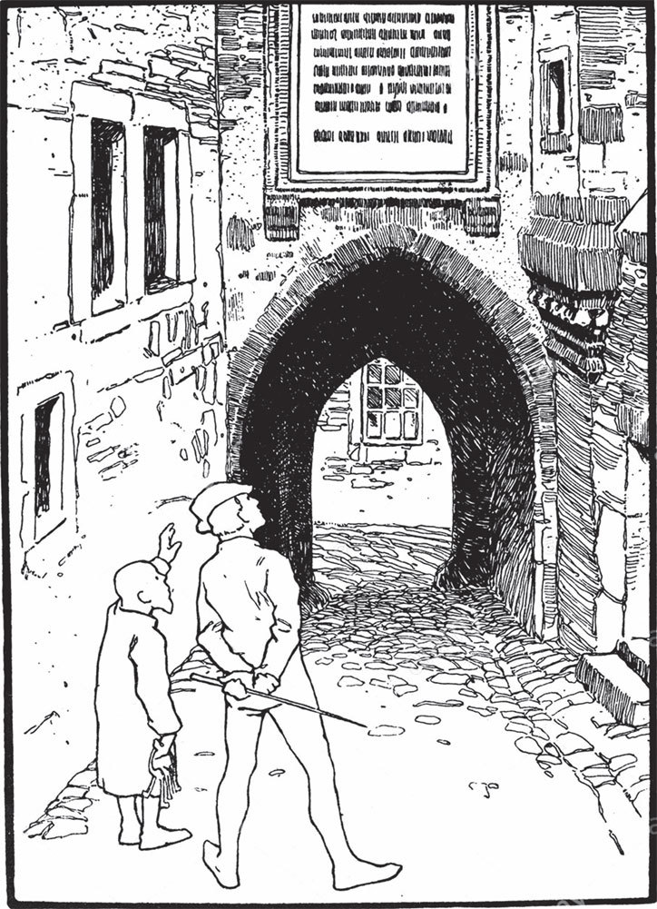

## Die Bienenkönigin

Zwei Königssöhne zogen einmal los, um <abbr title="das Abenteuer, die Abenteuer — приключение">Abenteuer</abbr> zu erleben. Sie gerieten in ein wildes, <abbr title="wüst — беспутный, разгульный">wüstes</abbr> Leben und kamen gar nicht mehr nach Hause. Der jüngste Bruder hieß der <abbr title="der Dummling, die Dummlinge — дурачок">Dummling</abbr>. Er <abbr title="sich aufmachen — отправиться в путь">machte sich auf</abbr> und suchte seine Brüder. Aber als er sie endlich fand, verspotteten sie ihn. Er wollte sich mit seiner <abbr title="die Einfalt — простодушие, простота">Einfalt</abbr> durch die Welt schlagen! Dabei kamen sie zwei nicht durch, obwohl sie doch viel klüger waren.

Sie zogen alle drei zusammen weiter und kamen an einen <abbr title="der Ameisenhaufen, die Ameisenhaufen — муравейник">Ameisenhaufen</abbr>. Die zwei älteren wollten ihn <abbr title="aufwühlen — разворошить">aufwühlen</abbr>. Sie wollten sehen, wie die kleinen Ameisen voller Angst herumkrochen und ihre Eier forttrugen. Aber der Dummling sagte:

— Lasst die Tiere <abbr title="in Frieden lassen — оставить в покое">in Frieden</abbr>. Ich <abbr title="dulden — терпеть, допускать">dulde</abbr> nicht, dass ihr sie stört.

Da gingen sie weiter und kamen an einen See. Darauf schwammen viele, viele Enten. Die zwei Brüder wollten ein paar fangen und braten. Aber der Dummling ließ es nicht zu und sagte:

— Lasst die Tiere in Frieden. Ich dulde nicht, dass ihr sie tötet.

Endlich kamen sie zu einem <abbr title="das Bienennest, die Bienennester — пчелиное гнездо, улей">Bienennest</abbr>. Darin war so viel Honig, dass er am Stamm herunterlief. Die zwei wollten Feuer unter dem Baum machen und die Bienen ersticken, um den Honig wegzunehmen. Aber der Dummling <abbr title="abhalten (hielt ab, hat abgehalten) — удерживать, не давать">hielt</abbr> sie wieder ab und sagte:

— Lasst die Tiere in Frieden. Ich dulde nicht, dass ihr sie verbrennt.

Endlich kamen die drei Brüder in ein Schloss. In den Ställen standen lauter steinerne Pferde, und kein Mensch war zu sehen. Sie gingen durch alle Säle, bis sie ganz am Ende vor eine Tür kamen. Davor hingen drei Schlösser. Mitten in der Tür war aber ein kleines <abbr title="das Fensterchen, die Fensterchen — окошечко">Fensterchen</abbr>, durch das man in die Stube sehen konnte. Da sahen sie ein graues Männchen, das an einem Tisch saß. Sie riefen es, einmal, zweimal, aber es hörte nicht. Endlich riefen sie zum dritten Mal. Da stand es auf, öffnete die Schlösser und kam heraus. Es sagte aber kein Wort, sondern führte sie zu einem <abbr title="reich gedeckt — богато накрытый">reich gedeckten</abbr> Tisch. Als sie gegessen und getrunken hatten, brachte es jeden in sein eigenes <abbr title="das Schlafgemach, die Schlafgemächer — опочивальня, спальня">Schlafgemach</abbr>.

Am nächsten Morgen kam das graue Männchen zu dem ältesten Bruder. Es winkte und führte ihn zu einer <abbr title="die Steintafel, die Steintafeln — каменная плита">Steintafel</abbr>. Darauf standen drei Aufgaben. Wer sie löste, konnte das Schloss erlösen. Die erste Aufgabe war: Im Wald unter dem Moos lagen die Perlen der Königstochter, tausend Stück. Die mussten gefunden werden. Und wenn vor Sonnenuntergang auch nur eine einzige fehlte, dann wurde der, der gesucht hatte, zu Stein.

Der Älteste ging hin und suchte den ganzen Tag. Aber als der Tag zu Ende war, hatte er erst hundert gefunden. Es geschah, was auf der Tafel stand: Er wurde in Stein verwandelt. Am nächsten Tag wagte der zweite Bruder das Abenteuer. Aber es ging ihm nicht viel besser als dem ältesten. Er fand nicht mehr als zweihundert Perlen und wurde zu Stein.

Endlich war auch der Dummling an der Reihe. Er suchte im Moos. Aber es war so schwer, die Perlen zu finden, und es ging so langsam. Da setzte er sich auf einen Stein und weinte. Und während er so dasaß, kam der Ameisenkönig, dem er einmal das Leben gerettet hatte, mit fünftausend Ameisen. Es <abbr title="dauern — длиться">dauerte</abbr> gar nicht lange, da hatten die kleinen Tiere zusammen alle Perlen gefunden und auf einen Haufen getragen.

Die zweite Aufgabe war, den Schlüssel zu der Schlafkammer der Königstochter aus dem See zu holen. Als der Dummling zum See kam, schwammen die Enten heran, die er einmal gerettet hatte. Sie tauchten unter und holten den Schlüssel aus der <abbr title="die Tiefe, die Tiefen — глубина">Tiefe</abbr>.

Die dritte Aufgabe aber war die schwerste. Der König hatte drei schlafende Töchter. Unter ihnen sollte er die jüngste und liebste <abbr title="heraussuchen — выбрать, отыскать">heraussuchen</abbr>. Aber sie <abbr title="sich gleichen (glich sich, hat sich geglichen) — быть похожими друг на друга">glichen sich</abbr> vollkommen. Es gab nur einen Unterschied: Bevor sie eingeschlafen waren, hatten sie verschiedene Süßigkeiten gegessen. Die älteste hatte ein Stück Zucker gegessen, die zweite ein wenig <abbr title="der Sirup — сироп">Sirup</abbr>, die jüngste einen <abbr title="der Löffel, die Löffel — ложка">Löffel</abbr> voll Honig.

Da kam die <abbr title="die Bienenkönigin, die Bienenköniginnen — пчелиная матка, королева пчёл">Bienenkönigin</abbr> von den Bienen, die der Dummling vor dem Feuer geschützt hatte. Sie probierte den Mund von allen dreien. Zuletzt blieb sie auf dem Mund sitzen, der Honig gegessen hatte. So erkannte der Königssohn die Richtige.

Da war der Zauber vorbei. Alles war aus dem Schlaf erlöst, und wer aus Stein war, bekam seine menschliche Gestalt zurück. Der Dummling heiratete die jüngste und liebste Tochter und wurde nach dem Tod von ihrem Vater König. Seine zwei Brüder aber bekamen die beiden anderen Schwestern.

---

### Neue Wörter

- **das Abenteuer, die Abenteuer** — приключение
- **wüst** — беспутный, разгульный
- **der Dummling, die Dummlinge** — дурачок
- **sich aufmachen** — отправиться в путь
- **die Einfalt** — простодушие, простота
- **der Ameisenhaufen, die Ameisenhaufen** — муравейник
- **aufwühlen** — разворошить
- **in Frieden lassen** — оставить в покое
- **dulden** — терпеть, допускать
- **das Bienennest, die Bienennester** — пчелиное гнездо, улей
- **abhalten (hielt ab, hat abgehalten)** — удерживать, не давать
- **das Fensterchen, die Fensterchen** — окошечко
- **reich gedeckt** — богато накрытый
- **das Schlafgemach, die Schlafgemächer** — опочивальня, спальня
- **die Steintafel, die Steintafeln** — каменная плита
- **dauern** — длиться
- **die Tiefe, die Tiefen** — глубина
- **heraussuchen** — выбрать, отыскать
- **sich gleichen (glich sich, hat sich geglichen)** — быть похожими друг на друга
- **der Sirup** — сироп
- **der Löffel, die Löffel** — ложка
- **die Bienenkönigin, die Bienenköniginnen** — пчелиная матка, королева пчёл

[← Zurück](kapitel-61.md) · [Inhalt](README.md)
