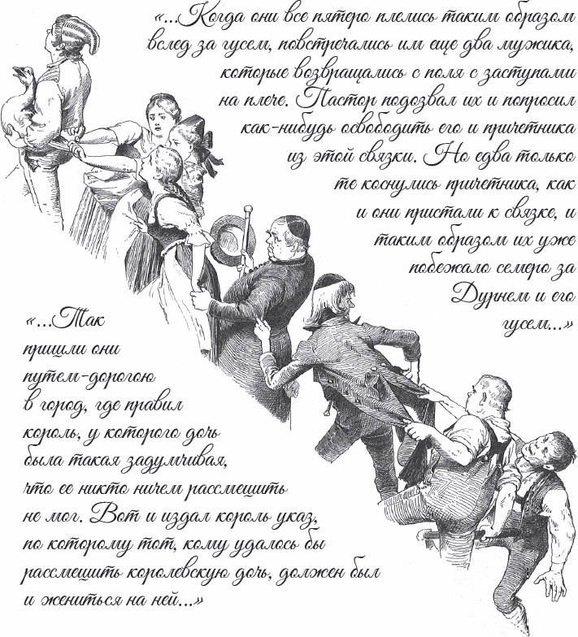

## Die goldene Gans

Es war einmal ein Mann, der hatte drei Söhne. Der jüngste hieß der Dummling. Alle verachteten ihn und verspotteten ihn, und bei jeder Gelegenheit kam er zuletzt.

Eines Tages wollte der älteste Sohn in den Wald gehen, um Holz zu hacken. Bevor er ging, gab ihm die Mutter noch einen schönen, feinen <abbr title="der Eierkuchen, die Eierkuchen — блин, омлет-лепёшка">Eierkuchen</abbr> und eine Flasche Wein mit, damit er keinen Hunger und keinen Durst litt. Als er in den Wald kam, begegnete ihm ein altes graues Männlein. Es wünschte ihm einen guten Tag und sagte:

— Gib mir doch ein Stück Kuchen aus deiner Tasche und lass mich einen Schluck von deinem Wein trinken. Ich bin so <abbr title="hungrig — голодный">hungrig</abbr> und durstig.

Aber der kluge Sohn antwortete:

— Gebe ich dir meinen Kuchen und meinen Wein, dann habe ich selbst nichts. <abbr title="sich packen — убираться (грубо)">Pack dich</abbr>, geh deiner Wege!

Er ließ das Männlein stehen und ging weiter. Dann fing er an, einen Baum zu fällen. Es dauerte nicht lange, da schlug er daneben, und die Axt fuhr ihm in den Arm. Er musste nach Hause gehen und sich <abbr title="verbinden (verband, hat verbunden) — перевязать">verbinden</abbr> lassen. Das war aber die Arbeit von dem grauen Männchen gewesen.

Danach ging der zweite Sohn in den Wald. Die Mutter gab ihm, wie dem ältesten, einen Eierkuchen und eine Flasche Wein. Auch ihm begegnete das alte graue Männchen und bat um ein Stückchen Kuchen und einen Schluck Wein. Aber auch der zweite Sohn sprach sehr vernünftig:

— Was ich dir gebe, das fehlt mir selbst. Pack dich, geh deiner Wege!

Er ließ das Männlein stehen und ging weiter. Die Strafe kam schnell: Nach ein paar Hieben an dem Baum hieb er sich ins Bein. Man musste ihn nach Hause tragen.

Da sagte der Dummling:

— Vater, lass mich doch einmal hinausgehen und Holz hacken.

Der Vater antwortete:

— Deine Brüder haben sich dabei verletzt. Lass das, du verstehst nichts davon.

Aber der Dummling bat so lange, bis der Vater endlich sagte:

— Dann geh nur. Durch Schaden wird man klug.

Die Mutter gab ihm einen Kuchen, der nur mit Wasser in der Asche gebacken war, und dazu eine Flasche <abbr title="sauer — кислый">saures</abbr> Bier. Als er in den Wald kam, begegnete ihm auch das alte graue Männchen. Es grüßte ihn und sagte:

— Gib mir ein Stück von deinem Kuchen und einen Schluck aus deiner Flasche. Ich bin so hungrig und durstig.

Der Dummling antwortete:

— Ich habe aber nur <abbr title="der Aschenkuchen, die Aschenkuchen — лепёшка, испечённая в золе">Aschenkuchen</abbr> und saures Bier. Wenn dir das recht ist, dann setzen wir uns und essen.

Sie setzten sich. Und als der Dummling seinen Aschenkuchen herausholte, war es ein feiner Eierkuchen, und das saure Bier war ein guter Wein. Nun aßen und tranken sie. Danach sagte das Männlein:

— Weil du ein gutes Herz hast und gern teilst, was du hast, will ich dir Glück <abbr title="schenken — дарить">schenken</abbr>. Dort steht ein alter Baum. Hau ihn um, dann findest du in den Wurzeln etwas.

Dann verabschiedete sich das Männlein.

Der Dummling ging hin und hieb den Baum um. Als der Baum fiel, saß in den Wurzeln eine Gans, und sie hatte Federn aus reinem Gold. Er hob sie heraus, nahm sie mit und ging in ein Wirtshaus. Dort wollte er übernachten.

Der Wirt hatte aber drei Töchter. Die sahen die Gans und waren neugierig, was das für ein seltsamer Vogel war. Sie hätten zu gern eine von seinen goldenen Federn gehabt. Die älteste dachte: «Ich finde schon eine Gelegenheit, eine Feder auszureißen.» Einmal ging der Dummling hinaus. Da packte sie die Gans am Flügel. Aber ihre Finger und ihre Hand blieben daran kleben.

Bald danach kam die zweite. Auch sie dachte an nichts anderes als an eine goldene Feder. Aber kaum hatte sie ihre Schwester berührt, da blieb sie an ihr hängen. Endlich kam auch die dritte mit demselben Plan. Da schrien die anderen:

— Bleib weg, <abbr title="um Himmels willen — ради бога">um Himmels willen</abbr>, bleib weg!

Aber sie begriff nicht, warum sie wegbleiben sollte. Sie dachte: «Wenn die dabei sind, kann ich auch dabei sein.» Sie sprang zu ihnen, und als sie ihre Schwester berührt hatte, blieb sie an ihr hängen. So mussten die drei die ganze Nacht bei der Gans verbringen.

Am nächsten Morgen nahm der Dummling die Gans in den Arm und ging los. Um die drei Mädchen, die daran hingen, kümmerte er sich nicht. Sie mussten immer hinter ihm herlaufen, mal links, mal rechts, wie es ihm gerade einfiel.

Mitten auf dem Feld trafen sie den Pfarrer. Als er diesen <abbr title="der Zug, die Züge — процессия, шествие">Zug</abbr> sah, sagte er:

— Schämt euch, ihr garstigen Mädchen! Warum lauft ihr dem jungen Burschen durchs Feld nach? Gehört sich das?

Und er fasste die jüngste an der Hand und wollte sie zurückziehen. Aber als er sie berührte, blieb auch er hängen und musste selbst hinterherlaufen.

Bald darauf kam der Küster des Weges. Er sah den Herrn Pfarrer, der drei Mädchen <abbr title="jemandem auf den Fersen folgen — следовать по пятам">auf den Fersen</abbr> folgte. Da wunderte er sich und rief:

— Ei, Herr Pfarrer, wohin so schnell? Vergesst nicht, dass wir heute noch eine Taufe haben!

Er lief zu ihm und fasste ihn am Ärmel, aber auch er blieb hängen. Wie die fünf so hintereinander her trabten, kamen zwei Bauern mit ihren Hacken vom Feld. Der Pfarrer rief sie und bat sie, ihn und den Küster <abbr title="losmachen — освободить, отцепить">loszumachen</abbr>. Aber kaum hatten sie den Küster berührt, da blieben sie hängen. Jetzt waren es schon sieben, die dem Dummling mit der Gans <abbr title="nachlaufen (lief nach, ist nachgelaufen) — бежать следом">nachliefen</abbr>.

Danach kam er in eine Stadt. Dort herrschte ein König, der hatte eine Tochter. Sie war so <abbr title="ernst — серьёзный">ernst</abbr>, dass niemand sie zum Lachen bringen konnte. Deshalb hatte der König ein <abbr title="das Gesetz, die Gesetze — закон">Gesetz</abbr> gemacht: Wer sie zum Lachen bringen konnte, der sollte sie heiraten. Als der Dummling das hörte, ging er mit seiner Gans und ihrem <abbr title="der Anhang — свита, «хвост»">Anhang</abbr> zur Königstochter. Sie sah die sieben Menschen, die immer hintereinander herliefen. Da fing sie ganz laut an zu lachen und konnte gar nicht mehr aufhören.

Nun wollte der Dummling sie als Braut haben. Aber dem König gefiel der Schwiegersohn nicht. Er hatte alle möglichen <abbr title="der Einwand, die Einwände — возражение">Einwände</abbr> und sagte: Zuerst muss der Dummling ihm einen Mann bringen, der einen ganzen Keller voll Wein austrinken kann.

Der Dummling dachte an das graue Männchen: «Das kann mir sicher helfen.» Er ging hinaus in den Wald. An der Stelle, wo er den Baum umgehauen hatte, saß ein Mann mit einem ganz betrübten Gesicht. Der Dummling fragte ihn, warum er so traurig war. Der Mann antwortete:

— Ich habe so großen Durst, und ich kann ihn nicht löschen. Kaltes Wasser <abbr title="vertragen (vertrug, hat vertragen) — переносить">vertrage</abbr> ich nicht. Ein ganzes Fass Wein habe ich zwar schon <abbr title="leeren — опустошать">geleert</abbr>, aber was ist schon <abbr title="ein Tropfen auf den heißen Stein — капля в море">ein Tropfen auf den heißen Stein</abbr>?

— Da kann ich dir helfen, — sagte der Dummling. — Komm nur mit, du sollst genug haben.

Er führte ihn in den Keller des Königs. Der Mann <abbr title="sich hermachen über + Akk. — набрасываться на">machte sich</abbr> über die großen Fässer her und trank und trank, bis ihm die <abbr title="die Hüfte, die Hüften — бедро">Hüften</abbr> wehtaten. Noch bevor ein Tag vorbei war, hatte er den ganzen Keller ausgetrunken.

Wieder wollte der Dummling seine Braut. Der König aber ärgerte sich: So ein einfacher Bursche, den alle nur Dummling nannten, sollte seine Tochter bekommen? Er stellte neue Bedingungen: Zuerst sollte der Dummling einen Mann bringen, der einen ganzen Berg Brot aufessen konnte.

Der Dummling überlegte nicht lange, sondern ging gleich hinaus in den Wald. Dort saß an derselben Stelle ein Mann. Er <abbr title="zuschnüren — затягивать (ремнём)">schnürte</abbr> sich den Bauch mit einem <abbr title="der Riemen, die Riemen — ремень">Riemen</abbr> zu, machte ein mürrisches Gesicht und sagte:

— Ich habe einen ganzen Backofen voll Brot gegessen. Aber was hilft das, wenn man so großen Hunger hat wie ich? Mein Magen bleibt leer. Ich muss mir den Bauch zuschnüren, damit ich nicht vor Hunger sterbe.

Darüber freute sich der Dummling und sagte:

— Steh auf und komm mit mir. Du sollst dich satt essen.

Er führte ihn an den Hof des Königs. Der König hatte alles Mehl aus dem ganzen Reich holen lassen, und daraus wurde ein riesiger Berg Brot gebacken. Der Mann aus dem Wald stellte sich davor und fing an zu essen. In einem Tag war der ganze Berg verschwunden.

Zum dritten Mal forderte der Dummling seine Braut. Der König aber suchte noch einmal eine Ausrede. Er verlangte ein Schiff, das auf dem Land und auf dem Wasser fahren konnte.

— Sobald du damit <abbr title="ansegeln — приплыть под парусами">angesegelt</abbr> kommst, — sagte er, — bekommst du meine Tochter zur Frau.

Der Dummling ging direkt in den Wald. Da saß das alte graue Männchen, dem er seinen Kuchen gegeben hatte, und sagte:

— Ich habe für dich getrunken und gegessen. Ich will dir auch das Schiff geben. Das alles tue ich, weil du barmherzig zu mir gewesen bist.

Da gab es ihm das Schiff, das auf dem Land und auf dem Wasser fuhr. Als der König das sah, konnte er ihm seine Tochter nicht länger <abbr title="verweigern — отказывать в">verweigern</abbr>. Die Hochzeit wurde gefeiert. Nach dem Tod des Königs erbte der Dummling das Reich und lebte noch lange glücklich mit seiner Frau.

---

### Neue Wörter

- **der Eierkuchen, die Eierkuchen** — блин, омлет-лепёшка
- **hungrig** — голодный
- **sich packen** — убираться (грубо)
- **verbinden (verband, hat verbunden)** — перевязать
- **sauer** — кислый
- **der Aschenkuchen, die Aschenkuchen** — лепёшка, испечённая в золе
- **schenken** — дарить
- **um Himmels willen** — ради бога
- **der Zug, die Züge** — процессия, шествие
- **jemandem auf den Fersen folgen** — следовать по пятам
- **losmachen** — освободить, отцепить
- **nachlaufen (lief nach, ist nachgelaufen)** — бежать следом
- **ernst** — серьёзный
- **das Gesetz, die Gesetze** — закон
- **der Anhang** — свита, «хвост»
- **der Einwand, die Einwände** — возражение
- **vertragen (vertrug, hat vertragen)** — переносить
- **leeren** — опустошать
- **ein Tropfen auf den heißen Stein** — капля в море
- **sich hermachen über + Akk.** — набрасываться на
- **die Hüfte, die Hüften** — бедро
- **zuschnüren** — затягивать (ремнём)
- **der Riemen, die Riemen** — ремень
- **ansegeln** — приплыть под парусами
- **verweigern** — отказывать в

[← Zurück](kapitel-63.md) · [Inhalt](README.md)
