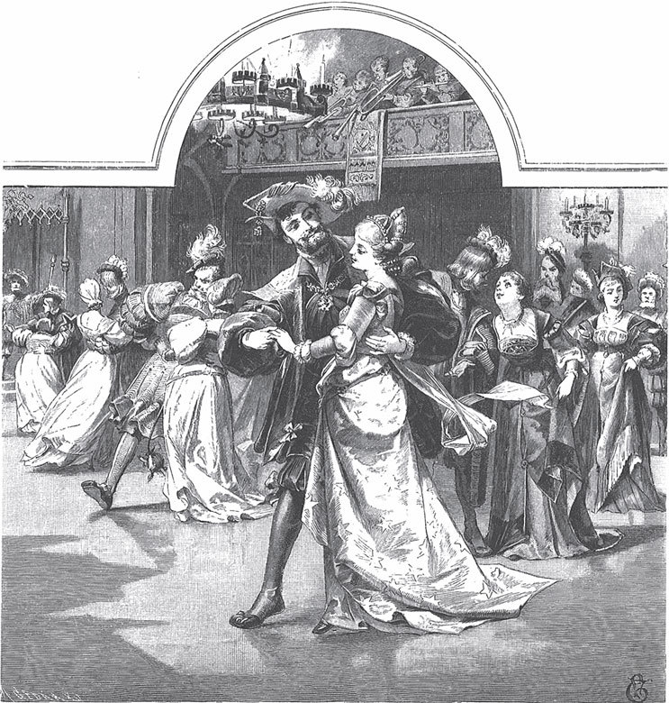

## Allerleirauh

Es war einmal ein König, der hatte eine Frau mit goldenen Haaren. Sie war so schön, dass es auf der ganzen Erde keine zweite wie sie gab. Eines Tages wurde sie krank. Als sie fühlte, dass sie bald sterben musste, rief sie den König und sagte:

— Wenn du nach meinem Tod wieder heiraten willst, dann nimm nur eine Frau, die genauso schön ist wie ich und die genauso goldene Haare hat wie ich. Das musst du mir versprechen.

Nachdem der König es ihr versprochen hatte, machte sie die Augen zu und starb.

Lange Zeit konnte niemand den König trösten, und er dachte nicht daran, eine zweite Frau zu nehmen. Endlich sagten seine Ratgeber:

— Es geht nicht anders. Der König muss wieder heiraten, damit wir eine Königin haben.

Nun wurden Boten weit und breit <abbr title="ausschicken — рассылать">ausgeschickt</abbr>. Sie sollten eine Braut suchen, die genauso schön war wie die verstorbene Königin. Aber auf der ganzen Welt gab es keine. Und selbst wenn man eine gefunden hätte – keine hatte solche goldenen Haare. So kamen die Boten <abbr title="erfolglos — безуспешно, ни с чем">erfolglos</abbr> wieder nach Hause.

Nun hatte der König eine Tochter. Sie war genauso schön wie ihre tote Mutter und hatte auch solche goldenen Haare. Als sie erwachsen war, sah der König sie einmal an. Er sah, dass sie in allem seiner toten Frau ähnlich war, und plötzlich fühlte er eine heftige Liebe zu ihr. Da sagte er zu seinen Ratgebern:

— Ich will meine Tochter heiraten. Sie ist das <abbr title="das Ebenbild, die Ebenbilder — точная копия, подобие">Ebenbild</abbr> meiner toten Frau, und eine andere Braut wie sie finde ich ja doch nicht.

Als die Ratgeber das hörten, erschraken sie und sagten:

— Gott hat verboten, dass ein Vater seine Tochter heiratet. Aus dieser Sünde kann nichts Gutes kommen, und das ganze Reich wird mit ins Unglück gezogen.

Die Tochter erschrak noch mehr, als sie den <abbr title="der Entschluss, die Entschlüsse — решение">Entschluss</abbr> ihres Vaters hörte. Aber sie hoffte, dass sie ihn von seinem Plan noch <abbr title="abbringen (brachte ab, hat abgebracht) — отговорить">abbringen</abbr> konnte. Da sagte sie zu ihm:

— Bevor ich Euren Wunsch erfülle, muss ich erst drei Kleider haben: eins so golden wie die Sonne, eins so silbern wie der Mond und eins so glänzend wie die Sterne. Außerdem verlange ich einen Mantel aus tausenderlei Pelz und <abbr title="das Rauchwerk — пушнина, меха">Rauchwerk</abbr>. Jedes Tier in Eurem Reich muss ein Stück von seiner Haut dazu geben.

Sie dachte aber: «Das alles zu <abbr title="beschaffen — раздобыть, достать">beschaffen</abbr>, ist ganz unmöglich. So bringe ich meinen Vater von seinen bösen Gedanken ab.»

Aber der König gab nicht auf. Die geschicktesten Mädchen in seinem Reich mussten die drei Kleider weben: eins so golden wie die Sonne, eins so silbern wie der Mond und eins so glänzend wie die Sterne. Und seine Jäger mussten alle Tiere im ganzen Reich fangen und ihnen ein Stück von ihrer Haut abziehen. Daraus wurde ein Mantel aus tausenderlei Rauchwerk gemacht. Endlich war alles fertig. Da ließ der König den Mantel holen, breitete ihn vor ihr aus und sagte:

— Morgen soll die Hochzeit sein.

Nun sah die Königstochter, dass sie das Herz ihres Vaters nicht mehr <abbr title="umstimmen — переубедить">umstimmen</abbr> konnte. Da beschloss sie zu fliehen. In der Nacht, während alle schliefen, stand sie auf. Von ihren <abbr title="die Kostbarkeit, die Kostbarkeiten — драгоценность">Kostbarkeiten</abbr> nahm sie drei Dinge mit: einen goldenen Ring, ein goldenes <abbr title="das Spinnrädchen, die Spinnrädchen — прялочка">Spinnrädchen</abbr> und eine goldene Haspel. Die drei Kleider von Sonne, Mond und Sternen steckte sie in eine Nussschale. Sie zog den Mantel aus allerlei Rauchwerk an und machte sich Gesicht und Hände mit <abbr title="der Ruß — сажа">Ruß</abbr> schwarz. Dann <abbr title="sich Gott befehlen — вверить себя Богу">befahl</abbr> sie sich Gott und ging fort. Sie ging die ganze Nacht, bis sie in einen großen Wald kam. Weil sie müde war, setzte sie sich in einen hohlen Baum und schlief ein.

Die Sonne ging auf, aber sie schlief weiter. Sie schlief noch immer, als es schon heller Tag war. Da geschah es, dass der König, dem dieser Wald gehörte, darin auf die Jagd ging. Als seine Hunde zu dem Baum kamen, schnupperten sie, liefen rundherum und bellten. Da sagte der König zu den Jägern:

— Seht doch nach, was für ein Wild sich dort versteckt hat.

Die Jäger gehorchten. Als sie zurückkamen, sagten sie:

— In dem hohlen Baum liegt ein seltsames Tier. So eins haben wir noch nie gesehen. Auf seiner Haut ist tausenderlei Pelz. Aber es liegt da und schläft.

Der König sagte:

— Versucht, ob ihr es lebendig fangen könnt. Dann bindet es auf den Wagen und nehmt es mit.

Als die Jäger das Mädchen anfassten, wachte es voller Schrecken auf und rief:

— Ich bin ein armes Kind, von Vater und Mutter verlassen. Habt Mitleid mit mir und nehmt mich mit!

Da sagten sie:

— Allerleirauh, du bist gut für die Küche. Komm nur mit, da kannst du die Asche <abbr title="zusammenkehren — сметать (в кучу)">zusammenkehren</abbr>.

Sie setzten sie also auf den Wagen und fuhren nach Hause ins königliche Schloss. Dort gaben sie ihr einen kleinen <abbr title="der Verschlag, die Verschläge — чулан, каморка">Verschlag</abbr> unter der Treppe, wohin kein Tageslicht kam, und sagten:

— <abbr title="das Rauhtierchen — «пушистый зверёк» (прозвище)">Rauhtierchen</abbr>, hier kannst du wohnen und schlafen.

Dann schickte man sie in die Küche. Dort trug sie Holz und Wasser, schürte das Feuer, rupfte die Hühner und Gänse, <abbr title="putzen — чистить">putzte</abbr> das Gemüse, kehrte die Asche und machte alle schmutzige Arbeit.

So lebte Allerleirauh lange Zeit sehr ärmlich. Ach, du schöne Königstochter, was soll nur aus dir werden!

Einmal aber gab es ein Fest im Schloss. Da sagte sie zum <abbr title="der Koch, die Köche — повар">Koch</abbr>:

— Darf ich ein bisschen hinaufgehen und <abbr title="zusehen (sah zu, hat zugesehen) — смотреть, наблюдать">zusehen</abbr>? Ich stelle mich draußen vor die Tür.

Der Koch antwortete:

— Ja, geh nur. Aber in einer halben Stunde musst du wieder hier sein und die Asche zusammentragen.

Da nahm sie ihr kleines <abbr title="das Öllämpchen, die Öllämpchen — масляная лампадка">Öllämpchen</abbr>, ging in ihren Verschlag und zog den Pelzmantel aus. Sie wusch sich den Ruß vom Gesicht und von den Händen, und ihre ganze Schönheit kam wieder zum Vorschein. Dann machte sie die Nuss auf und holte das Kleid heraus, das wie die Sonne glänzte. Danach ging sie hinauf zum Fest. Alle gingen ihr aus dem Weg, denn niemand kannte sie. Alle glaubten, sie war eine Königstochter. Der König aber kam ihr entgegen, reichte ihr die Hand und tanzte mit ihr. Er dachte in seinem Herzen: «So eine schöne Frau habe ich noch nie gesehen.»

Als der Tanz zu Ende war, verneigte sie sich. Und als der König sich umsah, war sie verschwunden, und niemand wusste, wohin. Man rief die Wächter, die vor dem Schloss standen, und fragte sie aus. Aber niemand hatte sie gesehen.

Sie war aber in ihren Verschlag gelaufen. Schnell hatte sie ihr Kleid ausgezogen, Gesicht und Hände schwarz gemacht und den Pelzmantel umgehängt. Jetzt war sie wieder Allerleirauh. Als sie in die Küche kam und die Asche zusammenkehren wollte, sagte der Koch:

— Lass das bis morgen. Koch mir lieber die <abbr title="die Suppe, die Suppen — суп">Suppe</abbr> für den König. Ich will auch einmal ein bisschen oben <abbr title="zugucken — подглядывать, глазеть">zugucken</abbr>. Aber lass mir kein Haar hineinfallen! Sonst bekommst du in Zukunft nichts mehr zu essen.

Der Koch ging fort, und Allerleirauh kochte die Suppe für den König. Sie kochte eine <abbr title="die Brotsuppe, die Brotsuppen — хлебный суп">Brotsuppe</abbr>, so gut sie konnte. Als die Suppe fertig war, holte sie aus dem Verschlag ihren goldenen Ring und legte ihn in die Schüssel, in die man die Suppe füllte.

Als der Tanz zu Ende war, ließ sich der König die Suppe bringen und aß sie. Sie schmeckte ihm so gut, dass er glaubte, er hatte noch nie eine bessere Suppe gegessen. Aber als er auf den Boden der Schüssel kam, sah er dort einen goldenen Ring liegen. Er konnte nicht begreifen, wie der Ring dorthin gekommen war. Da befahl er, dass der Koch zu ihm kommen sollte.

Der Koch erschrak, als er den Befehl hörte, und sagte zu Allerleirauh:

— Sicher hast du ein Haar in die Suppe fallen lassen! Wenn das wahr ist, bekommst du <abbr title="die Prügel (Pl.) — побои, взбучка">Prügel</abbr>.

Als er vor den König kam, fragte der König, wer die Suppe gekocht hatte. Der Koch antwortete:

— Ich habe sie gekocht.

Aber der König sagte:

— Das ist nicht wahr. Sie war anders und viel besser gekocht als sonst.

Da antwortete der Koch:

— Ich muss gestehen, dass ich sie nicht gekocht habe. Das Rauhtierchen hat sie gekocht.

Der König sagte:

— Geh und lass es heraufkommen.

Als Allerleirauh kam, fragte der König:

— Wer bist du?

— Ich bin ein armes Kind, das keinen Vater und keine Mutter mehr hat.

Er fragte weiter:

— Wozu bist du in meinem Schloss?

Sie antwortete:

— Ich bin zu nichts gut, nur dazu, dass man mir die Stiefel an den Kopf wirft.

Er fragte weiter:

— Woher hast du den Ring, der in der Suppe war?

Sie antwortete:

— Von dem Ring weiß ich nichts.

So konnte der König nichts erfahren und musste sie wieder wegschicken.

Nach einiger Zeit gab es wieder ein Fest. Da bat Allerleirauh den Koch wie beim letzten Mal um <abbr title="die Erlaubnis — разрешение">Erlaubnis</abbr>, zusehen zu dürfen. Er antwortete:

— Ja, aber komm in einer halben Stunde wieder und koch dem König die Brotsuppe, die er so gern isst.

Da lief sie in ihren Verschlag, wusch sich schnell, nahm aus der Nuss das Kleid, das so silbern war wie der Mond, und zog es an. Dann ging sie hinauf und sah aus wie eine Königstochter. Der König kam ihr entgegen und freute sich, dass er sie wiedersah. Weil gerade der Tanz begann, tanzten sie zusammen. Aber als der Tanz zu Ende war, verschwand sie wieder so schnell, dass der König nicht sehen konnte, wohin sie ging. Sie sprang in ihren Verschlag, machte sich wieder zum Rauhtierchen und ging in die Küche, um die Brotsuppe zu kochen. Während der Koch oben war, holte sie das goldene Spinnrad und legte es in die Schüssel. Die Suppe wurde darüber gefüllt. Dann brachte man sie dem König. Er aß sie, und sie schmeckte ihm so gut wie beim letzten Mal. Er ließ den Koch kommen, und auch diesmal musste der Koch gestehen, dass Allerleirauh die Suppe gekocht hatte. Wieder kam Allerleirauh vor den König. Aber sie antwortete nur, sie war allein dazu da, dass man ihr die Stiefel an den Kopf warf, und von dem goldenen Spinnrädchen wusste sie gar nichts.

Zum dritten Mal gab der König ein Fest, und es ging nicht anders als die letzten Male. Der Koch sagte zwar:

— Du bist eine Hexe, Rauhtierchen! Du tust immer etwas in die Suppe, und davon wird sie so gut und schmeckt dem König besser als meine.

Doch weil sie so bat, ließ er sie für die <abbr title="vereinbaren — договориться, условиться">vereinbarte</abbr> Zeit gehen. Nun zog sie das Kleid an, das wie die Sterne glänzte, und kam damit in den Saal. Der König tanzte wieder mit dem schönen Mädchen und meinte, dass sie noch nie so schön gewesen war. Und während er tanzte, <abbr title="anstecken — надеть (кольцо)">steckte</abbr> er ihr einen goldenen Ring an den Finger, ohne dass sie es merkte. Er hatte auch befohlen, dass der Tanz sehr lange dauern sollte. Als der Tanz zu Ende war, wollte er sie an den Händen festhalten. Aber sie riss sich los und sprang so schnell in die Menge, dass sie vor seinen Augen verschwand.

Sie lief, so schnell sie konnte, in ihren Verschlag unter der Treppe. Aber weil sie zu lange, mehr als eine halbe Stunde, geblieben war, konnte sie das schöne Kleid nicht mehr ausziehen. Sie warf nur den Pelzmantel darüber. In der Eile machte sie sich auch nicht ganz rußig: Ein Finger blieb weiß. Allerleirauh lief nun in die Küche, kochte dem König die Brotsuppe, und als der Koch fort war, legte sie die goldene Haspel hinein.

Als der König die Haspel auf dem Boden der Schüssel fand, ließ er Allerleirauh rufen. Da sah er den weißen Finger und den Ring, den er ihr beim Tanz angesteckt hatte. Er ergriff ihre Hand und hielt sie fest. Sie wollte sich losmachen und davonspringen, aber da ging der Pelzmantel ein wenig auf, und das Sternenkleid schimmerte darunter hervor. Der König fasste den Mantel und riss ihn ab. Da kamen die goldenen Haare hervor, und sie stand da in ihrer ganzen Pracht. Sie konnte sich nicht länger <abbr title="verbergen (verbarg, hat verborgen) — скрывать, прятать">verbergen</abbr>. Und als sie Ruß und Asche aus ihrem Gesicht gewischt hatte, war sie schöner als jede Frau, die man je auf der Erde gesehen hatte. Der König aber sagte:

— Du bist meine liebe Braut, und wir trennen uns nie mehr.

Danach wurde die Hochzeit gefeiert, und sie lebten glücklich bis an ihr Ende.

---

### Neue Wörter

- **ausschicken** — рассылать
- **erfolglos** — безуспешно, ни с чем
- **das Ebenbild, die Ebenbilder** — точная копия, подобие
- **der Entschluss, die Entschlüsse** — решение
- **abbringen (brachte ab, hat abgebracht)** — отговорить
- **das Rauchwerk** — пушнина, меха
- **beschaffen** — раздобыть, достать
- **umstimmen** — переубедить
- **die Kostbarkeit, die Kostbarkeiten** — драгоценность
- **das Spinnrädchen, die Spinnrädchen** — прялочка
- **der Ruß** — сажа
- **sich Gott befehlen** — вверить себя Богу
- **zusammenkehren** — сметать (в кучу)
- **der Verschlag, die Verschläge** — чулан, каморка
- **das Rauhtierchen** — «пушистый зверёк» (прозвище)
- **putzen** — чистить
- **der Koch, die Köche** — повар
- **zusehen (sah zu, hat zugesehen)** — смотреть, наблюдать
- **das Öllämpchen, die Öllämpchen** — масляная лампадка
- **die Suppe, die Suppen** — суп
- **zugucken** — подглядывать, глазеть
- **die Brotsuppe, die Brotsuppen** — хлебный суп
- **die Prügel (Pl.)** — побои, взбучка
- **die Erlaubnis** — разрешение
- **vereinbaren** — договориться, условиться
- **anstecken** — надеть (кольцо)
- **verbergen (verbarg, hat verborgen)** — скрывать, прятать

[← Zurück](kapitel-64.md) · [Inhalt](README.md)
