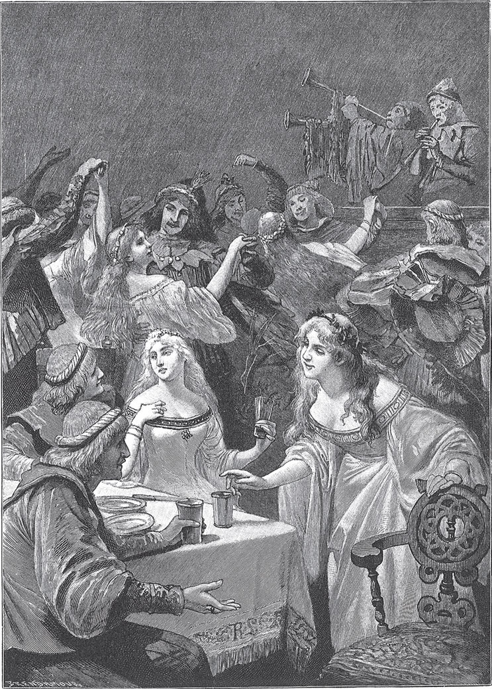

## Die zwölf Jäger

Es war einmal ein Königssohn, der hatte eine Braut und liebte sie sehr. Eines Tages saß er bei ihr und war ganz fröhlich. Da kam die Nachricht, dass sein Vater todkrank war und ihn vor seinem Ende noch einmal sehen wollte. Da sagte er zu seiner Liebsten:

— Ich muss jetzt fort und dich verlassen. Ich gebe dir diesen Ring als Andenken an mich. Wenn ich König bin, komme ich zurück und hole dich zu mir.

Dann ritt er fort. Als er bei seinem Vater ankam, war dieser <abbr title="sterbenskrank — смертельно больной">sterbenskrank</abbr> und dem Tod nah. Er sagte zu ihm:

— Liebster Sohn, ich wollte dich vor meinem Ende noch einmal sehen. Versprich mir, dass du so heiratest, wie ich es will.

Und er nannte ihm eine bestimmte Königstochter, die seine Frau werden sollte. Der Sohn war so betrübt, dass er gar nicht lange <abbr title="nachdenken (dachte nach, hat nachgedacht) — размышлять, обдумывать">nachdachte</abbr>. Er sagte:

— Ja, lieber Vater, Euer Wille soll geschehen.

Darauf schloss der König die Augen und starb.

Der Sohn wurde zum König <abbr title="ausrufen (rief aus, hat ausgerufen) — провозглашать">ausgerufen</abbr>. Als die <abbr title="die Trauerzeit — время траура">Trauerzeit</abbr> vorbei war, musste er das Versprechen halten, das er seinem Vater gegeben hatte. Er ließ um die Königstochter werben, und sie wurde ihm auch <abbr title="zusagen — дать согласие, обещать">zugesagt</abbr>.

Das hörte seine erste Braut. Sie <abbr title="sich grämen über + Akk. — горевать, сокрушаться">grämte sich</abbr> so sehr über seine <abbr title="die Untreue — неверность">Untreue</abbr>, dass sie fast daran starb. Da sagte ihr Vater zu ihr:

— Liebstes Kind, warum bist du so traurig? Was du dir wünschst, das sollst du haben.

Sie überlegte einen Augenblick, dann sagte sie:

— Lieber Vater, ich wünsche mir elf Mädchen, die mir im Gesicht, in der Gestalt und im <abbr title="der Wuchs — рост, телосложение">Wuchs</abbr> <abbr title="völlig — полностью, совершенно">völlig</abbr> gleichen.

Der König sagte:

— Wenn es möglich ist, soll dein Wunsch erfüllt werden.

Und er ließ in seinem ganzen Reich so lange suchen, bis man elf junge Mädchen gefunden hatte, die seiner Tochter im Gesicht, in der Gestalt und im Wuchs völlig glichen.

Als die Mädchen zur Königstochter kamen, ließ sie zwölf <abbr title="das Jägerkleid, die Jägerkleider — охотничий костюм">Jägerkleider</abbr> machen, eins genau wie das andere. Die elf Mädchen mussten die Jägerkleider anziehen, und sie selbst zog das zwölfte an. Dann <abbr title="sich verabschieden von + Dat. — прощаться с">verabschiedete sie sich</abbr> von ihrem Vater und ritt mit ihnen fort, an den Hof ihres <abbr title="ehemalig — бывший">ehemaligen</abbr> Bräutigams, den sie so sehr liebte. Dort fragte sie, ob er Jäger brauchte und ob er sie nicht alle zusammen in seinen <abbr title="der Dienst, die Dienste — служба">Dienst</abbr> nehmen wollte. Der König sah sie an und erkannte sie nicht. Aber weil es so schöne Leute waren, sagte er Ja, er wollte sie gern nehmen. Und so waren sie die zwölf Jäger des Königs.

Der König aber hatte einen Löwen. Das war ein wunderliches Tier, denn er wusste alles, was verborgen und heimlich war. Eines Abends sagte er zum König:

— Du glaubst, du hast da zwölf Jäger?

— Ja, — sagte der König, — es sind zwölf Jäger.

Der Löwe sprach weiter:

— Du <abbr title="sich irren — ошибаться">irrst dich</abbr>. Das sind zwölf Mädchen.

Der König antwortete:

— Das ist niemals wahr. Wie willst du mir das beweisen?

— Oh, lass nur Erbsen in deinem <abbr title="das Vorzimmer, die Vorzimmer — приёмная, прихожая">Vorzimmer</abbr> streuen, — antwortete der Löwe. — Dann siehst du es gleich. Männer haben einen festen Schritt. Wenn sie über Erbsen gehen, bewegt sich keine. Aber Mädchen, die trippeln und <abbr title="trappeln — топотать">trappeln</abbr> und <abbr title="schlurfen — шаркать">schlurfen</abbr>, und die Erbsen rollen.

Dem König gefiel der Rat gut, und er ließ die Erbsen streuen.

Es gab aber einen Diener des Königs, der mochte die Jäger. Als er hörte, dass man sie auf die Probe stellen wollte, ging er zu ihnen und erzählte ihnen alles. Er sagte:

— Der Löwe will dem König <abbr title="weismachen — внушать, морочить голову">weismachen</abbr>, dass ihr Mädchen seid.

Die Königstochter dankte ihm. Danach sagte sie zu ihren Mädchen:

— <abbr title="sich zusammennehmen (nahm zusammen, hat zusammengenommen) — взять себя в руки">Nehmt euch zusammen</abbr> und tretet fest auf die Erbsen.

Am nächsten Morgen ließ der König die zwölf Jäger zu sich rufen. Sie kamen ins Vorzimmer, wo die Erbsen lagen. Sie traten so fest darauf und hatten einen so sicheren, starken Gang, dass keine einzige rollte oder sich bewegte. Dann gingen sie wieder fort, und der König sagte zum Löwen:

— Du hast mich <abbr title="belügen (belog, hat belogen) — обманывать, лгать">belogen</abbr>. Sie gehen ja wie Männer.

Der Löwe antwortete:

— Sie haben gewusst, dass man sie auf die Probe stellen will, und haben sich zusammengenommen. Lass einmal zwölf Spinnräder ins Vorzimmer bringen. Dann kommen sie <abbr title="herbei — сюда, поближе">herbei</abbr> und freuen sich darüber, und das tut kein Mann.

Dem König gefiel der Rat, und er ließ die Spinnräder ins Vorzimmer stellen.

Aber der Diener, der es ehrlich mit den Jägern meinte, ging zu ihnen und verriet ihnen den Plan. Als sie allein waren, sagte die Königstochter zu ihren elf Mädchen:

— Nehmt euch zusammen und seht euch nicht nach den Spinnrädern um.

Am nächsten Morgen ließ der König seine zwölf Jäger rufen. Sie kamen durch das Vorzimmer und sahen die Spinnräder gar nicht an. Da sagte der König wieder zum Löwen:

— Du hast mich belogen. Es sind Männer, denn sie haben die Spinnräder nicht angesehen.

Der Löwe antwortete:

— Sie haben gewusst, dass man sie auf die Probe stellen will, und haben sich zusammengenommen.

Aber der König wollte dem Löwen nicht mehr glauben.

Die zwölf Jäger begleiteten den König immer auf die Jagd, und er mochte sie von Tag zu Tag lieber. Einmal, als sie gerade auf der Jagd waren, kam die Nachricht: Die Braut des Königs ist schon <abbr title="unterwegs — в пути">unterwegs</abbr>. Als die richtige Braut das hörte, tat es ihr so weh, dass ihr fast das Herz brach. Sie fiel ohnmächtig auf die Erde.

Der König dachte, seinem lieben Jäger war etwas passiert. Er lief hin, um ihm zu helfen, und zog ihm den Handschuh aus. Da sah er den Ring, den er seiner ersten Braut gegeben hatte. Und als er ihr ins Gesicht sah, erkannte er sie. Sein Herz war so gerührt, dass er sie küsste. Als sie die Augen aufmachte, sagte er:

— Du bist mein, und ich bin dein, und kein Mensch auf der Welt kann das ändern.

Zu der anderen Braut aber schickte er einen Boten. Er ließ sie bitten, in ihr Reich <abbr title="zurückkehren (ist zurückgekehrt) — возвращаться">zurückzukehren</abbr>, denn er hatte schon eine Frau. Und wer einen alten Schlüssel wiedergefunden hat, der braucht keinen neuen.

Danach wurde die Hochzeit gefeiert. Und der Löwe kam wieder in Gnade, weil er ja doch die Wahrheit gesagt hatte.

---

### Neue Wörter

- **sterbenskrank** — смертельно больной
- **nachdenken (dachte nach, hat nachgedacht)** — размышлять, обдумывать
- **ausrufen (rief aus, hat ausgerufen)** — провозглашать
- **die Trauerzeit** — время траура
- **zusagen** — дать согласие, обещать
- **sich grämen über + Akk.** — горевать, сокрушаться
- **die Untreue** — неверность
- **der Wuchs** — рост, телосложение
- **völlig** — полностью, совершенно
- **das Jägerkleid, die Jägerkleider** — охотничий костюм
- **sich verabschieden von + Dat.** — прощаться с
- **ehemalig** — бывший
- **der Dienst, die Dienste** — служба
- **sich irren** — ошибаться
- **das Vorzimmer, die Vorzimmer** — приёмная, прихожая
- **trappeln** — топотать
- **schlurfen** — шаркать
- **weismachen** — внушать, морочить голову
- **sich zusammennehmen (nahm zusammen, hat zusammengenommen)** — взять себя в руки
- **belügen (belog, hat belogen)** — обманывать, лгать
- **herbei** — сюда, поближе
- **unterwegs** — в пути
- **zurückkehren (ist zurückgekehrt)** — возвращаться

[← Zurück](kapitel-66.md) · [Inhalt](README.md)
