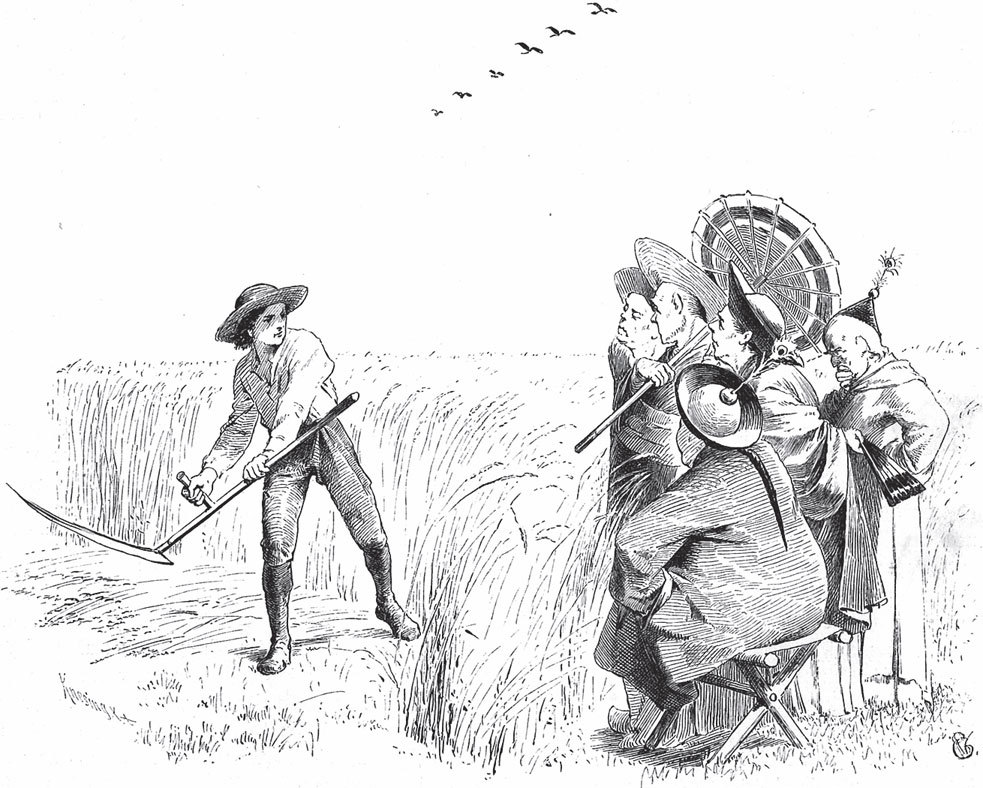

## Die drei Glückskinder

Ein Vater rief einmal seine drei Söhne zu sich. Dem ersten schenkte er einen Hahn, dem zweiten eine Sense und dem dritten eine Katze.

— Ich bin schon alt, — sagte er, — und mein Tod ist nah. Deshalb wollte ich vor meinem Ende noch für euch sorgen. Geld habe ich nicht. Was ich euch jetzt gebe, scheint wenig <abbr title="wert — стоящий, ценный">wert</abbr> zu sein. Aber es kommt nur darauf an, dass ihr es klug <abbr title="einsetzen — применять, использовать">einsetzt</abbr>. Sucht euch nur ein Land, wo man solche Dinge noch nicht kennt. Dann ist euer Glück gemacht.

Nach dem Tod des Vaters zog der älteste mit seinem Hahn los. Aber wohin er auch kam, kannte man den Hahn schon. In den Städten sah er ihn schon von weitem oben auf den Türmen sitzen und sich mit dem Wind drehen. In den Dörfern hörte er mehr als einen krähen. Niemand wollte über das Tier staunen. Es sah also nicht so aus, als ob er damit sein Glück machen könnte.

Endlich aber hatte er doch Glück: Er kam auf eine <abbr title="die Insel, die Inseln — остров">Insel</abbr>, wo die Leute nichts von einem Hahn wussten. Sie konnten sich nicht einmal ihre Zeit <abbr title="einteilen — распределять, делить">einteilen</abbr>. Sie wussten zwar, wann es Morgen oder Abend war. Aber in der Nacht, wenn sie nicht <abbr title="verschlafen (verschlief, hat verschlafen) — проспать">verschliefen</abbr>, wusste keiner, wie spät es war.

— Seht, — sagte er, — was für ein stolzes Tier! Es hat eine <abbr title="rubinrot — рубиново-красный">rubinrote</abbr> Krone auf dem Kopf und trägt Sporen wie ein Ritter. In der Nacht ruft es euch dreimal zu einer bestimmten Zeit. Und wenn es zum letzten Mal ruft, geht bald die Sonne auf. Wenn es aber am hellen Tag ruft, dann <abbr title="sich einstellen auf + Akk. — приготовиться к">stellt euch darauf ein</abbr>: Dann kommt bestimmt anderes Wetter.

Das gefiel den Leuten sehr. Sie schliefen eine ganze Nacht nicht und hörten mit großer Freude, wie der Hahn um zwei, um vier und um sechs Uhr laut und deutlich die Zeit ausrief. Sie fragten ihn, ob das Tier zu verkaufen wäre und wie viel er dafür haben wollte.

— Ungefähr so viel Gold, wie ein Esel tragen kann, — antwortete er.

— Das ist ja fast <abbr title="geschenkt — почти даром">geschenkt</abbr> für so ein kostbares Tier! — riefen alle zusammen und gaben ihm gern, was er verlangt hatte.

Als er mit dem Reichtum nach Hause kam, staunten seine Brüder. Der zweite sagte:

— Dann will ich mich auch auf den Weg machen und sehen, ob ich meine Sense genauso gut loswerde.

Aber es sah nicht danach aus. Überall traf er Bauern, und alle trugen genauso eine Sense auf der Schulter wie er. Doch zuletzt hatte auch er Glück, auf einer Insel, wo die Leute nichts von einer Sense wussten. Wenn dort das Korn reif war, fuhren sie Kanonen vor die Felder und schossen es herunter. Das war aber eine unsichere Sache. Mancher schoss darüber hinaus. Ein anderer traf statt des <abbr title="der Halm, die Halme — стебель, соломина">Halms</abbr> die <abbr title="die Ähre, die Ähren — колос">Ähren</abbr> und schoss sie fort. Dabei ging viel <abbr title="verloren gehen — пропадать">verloren</abbr>, und dazu gab es einen fürchterlichen Lärm. Da stellte sich der Mann hin und mähte das Korn so still und so schnell ab, dass die Leute vor Staunen Mund und Nase aufsperrten. Sie wollten ihm gern dafür geben, was er verlangte. Und er bekam ein Pferd, das so viel Gold trug, wie es nur tragen konnte.

Nun wollte auch der dritte Bruder seine Katze an den richtigen Mann bringen. Es ging ihm wie den anderen. Solange er auf dem <abbr title="das Festland — материк, суша">Festland</abbr> blieb, konnte er nichts erreichen. Es gab überall Katzen, und es waren so viele, dass man die neugeborenen Jungen meistens im Wasser ertränkte. Endlich ließ er sich mit einem Schiff auf eine Insel bringen. Dort hatte man zum Glück noch nie eine Katze gesehen. Und die Mäuse hatten so <abbr title="überhandnehmen (nahm überhand, hat überhandgenommen) — расплодиться, взять верх">überhandgenommen</abbr>, dass sie auf den Tischen und Bänken tanzten – egal, ob der Hausherr zu Hause war oder nicht.

Die Leute jammerten sehr über diese Plage. Sogar der König konnte sich in seinem Schloss nicht davor retten. In allen Ecken pfiffen Mäuse und <abbr title="zernagen — изгрызть">zernagten</abbr> alles, was sie mit ihren Zähnen packen konnten. Da fing die Katze ihre Jagd an und hatte bald ein paar Säle <abbr title="säubern — очищать">gesäubert</abbr>. Die Leute baten den König, das <abbr title="das Wundertier, die Wundertiere — чудо-зверь">Wundertier</abbr> für das Reich zu kaufen. Der König gab gern, was verlangt wurde: einen <abbr title="der Maulesel, die Maulesel — мул, лошак">Maulesel</abbr>, der mit Gold <abbr title="beladen (belud, hat beladen) — нагружать">beladen</abbr> war. Und der dritte Bruder kam mit den allergrößten Schätzen nach Hause.

Die Katze hatte im königlichen Schloss ihren großen Spaß mit den Mäusen und biss so viele tot, dass man sie nicht mehr zählen konnte. Endlich wurde ihr von der Arbeit heiß, und sie bekam Durst. Da blieb sie stehen, hob den Kopf und schrie:

— Miau, miau!

Als der König und alle seine Leute das seltsame Geschrei hörten, erschraken sie. In ihrer Angst liefen sie alle aus dem Schloss hinaus. Unten hielt der König <abbr title="Rat halten — держать совет">Rat</abbr>, was jetzt das Beste wäre. Zuletzt beschloss man, einen <abbr title="der Herold, die Herolde — глашатай">Herold</abbr> zu der Katze zu schicken. Er sollte sie auffordern, das Schloss zu verlassen – sonst würde man Gewalt gegen sie <abbr title="anwenden — применять">anwenden</abbr>. Die Ratgeber sagten:

— Lieber wollen wir uns von den Mäusen <abbr title="plagen — мучить, донимать">plagen</abbr> lassen – an dieses <abbr title="das Übel, die Übel — зло, беда">Übel</abbr> sind wir <abbr title="gewöhnt sein an + Akk. — привыкнуть к">gewöhnt</abbr> –, als unser Leben so einem Ungeheuer zu überlassen.

Ein <abbr title="der Edelknabe, die Edelknaben — паж">Edelknabe</abbr> musste hinaufgehen und die Katze fragen, ob sie das Schloss <abbr title="freiwillig — добровольно">freiwillig</abbr> <abbr title="räumen — освободить, покинуть">räumen</abbr> wollte. Aber die Katze hatte jetzt noch mehr Durst und antwortete nur:

— Miau, miau!

Der Edelknabe verstand: «<abbr title="durchaus — совершенно, вполне">Durchaus</abbr>, durchaus nicht!» Und er brachte dem König diese Antwort.

— Nun, — sagten die Ratgeber, — dann soll sie der Gewalt weichen.

Man fuhr Kanonen auf und schoss das Haus in <abbr title="in Brand schießen — поджечь стрельбой">Brand</abbr>. Als das Feuer in den Saal kam, wo die Katze saß, sprang sie glücklich aus dem Fenster. Die <abbr title="der Belagerer, die Belagerer — осаждающий">Belagerer</abbr> aber hörten nicht eher auf, bis das ganze Schloss <abbr title="in Grund und Boden — дотла, до основания">in Grund und Boden</abbr> geschossen war.

---

### Neue Wörter

- **wert** — стоящий, ценный
- **einsetzen** — применять, использовать
- **die Insel, die Inseln** — остров
- **einteilen** — распределять, делить
- **verschlafen (verschlief, hat verschlafen)** — проспать
- **rubinrot** — рубиново-красный
- **sich einstellen auf + Akk.** — приготовиться к
- **geschenkt** — почти даром
- **der Halm, die Halme** — стебель, соломина
- **die Ähre, die Ähren** — колос
- **verloren gehen** — пропадать
- **das Festland** — материк, суша
- **überhandnehmen (nahm überhand, hat überhandgenommen)** — расплодиться, взять верх
- **zernagen** — изгрызть
- **säubern** — очищать
- **das Wundertier, die Wundertiere** — чудо-зверь
- **der Maulesel, die Maulesel** — мул, лошак
- **beladen (belud, hat beladen)** — нагружать
- **Rat halten** — держать совет
- **der Herold, die Herolde** — глашатай
- **anwenden** — применять
- **plagen** — мучить, донимать
- **das Übel, die Übel** — зло, беда
- **gewöhnt sein an + Akk.** — привыкнуть к
- **der Edelknabe, die Edelknaben** — паж
- **freiwillig** — добровольно
- **räumen** — освободить, покинуть
- **durchaus** — совершенно, вполне
- **in Brand schießen** — поджечь стрельбой
- **der Belagerer, die Belagerer** — осаждающий
- **in Grund und Boden** — дотла, до основания

[← Zurück](kapitel-69.md) · [Inhalt](README.md)
