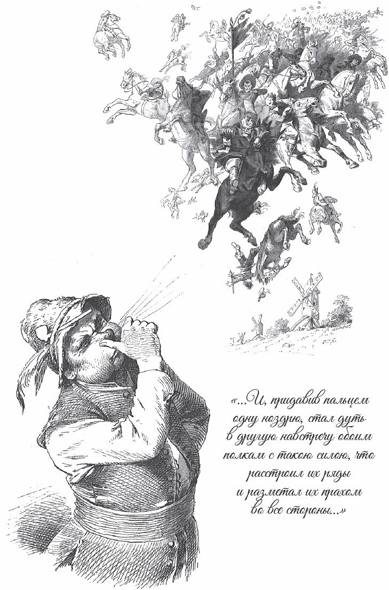

## Sechse kommen durch die ganze Welt

Es war einmal ein Mann, der konnte allerlei Künste. Er diente im Krieg und war brav und tapfer. Aber als der Krieg zu Ende war, bekam er seinen Abschied und nur drei Heller <abbr title="das Reisegeld — деньги на дорогу">Reisegeld</abbr>.

— Wartet nur, — sagte er, — das lasse ich mir nicht gefallen! Wenn ich die richtigen Leute finde, dann muss mir der König noch die Schätze des ganzen Landes herausgeben.

Voller Zorn ging er in den Wald. Dort sah er einen Mann stehen, der hatte sechs Bäume ausgerissen, als ob es <abbr title="der Kornhalm, die Kornhalme — колосок, стебелёк">Kornhalme</abbr> wären. Er sagte zu ihm:

— Willst du mein Diener sein und mit mir ziehen?

— Ja, — antwortete der, — aber zuerst will ich meiner Mutter das kleine <abbr title="das Bündel, die Bündel — вязанка, связка">Bündel</abbr> Holz nach Hause bringen.

Er nahm einen von den Bäumen und wickelte ihn um die fünf anderen. Dann hob er das Bündel auf die Schulter und trug es fort. Dann kam er wieder und ging mit seinem Herrn. Der sagte:

— Wir zwei kommen bestimmt durch die ganze Welt.

Als sie ein Weilchen gegangen waren, fanden sie einen Jäger. Er kniete auf dem Boden, hatte das Gewehr angelegt und zielte. Der Herr sagte zu ihm:

— Jäger, was willst du denn schießen?

Er antwortete:

— Zwei Meilen von hier sitzt eine Fliege auf dem Ast einer Eiche. Der will ich das linke Auge <abbr title="herausschießen — выбить выстрелом">herausschießen</abbr>.

— Oh, komm mit mir, — sagte der Mann. — Wenn wir drei zusammen sind, kommen wir bestimmt durch die ganze Welt.

Der Jäger war <abbr title="bereit — готовый">bereit</abbr> und ging mit ihm. Sie kamen zu sieben <abbr title="die Windmühle, die Windmühlen — ветряная мельница">Windmühlen</abbr>. Deren Flügel drehten sich ganz schnell. Aber weder links noch rechts wehte ein Wind, und kein Blättchen bewegte sich. Da sagte der Mann:

— Ich weiß nicht, was die Windmühlen <abbr title="antreiben (trieb an, hat angetrieben) — приводить в движение">antreibt</abbr>. Es geht ja kein <abbr title="das Lüftchen — ветерок">Lüftchen</abbr>.

Er ging mit seinen Dienern weiter. Als sie zwei Meilen gegangen waren, sahen sie einen Mann auf einem Baum sitzen. Er hielt sich das eine <abbr title="das Nasenloch, die Nasenlöcher — ноздря">Nasenloch</abbr> zu und blies aus dem anderen.

— Mensch, was treibst du denn da oben? — fragte der Mann.

Er antwortete:

— Zwei Meilen von hier stehen sieben Windmühlen. Seht, die blase ich an, damit sie laufen.

— Oh, komm mit mir, — sagte der Mann. — Wenn wir vier zusammen sind, kommen wir bestimmt durch die ganze Welt.

Da stieg der <abbr title="der Bläser, die Bläser — дувун, тот, кто дует">Bläser</abbr> herunter und ging mit. Nach einer Weile sahen sie einen, der stand auf einem Bein. Das andere hatte er <abbr title="abschnallen — отстегнуть">abgeschnallt</abbr> und neben sich gelegt. Da sagte der Herr:

— Du hast es dir ja bequem gemacht zum Ausruhen.

— Ich bin ein <abbr title="der Läufer, die Läufer — бегун, скороход">Läufer</abbr>, — antwortete er. — Damit ich nicht gar zu schnell renne, habe ich mir das eine Bein abgeschnallt. Wenn ich mit zwei Beinen laufe, bin ich schneller, als ein Vogel fliegt.

— Oh, komm mit mir. Wenn wir fünf zusammen sind, kommen wir bestimmt durch die ganze Welt.

Da ging er mit. Es dauerte gar nicht lange, da trafen sie einen, der hatte einen kleinen Hut auf. Aber er trug den Hut ganz schief auf dem einen Ohr. Da sagte der Herr zu ihm:

— Ordentlich, ordentlich! Häng doch deinen Hut nicht auf ein Ohr. Du siehst ja aus wie ein <abbr title="der Hanswurst, die Hanswurste — шут, паяц">Hanswurst</abbr>!

— Das darf ich nicht, — sagte der andere. — Denn wenn ich meinen Hut gerade setze, dann kommt ein gewaltiger <abbr title="der Frost, die Fröste — мороз">Frost</abbr>. Dann erfrieren die Vögel unter dem Himmel und fallen tot auf die Erde.

— Oh, komm mit mir, — sagte der Herr. — Wenn wir sechs zusammen sind, kommen wir bestimmt durch die ganze Welt.

Nun gingen die sechs in eine Stadt. Dort hatte der König bekannt gemacht: Wer mit seiner Tochter um die <abbr title="um die Wette laufen — бежать наперегонки">Wette</abbr> laufen will und gewinnt, der soll ihr Mann werden. Wer aber verliert, muss seinen Kopf hergeben. Da meldete sich der Mann und sagte:

— Ich will aber meinen Diener für mich laufen lassen.

Der König antwortete:

— Dann musst du auch sein Leben als <abbr title="das Pfand, die Pfänder — залог">Pfand</abbr> geben. Sein Kopf und dein Kopf <abbr title="haften für + Akk. — отвечать за">haften</abbr> für den Sieg.

Als das vereinbart war, schnallte der Mann dem Läufer das andere Bein <abbr title="anschnallen — пристегнуть">an</abbr> und sagte zu ihm:

— Nun sei flink und hilf uns, dass wir gewinnen.

Es war <abbr title="festlegen — установить, определить">festgelegt</abbr>: Wer zuerst Wasser aus einem weit entfernten Brunnen bringt, der ist Sieger. Nun bekam der Läufer einen Krug, und die Königstochter bekam auch einen. Sie fingen zur gleichen Zeit an zu laufen. Aber schon im nächsten Augenblick, als die Königstochter erst ein kleines Stück weit war, konnte kein <abbr title="der Zuschauer, die Zuschauer — зритель">Zuschauer</abbr> den Läufer mehr sehen. Es war, als ob der Wind <abbr title="vorbeisausen — промчаться со свистом">vorbeigesaust</abbr> wäre.

Nach kurzer Zeit kam er bei dem Brunnen an, schöpfte den Krug voll Wasser und kehrte um. Aber mitten auf dem Rückweg wurde er müde. Er stellte den Krug hin, legte sich auf die Erde und schlief ein. Als Kopfkissen nahm er aber einen <abbr title="der Pferdeschädel, die Pferdeschädel — лошадиный череп">Pferdeschädel</abbr>, der dort auf der Erde lag, damit er hart lag und bald wieder aufwachte.

Inzwischen war die Königstochter, die auch gut laufen konnte – so gut, wie es ein gewöhnlicher Mensch kann –, bei dem Brunnen angekommen. Sie eilte mit ihrem Krug voll Wasser zurück. Als sie den Läufer dort liegen und schlafen sah, freute sie sich und sagte:

— Jetzt ist der Feind in meiner Hand.

Sie <abbr title="ausgießen (goss aus, hat ausgegossen) — выливать">goss</abbr> seinen Krug aus und lief weiter.

Nun wäre alles verloren gewesen, wenn nicht zum Glück der Jäger mit seinen <abbr title="scharf — острый, зоркий">scharfen</abbr> Augen oben auf dem Schloss gestanden und alles gesehen hätte. Er sagte:

— Die Königstochter soll doch nicht gegen uns <abbr title="ankommen gegen + Akk. — справиться с, одолеть">ankommen</abbr>!

Er lud sein Gewehr und schoss so geschickt, dass er dem Läufer den Pferdeschädel unter dem Kopf <abbr title="wegschießen — выбить выстрелом">wegschoss</abbr>, ohne ihm wehzutun. Da wachte der Läufer auf, sprang in die Höhe und sah, dass sein Krug leer war und dass die Königstochter schon weit <abbr title="voraus — впереди">voraus</abbr> war. Aber er verlor den Mut nicht. Er lief mit dem Krug zum Brunnen zurück, schöpfte neues Wasser und war trotzdem noch zehn Minuten früher als die Königstochter am Ziel.

— Seht ihr, — sagte er, — jetzt habe ich erst richtig die Beine bewegt. Vorher konnte man das gar kein Laufen nennen.

Den König aber <abbr title="kränken — обижать, задевать">kränkte</abbr> es, und seine Tochter noch mehr, dass so ein gewöhnlicher <abbr title="entlassen (entließ, hat entlassen) — уволить; уволенный">entlassener</abbr> Soldat sie bekommen sollte. Sie berieten miteinander, wie sie ihn und seine Gesellen loswerden könnten. Da sagte der König zu ihr:

— Ich habe ein Mittel gefunden. Hab keine Angst, sie sollen nicht wieder nach Hause kommen.

Und zu den sechs sagte er:

— Jetzt sollt ihr zusammen feiern, essen und trinken.

Er führte sie in eine Stube. Sie hatte einen Boden aus <abbr title="das Eisen — железо">Eisen</abbr>, die Türen waren auch aus Eisen, und die Fenster waren mit eisernen <abbr title="der Stab, die Stäbe — прут, решётка">Stäben</abbr> <abbr title="sichern — запирать, защищать">gesichert</abbr>. In der Stube stand ein Tisch mit köstlichen Speisen. Da sagte der König zu ihnen:

— Geht hinein und lasst es euch gut gehen.

Als sie drinnen waren, ließ er die Tür abschließen und verriegeln. Dann ließ er den Koch kommen und befahl ihm, so lange ein Feuer unter der Stube zu machen, bis das Eisen glühend wäre. Das tat der Koch. Den sechs in der Stube wurde es, während sie am Tisch saßen, ganz warm. Sie dachten, das kommt vom Essen. Aber die Hitze wurde immer größer. Sie wollten hinaus, aber Tür und Fenster waren verschlossen. Da merkten sie, dass der König Böses vorhatte und sie ersticken wollte.

— Das soll ihm aber nicht gelingen, — sagte der mit dem kleinen Hut. — Ich lasse einen Frost kommen, vor dem sich das Feuer schämen und verkriechen soll.

Da setzte er seinen Hut gerade, und sofort kam ein Frost. Alle Hitze verschwand, und die Speisen auf den Schüsseln fingen an zu frieren.

Als ein paar Stunden vorbei waren, glaubte der König, sie wären in der Hitze <abbr title="verschmachten — изнемочь, погибнуть (от жары, жажды)">verschmachtet</abbr>. Er ließ die Tür öffnen und wollte selbst nach ihnen sehen. Aber als die Tür aufging, standen alle sechs da, frisch und gesund. Sie sagten, sie wären froh, dass sie hinauskönnten, um sich zu wärmen. Denn bei der großen <abbr title="die Kälte — холод">Kälte</abbr> in der Stube froren die Speisen an den Schüsseln fest.

Da ging der König voller Zorn hinunter zum Koch, schimpfte ihn und fragte, warum er nicht getan hatte, was man ihm befohlen hatte. Der Koch aber antwortete:

— Es ist genug Glut da, seht nur selbst.

Da sah der König, dass ein gewaltiges Feuer unter der Eisenstube brannte. Und er merkte, dass er den sechs auf diese Weise nichts <abbr title="jemandem nichts anhaben können — не мочь повредить кому-то">anhaben</abbr> konnte.

Nun dachte der König wieder nach, wie er die bösen Gäste loswerden könnte. Er ließ den Anführer kommen und sagte:

— Wenn du Gold nehmen und dein Recht auf meine Tochter aufgeben willst, dann sollst du so viel haben, wie du willst.

— Oh ja, Herr König, — antwortete er. — Gebt mir so viel, wie mein Diener tragen kann, dann verlange ich Eure Tochter nicht.

Damit war der König zufrieden. Der Mann sagte weiter:

— Dann komme ich in vierzehn Tagen und hole es.

Danach rief er alle Schneider aus dem ganzen Reich zusammen. Die mussten vierzehn Tage lang sitzen und einen Sack nähen. Als der Sack fertig war, musste der Starke, der Bäume ausreißen konnte, den Sack auf die Schulter nehmen und mit ihm zum König gehen. Da sagte der König:

— Was ist das für ein gewaltiger Kerl, der diesen <abbr title="der Ballen, die Ballen — тюк, рулон">Ballen</abbr> <abbr title="die Leinwand — полотно, холст">Leinwand</abbr>, so groß wie ein Haus, auf der Schulter trägt?

Er erschrak und dachte: «Wie viel Gold wird der wegschleppen!» Da ließ er eine Tonne Gold bringen. Sechzehn der stärksten Männer mussten sie tragen. Aber der Starke packte sie mit einer Hand, steckte sie in den Sack und sagte:

— Warum bringt ihr nicht gleich mehr? Das bedeckt ja kaum den Boden.

Da ließ der König nach und nach seinen ganzen Schatz bringen. Der Starke schob ihn in den Sack, und der Sack war davon noch nicht einmal halb voll.

— Bringt mehr her! — rief er. — Die paar Brocken füllen ihn nicht.

Da mussten im ganzen Reich noch siebentausend Wagen mit Gold zusammengefahren werden. Die schob der Starke <abbr title="samt + Dat. — вместе с">samt</abbr> den Ochsen, die davor gespannt waren, in seinen Sack.

— Ich will nicht lange <abbr title="hinsehen (sah hin, hat hingesehen) — присматриваться">hinsehen</abbr>, — sagte er, — und nehme, was kommt. Hauptsache, der Sack wird voll.

Als alles drin war, passte immer noch viel hinein. Da sagte er:

— Ich will der Sache jetzt ein Ende machen. Man kann einen Sack ja auch einmal <abbr title="zubinden (band zu, hat zugebunden) — завязывать">zubinden</abbr>, wenn er noch nicht voll ist.

Dann <abbr title="wuchten — взвалить (с усилием)">wuchtete</abbr> er ihn auf den Rücken und ging mit seinen Gesellen fort.

Als der König sah, wie ein einziger Mann den Reichtum des ganzen Landes forttrug, wurde er zornig. Er ließ seine Reiter <abbr title="aufsitzen (saß auf, ist aufgesessen) — садиться на коня">aufsitzen</abbr>. Sie sollten den sechs <abbr title="nachjagen — гнаться за">nachjagen</abbr> und hatten den Befehl, dem Starken den Sack wieder abzunehmen. Zwei <abbr title="das Regiment, die Regimenter — полк">Regimenter</abbr> holten sie bald ein und riefen ihnen zu:

— Ihr seid <abbr title="der/die Gefangene, die Gefangenen — пленник">Gefangene</abbr>! Legt den Sack mit dem Gold nieder, oder wir <abbr title="zusammenhauen — изрубить">hauen</abbr> euch zusammen!

— Was sagt ihr? — sagte der Bläser. — Wir sollen Gefangene sein? Eher sollt ihr alle in der Luft herumtanzen!

Er hielt sich das eine Nasenloch zu und blies mit dem anderen die beiden Regimenter an. Da flogen sie auseinander und in die blaue Luft, über alle Berge weg, der eine hierhin, der andere dorthin. Ein <abbr title="der Feldwebel, die Feldwebel — фельдфебель">Feldwebel</abbr> rief um Gnade: Er hätte neun Wunden, er wäre ein braver Kerl und hätte diese <abbr title="die Schande — позор">Schande</abbr> nicht verdient. Da blies der Bläser ein wenig schwächer, sodass der Feldwebel ohne Schaden wieder herunterkam. Dann sagte er zu ihm:

— Nun geh nach Hause zum König und sag ihm, er soll nur noch mehr Reiter schicken. Ich blase sie alle in die Luft.

Als der König die <abbr title="die Antwort, die Antworten — ответ">Antwort</abbr> hörte, sagte er:

— Lasst die Kerle gehen. Die haben etwas Besonderes an sich.

Da brachten die sechs den Reichtum nach Hause, teilten ihn unter sich und lebten glücklich bis an ihr Ende.

---

### Neue Wörter

- **das Reisegeld** — деньги на дорогу
- **der Kornhalm, die Kornhalme** — колосок, стебелёк
- **das Bündel, die Bündel** — вязанка, связка
- **herausschießen** — выбить выстрелом
- **bereit** — готовый
- **die Windmühle, die Windmühlen** — ветряная мельница
- **antreiben (trieb an, hat angetrieben)** — приводить в движение
- **das Lüftchen** — ветерок
- **das Nasenloch, die Nasenlöcher** — ноздря
- **der Bläser, die Bläser** — дувун, тот, кто дует
- **abschnallen** — отстегнуть
- **der Läufer, die Läufer** — бегун, скороход
- **der Hanswurst, die Hanswurste** — шут, паяц
- **der Frost, die Fröste** — мороз
- **um die Wette laufen** — бежать наперегонки
- **das Pfand, die Pfänder** — залог
- **haften für + Akk.** — отвечать за
- **anschnallen** — пристегнуть
- **festlegen** — установить, определить
- **der Zuschauer, die Zuschauer** — зритель
- **vorbeisausen** — промчаться со свистом
- **der Pferdeschädel, die Pferdeschädel** — лошадиный череп
- **ausgießen (goss aus, hat ausgegossen)** — выливать
- **scharf** — острый, зоркий
- **ankommen gegen + Akk.** — справиться с, одолеть
- **wegschießen** — выбить выстрелом
- **voraus** — впереди
- **kränken** — обижать, задевать
- **entlassen (entließ, hat entlassen)** — уволить; уволенный
- **das Eisen** — железо
- **der Stab, die Stäbe** — прут, решётка
- **sichern** — запирать, защищать
- **verschmachten** — изнемочь, погибнуть (от жары, жажды)
- **die Kälte** — холод
- **jemandem nichts anhaben können** — не мочь повредить кому-то
- **der Ballen, die Ballen** — тюк, рулон
- **die Leinwand** — полотно, холст
- **samt + Dat.** — вместе с
- **hinsehen (sah hin, hat hingesehen)** — присматриваться
- **zubinden (band zu, hat zugebunden)** — завязывать
- **wuchten** — взвалить (с усилием)
- **aufsitzen (saß auf, ist aufgesessen)** — садиться на коня
- **nachjagen** — гнаться за
- **das Regiment, die Regimenter** — полк
- **der/die Gefangene, die Gefangenen** — пленник
- **zusammenhauen** — изрубить
- **der Feldwebel, die Feldwebel** — фельдфебель
- **die Schande** — позор
- **die Antwort, die Antworten** — ответ

[← Zurück](kapitel-70.md) · [Inhalt](README.md)
