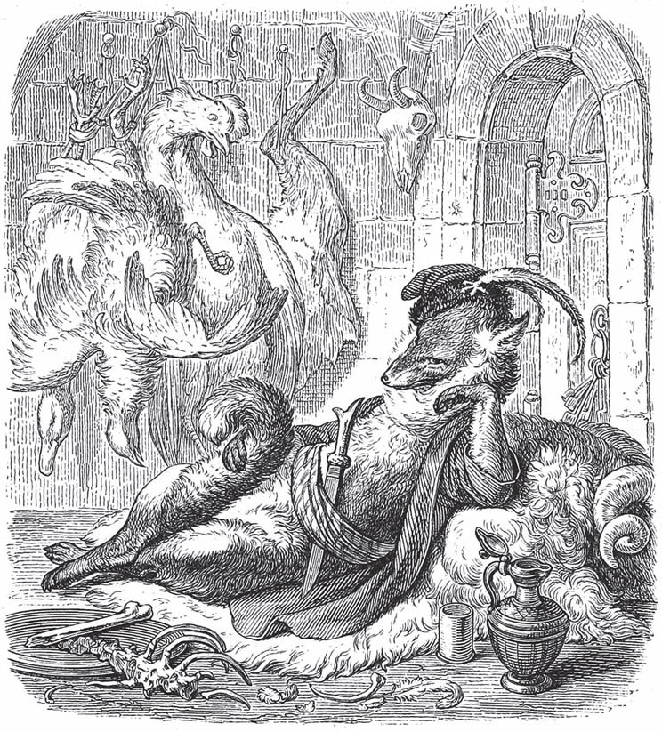

## Der Fuchs und die Frau Gevatterin

Die <abbr title="die Wölfin, die Wölfinnen — волчица">Wölfin</abbr> brachte ein Junges zur Welt und lud den Fuchs als Paten ein.

— Er ist doch nah mit uns <abbr title="verwandt — родственный">verwandt</abbr>, — sagte sie. — Er hat einen guten Verstand und ist sehr geschickt. Er kann mein Söhnchen unterrichten und ihm in der Welt <abbr title="weiterhelfen (half weiter, hat weitergeholfen) — помочь продвинуться">weiterhelfen</abbr>.

Der Fuchs kam auch ganz ehrbar und sagte:

— Liebe, <abbr title="verehrt — уважаемый">verehrte</abbr> Frau <abbr title="die Gevatterin, die Gevatterinnen — кума">Gevatterin</abbr>, ich danke Euch für die Ehre, die Ihr mir <abbr title="erweisen (erwies, hat erwiesen) — оказывать">erweist</abbr>. Ich will mich aber auch so benehmen, dass Ihr Eure Freude daran habt.

Beim Fest ließ er es sich gut schmecken und war ganz lustig. Danach sagte er:

— Liebe Frau Gevatterin, es ist unsere <abbr title="die Pflicht, die Pflichten — долг, обязанность">Pflicht</abbr>, für das Kindchen zu sorgen. Ihr müsst gute <abbr title="die Nahrung — пища, питание">Nahrung</abbr> haben, damit es auch zu Kräften kommt. Ich kenne einen <abbr title="der Schafstall, die Schafställe — овчарня">Schafstall</abbr>, aus dem wir uns leicht ein gutes Stück holen können.

Dieses Lied gefiel der Wölfin, und sie ging mit dem Fuchs hinaus zum Bauernhof. Er zeigte ihr den Stall von weitem und sagte:

— Dort könnt Ihr <abbr title="ungesehen — незамеченный">ungesehen</abbr> <abbr title="hineinkriechen (kroch hinein, ist hineingekrochen) — вползти, пролезть">hineinkriechen</abbr>. Ich will mich inzwischen auf der anderen Seite umsehen, ob ich vielleicht ein Hühnchen erwische.

Er ging aber nicht hin, sondern legte sich am Rand des Waldes nieder, <abbr title="ausstrecken — вытягивать">streckte</abbr> die Beine aus und ruhte sich aus.

Die Wölfin kroch in den Stall. Da lag ein Hund und machte Lärm, sodass die Bauern gelaufen kamen. Sie <abbr title="ertappen — застать, поймать (на месте)">ertappten</abbr> die Frau Gevatterin und gossen eine scharfe <abbr title="die Lauge, die Laugen — щёлок">Lauge</abbr> aus Asche über ihr Fell. Endlich entkam sie doch und <abbr title="sich schleppen — тащиться, плестись">schleppte sich</abbr> hinaus.

Da lag der Fuchs, tat ganz jämmerlich und sagte:

— Ach, liebe Frau Gevatterin, wie schlimm ist es mir ergangen! Die Bauern haben mich überfallen und mir alle Glieder zerschlagen. Wenn Ihr nicht wollt, dass ich hier liegen bleibe und elend sterbe, dann müsst Ihr mich forttragen.

Die Wölfin konnte selbst nur langsam gehen. Doch sie machte sich so große <abbr title="sich Sorgen machen um + Akk. — беспокоиться о">Sorgen</abbr> um den Fuchs, dass sie ihn auf ihren Rücken nahm. Und sie trug den ganz gesunden, unverletzten Gevatter langsam bis zu ihrem Haus. Da rief er ihr zu:

— Lebt wohl, liebe Frau Gevatterin, und lasst Euch den Braten gut bekommen!

Dann lachte er sie gewaltig aus und sprang davon.

---

### Neue Wörter

- **die Wölfin, die Wölfinnen** — волчица
- **verwandt** — родственный
- **weiterhelfen (half weiter, hat weitergeholfen)** — помочь продвинуться
- **verehrt** — уважаемый
- **die Gevatterin, die Gevatterinnen** — кума
- **erweisen (erwies, hat erwiesen)** — оказывать
- **die Pflicht, die Pflichten** — долг, обязанность
- **die Nahrung** — пища, питание
- **der Schafstall, die Schafställe** — овчарня
- **ungesehen** — незамеченный
- **hineinkriechen (kroch hinein, ist hineingekrochen)** — вползти, пролезть
- **ausstrecken** — вытягивать
- **ertappen** — застать, поймать (на месте)
- **die Lauge, die Laugen** — щёлок
- **sich schleppen** — тащиться, плестись
- **sich Sorgen machen um + Akk.** — беспокоиться о

[← Zurück](kapitel-73.md) · [Inhalt](README.md)
