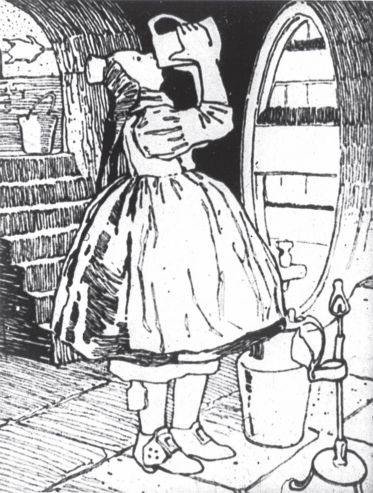

## Das kluge Gretel

Es war einmal eine Köchin, die hieß Gretel. Sie trug Schuhe mit roten <abbr title="der Absatz, die Absätze — каблук">Absätzen</abbr>. Wenn sie mit diesen Schuhen ausging, drehte sie sich hin und her und war ganz fröhlich. Dann dachte sie: «Du bist doch ein schönes <abbr title="das Mädel, die Mädel — девица, девчонка">Mädel</abbr>!» Und wenn sie nach Hause kam, trank sie vor lauter Freude einen Schluck Wein. Weil der Wein aber auch Appetit macht, probierte sie vom Besten, was sie kochte, so lange, bis sie satt war. Und sie sagte:

— Die Köchin muss doch wissen, wie das Essen schmeckt.

Eines Tages sagte ihr Herr zu ihr:

— Gretel, heute Abend kommt ein Gast. Mach mir zwei Hühner, aber recht fein!

— Mach ich schon, Herr, — antwortete Gretel.

Sie schlachtete die Hühner, <abbr title="brühen — обдавать кипятком, ошпаривать">brühte</abbr> sie, rupfte sie und steckte sie auf den Spieß. Als es Abend wurde, brachte sie sie zum Feuer, damit sie brieten. Die Hühner wurden schon braun und gar, aber der Gast war noch nicht da. Da rief Gretel ihrem Herrn zu:

— Wenn der Gast nicht kommt, muss ich die Hühner vom Feuer nehmen. Aber es ist ein Jammer, wenn man sie nicht bald isst. Gerade jetzt sind sie am <abbr title="saftig — сочный">saftigsten</abbr>.

Da sagte der Herr:

— Dann laufe ich selbst und hole den Gast.

Kaum hatte der Herr ihr den Rücken <abbr title="den Rücken drehen — повернуться спиной">gedreht</abbr>, da legte Gretel den Spieß mit den Hühnern zur Seite und dachte: «Wenn man so lange beim Feuer steht, <abbr title="schwitzen — потеть">schwitzt</abbr> man und bekommt Durst. Wer weiß, wann die kommen! Inzwischen springe ich schnell in den Keller und trinke einen Schluck.»

Sie lief hinunter, hob einen Krug an den Mund und sagte:

— <abbr title="Gott segne dich! — благослови тебя Бог">Gott segne dich</abbr>, Gretel!

Und sie tat einen guten Zug.

— Der Wein will nicht <abbr title="aufhören — прекращать(ся)">aufhören</abbr>, — sagte sie weiter, — und es ist nicht gut, mittendrin aufzuhören.

Und sie tat noch einen <abbr title="ernsthaft — серьёзный">ernsthaften</abbr> Zug. Dann ging sie wieder hinauf, stellte die Hühner wieder über das Feuer, bestrich sie mit Butter und drehte fröhlich den Spieß. Aber der Braten roch so gut! Gretel dachte: «Vielleicht fehlt noch etwas. Man muss ihn probieren!» Sie leckte an ihrem Finger und sagte:

— Ei, wie gut sind die Hühner! Es ist eine Sünde und eine Schande, dass man sie nicht sofort isst!

Sie lief zum Fenster und sah nach, ob der Herr mit dem Gast schon kam. Aber sie sah niemanden. Sie stellte sich wieder zu den Hühnern und dachte: «Der eine Flügel verbrennt. Es ist besser, ich esse ihn weg.» Also schnitt sie ihn ab und aß ihn auf, und er schmeckte ihr. Als sie fertig war, dachte sie: «Der andere Flügel muss auch weg, sonst merkt der Herr, dass etwas fehlt.»

Als die zwei Flügel <abbr title="verspeisen — съесть">verspeist</abbr> waren, ging sie wieder zum Fenster und sah nach dem Herrn. Aber sie sah ihn nicht.

— Wer weiß, — fiel ihr ein, — vielleicht kommen sie gar nicht und sind irgendwo eingekehrt.

Dann sagte sie zu sich:

— He, Gretel, sei guter Dinge! Das eine Huhn ist ja schon angefangen. Trink noch einen frischen Schluck und iss es ganz auf. Wenn es weg ist, hast du deine Ruhe. Warum soll die gute <abbr title="die Gottesgabe, die Gottesgaben — дар Божий">Gottesgabe</abbr> verderben?

Also lief sie noch einmal in den Keller, tat einen ehrbaren Zug und aß das eine Huhn mit großer Freude auf. Als das eine Huhn verschwunden war und der Herr immer noch nicht kam, sah Gretel das andere an und sagte:

— Wo das eine ist, muss auch das andere sein. Die zwei gehören zusammen. Was für das eine richtig ist, ist für das andere gerecht. Ich glaube, wenn ich noch einen Schluck trinke, schadet es mir nicht.

Also tat sie noch einen kräftigen Zug und schickte das zweite Huhn dem ersten hinterher.

Gerade als sie mitten beim besten Essen war, kam der Herr zurück und rief:

— Beeil dich, Gretel, der Gast kommt gleich!

— Ja, Herr, ich mache alles fertig, — antwortete Gretel.

Der Herr sah inzwischen nach, ob der Tisch gut gedeckt war. Er nahm das große Messer, mit dem er die Hühner schneiden wollte, und <abbr title="wetzen — точить (нож)">wetzte</abbr> es im Flur. Da kam der Gast und klopfte <abbr title="höflich — вежливо">höflich</abbr> an die Haustür. Gretel lief hin und sah nach, wer da war. Als sie den Gast sah, legte sie den Finger an den Mund und flüsterte:

— Still! Still! Gehen Sie schnell wieder weg! Wenn mein Herr Sie erwischt, sind Sie verloren. Er hat Sie zwar zum Abendessen eingeladen, aber er will Ihnen nur die beiden Ohren abschneiden. Hören Sie nur, wie er das Messer dafür wetzt!

Der Gast hörte das Wetzen und lief, so schnell er konnte, die Treppe wieder hinunter. Gretel war nicht faul. Sie lief schreiend zu ihrem Herrn und rief:

— Da haben Sie ja einen schönen Gast eingeladen!

— Ei, warum, Gretel? Was meinst du damit?

— Ja, — sagte sie, — er hat mir die beiden Hühner von der Schüssel genommen, gerade als ich sie auftragen wollte. Und dann ist er damit weggelaufen!

— Das ist ja eine feine Art! — sagte der Herr. Die schönen Hühner taten ihm leid. — Wenn er mir wenigstens das eine <abbr title="lassen (ließ, hat gelassen) — оставлять">gelassen hätte</abbr>! Dann hätte ich doch etwas zu essen.

Er rief dem Gast nach, er solle bleiben. Aber der Gast tat so, als hörte er nichts. Da lief der Herr hinter ihm her, das Messer immer noch in der Hand, und schrie:

— Nur eins! Nur eins!

Er meinte: Der Gast sollte ihm wenigstens ein Huhn lassen und nicht beide mitnehmen. Aber der Gast dachte, er sollte eins von seinen Ohren hergeben. Und er lief, als ob unter ihm Feuer brannte, damit er beide Ohren heil nach Hause brachte.

---

### Neue Wörter

- **der Absatz, die Absätze** — каблук
- **das Mädel, die Mädel** — девица, девчонка
- **brühen** — обдавать кипятком, ошпаривать
- **saftig** — сочный
- **den Rücken drehen** — повернуться спиной
- **schwitzen** — потеть
- **Gott segne dich!** — благослови тебя Бог
- **aufhören** — прекращать(ся)
- **ernsthaft** — серьёзный
- **verspeisen** — съесть
- **die Gottesgabe, die Gottesgaben** — дар Божий
- **wetzen** — точить (нож)
- **höflich** — вежливо
- **lassen (ließ, hat gelassen)** — оставлять

[← Zurück](kapitel-76.md) · [Inhalt](README.md)
