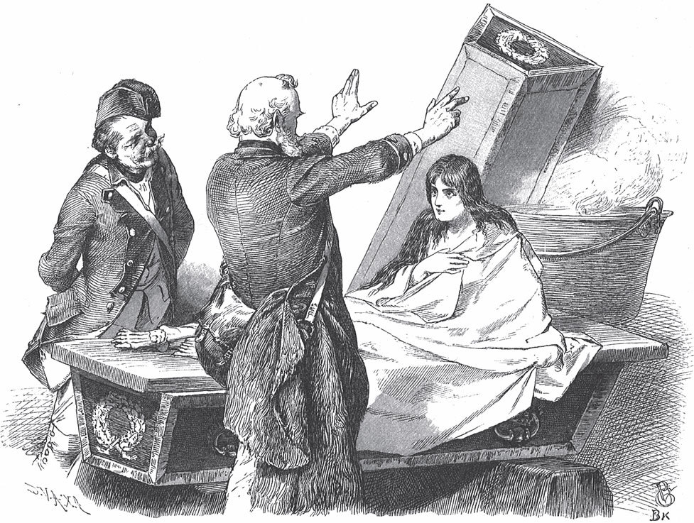
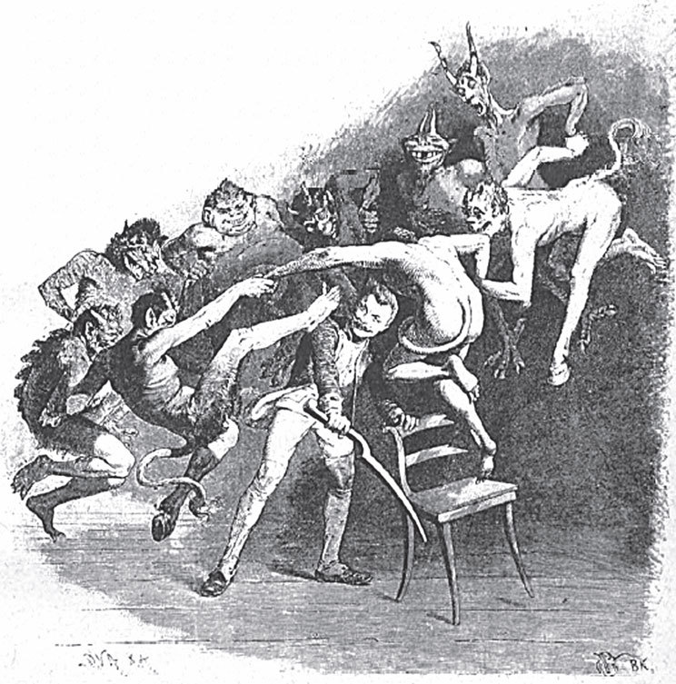

## Bruder Lustig

Es war einmal ein großer Krieg. Als der Krieg zu Ende war, wurden viele Soldaten entlassen. Auch der Bruder Lustig bekam seinen Abschied. Sonst bekam er nichts, nur ein kleines <abbr title="das Laibchen, die Laibchen — маленький каравай">Laibchen</abbr> <abbr title="das Kommissbrot — солдатский хлеб">Kommissbrot</abbr> und vier Kreuzer. Damit zog er fort.

Der heilige Petrus aber hatte sich als armer Bettler an den Weg gesetzt. Als der Bruder Lustig vorbeikam, bat er ihn um ein Almosen. Der Soldat antwortete:

— Lieber <abbr title="der Bettelmann, die Bettelleute — нищий">Bettelmann</abbr>, was soll ich dir geben? Ich war Soldat und habe meinen Abschied bekommen. Ich habe nichts als dieses kleine Kommissbrot und vier Kreuzer. Wenn das weg ist, muss ich auch betteln, genau wie du. Aber etwas will ich dir trotzdem geben.

Er teilte das Brot in vier Teile und gab dem Apostel einen Teil und einen Kreuzer. Der heilige Petrus bedankte sich und ging weiter. Dann setzte er sich in einer anderen Gestalt wieder als Bettler an den Weg. Als der Soldat kam, bat er ihn wie beim ersten Mal um eine Gabe. Der Bruder Lustig sagte dasselbe wie vorher und gab ihm wieder ein <abbr title="das Viertel, die Viertel — четверть">Viertel</abbr> vom Brot und einen Kreuzer. Der heilige Petrus bedankte sich und ging weiter. Zum dritten Mal setzte er sich in einer anderen Gestalt als Bettler an den Weg und sprach den Bruder Lustig an. Der Bruder Lustig gab ihm auch das dritte Viertel Brot und den dritten Kreuzer. Der heilige Petrus bedankte sich, und der Bruder Lustig ging weiter. Jetzt hatte er nur noch ein Viertel Brot und einen Kreuzer. Damit ging er in ein Wirtshaus, aß das Brot und ließ sich für den Kreuzer ein Bier dazu geben.

Als er fertig war, zog er weiter. Da kam ihm der heilige Petrus entgegen, diesmal in der Gestalt eines entlassenen Soldaten. Er sagte:

— Guten Tag, Kamerad! Kannst du mir nicht ein Stück Brot geben und einen Kreuzer für einen <abbr title="der Trunk — питьё, глоток">Trunk</abbr>?

— Woher soll ich das nehmen? — antwortete der Bruder Lustig. — Ich habe meinen Abschied bekommen und sonst nur ein Kommissbrot und vier Kreuzer. Drei Bettlern bin ich auf der Landstraße begegnet. Jedem habe ich ein Viertel von meinem Brot und einen Kreuzer gegeben. Das letzte Viertel habe ich im Wirtshaus gegessen und für den letzten Kreuzer getrunken. Jetzt bin ich <abbr title="blank sein — быть без гроша">blank</abbr>. Wenn du auch nichts mehr hast, können wir zusammen betteln gehen.

— Nein, — antwortete der heilige Petrus, — das wird nicht nötig sein. Ich <abbr title="sich verstehen auf + Akk. (verstand, hat verstanden) — знать толк в, уметь">verstehe mich</abbr> ein bisschen auf die <abbr title="die Heilkunst — врачевание, лекарское дело">Heilkunst</abbr>. Damit will ich mir schon so viel verdienen, wie ich brauche.

— Ja, — sagte der Bruder Lustig, — davon verstehe ich nichts. Also muss ich allein betteln gehen.

— Komm nur mit, — sagte der heilige Petrus. — Wenn ich etwas verdiene, sollst du die Hälfte bekommen.

— Das ist mir recht, — sagte der Bruder Lustig.

Also zogen sie zusammen weiter.

Sie kamen an ein Bauernhaus und hörten drinnen lautes Jammern und Schreien. Sie gingen hinein. Da lag der Mann todkrank im Bett und war nahe am Sterben, und die Frau heulte und weinte laut.

— Hört auf mit dem Heulen und Weinen, — sagte der heilige Petrus. — Ich mache den Mann wieder gesund.

Er nahm eine <abbr title="die Salbe, die Salben — мазь">Salbe</abbr> aus der Tasche und heilte den Kranken <abbr title="augenblicklich — мгновенно">augenblicklich</abbr>. Der Mann konnte aufstehen und war ganz gesund. Mann und Frau riefen voller Freude:

— Wie können wir Euch belohnen? Was sollen wir Euch geben?

Aber der heilige Petrus wollte nichts nehmen. Je mehr die Bauersleute ihn baten, desto mehr weigerte er sich. Der Bruder Lustig aber stieß den heiligen Petrus an und sagte:

— Nimm doch etwas, wir brauchen es ja!

Endlich brachte die Bäuerin ein Lamm. Das müsse er annehmen, sagte sie. Aber er wollte nicht. Da stieß ihn der Bruder Lustig in die Seite und sagte:

— Nimm es doch, du dummer Teufel, wir brauchen es ja!

Da sagte der heilige Petrus endlich:

— Ja, das Lamm will ich nehmen. Aber ich trage es nicht. Wenn du es willst, musst du es tragen.

— Kein Problem, — sagte der Bruder Lustig, — das trage ich schon.

Und er nahm es auf die Schulter. Sie gingen fort und kamen in einen Wald. Das Lamm war dem Bruder Lustig schwer geworden, und er hatte Hunger. Also sagte er zum heiligen Petrus:

— Schau, da ist ein schöner Platz. Hier könnten wir das Lamm kochen und essen.

— Mir ist es recht, — antwortete der heilige Petrus. — Aber vom Kochen verstehe ich nichts. Wenn du kochen willst, da hast du einen Kessel. Ich gehe inzwischen ein bisschen spazieren, bis es gar ist. Aber du darfst nicht anfangen zu essen, bevor ich zurück bin. Ich komme schon zur rechten Zeit.

— Geh nur, — sagte der Bruder Lustig. — Ich verstehe mich aufs Kochen. Ich mache das schon.

Der heilige Petrus ging fort. Der Bruder Lustig schlachtete das Lamm, machte Feuer, warf das Fleisch in den Kessel und kochte. Das Lamm war schon gar, aber der Apostel war immer noch nicht zurück. Da nahm der Bruder Lustig es aus dem Kessel, schnitt es auf und fand das Herz.

— Das soll ja das Beste sein, — sagte er und probierte es. Und am Ende aß er es ganz auf.

Endlich kam der heilige Petrus zurück und sagte:

— Du kannst das ganze Lamm allein essen. Ich will nur das Herz, gib es mir.

Da nahm der Bruder Lustig Messer und <abbr title="die Gabel, die Gabeln — вилка">Gabel</abbr> und tat so, als ob er eifrig im Fleisch suchte. Aber er konnte das Herz natürlich nicht finden. Endlich sagte er kurz:

— Es ist keins da.

— Nun, wo soll es denn sein? — fragte der Apostel.

— Das weiß ich nicht, — antwortete der Bruder Lustig. — Aber schau, was sind wir beide für Narren! Wir suchen das Herz vom Lamm, und keiner von uns denkt daran: Ein Lamm hat ja gar kein Herz!

— Ei, — sagte der heilige Petrus, — das ist ja etwas ganz Neues! Jedes Tier hat doch ein Herz. Warum soll ein Lamm keins haben?

— Nein, wirklich, Bruder, ein Lamm hat kein Herz. Denk nur richtig nach, dann fällt es dir ein. <abbr title="im Ernst — всерьёз, правда">Im Ernst</abbr>, es hat keins.

— Nun, schon gut, — sagte der heilige Petrus. — Wenn kein Herz da ist, brauche ich auch nichts vom Lamm. Du kannst es allein essen.

— Was ich nicht aufessen kann, nehme ich in meinem Ranzen mit, — sagte der Bruder Lustig. Er aß das halbe Lamm und steckte den Rest in seinen Ranzen.

Sie gingen weiter. Da machte der heilige Petrus, dass ein großes Wasser quer über den Weg floss. Sie mussten hindurch.

— Geh du nur voran, — sagte der heilige Petrus.

— Nein, — antwortete der Bruder Lustig, — geh du voran.

Und er dachte: «Wenn ihm das Wasser zu tief ist, bleibe ich zurück.»

Da ging der heilige Petrus hindurch, und das Wasser ging ihm nur bis ans Knie. Nun wollte auch der Bruder Lustig hindurch. Aber das Wasser wurde größer und stieg ihm bis an den Hals. Da rief er:

— Bruder, hilf mir!

Der heilige Petrus sagte:

— Willst du gestehen, dass du das Herz vom Lamm gegessen hast?

— Nein, — antwortete er, — ich habe es nicht gegessen.

Da wurde das Wasser noch größer und stieg ihm bis an den Mund.

— Hilf mir, Bruder! — rief der Soldat.

Der heilige Petrus fragte noch einmal:

— Willst du gestehen, dass du das Herz vom Lamm gegessen hast?

— Nein, — antwortete er, — ich habe es nicht gegessen.

Der heilige Petrus wollte ihn aber doch nicht ertrinken lassen. Er ließ das Wasser wieder sinken und half ihm hinüber.

Sie zogen weiter und kamen in ein Reich. Dort hörten sie, dass die Königstochter todkrank war.

— Holla, Bruder, — sagte der Soldat zum heiligen Petrus, — das ist ein guter <abbr title="der Fang — добыча, улов">Fang</abbr> für uns! Wenn wir sie gesund machen, haben wir für ewige Zeiten genug.

Jetzt war ihm der heilige Petrus nicht schnell genug.

— Nun heb die Beine, <abbr title="das Bruderherz — братец, дружище">Bruderherz</abbr>, — sagte er zu ihm, — damit wir noch rechtzeitig hinkommen.

Aber der heilige Petrus ging immer langsamer, so sehr der Bruder Lustig ihn auch trieb und schob. Bis sie endlich hörten, dass die Königstochter gestorben war.

— Da haben wir es, — sagte der Bruder Lustig. — Das kommt von deinem schläfrigen Gang!

— Sei nur still, — antwortete der heilige Petrus. — Ich kann noch mehr als Kranke gesund machen. Ich kann auch Tote wieder lebendig machen.

— Na, wenn das so ist, — sagte der Bruder Lustig, — dann bin ich einverstanden. Aber <abbr title="mindestens — по меньшей мере">mindestens</abbr> das halbe Königreich musst du uns damit verdienen.

Dann gingen sie ins königliche Schloss. Dort waren alle in großer Trauer. Der heilige Petrus aber sagte zum König, er wolle die Tochter wieder lebendig machen. Man führte ihn zu ihr, und er sagte:

— Bringt mir einen Kessel mit Wasser.

Als der Kessel gebracht war, schickte er alle hinaus. Nur der Bruder Lustig durfte bei ihm bleiben. Dann schnitt er der Toten alle Glieder ab und warf sie ins Wasser. Er machte Feuer unter dem Kessel und ließ sie kochen. Als alles Fleisch von den Knochen gefallen war, nahm er die schönen weißen Knochen heraus und legte sie auf einen Tisch. Er legte sie in ihrer natürlichen Ordnung zusammen. Als das geschehen war, trat er davor und sagte dreimal:

— Im Namen der <abbr title="allerheiligst — пресвятой">allerheiligsten</abbr> <abbr title="die Dreifaltigkeit — Святая Троица">Dreifaltigkeit</abbr>: Tote, steh auf!

Und beim dritten Mal erhob sich die Königstochter, lebendig, gesund und schön. Der König freute sich sehr und sagte zum heiligen Petrus:

— Wünsch dir deinen Lohn! Und wenn es mein halbes Königreich wäre, ich gebe es dir.

Aber der heilige Petrus antwortete:

— Ich will nichts dafür.

«Oh, du Dummkopf!», dachte der Bruder Lustig. Er stieß seinen Kameraden in die Seite und sagte:

— Sei doch nicht so dumm! Wenn du nichts willst, ich brauche schon etwas.

Aber der heilige Petrus wollte nichts. Doch der König sah, dass der andere gern etwas wollte. Deshalb ließ er ihm vom <abbr title="der Schatzmeister, die Schatzmeister — казначей">Schatzmeister</abbr> den Ranzen mit Gold füllen.

Dann zogen sie weiter. Als sie in einen Wald kamen, sagte der heilige Petrus zum Bruder Lustig:

— Jetzt wollen wir das Gold teilen.

— Ja, — antwortete er, — das wollen wir tun.

Da teilte der heilige Petrus das Gold, und zwar in drei Teile. Der Bruder Lustig dachte: «Was hat er jetzt wieder für einen <abbr title="einen Vogel haben — быть с приветом, с причудами">Vogel</abbr>! Er macht drei Teile, und wir sind doch nur zwei.»

Aber der heilige Petrus sagte:

— So, jetzt habe ich genau geteilt: ein Teil für mich, ein Teil für dich und ein Teil für den, der das Herz vom Lamm gegessen hat.

— Oh, das habe ich gegessen, — antwortete der Bruder Lustig und <abbr title="einstreichen (strich ein, hat eingestrichen) — загрести, прикарманить">strich</abbr> schnell das Gold ein. — Das kannst du mir glauben.

— Wie kann das wahr sein? — sagte der heilige Petrus. — Ein Lamm hat doch kein Herz.

— Ach was, Bruder, wo denkst du hin! Ein Lamm hat natürlich ein Herz, genau wie jedes Tier. Warum sollte gerade das Lamm keins haben?

— Nun, schon gut, — sagte der heilige Petrus. — Behalte das Gold allein. Aber ich bleibe nicht mehr bei dir. Ich gehe meinen Weg allein.

— Wie du willst, Bruderherz, — antwortete der Soldat. — Leb wohl!

Da ging der heilige Petrus eine andere Straße. Der Bruder Lustig aber dachte: «Gut, dass er abzieht. Er ist doch ein seltsamer <abbr title="der Heilige, die Heiligen — святой">Heiliger</abbr>.»

Nun hatte er zwar Geld genug, aber er konnte nicht damit <abbr title="umgehen mit + Dat. (ging um, ist umgegangen) — обращаться с">umgehen</abbr>. Er gab es aus, er <abbr title="verschenken — раздаривать">verschenkte</abbr> es, und nach einiger Zeit hatte er wieder nichts. Da kam er in ein Land und hörte, dass die Königstochter gestorben war. «Holla», dachte er, «das kann gut werden! Die mache ich wieder lebendig, und ich lasse mich ordentlich dafür bezahlen.»

Er ging also zum König und bot ihm an, die Tote wieder lebendig zu machen. Der König hatte nämlich gehört, dass ein ehemaliger Soldat herumzog und Tote wieder lebendig machte. Er dachte, der Bruder Lustig sei dieser Mann. Aber weil er kein Vertrauen zu ihm hatte, fragte er zuerst seine Räte. Die sagten, er könne es ruhig wagen, seine Tochter sei ja sowieso tot.

Nun ließ sich der Bruder Lustig einen Kessel mit Wasser bringen und schickte alle hinaus. Er schnitt die Glieder ab, warf sie ins Wasser und machte Feuer darunter, genau so, wie er es beim heiligen Petrus gesehen hatte. Das Wasser fing an zu kochen, und das Fleisch fiel ab. Da nahm er die Knochen heraus und legte sie auf den Tisch. Aber er wusste nicht, in welcher Ordnung sie liegen mussten, und legte alles <abbr title="verkehrt — неправильно, наоборот">verkehrt</abbr> durcheinander. Dann stellte er sich davor und sagte:

— Im Namen der allerheiligsten Dreifaltigkeit: Tote, steh auf!

Er sagte es dreimal, aber die Knochen rührten sich nicht. Da sagte er es noch dreimal, aber wieder umsonst.

— Du <abbr title="das Blitzmädel — девчонка-чертовка">Blitzmädel</abbr>, steh auf! — rief er. — Steh auf, oder es geht dir schlecht!

Kaum hatte er das gesagt, da kam der heilige Petrus durchs Fenster herein, in seiner früheren Gestalt als entlassener Soldat. Er sagte:

— Du gottloser Mensch, was machst du da? Wie soll die Tote <abbr title="auferstehen (erstand auf, ist auferstanden) — воскресать">auferstehen</abbr>, wenn du ihre Knochen so durcheinandergeworfen hast?

— Bruderherz, ich habe es gemacht, so gut ich konnte, — antwortete er.

— Diesmal helfe ich dir aus der Not. Aber das sage ich dir: Wenn du noch einmal so etwas unternimmst, dann geht es dir schlecht. Und du darfst vom König nicht das <abbr title="das Geringste — малейшее">Geringste</abbr> dafür verlangen oder annehmen.

Dann legte der heilige Petrus die Knochen in ihre richtige Ordnung und sagte dreimal:

— Im Namen der allerheiligsten Dreifaltigkeit: Tote, steh auf!

Und die Königstochter stand auf und war gesund und schön wie vorher. Der heilige Petrus ging wieder durchs Fenster hinaus. Der Bruder Lustig war froh, dass alles so gut ausgegangen war. Aber er ärgerte sich doch, dass er nichts dafür nehmen sollte. «Ich möchte nur wissen», dachte er, «was der für <abbr title="die Grille, die Grillen — причуда, блажь (также: сверчок)">Grillen</abbr> im Kopf hat. Was er mit der einen Hand gibt, das nimmt er mit der anderen. Das hat doch keinen Verstand!»

Nun bot der König dem Bruder Lustig an, was er haben wollte. Er durfte zwar nichts nehmen. Aber mit <abbr title="die Anspielung, die Anspielungen — намёк">Anspielungen</abbr> und List brachte er es so weit, dass der König ihm den Ranzen mit Gold füllen ließ. Damit zog er ab. Als er hinauskam, stand vor dem Tor der heilige Petrus und sagte:

— Schau, was bist du für ein Mensch! Habe ich dir nicht verboten, etwas zu nehmen? Und jetzt hast du den Ranzen doch voll Gold!

— Was kann ich dafür, — antwortete der Bruder Lustig, — wenn man es mir hineinsteckt?

— Das sage ich dir: Mach so etwas kein zweites Mal, sonst wird es dir schlimm ergehen.

— Ach, Bruder, keine Sorge! Jetzt habe ich Gold. Warum soll ich mich da noch mit dem <abbr title="das Knochenwaschen — мытьё костей">Knochenwaschen</abbr> <abbr title="sich abgeben mit + Dat. (gab ab, hat abgegeben) — возиться с">abgeben</abbr>?

— Ja, — sagte der heilige Petrus, — das Gold wird bestimmt lange reichen! Aber damit du danach nicht wieder auf verbotenen Wegen gehst, gebe ich deinem Ranzen eine besondere Kraft: Alles, was du dir hineinwünschst, soll auch darin sein. Leb wohl, du siehst mich nicht wieder.

— <abbr title="Gott befohlen! — с Богом! прощай">Gott befohlen</abbr>, — sagte der Bruder Lustig und dachte: «Ich bin froh, dass du gehst, du <abbr title="ein komischer Kauz — чудак">komischer Kauz</abbr>. Dir laufe ich bestimmt nicht nach.»

An die <abbr title="die Wunderkraft — чудесная сила">Wunderkraft</abbr> von seinem Ranzen dachte er nicht mehr.

Der Bruder Lustig zog mit seinem Gold herum und verschwendete es wie beim ersten Mal. Als er nur noch vier Kreuzer hatte, kam er an einem Wirtshaus vorbei. Er dachte: «Das Geld muss weg!» Und er ließ sich für drei Kreuzer Wein und für einen Kreuzer Brot geben. Während er dort saß und trank, kam ihm der Geruch von gebratenen Gänsen in die Nase. Der Bruder Lustig sah sich um und guckte. Da sah er, dass der Wirt zwei Gänse in der <abbr title="die Ofenröhre, die Ofenröhren — духовка">Ofenröhre</abbr> hatte. Jetzt fiel ihm ein, was sein Kamerad gesagt hatte: Was er sich in seinen Ranzen wünschte, das sollte darin sein. «Holla, das musst du mit den Gänsen ausprobieren!»

Also ging er hinaus, und vor der Tür sagte er:

— Ich wünsche die zwei gebratenen Gänse aus der Ofenröhre in meinen Ranzen.

Dann <abbr title="aufschnallen — расстегнуть (пряжку)">schnallte</abbr> er den Ranzen auf und sah hinein. Da lagen beide drin.

— Ach, so ist es recht! — sagte er. — Jetzt bin ich ein <abbr title="ein gemachter Mann sein — быть обеспеченным человеком">gemachter Mann</abbr>!

Er ging auf eine Wiese und holte den Braten heraus. Gerade als er mitten beim Essen war, kamen zwei <abbr title="der Handwerksbursche, die Handwerksburschen — подмастерье">Handwerksburschen</abbr> vorbei. Sie sahen die eine Gans, die noch niemand angerührt hatte, mit hungrigen Augen an. Der Bruder Lustig dachte: «Eine reicht dir.» Er rief die zwei Burschen zu sich und sagte:

— Da, nehmt die Gans und esst sie auf meine Gesundheit.

Sie bedankten sich und gingen damit ins Wirtshaus. Dort bestellten sie einen halben <abbr title="der Liter, die Liter — литр">Liter</abbr> Wein und ein Brot, packten die geschenkte Gans aus und fingen an zu essen. Die Wirtin sah zu und sagte zu ihrem Mann:

— Die zwei essen eine Gans. Schau doch nach, ob es nicht eine von unseren aus der Ofenröhre ist.

Der Wirt lief hin, und die Ofenröhre war leer.

— Was, ihr <abbr title="das Diebesgesindel — воровской сброд">Diebesgesindel</abbr>, so <abbr title="billig — дёшево">billig</abbr> wollt ihr Gänse essen? Sofort bezahlen, oder ich wasche euch mit grünem <abbr title="der Haselsaft — «ореховый сок» (шутл.: побои ореховой палкой)">Haselsaft</abbr>!

Die zwei sagten:

— Wir sind keine Diebe. Ein entlassener Soldat hat uns die Gans draußen auf der Wiese geschenkt.

— Ihr wollt mich wohl <abbr title="jemanden an der Nase herumführen — водить за нос">an der Nase herumführen</abbr>! Der Soldat war hier, aber er ist als ehrlicher Kerl zur Tür hinausgegangen. Auf den habe ich aufgepasst. Ihr seid die Diebe, und ihr sollt bezahlen!

Aber sie konnten nicht bezahlen. Da nahm er den Stock und <abbr title="prügeln — колотить, бить">prügelte</abbr> sie zur Tür hinaus.

Der Bruder Lustig ging seiner Wege und kam an einen Ort. Dort stand ein prächtiges Schloss, und nicht weit davon ein schlechtes Wirtshaus. Er ging in das Wirtshaus und bat um ein Nachtlager. Aber der Wirt schickte ihn weg und sagte:

— Es ist kein Platz mehr frei. Das Haus ist voll von vornehmen Gästen.

— Das wundert mich, — sagte der Bruder Lustig. — Warum kommen sie zu Euch und gehen nicht in das prächtige Schloss?

— Ja, — antwortete der Wirt, — mit dem Schloss ist das so eine Sache. Wer dort schon eine Nacht verbringen wollte, ist nicht lebendig wieder herausgekommen.

— Wenn es andere versucht haben, — sagte der Bruder Lustig, — dann versuche ich es auch.

— Lasst das lieber, — sagte der Wirt, — das kostet Euch den Hals.

— So schnell kostet es mich nicht den Hals, — sagte der Bruder Lustig. — Gebt mir nur die Schlüssel und ordentlich Essen und Trinken mit.

Der Wirt gab ihm die Schlüssel und Essen und Trinken, und damit ging der Bruder Lustig ins Schloss. Er ließ es sich gut schmecken. Als er endlich müde wurde, legte er sich auf den Boden, denn ein Bett gab es nicht. Er schlief bald ein. Aber in der Nacht weckte ihn ein großer Lärm. Als er <abbr title="wach — бодрствующий, проснувшийся">wach</abbr> wurde, sah er neun hässliche Teufel im Zimmer. Sie hatten einen Kreis um ihn gemacht und tanzten um ihn herum.

— Na, tanzt, so lange ihr wollt, — sagte der Bruder Lustig, — aber keiner kommt mir zu nah!

Aber die Teufel kamen immer näher und traten ihm mit ihren <abbr title="scheußlich — мерзкий">scheußlichen</abbr> Füßen fast ins Gesicht.

— Ruhe, ihr <abbr title="das Teufelsgespenst, die Teufelsgespenster — бесовские призраки">Teufelsgespenster</abbr>! — sagte er.

Aber sie machten es immer <abbr title="schlimm — плохой; хуже">schlimmer</abbr>. Da wurde der Bruder Lustig böse und rief:

— Holla, ich mache gleich Ruhe!

Er packte ein <abbr title="das Stuhlbein, die Stuhlbeine — ножка стула">Stuhlbein</abbr> und schlug mitten unter sie. Aber neun Teufel gegen einen Soldaten, das war doch zu viel. Wenn er auf die vorderen einschlug, packten ihn die anderen hinten an den Haaren und rissen erbärmlich daran.

— <abbr title="das Teufelspack — чёртово отродье">Teufelspack</abbr>! — rief er. — Jetzt wird es mir zu <abbr title="es wird mir zu bunt — это уже слишком">bunt</abbr>. Aber wartet! Alle neun in meinen Ranzen hinein!

<abbr title="husch! — шмыг! раз — и…">Husch</abbr>, steckten sie drin. Er <abbr title="zuschnallen — застегнуть (на пряжку)">schnallte</abbr> ihn zu und warf ihn in eine Ecke. Da war es auf einmal still, und der Bruder Lustig legte sich wieder hin und schlief bis zum hellen Morgen.

Am Morgen kamen der Wirt und der <abbr title="der Edelmann, die Edelleute — дворянин">Edelmann</abbr>, dem das Schloss gehörte. Sie wollten sehen, wie es ihm ergangen war. Als sie ihn gesund und munter sahen, staunten sie und fragten:

— Haben Euch die Geister denn nichts getan?

— Was denkt Ihr denn! — antwortete der Bruder Lustig. — Ich habe sie alle neun in meinem Ranzen. Ihr könnt wieder ganz ruhig in Eurem Schloss wohnen. Von jetzt an <abbr title="spuken — водиться (о привидениях)">spukt</abbr> hier keiner mehr!

Da dankte ihm der Edelmann und beschenkte ihn reich. Er bat ihn, in seinen Diensten zu bleiben. Er wolle sein ganzes Leben lang für ihn sorgen.

— Nein, — antwortete er, — ich bin an das Wandern gewöhnt. Ich will weiterziehen.

Da ging der Bruder Lustig fort. Er kam in eine <abbr title="die Schmiede, die Schmieden — кузница">Schmiede</abbr> und legte den Ranzen mit den neun Teufeln auf den Amboss. Er bat den <abbr title="der Schmied, die Schmiede — кузнец">Schmied</abbr> und seine Gesellen, <abbr title="draufschlagen (schlug drauf, hat draufgeschlagen) — бить по чему-то">draufzuschlagen</abbr>. Die schlugen mit ihren großen <abbr title="der Hammer, die Hämmer — молот, молоток">Hämmern</abbr> mit aller Kraft drauf, sodass die Teufel jämmerlich <abbr title="kreischen — визжать">kreischten</abbr>. Als er danach den Ranzen aufmachte, waren acht tot. Aber einer hatte in einer Falte gesessen und lebte noch. Er schlüpfte heraus und fuhr wieder in die Hölle.

Danach zog der Bruder Lustig noch lange in der Welt herum, und wer es wüsste, könnte viel davon erzählen. Aber endlich wurde er alt und dachte an sein Ende. Da ging er zu einem <abbr title="der Einsiedler, die Einsiedler — отшельник">Einsiedler</abbr>, der als frommer Mann bekannt war, und sagte zu ihm:

— Ich bin das Wandern <abbr title="einer Sache müde sein — устать от чего-то">müde</abbr>. Jetzt will ich versuchen, ins Himmelreich zu kommen.

Der Einsiedler antwortete:

— Es gibt zwei Wege. Der eine ist breit und angenehm und führt in die Hölle. Der andere ist eng und rau und führt in den Himmel.

«Ich müsste ja ein Narr sein», dachte der Bruder Lustig, «wenn ich den engen und rauen Weg gehen würde.»

Er machte sich auf und ging den breiten und angenehmen Weg. Endlich kam er zu einem großen schwarzen Tor, und das war das Tor der Hölle. Der Bruder Lustig klopfte an, und der Torwächter sah nach, wer da war. Aber als er den Bruder Lustig sah, erschrak er. Er war nämlich gerade der neunte Teufel, der auch im Ranzen gesteckt hatte und <abbr title="mit einem blauen Auge davonkommen — отделаться лёгким испугом">mit einem blauen Auge davongekommen</abbr> war. Darum schob er schnell wieder den Riegel vor, lief zum <abbr title="der Oberste, die Obersten — главный, старший">Obersten</abbr> der Teufel und sagte:

— Draußen ist ein Kerl mit einem Ranzen und will herein. Aber lasst ihn <abbr title="auf keinen Fall — ни в коем случае">auf keinen Fall</abbr> herein, sonst wünscht er die ganze Hölle in seinen Ranzen. Er hat mich einmal ganz fürchterlich darin <abbr title="hämmern — бить молотом">hämmern</abbr> lassen.

Also rief man dem Bruder Lustig zu, er solle wieder gehen, er komme nicht herein. «Wenn sie mich hier nicht wollen», dachte er, «dann sehe ich mal, ob ich im Himmel eine Unterkunft finde. Irgendwo muss ich ja bleiben.»

Er drehte also um und zog weiter, bis er an das Himmelstor kam. Dort klopfte er auch an. Der heilige Petrus saß gerade dort als Torwächter. Der Bruder Lustig erkannte ihn sofort und dachte: «Hier findest du einen alten Freund, hier geht es bestimmt besser.»

Aber der heilige Petrus sagte:

— Ich glaube gar, du willst in den Himmel?

— Lass mich doch hinein, Bruder! Irgendwo muss ich doch <abbr title="unterkommen (kam unter, ist untergekommen) — найти пристанище">unterkommen</abbr>. Hätten sie mich in der Hölle aufgenommen, wäre ich nicht hierhergekommen.

— Nein, — sagte der heilige Petrus, — du kommst nicht herein.

— Nun, wenn du mich nicht hereinlassen willst, dann nimm auch deinen Ranzen zurück. Dann will ich gar nichts von dir haben, — sagte der Bruder Lustig.

— Dann gib ihn her, — sagte der heilige Petrus.

Da reichte er den Ranzen durch das <abbr title="das Gitter, die Gitter — решётка">Gitter</abbr> in den Himmel hinein. Der heilige Petrus nahm ihn und hängte ihn neben seinen Sessel. Da sagte der Bruder Lustig:

— Und jetzt wünsche ich mich selbst in meinen Ranzen hinein!

Husch, war er drin. Nun saß er im Himmel, und der heilige Petrus musste ihn dort lassen.

---

### Neue Wörter

- **das Laibchen, die Laibchen** — маленький каравай
- **das Kommissbrot** — солдатский хлеб
- **der Bettelmann, die Bettelleute** — нищий
- **das Viertel, die Viertel** — четверть
- **der Trunk** — питьё, глоток
- **blank sein** — быть без гроша
- **sich verstehen auf + Akk. (verstand, hat verstanden)** — знать толк в, уметь
- **die Heilkunst** — врачевание, лекарское дело
- **die Salbe, die Salben** — мазь
- **augenblicklich** — мгновенно
- **die Gabel, die Gabeln** — вилка
- **im Ernst** — всерьёз, правда
- **der Fang** — добыча, улов
- **das Bruderherz** — братец, дружище
- **mindestens** — по меньшей мере
- **allerheiligst** — пресвятой
- **die Dreifaltigkeit** — Святая Троица
- **der Schatzmeister, die Schatzmeister** — казначей
- **einen Vogel haben** — быть с приветом, с причудами
- **einstreichen (strich ein, hat eingestrichen)** — загрести, прикарманить
- **der Heilige, die Heiligen** — святой
- **umgehen mit + Dat. (ging um, ist umgegangen)** — обращаться с
- **verschenken** — раздаривать
- **verkehrt** — неправильно, наоборот
- **das Blitzmädel** — девчонка-чертовка
- **auferstehen (erstand auf, ist auferstanden)** — воскресать
- **das Geringste** — малейшее
- **die Grille, die Grillen** — причуда, блажь (также: сверчок)
- **die Anspielung, die Anspielungen** — намёк
- **das Knochenwaschen** — мытьё костей
- **sich abgeben mit + Dat. (gab ab, hat abgegeben)** — возиться с
- **Gott befohlen!** — с Богом! прощай
- **ein komischer Kauz** — чудак
- **die Wunderkraft** — чудесная сила
- **die Ofenröhre, die Ofenröhren** — духовка
- **aufschnallen** — расстегнуть (пряжку)
- **ein gemachter Mann sein** — быть обеспеченным человеком
- **der Handwerksbursche, die Handwerksburschen** — подмастерье
- **der Liter, die Liter** — литр
- **das Diebesgesindel** — воровской сброд
- **billig** — дёшево
- **der Haselsaft** — «ореховый сок» (шутл.: побои ореховой палкой)
- **jemanden an der Nase herumführen** — водить за нос
- **prügeln** — колотить, бить
- **wach** — бодрствующий, проснувшийся
- **scheußlich** — мерзкий
- **das Teufelsgespenst, die Teufelsgespenster** — бесовские призраки
- **schlimm** — плохой; хуже
- **das Stuhlbein, die Stuhlbeine** — ножка стула
- **das Teufelspack** — чёртово отродье
- **es wird mir zu bunt** — это уже слишком
- **husch!** — шмыг! раз — и…
- **zuschnallen** — застегнуть (на пряжку)
- **der Edelmann, die Edelleute** — дворянин
- **spuken** — водиться (о привидениях)
- **die Schmiede, die Schmieden** — кузница
- **der Schmied, die Schmiede** — кузнец
- **draufschlagen (schlug drauf, hat draufgeschlagen)** — бить по чему-то
- **der Hammer, die Hämmer** — молот, молоток
- **kreischen** — визжать
- **der Einsiedler, die Einsiedler** — отшельник
- **einer Sache müde sein** — устать от чего-то
- **mit einem blauen Auge davonkommen** — отделаться лёгким испугом
- **der Oberste, die Obersten** — главный, старший
- **auf keinen Fall** — ни в коем случае
- **hämmern** — бить молотом
- **unterkommen (kam unter, ist untergekommen)** — найти пристанище
- **das Gitter, die Gitter** — решётка

[← Zurück](kapitel-80.md) · [Inhalt](README.md)
