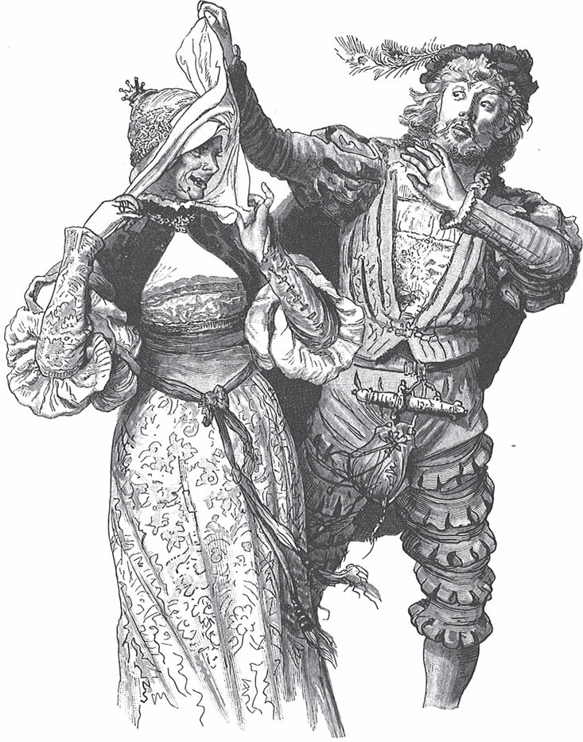

## Hans heiratet

Es war einmal ein junger Bauer, der hieß Hans. Sein Vetter wollte gern eine reiche Frau für ihn finden. Er setzte Hans hinter den Ofen und ließ ordentlich <abbr title="einheizen — натопить">einheizen</abbr>. Dann holte er einen Topf Milch und eine gute Menge <abbr title="das Weißbrot — белый хлеб">Weißbrot</abbr>. Er gab Hans einen <abbr title="neu geprägt — только что отчеканенный">neu geprägten</abbr>, glänzenden Heller in die Hand und sagte:

— Hans, den Heller da hältst du fest. Und das Weißbrot brockst du in die Milch. Bleib hier sitzen und geh nicht von der <abbr title="die Stelle, die Stellen — место">Stelle</abbr>, bis ich wiederkomme.

— Ja, — sagte Hans, — das mache ich alles.

Nun zog der Vetter eine alte, <abbr title="geflickt — залатанный">geflickte</abbr> Hose an. Die Hose war voller Flicken, und so ein Flicken hieß damals auch «<abbr title="der Placken, die Placken — заплата; (стар.) клочок земли, участок">Placken</abbr>». Aber «Placken» nannte man früher auch ein Stück Land, ein Feld oder eine Wiese. So ging er ins andere Dorf zu einer reichen <abbr title="die Bauerntochter, die Bauerntöchter — крестьянская дочь">Bauerntochter</abbr> und sagte:

— Wollt Ihr nicht meinen Vetter Hans heiraten? Ihr bekommt einen tüchtigen und gescheiten Mann. Er wird Euch gefallen.

Der <abbr title="geizig — скупой">geizige</abbr> Vater fragte:

— Wie sieht es mit seinem Vermögen aus? Hat er auch etwas einzubrocken?

— Lieber Freund, — antwortete der Vetter, — mein junger Vetter sitzt im Warmen, er hat einen schönen, guten <abbr title="der Pfennig, die Pfennige — пфенниг, денежка">Pfennig</abbr> in der Hand, und einzubrocken hat er auch. Und er hat bestimmt nicht weniger Placken als ich.

Dabei schlug er sich auf seine geflickte Hose.

— Wenn Ihr Euch die Mühe machen wollt, mit mir hinzugehen, dann zeige ich Euch sofort, dass alles so ist, wie ich sage.

Der <abbr title="der Geizhals, die Geizhälse — скряга">Geizhals</abbr> wollte die gute Gelegenheit nicht <abbr title="verpassen — упустить">verpassen</abbr> und sagte:

— Wenn das so ist, habe ich nichts gegen die Heirat.

Am <abbr title="festgesetzt — назначенный">festgesetzten</abbr> Tag wurde die Hochzeit gefeiert. Danach wollte die junge Frau aufs Feld gehen und die Güter des Bräutigams sehen. Da zog Hans zuerst seinen <abbr title="der Sonntagsanzug, die Sonntagsanzüge — праздничный костюм">Sonntagsanzug</abbr> aus und seinen geflickten Kittel an. Er sagte:

— Sonst mache ich mir noch den guten Anzug schmutzig.

Dann gingen sie zusammen aufs Feld. Überall, wo man am Weg einen <abbr title="der Weinberg, die Weinberge — виноградник">Weinberg</abbr> sah oder wo Felder und Wiesen <abbr title="abteilen — разделять, размежёвывать">abgeteilt</abbr> waren, zeigte Hans mit dem Finger darauf. Dann schlug er auf einen großen oder kleinen Flicken an seinem Kittel und sagte:

— Der Placken ist meiner und der da auch, mein Schatz, schau nur hin!

Damit wollte er sagen: Die Frau sollte nicht dumm auf das weite Feld <abbr title="gaffen — глазеть">gaffen</abbr>, sondern auf seinen Kittel schauen. Der gehörte ihm wirklich.

— Warst du auch auf der Hochzeit?

— Ja, ich war dort, und ganz <abbr title="fein gekleidet — нарядно одетый">fein gekleidet</abbr>. Mein <abbr title="der Kopfschmuck — головной убор, украшение">Kopfschmuck</abbr> war aus Schnee. Da kam die Sonne, und er ist mir geschmolzen. Mein Kleid war aus <abbr title="die Spinnwebe, die Spinnweben — паутина">Spinnweben</abbr>. Da kam ich durch Dornen, die rissen es mir ab. Meine Pantoffeln waren aus Glas. Da stieß ich an einen Stein, und sie machten «klink!» und <abbr title="entzweispringen (sprang entzwei, ist entzweigesprungen) — разлететься на куски">sprangen entzwei</abbr>.

---

### Neue Wörter

- **einheizen** — натопить
- **das Weißbrot** — белый хлеб
- **neu geprägt** — только что отчеканенный
- **die Stelle, die Stellen** — место
- **geflickt** — залатанный
- **der Placken, die Placken** — заплата; (стар.) клочок земли, участок
- **die Bauerntochter, die Bauerntöchter** — крестьянская дочь
- **geizig** — скупой
- **der Pfennig, die Pfennige** — пфенниг, денежка
- **der Geizhals, die Geizhälse** — скряга
- **verpassen** — упустить
- **festgesetzt** — назначенный
- **der Sonntagsanzug, die Sonntagsanzüge** — праздничный костюм
- **der Weinberg, die Weinberge** — виноградник
- **abteilen** — разделять, размежёвывать
- **gaffen** — глазеть
- **fein gekleidet** — нарядно одетый
- **der Kopfschmuck** — головной убор, украшение
- **die Spinnwebe, die Spinnweben** — паутина
- **entzweispringen (sprang entzwei, ist entzweigesprungen)** — разлететься на куски

[← Zurück](kapitel-83.md) · [Inhalt](README.md)
