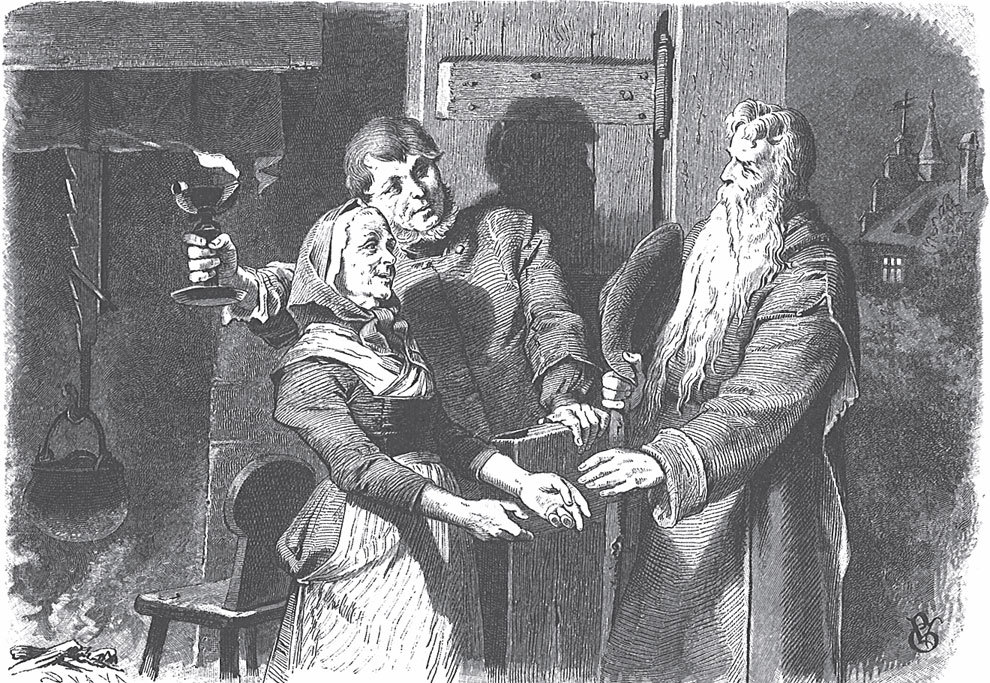

## Der Arme und der Reiche

In alten Zeiten, als der liebe Gott noch selbst auf der Erde unter den Menschen wanderte, geschah Folgendes. Eines Abends war er müde, und die Nacht kam, bevor er eine Herberge erreichen konnte. Vor ihm am Weg standen zwei Häuser <abbr title="einander gegenüber — друг напротив друга">einander gegenüber</abbr>. Das eine war groß und schön, das andere klein und ärmlich. Das große Haus gehörte einem reichen Mann, das kleine einem armen. Da dachte der liebe Gott: «Dem Reichen <abbr title="jemandem zur Last fallen — быть в тягость кому-то">falle</abbr> ich nicht zur Last. Bei ihm will ich übernachten.»

Als der Reiche das Klopfen an seiner Tür hörte, öffnete er das Fenster und fragte den Fremden, was er suche.

— Ich bitte um ein Nachtlager, — antwortete der Herr.

Der Reiche sah den Wanderer vom Kopf bis zu den Füßen an. Der liebe Gott trug <abbr title="schlicht — простой, скромный">schlichte</abbr> Kleider und sah nicht aus wie einer, der viel Geld in der Tasche hat. Deshalb schüttelte der Reiche den Kopf und sagte:

— Ich kann Euch nicht aufnehmen. Meine Kammern sind voll mit Kräutern und <abbr title="der Samen, die Samen — семена">Samen</abbr>. Wenn ich jeden <abbr title="beherbergen — давать приют">beherberge</abbr>, der an meine Tür klopft, dann muss ich bald selbst betteln gehen. Sucht Euch woanders einen Platz!

Er schlug das Fenster zu und ließ den lieben Gott einfach stehen. Da <abbr title="jemandem den Rücken kehren — повернуться спиной к кому-то">kehrte</abbr> ihm der liebe Gott den Rücken und ging hinüber zu dem kleinen Haus. Kaum hatte er geklopft, da öffnete der Arme schon seine kleine Tür und bat den Wanderer herein.

— Bleibt über Nacht bei mir, — sagte er. — Es ist schon finster, heute könnt Ihr nicht mehr weiter.

Das gefiel dem lieben Gott, und er trat ein. Die Frau des Armen gab ihm die Hand und <abbr title="jemanden willkommen heißen (hieß, hat geheißen) — приветствовать кого-то">hieß</abbr> ihn willkommen. Er solle es sich bequem machen, sagte sie. Sie hätten nicht viel, aber was sie hätten, gäben sie von Herzen gern. Dann stellte sie Kartoffeln aufs Feuer. Während sie kochten, melkte sie ihre Ziege, damit sie ein wenig Milch dazu hatten. Als der Tisch gedeckt war, setzte sich der liebe Gott und aß mit ihnen. Das einfache Essen schmeckte ihm gut, denn um ihn herum waren fröhliche Gesichter.

Nach dem Essen, als es Zeit zum Schlafen war, rief die Frau ihren Mann heimlich zu sich und sagte:

— Hör mal, lieber Mann, heute Nacht machen wir uns ein <abbr title="das Strohlager, die Strohlager — подстилка из соломы">Strohlager</abbr> auf dem Boden. Dann kann sich der arme Wanderer in unser Bett legen und sich ausruhen. Er ist den ganzen Tag gelaufen, da wird man müde.

— Von Herzen gern, — antwortete er. — Ich will es ihm anbieten.

Er ging zum lieben Gott und bat ihn: Wenn es ihm recht sei, solle er sich in ihr Bett legen und seine Glieder gut ausruhen. Der liebe Gott wollte den beiden Alten ihr Bett nicht wegnehmen. Aber sie gaben nicht nach, bis er es endlich tat und sich in ihr Bett legte. Sie selbst schliefen auf dem Stroh am Boden.

Am nächsten Morgen standen sie noch vor Sonnenaufgang auf und kochten dem Gast ein Frühstück, so gut sie konnten. Als die Sonne durch das kleine Fenster schien und der liebe Gott aufgestanden war, aß er wieder mit ihnen. Dann wollte er seinen Weg <abbr title="fortsetzen — продолжать">fortsetzen</abbr>. In der Tür drehte er sich um und sagte:

— Weil ihr so mitleidig und fromm seid, dürft ihr euch drei Dinge wünschen. Die will ich euch erfüllen.

Da sagte der Arme:

— Was soll ich mir sonst wünschen als die <abbr title="die ewige Seligkeit — вечное блаженство">ewige Seligkeit</abbr>? Und dass wir zwei gesund bleiben, solange wir leben, und dass wir unser tägliches Brot haben. Für den dritten Wunsch fällt mir nichts ein.

— Willst du dir nicht ein neues Haus statt des alten wünschen? — fragte der liebe Gott.

— O ja, — sagte der Mann. — Wenn ich das auch noch bekommen kann, dann wäre es mir sehr lieb.

Da erfüllte der Herr ihre Wünsche. Er verwandelte ihr altes Haus in ein neues, gab ihnen noch einmal seinen Segen und zog weiter.

Es war schon heller Tag, als der Reiche aufstand. Er <abbr title="sich lehnen — облокотиться, высунуться">lehnte sich</abbr> aus dem Fenster und sah gegenüber ein neues, sauberes Haus mit roten <abbr title="der Ziegel, die Ziegel — черепица; кирпич">Ziegeln</abbr>. Dort hatte gestern noch eine alte Hütte gestanden. Er <abbr title="große Augen machen — сделать большие глаза, удивиться">machte große Augen</abbr>, rief seine Frau und sagte:

— Sag mir, was ist geschehen? Gestern Abend stand da noch die alte, elende Hütte, und heute steht da ein schönes neues Haus. Lauf hinüber und frag, wie das gekommen ist!

Die Frau ging hinüber und fragte den Armen aus. Er erzählte ihr:

— Gestern Abend kam ein Wanderer, der suchte ein Nachtlager. Und heute Morgen, beim Abschied, hat er uns drei Wünsche <abbr title="gewähren — даровать, предоставлять">gewährt</abbr>: die ewige Seligkeit, Gesundheit in diesem Leben und das tägliche Brot dazu. Und zuletzt noch statt unserer alten Hütte ein schönes neues Haus.

Die Frau des Reichen lief schnell zurück und erzählte ihrem Mann alles. Der Mann rief:

— Ich könnte mich <abbr title="sich in Stücke reißen — рвать на себе волосы (букв. разорвать себя на куски)">in Stücke reißen</abbr>! Hätte ich das nur gewusst! Der Fremde war zuerst bei uns und wollte hier übernachten. Aber ich habe ihn weggeschickt.

— Beeil dich! — sagte die Frau. — Setz dich auf dein Pferd, dann kannst du den Mann noch einholen. Und dann musst du dir auch drei Wünsche geben lassen.

Der Reiche befolgte den guten Rat. Er jagte mit seinem Pferd davon und holte den lieben Gott noch ein. Er redete fein und freundlich. Er sei ihm hoffentlich nicht böse, dass man ihn nicht gleich <abbr title="hereinlassen (ließ herein, hat hereingelassen) — впускать">hereingelassen</abbr> habe. Er habe nur den Schlüssel zur Haustür gesucht, und inzwischen sei der Gast weggegangen. Wenn er auf diesem Weg zurückkomme, müsse er unbedingt bei ihm einkehren.

— Ja, — sagte der liebe Gott, — wenn ich einmal zurückkomme, will ich das tun.

Da fragte der Reiche, ob er sich nicht auch drei Dinge wünschen dürfe, wie sein <abbr title="der Nachbar, die Nachbarn — сосед">Nachbar</abbr>. Ja, sagte der liebe Gott, das dürfe er. Aber es wäre nicht gut für ihn, und er solle sich lieber nichts wünschen. Der Reiche meinte, er werde sich schon etwas aussuchen, was ihm Glück bringe. Er wolle nur sicher sein, dass es auch erfüllt werde. Da sagte der liebe Gott:

— Reite nach Hause. Drei Wünsche, die du <abbr title="äußern — высказывать">äußerst</abbr>, sollen in Erfüllung gehen.

Nun hatte der Reiche, was er verlangt hatte. Er ritt nach Hause und begann nachzudenken, was er sich wünschen sollte. Während er so <abbr title="grübeln — ломать голову, размышлять">grübelte</abbr> und die Zügel locker ließ, fing das Pferd an zu springen. Immer wieder wurde er in seinen Gedanken gestört und konnte sie gar nicht <abbr title="ordnen — приводить в порядок">ordnen</abbr>. Er klopfte dem Pferd auf den Hals und sagte:

— Ruhig, Liese!

Aber das Pferd machte wieder Sprünge. Da wurde er zuletzt ärgerlich und rief ganz ungeduldig:

— Ich wollte, du würdest dir den Hals brechen!

Kaum hatte er das Wort gesagt, plumps, fiel er auf die Erde. Das Pferd lag tot da und rührte sich nicht mehr. So war der erste Wunsch erfüllt. Weil er aber von Natur geizig war, wollte er den Sattel nicht im Stich lassen. Er schnitt ihn ab, <abbr title="hängen — вешать">hängte</abbr> ihn sich auf den Rücken und musste nun zu Fuß gehen. «Du hast noch zwei Wünsche übrig», dachte er und tröstete sich damit.

Langsam ging er durch den Sand. Zu Mittag brannte die Sonne heiß, und ihm wurde warm und missmutig zumute. Der Sattel drückte ihn auf dem Rücken, und er wusste noch immer nicht, was er sich wünschen sollte.

«Wenn ich mir auch alle Reiche und Schätze der Welt wünsche», sagte er zu sich selbst, «dann fällt mir <abbr title="hinterher — потом, после">hinterher</abbr> noch dies und das ein. Das weiß ich schon <abbr title="im Voraus — заранее">im Voraus</abbr>. Ich will es aber so machen, dass mir gar nichts mehr zu wünschen übrig bleibt.»

Dann seufzte er und sagte:

— Ja, wenn ich der <abbr title="bayrisch — баварский">bayrische</abbr> Bauer wäre! Der hatte auch drei Wünsche frei, und der wusste sich zu helfen. Er wünschte sich zuerst recht viel Bier, zweitens so viel Bier, wie er trinken konnte, und drittens noch ein Fass Bier dazu.

Manchmal glaubte er, jetzt habe er es gefunden. Aber dann schien es ihm doch zu wenig. Da dachte er daran, wie gut es seine Frau jetzt hatte. Sie saß zu Hause in einer kühlen Stube und ließ es sich gut schmecken. Das ärgerte ihn richtig. Und ohne dass er es merkte, sagte er so vor sich hin:

— Ich wollte, die säße zu Hause auf dem Sattel und könnte nicht herunter, statt dass ich ihn hier auf meinem Rücken schleppe!

Und als das letzte Wort aus seinem Mund kam, war der Sattel von seinem Rücken verschwunden. Er merkte, dass auch sein zweiter Wunsch in Erfüllung gegangen war. Da wurde ihm erst recht heiß. Er fing an zu laufen. Zu Hause wollte er sich ganz einsam in seine Kammer setzen und sich etwas Großes für den letzten Wunsch ausdenken.

Aber als er ankam und die Tür zur Stube öffnete, saß da seine Frau mitten im Zimmer auf dem Sattel. Sie konnte nicht herunter, sie jammerte und schrie. Da sagte er:

— <abbr title="sich zufriedengeben — успокоиться, довольствоваться">Gib dich zufrieden</abbr>! Ich will dir alle Reichtümer der Welt herbeiwünschen. Bleib nur da sitzen!

Aber sie schimpfte ihn einen <abbr title="der Schafskopf, die Schafsköpfe — болван (букв. баранья голова)">Schafskopf</abbr> und sagte:

— Was helfen mir alle Reichtümer der Welt, wenn ich auf dem Sattel sitze? Du hast mich hier draufgewünscht, also musst du mir auch wieder herunterhelfen!

Ob er wollte oder nicht, er musste den dritten Wunsch aussprechen: dass sie vom Sattel frei war und heruntersteigen konnte. Und der Wunsch wurde sofort erfüllt. So hatte er nichts davon als Ärger, Mühe, <abbr title="das Schimpfwort, die Schimpfwörter — ругательство">Schimpfwörter</abbr> und ein verlorenes Pferd. Die Armen aber lebten zufrieden, still und fromm bis an ihr seliges Ende.

---

### Neue Wörter

- **einander gegenüber** — друг напротив друга
- **jemandem zur Last fallen** — быть в тягость кому-то
- **schlicht** — простой, скромный
- **der Samen, die Samen** — семена
- **beherbergen** — давать приют
- **jemandem den Rücken kehren** — повернуться спиной к кому-то
- **jemanden willkommen heißen (hieß, hat geheißen)** — приветствовать кого-то
- **das Strohlager, die Strohlager** — подстилка из соломы
- **fortsetzen** — продолжать
- **die ewige Seligkeit** — вечное блаженство
- **sich lehnen** — облокотиться, высунуться
- **der Ziegel, die Ziegel** — черепица; кирпич
- **große Augen machen** — сделать большие глаза, удивиться
- **gewähren** — даровать, предоставлять
- **sich in Stücke reißen** — рвать на себе волосы (букв. разорвать себя на куски)
- **hereinlassen (ließ herein, hat hereingelassen)** — впускать
- **der Nachbar, die Nachbarn** — сосед
- **äußern** — высказывать
- **grübeln** — ломать голову, размышлять
- **ordnen** — приводить в порядок
- **hängen** — вешать
- **hinterher** — потом, после
- **im Voraus** — заранее
- **bayrisch** — баварский
- **sich zufriedengeben** — успокоиться, довольствоваться
- **der Schafskopf, die Schafsköpfe** — болван (букв. баранья голова)
- **das Schimpfwort, die Schimpfwörter** — ругательство

[← Zurück](kapitel-86.md) · [Inhalt](README.md)
