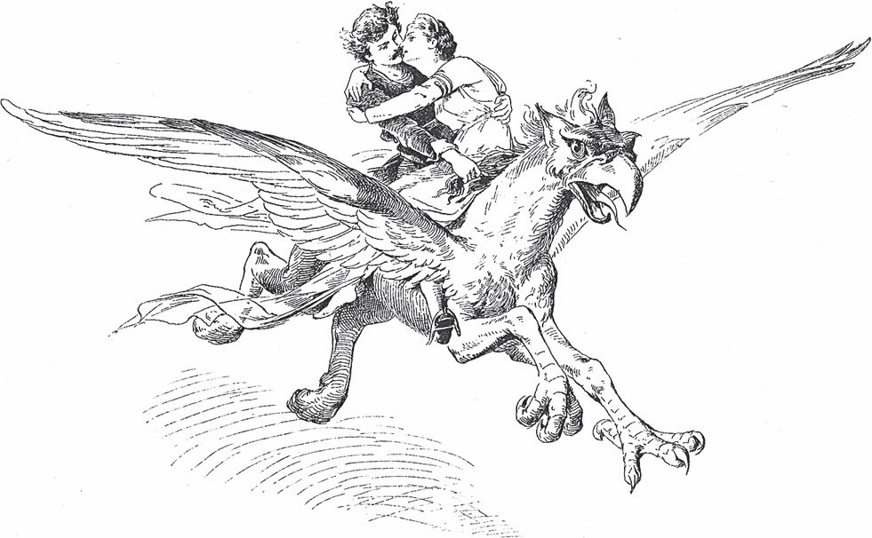

## Das singende springende Löweneckerchen

Es war einmal ein Mann, der wollte eine große Reise machen. Beim Abschied fragte er seine drei Töchter, was er ihnen <abbr title="mitbringen (brachte mit, hat mitgebracht) — привозить, приносить с собой">mitbringen</abbr> solle. Die älteste wollte Perlen, die zweite wollte Diamanten. Die dritte aber sagte:

— Lieber Vater, ich wünsche mir ein singendes springendes Löweneckerchen.

Ein Löweneckerchen, das ist eine <abbr title="die Lerche, die Lerchen — жаворонок">Lerche</abbr>, ein kleiner Vogel, der hoch in den Himmel fliegt und dabei singt.

— Ja, — sagte der Vater, — wenn ich eins kriegen kann, sollst du es haben.

Er küsste alle drei und zog fort. Als die Zeit kam und er wieder auf dem Heimweg war, hatte er Perlen und Diamanten für die beiden älteren Töchter gekauft. Aber das singende springende Löweneckerchen für die jüngste hatte er <abbr title="überall — везде">überall</abbr> vergeblich gesucht. Das tat ihm leid, denn sie war sein liebstes Kind.

Da führte ihn der Weg durch einen Wald. Mitten im Wald stand ein prächtiges Schloss, und nah am Schloss stand ein Baum. Ganz oben auf der Spitze des Baumes sah er ein Löweneckerchen, das sang und sprang.

— Ei, du kommst mir gerade recht! — sagte er vergnügt. Er rief seinen Diener, der sollte hinaufsteigen und das Tierchen fangen.

Aber als der Diener zu dem Baum trat, sprang darunter ein Löwe auf. Er schüttelte sich und brüllte so laut, dass das Laub an den Bäumen zitterte.

— Wer mir mein singendes springendes Löweneckerchen stehlen will, — rief er, — den fresse ich auf!

Da sagte der Mann:

— Ich habe nicht gewusst, dass der Vogel dir gehört. Ich will mein Unrecht <abbr title="wiedergutmachen — загладить, исправить">wiedergutmachen</abbr> und mich mit viel Gold <abbr title="sich freikaufen — выкупить себя">freikaufen</abbr>. Lass mir nur das Leben!

Der Löwe sprach:

— Dich kann nur eins retten: Du musst mir versprechen, was dir zu Hause zuerst begegnet. Wenn du das tust, schenke ich dir das Leben und obendrein den Vogel für deine Tochter.

Aber der Mann weigerte sich und sagte:

— Das könnte meine jüngste Tochter sein. Sie hat mich am liebsten und läuft mir immer entgegen, wenn ich nach Hause komme.

Der Diener aber hatte Angst und sagte:

— Muss Euch denn gerade Eure Tochter begegnen? Es könnte ja auch eine Katze oder ein Hund sein.

Da ließ sich der Mann überreden. Er nahm das singende springende Löweneckerchen und versprach dem Löwen, was ihm zu Hause zuerst begegnen würde.

Als er zu Hause ankam und in sein Haus trat, war das Erste, was ihm begegnete, niemand anders als seine jüngste, liebste Tochter. Sie kam <abbr title="gelaufen kommen — прибежать">gelaufen</abbr>, küsste und umarmte ihn. Und als sie sah, dass er ein singendes springendes Löweneckerchen mitgebracht hatte, war sie außer sich vor Freude. Der Vater aber konnte sich nicht freuen. Er fing an zu weinen und sagte:

— Mein liebstes Kind, den kleinen Vogel habe ich teuer bezahlt. Ich musste dich dafür einem wilden Löwen versprechen. Wenn er dich hat, wird er dich zerreißen und fressen.

Er erzählte ihr alles, wie es gewesen war, und bat sie, nicht hinzugehen, was auch immer passieren würde. Sie aber tröstete ihn und sagte:

— Liebster Vater, was Ihr versprochen habt, das muss man auch halten. Ich will hingehen und den Löwen schon besänftigen, damit ich gesund zu Euch zurückkomme.

Am nächsten Morgen ließ sie sich den Weg zeigen, nahm Abschied und ging getrost in den Wald hinein. Der Löwe aber war ein verzauberter Königssohn. Am Tag war er ein Löwe, und mit ihm wurden alle seine Leute Löwen. In der Nacht aber hatten sie wieder ihre natürliche menschliche Gestalt. Als sie ankam, wurde sie freundlich empfangen und ins Schloss geführt. Als die Nacht kam, war er ein schöner Mann, und die Hochzeit wurde mit großer Pracht gefeiert. Sie lebten glücklich miteinander. In der Nacht waren sie wach, und am Tag schliefen sie.

Eines Tages kam er und sagte:

— Morgen ist ein Fest im Haus deines Vaters, weil deine älteste Schwester heiratet. Wenn du Lust hast hinzugehen, dann sollen dich meine Löwen hinbringen.

Da sagte sie ja, sie wolle gern ihren Vater wiedersehen. Sie fuhr hin, und die Löwen begleiteten sie. Als sie ankam, war die Freude groß. Denn alle hatten geglaubt, der Löwe habe sie zerrissen und sie sei schon lange nicht mehr am Leben. Sie aber erzählte, was für einen schönen Mann sie habe und wie gut es ihr gehe. Sie blieb bei ihnen, solange die Hochzeit dauerte. Dann fuhr sie wieder zurück in den Wald.

Als die zweite Tochter heiratete und sie wieder zur Hochzeit eingeladen war, sagte sie zum Löwen:

— Diesmal will ich nicht allein sein. Du musst mitkommen.

Der Löwe aber sagte, das sei zu gefährlich für ihn. Wenn dort der <abbr title="der Strahl, die Strahlen — луч">Strahl</abbr> eines brennenden Lichts ihn berühre, dann werde er in eine Taube verwandelt. Dann müsse er sieben Jahre lang mit den Tauben fliegen.

— Ach, — sagte sie, — komm nur mit! Ich will dich schon hüten und vor allem Licht schützen.

Also zogen sie zusammen los und nahmen auch ihr kleines Kind mit. Dort ließ sie einen Saal <abbr title="mauern — возводить (из камня), класть стену">mauern</abbr>, so stark und dick, dass kein Strahl <abbr title="hindurchkommen (kam hindurch, ist hindurchgekommen) — проникнуть сквозь">hindurchkommen</abbr> konnte. Darin sollte er sitzen, wenn man die Hochzeitslichter anzündete. Aber die Tür war aus frischem Holz gemacht. Das Holz sprang und bekam einen kleinen <abbr title="der Riss, die Risse — трещина">Riss</abbr>, den niemand bemerkte.

Nun wurde die Hochzeit mit Pracht gefeiert. Aber als der Zug aus der Kirche mit den vielen <abbr title="die Fackel, die Fackeln — факел">Fackeln</abbr> und Lichtern an dem Saal vorbeikam, da fiel ein <abbr title="haarfein — тонкий как волос">haarfeiner</abbr> Strahl auf den Königssohn. Im selben Augenblick war er verwandelt. Als sie hineinkam und ihn suchte, sah sie ihn nicht. Dort saß nur eine weiße Taube. Die Taube sprach zu ihr:

— Sieben Jahre muss ich in die Welt <abbr title="fortfliegen (flog fort, ist fortgeflogen) — улетать прочь">fortfliegen</abbr>. Aber alle sieben Schritte will ich einen roten Blutstropfen und eine weiße Feder fallen lassen. Die sollen dir den Weg zeigen. Wenn du der Spur folgst, kannst du mich erlösen.

Da flog die Taube zur Tür hinaus, und sie folgte ihr. Alle sieben Schritte fiel ein rotes Blutströpfchen und ein weißes Federchen herab und zeigte ihr den Weg. So ging sie immer weiter in die weite Welt hinein. Sie sah nicht nach links und nicht nach rechts, und sie ruhte sich nie aus. Die sieben Jahre waren fast vorbei. Da freute sie sich und glaubte, sie seien bald erlöst. Aber davon war sie noch weit entfernt.

Einmal, als sie so weiterging, fiel kein Federchen mehr und auch kein rotes Blutströpfchen. Und als sie die Augen hob, war die Taube verschwunden. Sie dachte: «Menschen können dir hier nicht helfen.» Deshalb stieg sie zur Sonne hinauf und sagte zu ihr:

— Du scheinst in alle <abbr title="die Ritze, die Ritzen — щель">Ritzen</abbr> und über alle Spitzen. Hast du keine weiße Taube fliegen sehen?

— Nein, — sagte die Sonne, — ich habe keine gesehen. Aber ich schenke dir ein <abbr title="das Kästchen, die Kästchen — шкатулка, коробочка">Kästchen</abbr>. Mach es auf, wenn du in großer Not bist.

Da dankte sie der Sonne und ging weiter, bis es Abend war und der Mond schien. Da fragte sie ihn:

— Du scheinst ja die ganze Nacht und durch alle Felder und Wälder. Hast du keine weiße Taube fliegen sehen?

— Nein, — sagte der Mond, — ich habe keine gesehen. Aber ich schenke dir ein Ei. Zerbrich es, wenn du in großer Not bist.

Da dankte sie dem Mond und ging weiter, bis der Nachtwind kam und sie anblies. Da sprach sie zu ihm:

— Du wehst ja über alle Bäume und unter allen Blättern hindurch. Hast du keine weiße Taube fliegen sehen?

— Nein, — sagte der Nachtwind, — ich habe keine gesehen. Aber ich will die drei anderen Winde fragen. Vielleicht haben sie sie gesehen.

Der <abbr title="der Ostwind — восточный ветер">Ostwind</abbr> und der <abbr title="der Westwind — западный ветер">Westwind</abbr> kamen und hatten nichts gesehen. Der <abbr title="der Südwind — южный ветер">Südwind</abbr> aber sprach:

— Die weiße Taube habe ich gesehen. Sie ist zum Roten Meer geflogen. Dort ist sie wieder ein Löwe geworden, denn die sieben Jahre sind vorbei. Der Löwe steht dort im <abbr title="der Kampf, die Kämpfe — бой, борьба">Kampf</abbr> mit einem <abbr title="der Lindwurm, die Lindwürmer — дракон, змей">Lindwurm</abbr>. Der Lindwurm aber ist eine verzauberte Königstochter.

Da sagte der Nachtwind zu ihr:

— Ich will dir einen Rat geben. Geh zum Roten Meer. Am rechten Ufer stehen große Ruten. Zähle sie, schneide dir die elfte ab und schlag damit den Lindwurm. Dann kann der Löwe ihn besiegen, und beide bekommen ihren menschlichen <abbr title="der Körper, die Körper — тело">Körper</abbr> wieder. Dann sieh dich um. Du wirst den <abbr title="der Vogel Greif — птица Гриф (сказочная птица)">Vogel Greif</abbr> sehen, der am Roten Meer sitzt. Schwing dich mit deinem Liebsten auf seinen Rücken. Der Vogel wird euch über das Meer nach Hause tragen. Hier hast du auch eine Nuss. Wenn du mitten über dem Meer bist, lass sie hinunterfallen. Sofort wird sie <abbr title="keimen — прорастать">keimen</abbr>, und ein großer <abbr title="der Nussbaum, die Nussbäume — ореховое дерево">Nussbaum</abbr> wird aus dem Wasser wachsen. Darauf ruht sich der Greif aus. Könnte er sich nicht ausruhen, dann wäre er nicht stark genug, um euch hinüberzutragen. Und wenn du vergisst, die Nuss hinunterzuwerfen, dann lässt er euch ins Meer fallen.

Da ging sie hin und fand alles so, wie der Nachtwind gesagt hatte. Sie zählte die Ruten am Meer und schnitt die elfte ab. Damit schlug sie den Lindwurm, und der Löwe besiegte ihn. Sofort hatten beide ihren menschlichen Körper wieder. Aber als die Königstochter, die vorher ein Lindwurm gewesen war, vom Zauber frei war, nahm sie den jungen Mann in den Arm, setzte sich auf den Vogel Greif und flog mit ihm fort.

Da stand die Arme, die so weit gewandert war, und war wieder verlassen. Sie setzte sich hin und weinte. Endlich aber fasste sie Mut und sagte:

— Ich will noch so weit gehen, wie der Wind weht, und so lange, wie der Hahn kräht, bis ich ihn finde.

Und sie ging fort, lange, lange Wege, bis sie endlich zu dem Schloss kam, wo die beiden zusammen lebten. Dort hörte sie, dass bald ein Fest sein sollte, bei dem die beiden Hochzeit feiern wollten. Sie aber sagte:

— Gott hilft mir noch.

Sie öffnete das Kästchen, das ihr die Sonne gegeben hatte. Darin lag ein Kleid, das so glänzte wie die Sonne selbst. Sie nahm es heraus, zog es an und ging hinauf ins Schloss. Alle Leute und auch die Braut selbst sahen sie mit Staunen an. Das Kleid gefiel der Braut so gut, dass sie dachte, es wäre ein schönes Hochzeitskleid. Sie fragte, ob es nicht zu verkaufen sei.

— Nicht für Geld und Gut, — antwortete sie, — aber für Fleisch und Blut.

Die Braut fragte, was sie damit meine. Da sagte sie:

— Lasst mich eine Nacht in der Kammer schlafen, wo der Bräutigam schläft.

Die Braut wollte nicht, und doch wollte sie das Kleid gern haben. Endlich willigte sie ein. Aber der <abbr title="der Kammerdiener, die Kammerdiener — камердинер">Kammerdiener</abbr> musste dem Königssohn einen Schlaftrunk geben. Als es Nacht war und der junge Mann schon schlief, wurde sie in die Kammer geführt. Da setzte sie sich ans Bett und sagte:

— Ich bin dir sieben Jahre <abbr title="nachfolgen (ist nachgefolgt) — следовать за кем-то">nachgefolgt</abbr>. Ich war bei Sonne und Mond und bei den vier Winden und habe nach dir gefragt. Ich habe dir gegen den Lindwurm geholfen. Willst du mich denn ganz vergessen?

Der Königssohn aber schlief so fest, dass es ihm nur so vorkam, als rauschte draußen der Wind in den <abbr title="die Tanne, die Tannen — ель, пихта">Tannen</abbr>. Als der Morgen anbrach, wurde sie wieder hinausgeführt und musste das goldene Kleid hergeben.

Und weil auch das nichts geholfen hatte, wurde sie traurig. Sie ging hinaus auf eine Wiese, setzte sich dort hin und weinte. Und wie sie so saß, fiel ihr das Ei ein, das ihr der Mond gegeben hatte. Sie schlug es auf. Da kam eine <abbr title="die Glucke, die Glucken — наседка">Glucke</abbr> mit zwölf <abbr title="das Küken, die Küken — цыплёнок">Küken</abbr> heraus, ganz aus Gold. Die Küken liefen herum und <abbr title="piepen — пищать">piepten</abbr> und krochen der Alten wieder unter die Flügel. Etwas Schöneres gab es auf der ganzen Welt nicht zu sehen. Da stand sie auf und trieb die Tiere auf der Wiese vor sich her, bis die Braut aus dem Fenster sah. Die kleinen Küken gefielen der Braut so gut, dass sie gleich herunterkam und fragte, ob sie nicht zu verkaufen seien.

— Nicht für Geld und Gut, aber für Fleisch und Blut. Lasst mich noch eine Nacht in der Kammer schlafen, wo der Bräutigam schläft.

Die Braut sagte ja. Sie wollte sie betrügen wie am Abend davor. Aber als der Königssohn zu Bett ging, fragte er seinen Kammerdiener, was das Murmeln und Rauschen in der Nacht gewesen sei. Da erzählte der Kammerdiener alles. Er habe ihm einen Schlaftrunk geben müssen, weil ein armes Mädchen heimlich in der Kammer geschlafen habe. Und heute Nacht solle er ihm wieder einen geben.

— Gieß den Trank neben das Bett aus, — sagte der Königssohn.

In der Nacht wurde sie wieder hereingeführt. Und als sie anfing zu erzählen, wie traurig es ihr ergangen war, erkannte er sofort an der Stimme seine liebe Gemahlin. Er sprang auf und rief:

— Jetzt bin ich erst richtig erlöst! Mir war wie in einem Traum. Die fremde Königstochter hatte mich verzaubert, sodass ich dich vergessen musste. Aber Gott hat den <abbr title="der Bann — чары, наваждение">Bann</abbr> noch zur rechten Stunde von mir genommen.

Da gingen sie beide in der Nacht heimlich aus dem Schloss. Denn sie <abbr title="sich fürchten vor + Dat. — бояться">fürchteten sich</abbr> vor dem Vater der Königstochter, der ein <abbr title="der Zauberer, die Zauberer — колдун, волшебник">Zauberer</abbr> war. Sie setzten sich auf den Vogel Greif, und der trug sie über das Rote Meer. Als sie in der Mitte waren, ließ sie die Nuss fallen. Sofort wuchs ein großer Nussbaum, und darauf ruhte sich der Vogel aus. Dann trug er sie nach Hause. Dort fanden sie ihr Kind, das groß und schön geworden war. Und von nun an lebten sie glücklich bis an ihr Ende.

---

### Neue Wörter

- **mitbringen (brachte mit, hat mitgebracht)** — привозить, приносить с собой
- **die Lerche, die Lerchen** — жаворонок
- **überall** — везде
- **wiedergutmachen** — загладить, исправить
- **sich freikaufen** — выкупить себя
- **gelaufen kommen** — прибежать
- **der Strahl, die Strahlen** — луч
- **mauern** — возводить (из камня), класть стену
- **hindurchkommen (kam hindurch, ist hindurchgekommen)** — проникнуть сквозь
- **der Riss, die Risse** — трещина
- **die Fackel, die Fackeln** — факел
- **haarfein** — тонкий как волос
- **fortfliegen (flog fort, ist fortgeflogen)** — улетать прочь
- **die Ritze, die Ritzen** — щель
- **das Kästchen, die Kästchen** — шкатулка, коробочка
- **der Ostwind** — восточный ветер
- **der Westwind** — западный ветер
- **der Südwind** — южный ветер
- **der Kampf, die Kämpfe** — бой, борьба
- **der Lindwurm, die Lindwürmer** — дракон, змей
- **der Körper, die Körper** — тело
- **der Vogel Greif** — птица Гриф (сказочная птица)
- **keimen** — прорастать
- **der Nussbaum, die Nussbäume** — ореховое дерево
- **der Kammerdiener, die Kammerdiener** — камердинер
- **nachfolgen (ist nachgefolgt)** — следовать за кем-то
- **die Tanne, die Tannen** — ель, пихта
- **die Glucke, die Glucken** — наседка
- **das Küken, die Küken** — цыплёнок
- **piepen** — пищать
- **der Bann** — чары, наваждение
- **sich fürchten vor + Dat.** — бояться
- **der Zauberer, die Zauberer** — колдун, волшебник

[← Zurück](kapitel-87.md) · [Inhalt](README.md)
