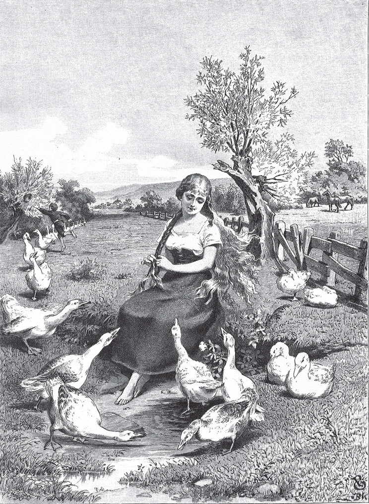

## Die Gänsemagd

Es lebte einmal eine alte Königin. Ihr Gemahl war schon vor vielen Jahren gestorben, und sie hatte eine schöne Tochter. Als die Tochter erwachsen war, wurde sie einem Königssohn versprochen, der weit weg wohnte. Als nun die Zeit kam, dass die beiden heiraten sollten, musste das Kind in das fremde Reich reisen. Die alte Königin packte ihr sehr viele kostbare Dinge ein: Gold und Silber, Becher und Schmuck, kurz alles, was zu einer königlichen Mitgift gehörte. Denn sie liebte ihr Kind von Herzen.

Sie gab ihr auch eine <abbr title="die Kammerjungfer, die Kammerjungfern — камеристка, горничная">Kammerjungfer</abbr> mit. Die sollte mitreiten und die Braut dem Bräutigam <abbr title="übergeben (übergab, hat übergeben) — передавать">übergeben</abbr>. Jede bekam ein Pferd für die Reise. Das Pferd der Königstochter hieß Falada und konnte sprechen.

Als die Stunde des Abschieds gekommen war, ging die alte Mutter in ihr Schlafgemach. Sie nahm ein kleines Messer und schnitt sich damit in die Finger, sodass sie bluteten. Dann hielt sie ein weißes Tüchlein darunter und ließ drei Tropfen Blut hineinfallen. Das gab sie der Tochter und sagte:

— Liebes Kind, bewahre das gut auf. Unterwegs wirst du es brauchen.

So nahmen beide traurig Abschied voneinander. Die Königstochter steckte das Tüchlein vorne in ihr Kleid, an die Brust. Dann setzte sie sich aufs Pferd und ritt zu ihrem Bräutigam.

Nachdem sie eine Stunde geritten waren, bekam sie großen Durst. Sie sagte zu ihrer Kammerjungfer:

— Steig ab und schöpfe mir mit meinem Becher, den du für mich mitgenommen hast, Wasser aus dem Bach. Ich möchte gern etwas trinken.

— Wenn Ihr Durst habt, — sagte die Kammerjungfer, — dann steigt selbst ab, legt Euch ans Wasser und trinkt. Ich will nicht Eure Magd sein.

Weil sie so großen Durst hatte, stieg die Königstochter ab. Sie beugte sich über das Wasser im Bach und trank. Aus dem goldenen Becher durfte sie nicht trinken. Da sagte sie:

— Ach Gott!

Und die drei Blutstropfen antworteten:

— Wenn das deine Mutter wüsste, das Herz im Leib würde ihr zerspringen.

Aber die Königsbraut war <abbr title="demütig — смиренный, кроткий">demütig</abbr>. Sie sagte nichts und stieg wieder aufs Pferd. So ritten sie einige Meilen weiter. Aber der Tag war warm, die Sonne stach, und bald hatte sie wieder Durst. Als sie an einen Fluss kamen, rief sie noch einmal ihre Kammerjungfer:

— Steig ab und gib mir aus meinem Goldbecher zu trinken!

Denn die bösen Worte hatte sie längst vergessen. Aber die Kammerjungfer sprach noch hochmütiger:

— Wollt Ihr trinken, dann trinkt allein. Ich will nicht Eure Magd sein.

Da stieg die Königstochter wegen des großen Durstes ab. Sie legte sich über das fließende Wasser, weinte und sagte:

— Ach Gott!

Und die Blutstropfen antworteten wieder:

— Wenn das deine Mutter wüsste, das Herz im Leib würde ihr zerspringen.

Während sie so trank und sich weit nach vorn lehnte, fiel ihr das Tüchlein mit den drei Tropfen aus dem Kleid. Es schwamm mit dem Wasser fort, und in ihrer großen Angst merkte sie es nicht. Die Kammerjungfer aber hatte zugesehen. Sie freute sich, denn nun bekam sie Macht über die Braut. Ohne die Blutstropfen war die Braut schwach und <abbr title="machtlos — бессильный">machtlos</abbr> geworden.

Als die Königstochter wieder auf ihr Pferd Falada steigen wollte, sagte die Kammerfrau:

— Auf Falada gehöre ich, und auf meinen Gaul gehörst du!

Und das musste sie sich gefallen lassen. Dann befahl ihr die Kammerfrau mit harten Worten, die königlichen Kleider auszuziehen und ihre eigenen schlechten Kleider anzuziehen. Zuletzt musste die Königstochter unter freiem Himmel schwören, dass sie am Königshof keinem Menschen etwas davon sagen würde. Hätte sie diesen Eid nicht <abbr title="einen Eid leisten — принести клятву">geleistet</abbr>, dann hätte die Kammerfrau sie <abbr title="auf der Stelle — на месте, тут же">auf der Stelle</abbr> umgebracht. Aber Falada sah das alles und merkte es sich gut.

Die Kammerfrau stieg nun auf Falada und die wahre Braut auf den schlechten Gaul. So ritten sie weiter, bis sie endlich im königlichen Schloss eintrafen. Dort war die Freude über ihre <abbr title="die Ankunft — прибытие">Ankunft</abbr> groß. Der Königssohn lief ihnen entgegen, hob die Kammerfrau vom Pferd und glaubte, sie sei seine Braut. Sie wurde die Treppe hinaufgeführt. Die wahre Königstochter aber musste unten stehen bleiben.

Da sah der alte König aus dem Fenster. Er sah sie im Hof stehen und sah, wie fein, zart und schön sie war. Gleich ging er in das königliche <abbr title="das Gemach, die Gemächer — покои">Gemach</abbr> und fragte die Braut nach dem Mädchen, das sie mitgebracht hatte und das unten im Hof stand. Wer sie denn sei?

— Die habe ich unterwegs mitgenommen, damit ich Gesellschaft habe. Gebt der Magd etwas zu arbeiten, damit sie nicht faul herumsteht.

Aber der alte König hatte keine Arbeit für sie. Ihm fiel nur ein:

— Ich habe da so einen kleinen Jungen, der hütet die Gänse. Dem kann sie helfen.

Der Junge hieß Kürdchen, das heißt «kleiner Konrad». Ihm musste die wahre Braut nun helfen, die Gänse zu hüten.

Bald aber sagte die falsche Braut zu dem jungen König:

— Liebster Gemahl, ich bitte Euch, tut mir einen Gefallen.

— Das will ich gern tun, — antwortete er.

— Dann ruft den <abbr title="der Abdecker, die Abdecker — живодёр">Abdecker</abbr> und lasst dem Pferd, auf dem ich hergeritten bin, den Kopf abschlagen. Es hat mich unterwegs geärgert.

In Wirklichkeit aber fürchtete sie, dass das Pferd erzählen könnte, wie sie die Königstochter behandelt hatte. Nun war es so weit, und der treue Falada sollte sterben. Da hörte auch die echte Königstochter davon. Heimlich versprach sie dem Abdecker ein Stück Geld, wenn er ihr einen kleinen Dienst <abbr title="einen Dienst erweisen (erwies, hat erwiesen) — оказать услугу">erwiese</abbr>. In der Stadt gab es ein großes, finsteres Tor, durch das sie abends und morgens mit den Gänsen gehen musste. Unter dieses finstere Tor sollte er Faladas Kopf <abbr title="nageln — прибивать гвоздями">nageln</abbr>, damit sie ihn noch öfter sehen konnte. Der Knecht des Abdeckers versprach es. Er hieb den Kopf ab und nagelte ihn unter dem finsteren Tor fest.

Früh am Morgen, als sie und Kürdchen die Gänse unter dem Tor <abbr title="hinaustreiben (trieb hinaus, hat hinausgetrieben) — выгонять">hinaustrieben</abbr>, sagte sie im Vorbeigehen:

— O du Falada, da du <abbr title="hangen (alt) = hängen — висеть">hangest</abbr>!

Da antwortete der Kopf:

> — O du Jungfer Königin, da du <abbr title="gangen (alt) = gehen — идти">gangest</abbr>,  
> wenn das deine Mutter wüsste,  
> ihr Herz tät ihr zerspringen.

Das heißt: «Du hängst hier, und du, junge Königin, gehst hier vorbei. Wenn das deine Mutter wüsste, ihr Herz würde zerspringen.»

Da zog sie still weiter zur Stadt hinaus, und sie trieben die Gänse aufs Feld. Als sie auf der Wiese angekommen war, setzte sie sich hin und öffnete ihre Haare. Die waren aus reinem Gold. Kürdchen sah sie und freute sich, wie sie glänzten. Er wollte ihr ein paar Haare ausreißen. Da sprach sie:

> — Weh, weh, Windchen,  
> nimm Kürdchen sein Hütchen,  
> und lass'n sich mit jagen,  
> bis ich mich geflochten und <abbr title="schnatzen (alt) — причесать, убрать волосы">geschnatzt</abbr>  
> und wieder aufgesatzt.

Das heißt: «Wehe, Wind, nimm Kürdchen das Hütchen weg und lass ihn ihm nachlaufen, bis ich meine Haare geflochten, gekämmt und wieder hochgesteckt habe.»

Da kam ein so starker Wind, dass er Kürdchens Hütchen weit über das Land wehte. Kürdchen musste ihm nachlaufen. Bis er wiederkam, war sie mit dem Kämmen und <abbr title="hochstecken — закалывать (волосы)">Hochstecken</abbr> fertig, und er konnte keine Haare mehr kriegen. Da war Kürdchen böse und sprach nicht mehr mit ihr. So hüteten sie die Gänse, bis es Abend wurde. Dann gingen sie nach Hause.

Am nächsten Morgen, als sie die Gänse unter dem finsteren Tor hinaustrieben, sagte das Mädchen:

— O du Falada, da du hangest!

Falada antwortete:

> — O du Jungfer Königin, da du gangest,  
> wenn das deine Mutter wüsste,  
> das Herz tät ihr zerspringen.

Und draußen auf dem Feld setzte sie sich wieder auf die Wiese und fing an, ihr Haar <abbr title="auskämmen — расчёсывать">auszukämmen</abbr>. Kürdchen lief herbei und wollte danach greifen. Da sprach sie schnell:

> — Weh, weh, Windchen,  
> nimm Kürdchen sein Hütchen,  
> und lass'n sich mit jagen,  
> bis ich mich geflochten und geschnatzt  
> und wieder aufgesatzt.

Da wehte der Wind und wehte ihm das Hütchen weit vom Kopf, sodass Kürdchen hinterherlaufen musste. Als er wiederkam, war ihr Haar längst in Ordnung, und er konnte kein einziges erwischen. So hüteten sie die Gänse, bis es Abend wurde.

Am Abend aber, nachdem sie nach Hause gekommen waren, ging Kürdchen zum alten König und sagte:

— Mit dem Mädchen will ich nicht länger Gänse hüten.

— Warum denn? — fragte der alte König.

— Ach, sie ärgert mich den ganzen Tag.

Da befahl ihm der alte König zu erzählen, was er denn mit ihr erlebe. Kürdchen sagte:

— Morgens, wenn wir mit der Herde unter dem finsteren Tor durchkommen, hängt da ein <abbr title="der Pferdekopf, die Pferdeköpfe — лошадиная голова">Pferdekopf</abbr> an der Wand. Zu dem sagt sie: «Falada, da du hangest!» Und dann antwortet der Kopf:

> — O du Königsjungfer, da du gangest,  
> wenn das deine Mutter wüsste,  
> das Herz tät ihr zerspringen.

Und Kürdchen erzählte weiter, was auf der Gänsewiese passierte und wie er dort seinem Hut im Wind nachlaufen musste.

Der alte König befahl ihm, am nächsten Tag wieder mit ihr hinauszugehen. Am Morgen setzte er sich selbst hinter das finstere Tor und hörte, wie sie mit Faladas Kopf sprach. Dann ging er ihr auch aufs Feld nach und versteckte sich in einem Busch auf der Wiese. Bald sah er mit eigenen Augen, wie die Gänsemagd und der <abbr title="der Gänsejunge, die Gänsejungen — мальчик-гусопас">Gänsejunge</abbr> die Herde brachten. Nach einer Weile setzte sie sich hin und löste ihre Zöpfe. Die Haare strahlten nur so. Gleich sprach sie wieder:

> — Weh, weh, Windchen,  
> fass Kürdchen sein Hütchen,  
> und lass'n sich mit jagen,  
> bis dass ich mich geflochten und geschnatzt  
> und wieder aufgesatzt.

Da kam ein <abbr title="der Windstoß, die Windstöße — порыв ветра">Windstoß</abbr> und flog mit Kürdchens Hut davon, sodass er weit laufen musste. Die Magd aber kämmte und flocht still ihre <abbr title="die Locke, die Locken — локон">Locken</abbr>. Der alte König <abbr title="beobachten — наблюдать">beobachtete</abbr> alles. Dann ging er unbemerkt zurück.

Als die Gänsemagd am Abend nach Hause kam, rief er sie beiseite und fragte, warum sie das alles tue.

— Das darf ich Euch nicht sagen. Ich darf auch keinem Menschen mein Leid klagen. Denn das habe ich unter freiem Himmel geschworen. Sonst hätte ich mein Leben verloren.

Er drängte sie und ließ ihr keine Ruhe. Aber er konnte nichts aus ihr herausbekommen. Da sagte er:

— Wenn du mir nichts sagen willst, dann klag dem <abbr title="der Eisenofen, die Eisenöfen — чугунная печь">Eisenofen</abbr> da dein Leid.

Und er ging fort. Da kroch sie in den Eisenofen. Sie fing an zu jammern und zu weinen, <abbr title="sein Herz ausschütten — излить душу">schüttete</abbr> ihr Herz aus und sagte:

— Da sitze ich nun, von aller Welt verlassen, und bin doch eine Königstochter. Eine falsche Kammerjungfer hat mich mit Gewalt gezwungen, meine königlichen Kleider abzulegen. Sie hat meinen Platz bei meinem Bräutigam <abbr title="einnehmen (nahm ein, hat eingenommen) — занимать">eingenommen</abbr>, und ich muss als Gänsemagd niedrige Arbeit tun. Wenn das meine Mutter wüsste, das Herz im Leib würde ihr zerspringen.

Der alte König aber stand draußen am <abbr title="das Ofenrohr, die Ofenrohre — печная труба">Ofenrohr</abbr>, lauschte und hörte, was sie sagte. Da kam er wieder herein und ließ sie aus dem Ofen kommen. Man zog ihr königliche Kleider an, und es war wie ein Wunder, wie schön sie war. Der alte König rief seinen Sohn und verriet ihm, dass er die falsche Braut habe. Die sei nur ein Kammermädchen. Die wahre aber stehe hier, die frühere Gänsemagd. Der junge König war von Herzen froh, als er ihre Schönheit und Tugend sah.

Ein großes Festmahl wurde vorbereitet, und alle Leute und guten Freunde wurden eingeladen. Oben am Tisch saß der Bräutigam, die Königstochter auf der einen Seite und die Kammerjungfer auf der anderen. Aber die Kammerjungfer war <abbr title="verblendet — ослеплённый">verblendet</abbr> und erkannte die andere in dem glänzenden Schmuck nicht mehr.

Als sie gegessen und getrunken hatten und guter Laune waren, gab der alte König der Kammerfrau ein Rätsel auf. Was verdiene eine Frau, die ihren Herrn so und so betrogen habe? Er erzählte dabei die ganze Geschichte und fragte:

— Welches Urteil hat diese Frau verdient?

Da sagte die falsche Braut:

— Sie verdient nichts Besseres, als dass man sie <abbr title="splitternackt — совершенно голый">splitternackt</abbr> auszieht und in ein Fass steckt, das innen mit spitzen Nägeln <abbr title="beschlagen — обитый">beschlagen</abbr> ist. Zwei weiße Pferde müssen davor gespannt werden, die sie Gasse auf, Gasse ab zu Tode schleifen.

— Das bist du, — sagte der alte König. — Du hast dein eigenes Urteil gesprochen, und so soll es mit dir geschehen.

Und als das Urteil <abbr title="vollstrecken — приводить в исполнение">vollstreckt</abbr> war, heiratete der junge König seine richtige Braut, und beide <abbr title="regieren — править">regierten</abbr> ihr Reich in Frieden und Glück.

---

### Neue Wörter

- **die Kammerjungfer, die Kammerjungfern** — камеристка, горничная
- **übergeben (übergab, hat übergeben)** — передавать
- **demütig** — смиренный, кроткий
- **machtlos** — бессильный
- **einen Eid leisten** — принести клятву
- **auf der Stelle** — на месте, тут же
- **die Ankunft** — прибытие
- **das Gemach, die Gemächer** — покои
- **der Abdecker, die Abdecker** — живодёр
- **einen Dienst erweisen (erwies, hat erwiesen)** — оказать услугу
- **nageln** — прибивать гвоздями
- **hinaustreiben (trieb hinaus, hat hinausgetrieben)** — выгонять
- **hangen (alt) = hängen** — висеть
- **gangen (alt) = gehen** — идти
- **schnatzen (alt)** — причесать, убрать волосы
- **hochstecken** — закалывать (волосы)
- **auskämmen** — расчёсывать
- **der Pferdekopf, die Pferdeköpfe** — лошадиная голова
- **der Gänsejunge, die Gänsejungen** — мальчик-гусопас
- **der Windstoß, die Windstöße** — порыв ветра
- **die Locke, die Locken** — локон
- **beobachten** — наблюдать
- **der Eisenofen, die Eisenöfen** — чугунная печь
- **sein Herz ausschütten** — излить душу
- **einnehmen (nahm ein, hat eingenommen)** — занимать
- **das Ofenrohr, die Ofenrohre** — печная труба
- **verblendet** — ослеплённый
- **splitternackt** — совершенно голый
- **beschlagen** — обитый
- **vollstrecken** — приводить в исполнение
- **regieren** — править

[← Zurück](kapitel-88.md) · [Inhalt](README.md)
