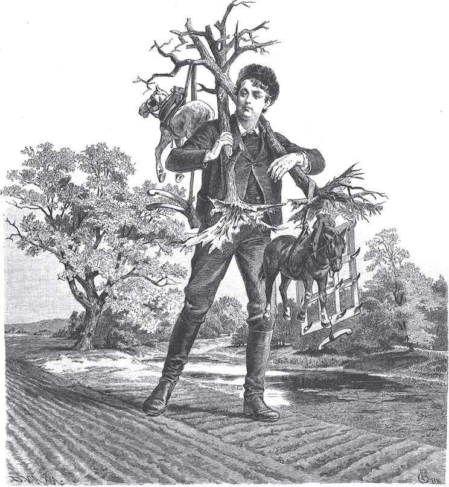

## Der junge Riese

Ein Bauer hatte einen Sohn, der nur so groß wie ein Daumen war. Er wurde nicht größer und wuchs in vielen Jahren nicht um ein <abbr title="um ein Haarbreit — ни на волос">Haarbreit</abbr>. Einmal wollte der Bauer aufs Feld gehen, um zu <abbr title="pflügen — пахать">pflügen</abbr>. Da sagte der Kleine:

— Vater, ich will mit hinaus.

— Du willst mit hinaus? — sagte der Vater. — Bleib du lieber hier, dort nützt du mir nichts. Du könntest mir auch noch verloren gehen.

Da fing der <abbr title="der Däumling, die Däumlinge — мальчик-с-пальчик">Däumling</abbr> an zu weinen. Damit er endlich Ruhe hatte, steckte ihn der Vater in die Tasche und nahm ihn mit. Draußen auf dem Feld holte er ihn wieder heraus und setzte ihn in eine frische <abbr title="die Furche, die Furchen — борозда">Furche</abbr>. Während er da so saß, kam ein großer Riese über den Berg.

— Siehst du dort den großen <abbr title="der Butzemann, die Butzemänner — бука, страшила">Butzemann</abbr>? — sagte der Vater. Er wollte den Kleinen erschrecken, damit er brav war. — Der kommt und holt dich!

Der Riese aber hatte mit seinen langen Beinen kaum ein paar Schritte gemacht, da war er schon bei der Furche. Er hob den kleinen Däumling mit zwei Fingern vorsichtig in die Höhe, betrachtete ihn und ging, ohne ein Wort zu sagen, mit ihm fort. Der Vater stand daneben und konnte vor Schreck keinen Laut herausbringen. Er glaubte, sein Kind sei verloren und er würde es sein Leben lang nicht wiedersehen.

Der Riese aber trug es nach Hause und ließ es an seiner Brust saugen. Da wuchs der Däumling und wurde groß und stark, wie es Riesen sind. Nachdem zwei Jahre vergangen waren, ging der Alte mit ihm in den Wald. Er wollte ihn prüfen und sagte:

— Zieh dir eine <abbr title="die Gerte, die Gerten — прут, хлыст">Gerte</abbr> heraus.

Da war der Junge schon so stark, dass er einen jungen Baum mit den Wurzeln aus der Erde riss. Der Riese aber meinte: «Das muss noch besser werden.» Er nahm ihn wieder mit und <abbr title="säugen — кормить грудью">säugte</abbr> ihn noch zwei Jahre. Als er ihn wieder prüfte, war seine Kraft schon so gewachsen, dass er einen alten Baum aus der Erde brechen konnte. Das war dem Riesen immer noch nicht genug. Er säugte ihn noch einmal zwei Jahre. Dann ging er mit ihm in den Wald und sagte:

— Nun reiß einmal eine ordentliche Gerte aus!

Da riss der Junge die dickste Eiche aus der Erde, dass es krachte, und für ihn war das nur ein Spaß.

— Jetzt ist es genug, — sagte der Riese. — Du hast ausgelernt.

Er brachte ihn zurück auf den Acker, von dem er ihn geholt hatte. Sein Vater stand dort hinter dem <abbr title="der Pflug, die Pflüge — плуг">Pflug</abbr>. Der junge Riese ging auf ihn zu und sagte:

— Sieh nur, Vater, was für ein Mann dein Sohn geworden ist!

Der Bauer erschrak und sagte:

— Nein, du bist nicht mein Sohn. Ich will dich nicht. Geh weg von mir!

— Freilich bin ich dein Sohn. Lass mich an die Arbeit! Ich kann so gut pflügen wie du, sogar noch besser.

— Nein, nein, du bist nicht mein Sohn, und pflügen kannst du auch nicht. Geh weg von mir!

Weil er sich aber vor dem großen Mann fürchtete, ließ er den Pflug los, trat zurück und setzte sich an den Rand des Feldes. Da nahm der Junge den Pflug und drückte nur mit einer Hand darauf. Aber der <abbr title="der Druck — давление, нажим">Druck</abbr> war so gewaltig, dass der Pflug tief in die Erde ging. Der Bauer konnte das nicht mit ansehen und rief ihm zu:

— Wenn du pflügen willst, darfst du nicht so stark drücken. Das gibt schlechte Arbeit!

Der Junge aber <abbr title="ausspannen — выпрягать">spannte</abbr> die Pferde aus, zog den Pflug selbst und sagte:

— Geh nur nach Hause, Vater, und sag der Mutter, sie soll eine große Schüssel voll Essen kochen. Ich <abbr title="umpflügen — вспахать">pflüge</abbr> inzwischen den Acker um.

Da ging der Bauer nach Hause und bestellte das Essen bei seiner Frau. Der Junge aber pflügte das Feld, das zwei <abbr title="der Morgen, die Morgen — морген (мера земли)">Morgen</abbr> groß war, ganz allein. Dann spannte er sich selbst vor die <abbr title="die Egge, die Eggen — борона">Egge</abbr> und <abbr title="eggen — боронить">eggte</abbr> alles mit zwei Eggen zugleich. Als er fertig war, ging er in den Wald und riss zwei Eichen aus. Die legte er sich auf die Schultern. Hinten und vorne legte er eine Egge darauf und hinten und vorne auch ein Pferd. Und das alles trug er, als wäre es ein Bündel Stroh, zum Haus seiner Eltern.

Als er in den Hof kam, erkannte ihn seine Mutter nicht und fragte:

— Wer ist dieser entsetzliche große Mann?

— Das ist unser Sohn, — sagte der Bauer.

— Nein, das ist niemals unser Sohn, — sagte sie. — So einen großen hatten wir nicht. Unserer war ein kleines Ding.

Sie rief ihm zu:

— Geh fort, wir wollen dich nicht!

Der Junge schwieg. Er führte seine Pferde in den Stall und gab ihnen <abbr title="der Hafer — овёс">Hafer</abbr> und Heu, alles so, wie es sich gehörte. Als er fertig war, ging er in die Stube, setzte sich auf die Bank und sagte:

— Mutter, jetzt hätte ich Lust zu essen. Ist es bald fertig?

Da sagte sie ja und brachte zwei sehr große Schüsseln voll herein. Davon wären sie und ihr Mann acht Tage lang satt geworden. Der Junge aber aß alles allein auf und fragte, ob sie nicht noch mehr <abbr title="auftischen — подавать на стол">auftischen</abbr> könne.

— Nein, — sagte sie, — das ist alles, was wir haben.

— Das war ja nur zum Probieren. Ich muss mehr haben.

Sie wagte nicht, ihm zu widersprechen. Sie ging hin und setzte einen großen <abbr title="der Schweinekessel, die Schweinekessel — котёл для свиного корма">Schweinekessel</abbr> voll übers Feuer. Als das Essen gar war, trug sie es herein.

— Endlich kommen noch ein paar Brocken, — sagte er und aß alles auf. Aber es war doch nicht genug, um seinen Hunger zu stillen. Da sagte er:

— Vater, ich sehe schon, bei dir werde ich nicht satt. Wenn du mir einen Stab aus Eisen besorgst, der so stark ist, dass ich ihn nicht an meinen Knien zerbrechen kann, dann will ich fort in die Welt gehen.

Der Bauer war froh. Er spannte seine zwei Pferde vor den Wagen und holte beim Schmied einen Stab, so groß und dick, wie ihn die zwei Pferde gerade noch ziehen konnten. Der Junge nahm ihn vor die Knie, und ratsch! — er brach ihn in der Mitte entzwei wie eine <abbr title="die Bohnenstange, die Bohnenstangen — жердь для фасоли">Bohnenstange</abbr> und warf ihn weg. Da spannte der Vater vier Pferde vor und holte einen Stab, so groß und dick, wie ihn die vier Pferde ziehen konnten. Der Sohn <abbr title="knicken — переломить, согнуть">knickte</abbr> auch diesen am Knie entzwei, warf ihn hin und sagte:

— Vater, der hilft mir nichts. Du musst mehr Pferde <abbr title="vorspannen — запрягать">vorspannen</abbr> und einen stärkeren Stab holen.

Da spannte der Vater acht Pferde vor und holte einen, so groß und dick, wie ihn die acht Pferde herbeifahren konnten. Als der Sohn den in die Hand nahm, brach er gleich oben ein Stück davon ab und sagte:

— Vater, ich sehe, du kannst mir keinen Stab besorgen, wie ich ihn brauche. Ich will nicht länger bei dir bleiben.

Da ging er fort und <abbr title="sich ausgeben als (gab aus, hat ausgegeben) — выдавать себя за">gab sich</abbr> als <abbr title="der Schmiedegeselle, die Schmiedegesellen — подмастерье кузнеца">Schmiedegeselle</abbr> aus. Er kam in ein Dorf, in dem ein Schmied wohnte. Der war ein Geizhals, gönnte keinem Menschen etwas und wollte alles für sich allein haben. Zu ihm trat der Junge in die Schmiede und fragte, ob er keinen Gesellen brauche.

— Ja, — sagte der Schmied. Er sah ihn an und dachte: «Das ist ein tüchtiger Kerl, der wird gut mit dem Hammer schlagen und sein Brot verdienen.» Er fragte:

— Wie viel Lohn willst du haben?

— Gar keinen will ich haben, — antwortete der Junge. — Nur alle vierzehn Tage, wenn die anderen Gesellen ihren Lohn bekommen, will ich dir zwei Streiche geben. Die musst du aushalten.

Damit war der Geizhals von Herzen zufrieden, denn er dachte, so könne er viel Geld sparen. Am nächsten Morgen sollte der fremde Geselle als Erster schlagen. Der Meister brachte den glühenden Stab, und der Junge tat den ersten Schlag. Da flog das Eisen auseinander, und der Amboss sank so tief in die Erde, dass sie ihn gar nicht wieder herausbekommen konnten. Da wurde der Geizhals böse und sagte:

— Ach was, dich kann ich nicht brauchen, du schlägst viel zu grob. Was willst du für den einen Schlag haben?

— Ich will dir nur einen ganz kleinen Streich geben, weiter nichts, — sagte er.

Und er hob seinen Fuß und gab ihm einen Tritt, sodass der Schmied über vier <abbr title="das Fuder, die Fuder — воз (мера)">Fuder</abbr> Heu hinwegflog. Dann suchte er sich den dicksten Eisenstab aus, den es in der Schmiede gab, nahm ihn als Stock in die Hand und ging weiter.

Nachdem er eine Weile gewandert war, kam er zu einem <abbr title="der Gutshof, die Gutshöfe — поместье, хутор">Gutshof</abbr> und fragte den <abbr title="der Amtmann, die Amtmänner — управляющий, амтман">Amtmann</abbr>, ob er keinen <abbr title="der Großknecht, die Großknechte — старший работник">Großknecht</abbr> brauche.

— Ja, — sagte der Amtmann, — ich kann einen gebrauchen. Du siehst aus wie ein tüchtiger Kerl, der schon etwas kann. Wie viel Lohn willst du im Jahr haben?

Er antwortete wieder, er wolle gar keinen Lohn. Aber jedes Jahr wolle er ihm drei Streiche geben, die müsse er aushalten. Damit war der Amtmann zufrieden, denn auch er war ein Geizhals.

Am nächsten Morgen sollten die Knechte in den Wald fahren, um Holz zu holen. Die anderen Knechte waren schon auf, er aber lag noch im Bett. Da rief einer ihn an:

— Steh auf, es ist Zeit! Wir fahren ins Holz, und du musst mit.

— Ach, — sagte er ganz grob und <abbr title="trotzig — упрямо, дерзко">trotzig</abbr>, — fahrt ihr nur hin. Ich komme doch eher zurück als ihr alle zusammen.

Da gingen die anderen zum Amtmann und erzählten ihm, der Großknecht liege noch im Bett und wolle nicht mit ins Holz fahren. Der Amtmann sagte, sie sollten ihn noch einmal wecken und ihm sagen, er solle die Pferde vorspannen. Aber der Großknecht sagte wie vorher:

— Fahrt ihr nur hin. Ich komme doch eher zurück als ihr alle zusammen.

Dann blieb er noch zwei Stunden liegen. Endlich stieg er <abbr title="aus den Federn steigen — вылезти из постели">aus den Federn</abbr>. Aber zuerst holte er sich zwei <abbr title="der Scheffel, die Scheffel — шеффель (мера сыпучих тел)">Scheffel</abbr> Erbsen vom Dachboden, kochte sich einen Brei und aß ihn in aller Ruhe. Erst als das alles erledigt war, spannte er die Pferde vor und fuhr ins Holz.

Nicht weit vor dem Wald gab es einen <abbr title="der Hohlweg, die Hohlwege — узкая дорога в овраге">Hohlweg</abbr>, durch den er fahren musste. Dort fuhr er den Wagen erst hindurch, dann mussten die Pferde stillstehen. Er ging hinter den Wagen, nahm Bäume und Reisig und baute eine große <abbr title="die Sperre, die Sperren — завал, заграждение">Sperre</abbr>, sodass kein Pferd mehr durchkommen konnte. Als er zum Wald kam, fuhren die anderen gerade mit ihren beladenen Wagen heraus und wollten nach Hause. Da sagte er zu ihnen:

— Fahrt nur hin, ich bin doch eher zu Hause als ihr.

Er fuhr gar nicht weit in den Wald hinein. Er riss gleich zwei der allergrößten Bäume aus der Erde, warf sie auf den Wagen und drehte um. Als er bei der Sperre ankam, standen die anderen noch da und konnten nicht durch.

— Seht ihr wohl? — sagte er. — Wärt ihr bei mir geblieben, dann wärt ihr genauso schnell nach Hause gekommen und hättet noch eine Stunde schlafen können.

Nun wollte er weiterfahren, aber seine Pferde kamen nicht durch. Da spannte er sie aus, legte sie oben auf den Wagen und nahm selbst die <abbr title="die Deichsel, die Deichseln — оглобля, дышло">Deichsel</abbr> in die Hand. Und <abbr title="hü! — но!, пошёл! (лошадям)">hü</abbr>! — er zog alles hindurch, so leicht, als hätte er Federn geladen. Als er drüben war, sagte er zu den anderen:

— Seht ihr wohl, ich bin schneller durch als ihr!

Er fuhr weiter, und die anderen mussten stehen bleiben. Im Hof aber nahm er einen Baum in die Hand, zeigte ihn dem Amtmann und sagte:

— Ist das nicht ein schönes Stück <abbr title="das Brennholz — дрова">Brennholz</abbr>?

Da sagte der Amtmann zu seiner Frau:

— Der Knecht ist gut. Auch wenn er lange schläft, ist er doch eher zurück als die anderen.

Nun diente er dem Amtmann ein Jahr. Als das Jahr <abbr title="herum sein — пройти, закончиться">herum</abbr> war und die anderen Knechte ihren Lohn bekamen, sagte er, es sei Zeit, er wolle sich jetzt auch seinen Lohn nehmen. Dem Amtmann aber wurde <abbr title="jemandem wird angst — кому-то становится страшно">angst</abbr> vor den Streichen, die er bekommen sollte. Er bat ihn <abbr title="inständig — настойчиво, слёзно">inständig</abbr>, sie ihm zu schenken. Lieber wolle er selbst Großknecht werden, und der Großknecht solle Amtmann sein.

— Nein, — sagte der Großknecht, — ich will kein Amtmann werden. Ich bin Großknecht und will es bleiben. Aber ich will <abbr title="austeilen — раздавать">austeilen</abbr>, was vereinbart ist.

Der Amtmann wollte ihm geben, was er nur verlangte, aber es half nichts. Der Großknecht sagte zu allem Nein. Da wusste sich der Amtmann nicht mehr zu helfen und bat ihn um vierzehn Tage <abbr title="die Frist, die Fristen — срок, отсрочка">Frist</abbr>. Er wolle über etwas nachdenken. Der Großknecht sagte, die Frist solle er haben.

Der Amtmann rief alle seine <abbr title="der Schreiber, die Schreiber — писарь">Schreiber</abbr> zusammen. Sie sollten nachdenken und ihm einen Rat geben. Die Schreiber dachten lange nach. Endlich sagten sie, vor dem Großknecht sei niemand seines Lebens sicher. Der schlage einen Menschen tot wie eine <abbr title="die Mücke, die Mücken — комар">Mücke</abbr>. Der Amtmann solle ihm befehlen, in den Brunnen zu steigen und ihn zu <abbr title="reinigen — чистить">reinigen</abbr>. Wenn er unten sei, wollten sie einen der Mühlsteine, die dort lagen, herbeirollen und ihm auf den Kopf werfen. Dann würde er das Tageslicht nie wiedersehen.

Der Rat gefiel dem Amtmann, und der Großknecht war bereit, in den Brunnen hinabzusteigen. Als er unten auf dem Grund stand, rollten sie den größten Mühlstein hinunter und glaubten, er habe ihm den Kopf <abbr title="zerschmettern — размозжить">zerschmettert</abbr>. Aber er rief:

— Jagt die Hühner vom Brunnen weg! Die <abbr title="scharren — скрести, рыться">scharren</abbr> da oben im Sand und werfen mir die Körner in die Augen, sodass ich nichts sehen kann!

Da rief der Amtmann: «Husch! Husch!» und tat so, als ob er die Hühner <abbr title="verscheuchen — прогонять, спугивать">verscheuchte</abbr>. Als der Großknecht mit seiner Arbeit fertig war, stieg er herauf und sagte:

— Seht mal, was für eine schöne Halskette ich umhabe!

Es war der Mühlstein, den er um den Hals trug.

Jetzt wollte der Großknecht seinen Lohn nehmen. Aber der Amtmann bat wieder um vierzehn Tage <abbr title="die Bedenkzeit — время на размышление">Bedenkzeit</abbr>. Die Schreiber kamen zusammen und gaben ihm den Rat, er solle den Großknecht in die verwunschene Mühle schicken, um dort in der Nacht Korn zu <abbr title="mahlen (mahlte, hat gemahlen) — молоть">mahlen</abbr>. Von dort sei noch kein Mensch am Morgen lebendig herausgekommen. Der Plan gefiel dem Amtmann. Er rief den Großknecht noch am selben Abend und befahl ihm, acht <abbr title="der Malter, die Malter — мальтер (мера зерна)">Malter</abbr> Korn in die Mühle zu bringen und noch in der Nacht zu mahlen. Man brauche es dringend.

Da ging der Großknecht auf den Dachboden. Zwei Malter steckte er in seine rechte Tasche, zwei in die linke. Vier nahm er in einem <abbr title="der Quersack, die Quersäcke — перемётная сума">Quersack</abbr>, halb auf dem Rücken, halb auf der Brust. So beladen ging er zur verwunschenen Mühle. Der Müller sagte ihm, am Tag könne er dort sehr gut mahlen, aber nicht in der Nacht. Dann sei die Mühle verwunschen. Wer nachts noch hineingegangen sei, den habe man am Morgen tot darin gefunden.

— Ich komme schon durch, — sagte er. — Geht nur und <abbr title="sich aufs Ohr legen — завалиться спать">legt euch aufs Ohr</abbr>.

Dann ging er in die Mühle und <abbr title="aufschütten — насыпать">schüttete</abbr> das Korn auf. Gegen elf Uhr ging er in die Stube des Müllers und setzte sich auf die Bank. Als er ein Weilchen dort gesessen hatte, ging auf einmal die Tür auf, und eine große, große Tafel kam herein. Auf die Tafel stellten sich Wein und Braten und viel gutes Essen, alles von selbst. Denn es war niemand da, der es auftrug. Danach rückten die Stühle heran, aber es kamen keine Leute. Plötzlich sah er Finger, die mit den Messern und Gabeln <abbr title="hantieren — орудовать">hantierten</abbr> und Speisen auf die Teller legten. Sonst konnte er nichts sehen. Weil er hungrig war und die Speisen sah, setzte er sich auch an die Tafel, aß mit und ließ es sich gut schmecken.

Als er satt war und die anderen ihre Schüsseln auch ganz leer gegessen hatten, wurden auf einmal alle Lichter <abbr title="auslöschen — гасить">ausgelöscht</abbr>. Das hörte er deutlich. Und als es nun <abbr title="stockfinster — кромешно темно">stockfinster</abbr> war, bekam er so etwas wie eine Ohrfeige ins Gesicht. Da sagte er:

— Wenn noch einmal so etwas kommt, dann teile ich auch aus.

Und als er zum zweiten Mal eine Ohrfeige bekam, schlug er <abbr title="ebenfalls — также, тоже">ebenfalls</abbr> zu. So ging es die ganze Nacht weiter. Er nahm nichts umsonst, sondern gab reichlich zurück und schlug kräftig um sich. Als der Tag anbrach, hörte alles auf. Nachdem der Müller aufgestanden war, wollte er nach ihm sehen und wunderte sich, dass er noch lebte. Da sagte der Großknecht:

— Ich habe mich satt gegessen, ich habe Ohrfeigen bekommen, aber ich habe auch Ohrfeigen ausgeteilt.

Der Müller freute sich und sagte, nun sei die Mühle erlöst. Er wollte ihm gern viel Geld als Belohnung geben. Aber der Großknecht sagte:

— Geld will ich nicht, ich habe doch genug.

Dann nahm er sein Mehl auf den Rücken, ging nach Hause und sagte dem Amtmann, er habe die Sache erledigt. Nun wolle er seinen vereinbarten Lohn haben.

Als der Amtmann das hörte, bekam er erst recht Angst. Er wusste nicht mehr, was er tun sollte, ging in der Stube auf und ab, und die <abbr title="der Schweißtropfen, die Schweißtropfen — капля пота">Schweißtropfen</abbr> liefen ihm von der Stirn. Er öffnete das Fenster, um frische Luft zu bekommen. Aber ehe er sich's versah, hatte ihm der Großknecht einen Tritt gegeben. Der Amtmann flog durchs Fenster in die Luft hinein, immer weiter, bis ihn niemand mehr sehen konnte. Da sagte der Großknecht zur Frau des Amtmanns:

— Wenn er nicht wiederkommt, dann müsst Ihr den zweiten Streich <abbr title="hinnehmen (nahm hin, hat hingenommen) — принять, стерпеть">hinnehmen</abbr>.

— Nein, nein, — rief sie, — das halte ich nicht aus!

Und sie öffnete das andere Fenster, weil ihr auch die Schweißtropfen von der Stirn liefen. Da gab er ihr einen Tritt, und sie flog ebenfalls hinaus. Und weil sie leichter war, flog sie noch viel höher als ihr Mann.

— Komm doch zu mir! — rief der Mann.

— Komm du zu mir, — rief sie, — ich kann nicht zu dir!

So schwebten sie in der Luft, und keiner konnte zum anderen kommen. Ob sie dort noch immer schweben, das weiß ich nicht. Der junge Riese aber nahm seine Eisenstange und ging weiter.

---

### Neue Wörter

- **um ein Haarbreit** — ни на волос
- **pflügen** — пахать
- **der Däumling, die Däumlinge** — мальчик-с-пальчик
- **die Furche, die Furchen** — борозда
- **der Butzemann, die Butzemänner** — бука, страшила
- **die Gerte, die Gerten** — прут, хлыст
- **säugen** — кормить грудью
- **der Pflug, die Pflüge** — плуг
- **der Druck** — давление, нажим
- **ausspannen** — выпрягать
- **umpflügen** — вспахать
- **der Morgen, die Morgen** — морген (мера земли)
- **die Egge, die Eggen** — борона
- **eggen** — боронить
- **der Hafer** — овёс
- **auftischen** — подавать на стол
- **der Schweinekessel, die Schweinekessel** — котёл для свиного корма
- **die Bohnenstange, die Bohnenstangen** — жердь для фасоли
- **knicken** — переломить, согнуть
- **vorspannen** — запрягать
- **sich ausgeben als (gab aus, hat ausgegeben)** — выдавать себя за
- **der Schmiedegeselle, die Schmiedegesellen** — подмастерье кузнеца
- **das Fuder, die Fuder** — воз (мера)
- **der Gutshof, die Gutshöfe** — поместье, хутор
- **der Amtmann, die Amtmänner** — управляющий, амтман
- **der Großknecht, die Großknechte** — старший работник
- **trotzig** — упрямо, дерзко
- **aus den Federn steigen** — вылезти из постели
- **der Scheffel, die Scheffel** — шеффель (мера сыпучих тел)
- **der Hohlweg, die Hohlwege** — узкая дорога в овраге
- **die Sperre, die Sperren** — завал, заграждение
- **die Deichsel, die Deichseln** — оглобля, дышло
- **hü!** — но!, пошёл! (лошадям)
- **das Brennholz** — дрова
- **herum sein** — пройти, закончиться
- **jemandem wird angst** — кому-то становится страшно
- **inständig** — настойчиво, слёзно
- **austeilen** — раздавать
- **die Frist, die Fristen** — срок, отсрочка
- **der Schreiber, die Schreiber** — писарь
- **die Mücke, die Mücken** — комар
- **reinigen** — чистить
- **zerschmettern** — размозжить
- **scharren** — скрести, рыться
- **verscheuchen** — прогонять, спугивать
- **die Bedenkzeit** — время на размышление
- **mahlen (mahlte, hat gemahlen)** — молоть
- **der Malter, die Malter** — мальтер (мера зерна)
- **der Quersack, die Quersäcke** — перемётная сума
- **sich aufs Ohr legen** — завалиться спать
- **aufschütten** — насыпать
- **hantieren** — орудовать
- **auslöschen** — гасить
- **stockfinster** — кромешно темно
- **ebenfalls** — также, тоже
- **der Schweißtropfen, die Schweißtropfen** — капля пота
- **hinnehmen (nahm hin, hat hingenommen)** — принять, стерпеть

[← Zurück](kapitel-89.md) · [Inhalt](README.md)
