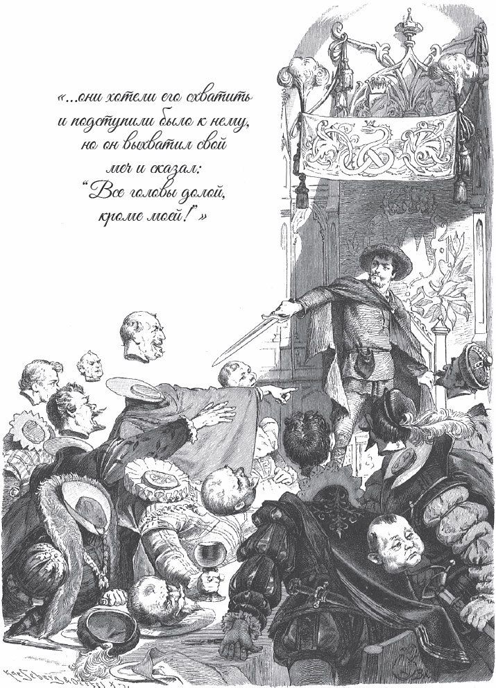

## Der König vom goldenen Berg

Ein Kaufmann hatte zwei Kinder, einen Jungen und ein Mädchen. Beide waren noch klein und konnten noch nicht laufen. Er hatte zwei <abbr title="reich beladen — богато гружёный">reich beladene</abbr> Schiffe auf dem Meer, und darin war sein ganzes Vermögen. Gerade als er glaubte, er würde damit viel Geld verdienen, kam die Nachricht, die Schiffe seien gesunken. Statt eines reichen Mannes war er nun ein armer Mann. Ihm war nichts mehr übrig geblieben als ein Acker vor der Stadt.

Um sein Unglück ein wenig zu vergessen, ging er hinaus auf den Acker. Während er dort auf und ab ging, stand auf einmal ein kleines schwarzes Männchen neben ihm. Es fragte, warum er so traurig sei und was er sich so sehr <abbr title="sich etwas zu Herzen nehmen — принимать близко к сердцу">zu Herzen nehme</abbr>. Da sagte der Kaufmann:

— Wenn du mir helfen könntest, würde ich es dir schon sagen.

— Wer weiß, — antwortete das schwarze Männchen, — vielleicht helfe ich dir.

Da erzählte der Kaufmann, dass sein ganzer Reichtum im Meer verloren gegangen sei und dass er nichts mehr habe als diesen Acker.

— <abbr title="sich sorgen — беспокоиться, тревожиться">Sorge dich</abbr> nicht, — sagte das Männchen. — Du sollst so viel Geld haben, wie du willst. Du musst mir nur versprechen: Was dir zu Hause als Erstes <abbr title="gegen das Bein stoßen — ткнуться в ногу">gegen das Bein stößt</abbr>, das bringst du in zwölf Jahren hierher auf diesen Platz.

Der Kaufmann dachte: „Was kann das anderes sein als mein Hund?“ An seinen kleinen Jungen dachte er nicht. Er sagte Ja, gab dem schwarzen Mann seine <abbr title="die Unterschrift, die Unterschriften — подпись">Unterschrift</abbr> und sein <abbr title="das Siegel, die Siegel — печать">Siegel</abbr> darauf und ging nach Hause.

Als er nach Hause kam, freute sich sein kleiner Junge so sehr, dass er sich an den Bänken festhielt, zu ihm wackelte und ihn fest an den Beinen packte. Da erschrak der Vater, denn sein Versprechen fiel ihm ein, und jetzt wusste er, was er <abbr title="verschreiben (verschrieb, hat verschrieben) — отписать, отдать по договору">verschrieben</abbr> hatte. Aber weil er immer noch kein Geld in seinen Kisten und Kästen fand, dachte er, das Männchen habe nur einen <abbr title="der Spaß, die Späße — шутка">Spaß</abbr> gemacht.

Einen Monat später ging er auf den Dachboden. Er wollte altes <abbr title="das Zinn — олово">Zinn</abbr> zusammensuchen und verkaufen. Da sah er einen großen Haufen Geld liegen. Nun war er wieder guter Dinge, kaufte Waren ein und wurde ein größerer Kaufmann als vorher. Um Gott kümmerte er sich nicht mehr viel.

Unterdessen wurde der Junge groß, und er war klug und gescheit. Aber je näher die zwölf Jahre kamen, desto mehr Sorgen machte sich der Kaufmann. Man konnte ihm die Angst im Gesicht ansehen. Einmal fragte ihn der Sohn, was ihm fehle. Der Vater wollte es nicht sagen. Aber der Sohn fragte so lange, bis er es ihm endlich erzählte: Er habe ihn, ohne zu wissen, was er verspreche, einem schwarzen Männchen versprochen und dafür viel Geld bekommen. Er habe seine Unterschrift mit Siegel darauf gegeben, und nun müsse er ihn nach zwölf Jahren ausliefern. Da sagte der Sohn:

— Ach Vater, habt keine Angst, das wird schon gut gehen. Der Schwarze hat keine Macht über mich.

Der Sohn ließ sich von dem Pfarrer segnen. Als die Stunde kam, gingen sie zusammen hinaus auf den Acker. Der Sohn zeichnete einen Kreis auf die Erde und stellte sich mit seinem Vater hinein. Da kam das schwarze Männchen und sagte zu dem Alten:

— Hast du mitgebracht, was du mir versprochen hast?

Der Vater schwieg, aber der Sohn fragte:

— Was willst du hier?

— Ich habe mit deinem Vater zu sprechen und nicht mit dir, — sagte das schwarze Männchen.

— Du hast meinen Vater betrogen und verführt, — antwortete der Sohn. — Gib das Papier heraus!

— Nein, — sagte das schwarze Männchen, — mein Recht gebe ich nicht auf.

Da sprachen sie noch lange miteinander. Endlich wurden sie sich <abbr title="einig werden — договориться, прийти к согласию">einig</abbr>: Der Sohn gehörte nicht dem Teufel, aber auch nicht mehr seinem Vater. Darum sollte er sich in ein kleines Boot setzen, das auf einem Fluss stand, der <abbr title="abwärts — вниз (по течению)">abwärts</abbr> floss. Der Vater sollte das Boot mit seinem eigenen Fuß wegstoßen, und dann sollte der Sohn dem Wasser überlassen sein.

Da nahm der Sohn Abschied von seinem Vater und setzte sich in das Boot, und der Vater musste es mit seinem eigenen Fuß wegstoßen. Das Boot kippte um, sodass der Boden oben war und das <abbr title="das Deck, die Decks — палуба">Deck</abbr> im Wasser. Der Vater glaubte, sein Sohn sei verloren. Er ging nach Hause und <abbr title="trauern um + Akk. — скорбеть, горевать">trauerte</abbr> um ihn.

Das Boot ging aber nicht unter, sondern trieb ruhig weiter. Der junge Mann saß sicher darin. So trieb es lange, bis es endlich an einem unbekannten Ufer hängen blieb. Da stieg er an Land, sah ein schönes Schloss vor sich und ging darauf zu.

Als er aber hineinging, merkte er, dass es verwünscht war. Er ging durch alle Zimmer, aber sie waren leer. Erst in der letzten Kammer lag eine Schlange und <abbr title="sich ringeln — извиваться, свиваться кольцами">ringelte sich</abbr>. Die Schlange war aber eine verwünschte Jungfrau. Sie freute sich, als sie ihn sah, und sagte zu ihm:

— Kommst du, mein <abbr title="der Erlöser, die Erlöser — избавитель, спаситель">Erlöser</abbr>? Auf dich habe ich schon zwölf Jahre gewartet. Dieses Reich ist verwünscht, und du musst es erlösen.

— Wie kann ich das? — fragte er.

— Heute Nacht kommen zwölf schwarze Männer, die mit Ketten behängt sind. Sie werden dich fragen, was du hier machst. Aber schweig und gib ihnen keine Antwort. Lass sie mit dir machen, was sie wollen. Sie werden dich quälen, schlagen und stechen. Lass alles geschehen, nur sprich nicht! Um zwölf Uhr müssen sie wieder fort. In der zweiten Nacht kommen wieder zwölf andere, und in der dritten Nacht vierundzwanzig. Die werden dir den Kopf abhauen. Aber um zwölf Uhr ist ihre Macht vorbei. Wenn du dann <abbr title="durchhalten (hielt durch, hat durchgehalten) — выдержать, выстоять">durchgehalten</abbr> und kein einziges Wort gesprochen hast, dann bin ich erlöst. Ich komme zu dir und habe in einer Flasche das Wasser des Lebens. Damit bestreiche ich dich, und dann bist du wieder lebendig und gesund wie vorher.

Da sagte er:

— Gern will ich dich erlösen.

Nun geschah alles so, wie sie gesagt hatte. Die schwarzen Männer konnten ihm kein einziges Wort <abbr title="abzwingen (zwang ab, hat abgezwungen) — вынудить, выжать (силой)">abzwingen</abbr>. In der dritten Nacht wurde die Schlange zu einer schönen Königstochter. Sie kam mit dem Wasser des Lebens und machte ihn wieder lebendig. Dann fiel sie ihm um den Hals und küsste ihn, und im ganzen Schloss war <abbr title="der Jubel — ликование">Jubel</abbr> und Freude. Dann wurde ihre Hochzeit gefeiert, und er war König vom goldenen Berg.

So lebten sie vergnügt zusammen, und die Königin brachte einen schönen Jungen zur Welt. Acht Jahre waren schon vergangen, da fiel ihm sein Vater wieder ein. Sein Herz wurde <abbr title="bewegt — взволнованный, растроганный">bewegt</abbr>, und er wünschte sich, ihn einmal zu besuchen. Die Königin wollte ihn aber nicht gehen lassen und sagte:

— Ich weiß schon, dass das mein Unglück ist.

Er ließ ihr aber keine Ruhe, bis sie einwilligte. Beim Abschied gab sie ihm noch einen <abbr title="der Wunschring, die Wunschringe — волшебное кольцо исполнения желаний">Wunschring</abbr> und sagte:

— Nimm diesen Ring und steck ihn an deinen Finger. Dann bist du sofort dort, wohin du dich wünschst. Nur musst du mir versprechen, dass du ihn nicht <abbr title="benutzen — использовать">benutzt</abbr>, um mich von hier zu deinem Vater zu wünschen.

Er versprach es ihr, steckte den Ring an seinen Finger und wünschte sich nach Hause, vor die Stadt, in der sein Vater lebte. Im selben Augenblick war er auch dort und wollte in die Stadt hinein. Aber als er vor das Tor kam, wollten ihn die Wachen nicht hineinlassen. Denn er hatte seltsame und zugleich so reiche und prächtige Kleider an. Da ging er auf einen Berg, wo ein Schäfer seine Schafe hütete. Mit ihm tauschte er die Kleider. Er zog den alten Schäferrock an und ging so ungestört in die Stadt.

Als er zu seinem Vater kam, sagte er ihm, wer er war. Aber der Vater glaubte niemals, dass es sein Sohn sei. Er sagte, er habe zwar einen Sohn gehabt, aber der sei schon lange tot. Weil er aber sehe, dass er ein armer, <abbr title="bedürftig — нуждающийся, бедный">bedürftiger</abbr> Schäfer sei, wolle er ihm einen Teller voll zu essen geben. Da sagte der Schäfer zu seinen Eltern:

— Ich bin <abbr title="wahrhaftig — воистину, действительно">wahrhaftig</abbr> euer Sohn. Kennt ihr kein Zeichen an meinem Körper, an dem ihr mich erkennen könnt?

— Ja, — sagte die Mutter, — unser Sohn hatte eine <abbr title="die Himbeere, die Himbeeren — малина (здесь: родимое пятно)">Himbeere</abbr> unter dem rechten Arm.

Er schob das Hemd zurück, und da sahen sie die Himbeere unter seinem rechten Arm. Nun <abbr title="zweifeln an + Dat. — сомневаться">zweifelten</abbr> sie nicht mehr, dass es ihr Sohn war. Dann erzählte er ihnen, er sei König vom goldenen Berg, eine Königstochter sei seine Gemahlin, und sie hätten einen schönen Sohn von sieben Jahren. Da sagte der Vater:

— Nie und nimmer ist das wahr! Das ist mir ein schöner König, der in einem zerlumpten Schäferrock herumläuft!

Da wurde der Sohn zornig. Ohne an sein Versprechen zu denken, drehte er den Ring herum und wünschte beide zu sich, seine Gemahlin und sein Kind. Im selben Augenblick waren sie auch da. Aber die Königin jammerte und weinte. Sie sagte, er habe sein Wort gebrochen und sie unglücklich gemacht. Er sagte:

— Ich habe es <abbr title="unachtsam — по неосторожности, невнимательно">unachtsam</abbr> getan und nicht mit <abbr title="der böse Wille — злой умысел">bösem Willen</abbr>.

Er <abbr title="jemandem gut zureden — уговаривать, успокаивать">redete ihr gut zu</abbr>, und sie tat auch so, als ob sie nachgäbe. Aber sie hatte Böses <abbr title="etwas im Sinn haben — замышлять">im Sinn</abbr>.

Da führte er sie vor die Stadt hinaus auf den Acker und zeigte ihr das Wasser, wo man das Boot damals weggestoßen hatte. Dann sagte er:

— Ich bin müde. Setz dich, ich will ein wenig auf deinem Schoß schlafen.

Er legte seinen Kopf auf ihren Schoß, und sie suchte ihm ein wenig die Läuse aus dem Haar, bis er einschlief. Als er eingeschlafen war, zog sie zuerst den Ring von seinem Finger. Dann zog sie ihren Fuß unter ihm weg und ließ nur ihren Pantoffel zurück. Danach nahm sie ihr Kind auf den Arm und wünschte sich wieder in ihr Königreich.

Als er aufwachte, lag er ganz verlassen da. Seine Gemahlin und das Kind waren fort, und der Ring an seinem Finger auch. Nur der Pantoffel stand noch da als Zeichen. „Nach Hause zu deinen Eltern kannst du nicht mehr gehen“, dachte er. „Die würden sagen, du bist ein Hexenmeister. Du willst deine Sachen packen und so lange gehen, bis du in dein Königreich kommst.“

Also ging er fort und kam endlich zu einem Berg. Vor dem Berg standen drei Riesen und stritten miteinander, weil sie nicht wussten, wie sie das Erbe ihres Vaters teilen sollten. Als sie ihn vorbeigehen sahen, riefen sie ihn und sagten, kleine Menschen hätten einen klugen Verstand. Er solle ihnen die <abbr title="die Erbschaft, die Erbschaften — наследство">Erbschaft</abbr> verteilen.

Die Erbschaft <abbr title="bestehen aus + Dat. (bestand, hat bestanden) — состоять из">bestand</abbr> aus drei Dingen. Erstens aus einem Degen: Wenn man ihn in die Hand nahm und sagte: „Köpfe alle runter, nur meiner nicht!“, dann lagen alle Köpfe auf der Erde. Zweitens aus einem Mantel: Wer ihn anzog, war <abbr title="unsichtbar — невидимый">unsichtbar</abbr>. Drittens aus einem Paar Stiefeln: Wenn man sie angezogen hatte und sich irgendwohin wünschte, dann war man im Augenblick dort. Er sagte:

— Gebt mir die drei Stücke, damit ich ausprobieren kann, ob sie noch <abbr title="in gutem Zustand sein — быть в хорошем состоянии">in gutem Zustand</abbr> sind.

Da gaben sie ihm den Mantel. Als er ihn umgehängt hatte, war er unsichtbar und in eine Fliege verwandelt. Dann nahm er wieder seine eigene Gestalt an und sagte:

— Der Mantel ist gut. Nun gebt mir das Schwert.

— Nein, — sagten sie, — das geben wir nicht! Wenn du sagst: „Köpfe alle runter, nur meiner nicht!“, dann sind unsere Köpfe alle ab, und nur du hast deinen noch.

Doch sie gaben es ihm unter der Bedingung, dass er es an einem Baum ausprobierte. Das tat er, und das Schwert durchschnitt den Stamm eines Baumes wie einen Strohhalm. Nun wollte er noch die Stiefel haben. Aber sie sagten:

— Nein, die geben wir nicht her. Wenn du sie angezogen hättest und dich oben auf den Berg wünschtest, dann stünden wir hier unten und hätten nichts.

— Nein, — sagte er, — das werde ich nicht tun.

Da gaben sie ihm auch die Stiefel. Als er nun alle drei Stücke hatte, dachte er an nichts anderes als an seine Frau und sein Kind und sagte <abbr title="vor sich hin sagen — сказать про себя, вполголоса">vor sich hin</abbr>:

— Ach, wäre ich doch auf dem goldenen Berg!

Und sofort verschwand er vor den Augen der Riesen. So war ihr Erbe also geteilt.

Als er nahe beim Schloss war, hörte er <abbr title="das Freudengeschrei — радостные крики">Freudengeschrei</abbr>, Geigen und Flöten. Die Leute sagten ihm, seine Gemahlin feiere ihre Hochzeit mit einem anderen. Da wurde er zornig und sagte:

— Die Falsche! Sie hat mich betrogen und verlassen, als ich eingeschlafen war.

Er hängte seinen Mantel um und ging unsichtbar ins Schloss. Als er in den Saal kam, stand dort eine große Tafel mit köstlichen Speisen. Die Gäste aßen und tranken, lachten und <abbr title="scherzen — шутить">scherzten</abbr>. Die Königin aber saß in der Mitte in prächtigen Kleidern auf einem königlichen Sessel und hatte die Krone auf dem Kopf.

Er stellte sich hinter sie, und niemand sah ihn. Wenn man ihr ein Stück Fleisch auf den Teller legte, nahm er es weg und aß es. Und wenn man ihr ein Glas Wein einschenkte, nahm er es weg und trank es aus. Man gab ihr immer wieder etwas, aber sie hatte trotzdem nie etwas, denn Teller und Glas verschwanden sofort. Da wurde sie bestürzt und schämte sich. Sie stand auf, ging in ihre Kammer und weinte, und er ging hinter ihr her. Da sagte sie:

— Ist denn der Teufel über mir, oder ist mein Erlöser nie gekommen?

Da schlug er ihr ins Gesicht und sagte:

— Dein Erlöser ist nie gekommen? Er ist über dir, du <abbr title="die Betrügerin, die Betrügerinnen — обманщица">Betrügerin</abbr>! Habe ich das von dir verdient?

Dann machte er sich wieder <abbr title="sichtbar — видимый">sichtbar</abbr>, ging in den Saal und rief:

— Die Hochzeit ist aus! Der wahre König ist gekommen!

Die Könige, Fürsten und Räte, die dort <abbr title="versammelt — собравшийся">versammelt</abbr> waren, verspotteten und <abbr title="verlachen — осмеивать">verlachten</abbr> ihn. Er aber machte nicht viele Worte und sagte:

— Wollt ihr hinaus oder nicht?

Da wollten sie ihn fangen und <abbr title="eindringen auf + Akk. (drang ein, ist eingedrungen) — наступать, наседать">drangen</abbr> auf ihn ein. Aber er zog sein Schwert und sagte:

— Köpfe alle runter, nur meiner nicht!

Da rollten alle Köpfe auf die Erde, und er allein war der Herr. Und er war wieder König vom goldenen Berg.

---

### Neue Wörter

- **reich beladen** — богато гружёный
- **sich etwas zu Herzen nehmen** — принимать близко к сердцу
- **sich sorgen** — беспокоиться, тревожиться
- **gegen das Bein stoßen** — ткнуться в ногу
- **die Unterschrift, die Unterschriften** — подпись
- **das Siegel, die Siegel** — печать
- **verschreiben (verschrieb, hat verschrieben)** — отписать, отдать по договору
- **der Spaß, die Späße** — шутка
- **das Zinn** — олово
- **einig werden** — договориться, прийти к согласию
- **abwärts** — вниз (по течению)
- **das Deck, die Decks** — палуба
- **trauern um + Akk.** — скорбеть, горевать
- **sich ringeln** — извиваться, свиваться кольцами
- **der Erlöser, die Erlöser** — избавитель, спаситель
- **durchhalten (hielt durch, hat durchgehalten)** — выдержать, выстоять
- **abzwingen (zwang ab, hat abgezwungen)** — вынудить, выжать (силой)
- **der Jubel** — ликование
- **bewegt** — взволнованный, растроганный
- **der Wunschring, die Wunschringe** — волшебное кольцо исполнения желаний
- **benutzen** — использовать
- **bedürftig** — нуждающийся, бедный
- **wahrhaftig** — воистину, действительно
- **die Himbeere, die Himbeeren** — малина (здесь: родимое пятно)
- **zweifeln an + Dat.** — сомневаться
- **unachtsam** — по неосторожности, невнимательно
- **der böse Wille** — злой умысел
- **jemandem gut zureden** — уговаривать, успокаивать
- **etwas im Sinn haben** — замышлять
- **die Erbschaft, die Erbschaften** — наследство
- **bestehen aus + Dat. (bestand, hat bestanden)** — состоять из
- **unsichtbar** — невидимый
- **in gutem Zustand sein** — быть в хорошем состоянии
- **vor sich hin sagen** — сказать про себя, вполголоса
- **das Freudengeschrei** — радостные крики
- **scherzen** — шутить
- **die Betrügerin, die Betrügerinnen** — обманщица
- **sichtbar** — видимый
- **versammelt** — собравшийся
- **verlachen** — осмеивать
- **eindringen auf + Akk. (drang ein, ist eingedrungen)** — наступать, наседать

[← Zurück](kapitel-91.md) · [Inhalt](README.md)
