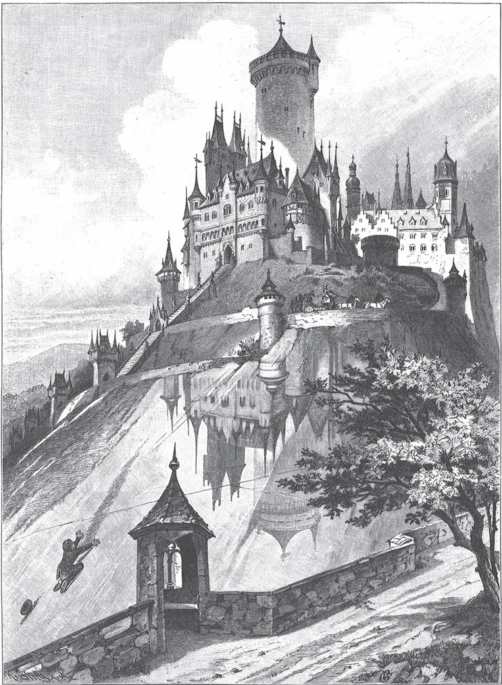

## Die Rabe

Es war einmal eine Königin, die hatte ein kleines Töchterchen. Es war noch so klein, dass man es auf dem Arm tragen musste. Einmal war das Kind unartig, und die Mutter konnte sagen, was sie wollte, es wurde nicht ruhig. Da wurde sie ungeduldig. Weil gerade viele Raben um das Schloss herumflogen, öffnete sie das Fenster und sagte:

— Ich wollte, du wärst eine Rabe und flögst fort, dann hätte ich Ruhe!

Kaum hatte sie das Wort gesagt, da war das Kind in eine Rabe verwandelt und flog von ihrem Arm zum Fenster hinaus. Sie flog in einen dunklen Wald und blieb lange Zeit dort, und die Eltern hörten nichts mehr von ihr.

Viel später führte einmal ein Mann sein Weg in diesen Wald. Er hörte die Rabe rufen und ging der Stimme nach. Als er näher kam, sagte die Rabe:

— Ich bin von <abbr title="die Geburt, die Geburten — рождение">Geburt</abbr> eine Königstochter und bin verwünscht worden. Aber du kannst mich erlösen.

— Was soll ich tun? — fragte er.

— Geh weiter in den Wald, dann wirst du ein Haus finden, — sagte sie. — Darin sitzt eine alte Frau. Sie wird dir Essen und Trinken anbieten, aber du darfst nichts nehmen. Wenn du etwas isst oder trinkst, dann <abbr title="in einen Schlaf fallen — впасть в сон">fällst</abbr> du in einen Schlaf und kannst mich nicht erlösen. Im Garten hinter dem Haus ist ein großer <abbr title="der Lohhaufen, die Lohhaufen — куча дубильной коры">Lohhaufen</abbr>. Darauf sollst du stehen und auf mich warten. Drei Tage lang komme ich jeden Mittag um zwei Uhr in einer Kutsche zu dir. Am ersten Tag ziehen sie vier weiße <abbr title="der Hengst, die Hengste — жеребец">Hengste</abbr>, dann vier rote und zuletzt vier schwarze. Wenn du aber nicht wach bist, sondern schläfst, dann werde ich nicht erlöst.

Der Mann versprach, alles zu tun, was sie verlangt hatte. Aber die Rabe sagte:

— Ach, ich weiß es schon: Du wirst mich nicht erlösen. Du nimmst etwas von der Frau.

Da versprach der Mann noch einmal, dass er ganz sicher nichts anrühren wolle, weder vom Essen noch vom Trinken.

Als er aber in das Haus kam, trat die alte Frau zu ihm und sagte:

— Armer Mann, wie erschöpft Ihr seid! Kommt und stärkt Euch, esst und trinkt!

— Nein, — sagte der Mann, — ich will nicht essen und nicht trinken.

Sie ließ ihm aber keine Ruhe und sagte:

— Wenn Ihr nicht essen wollt, dann trinkt wenigstens einen Schluck aus dem Glas. Einmal ist keinmal.

Da ließ er sich überreden und trank. Am Nachmittag gegen zwei Uhr ging er hinaus in den Garten auf den Lohhaufen und wollte auf die Rabe warten. Während er dort stand, wurde er auf einmal so müde, dass er nichts dagegen tun konnte. Er legte sich ein wenig hin, aber er wollte nicht einschlafen. Doch kaum hatte er sich <abbr title="sich ausstrecken — растянуться, вытянуться">ausgestreckt</abbr>, da fielen ihm die Augen von selbst zu. Er schlief ein und schlief so fest, dass ihn nichts auf der Welt hätte wecken können.

Um zwei Uhr kam die Rabe mit vier weißen Hengsten gefahren. Aber sie war schon in tiefer Trauer und sagte:

— Ich weiß, dass er schläft.

Und als sie in den Garten kam, lag er wirklich auf dem Lohhaufen und schlief. Sie stieg aus der Kutsche, ging zu ihm, schüttelte ihn und rief ihn, aber er wachte nicht auf.

Am nächsten Tag zur Mittagszeit kam die alte Frau wieder und brachte ihm Essen und Trinken. Er wollte es nicht annehmen. Aber sie ließ ihm keine Ruhe und <abbr title="auf jemanden einreden (redete ein, hat eingeredet) — уговаривать, твердить">redete</abbr> so lange auf ihn ein, bis er wieder einen Schluck aus dem Glas nahm. Gegen zwei Uhr ging er in den Garten auf den Lohhaufen und wollte auf die Rabe warten. Da überfiel ihn auf einmal eine so große Müdigkeit, dass seine Glieder ihn nicht mehr trugen. Er konnte sich nicht helfen, er musste sich hinlegen und fiel in einen tiefen Schlaf.

Als die Rabe mit vier braunen Hengsten angefahren kam, war sie schon in tiefer Trauer und sagte:

— Ich weiß, dass er schläft.

Sie ging zu ihm, aber er lag da im Schlaf und war nicht zu wecken.

Am nächsten Tag fragte die alte Frau, was denn los sei. Er esse und trinke nichts – ob er denn sterben wolle? Er antwortete:

— Ich will nicht und darf nicht essen und trinken.

Sie stellte aber die Schüssel mit Essen und das Glas mit Wein vor ihn hin. Als der Duft zu ihm aufstieg, konnte er nicht widerstehen und nahm einen großen Schluck. Als die Zeit kam, ging er hinaus in den Garten auf den Lohhaufen und wartete auf die Königstochter. Da wurde er noch müder als an den Tagen vorher. Er legte sich hin und schlief so fest, als wäre er ein Stein.

Um zwei Uhr kam die Rabe mit vier schwarzen Hengsten, und die Kutsche und alles war schwarz. Sie war aber schon in tiefer Trauer und sagte:

— Ich weiß, dass er schläft und mich nicht erlösen kann.

Als sie zu ihm kam, lag er da und schlief fest. Sie rüttelte ihn und rief ihn, aber sie konnte ihn nicht wecken. Da legte sie ein Brot neben ihn, dann ein Stück Fleisch und als Drittes eine Flasche Wein. Er konnte von allem so viel nehmen, wie er wollte, es wurde nie weniger. Danach nahm sie einen goldenen Ring von ihrem Finger und steckte ihn an seinen Finger. In den Ring war ihr Name <abbr title="eingravieren — выгравировать">eingraviert</abbr>. Zuletzt legte sie einen Brief hin. Darin stand, was sie ihm gegeben hatte und dass es nie zu Ende gehen würde. Und es stand auch darin: „Ich sehe wohl, dass du mich hier nicht erlösen kannst. Willst du mich aber trotzdem noch erlösen, dann komm zum goldenen Schloss von Stromberg. Es steht in deiner Macht, das weiß ich gewiss.“ Und als sie ihm das alles gegeben hatte, setzte sie sich in ihre Kutsche und fuhr in das goldene Schloss von Stromberg.

Als der Mann aufwachte und sah, dass er geschlafen hatte, wurde er von Herzen traurig und sagte:

— Sicher ist sie jetzt vorbeigefahren, und ich habe sie nicht erlöst.

Da fielen ihm die Dinge <abbr title="ins Auge fallen — бросаться в глаза">ins Auge</abbr>, die neben ihm lagen, und er las den Brief, in dem stand, wie alles gekommen war. Also machte er sich auf den Weg. Er wollte zum goldenen Schloss von Stromberg, aber er wusste nicht, wo es lag.

Er war schon lange in der Welt herumgezogen, da kam er in einen dunklen Wald. Vierzehn Tage lang ging er darin und fand nicht mehr heraus. Wieder wurde es Abend, und er war so müde, dass er sich unter einen Busch legte und einschlief. Am nächsten Tag ging er weiter. Als er sich am Abend wieder unter einen Busch legen wollte, hörte er ein Heulen und Jammern, sodass er nicht einschlafen konnte.

Zu der Zeit, wenn die Leute die Lichter anzünden, sah er ein Licht schimmern. Er ging ihm nach und kam vor ein Haus. Das Haus sah sehr klein aus, denn davor stand ein großer Riese. Da dachte er bei sich: „Wenn du hineingehst und der Riese dich erblickt, dann ist es leicht um dein Leben <abbr title="um jemanden ist es geschehen — кому-то конец">geschehen</abbr>.“ Endlich wagte er es und trat näher. Als der Riese ihn sah, sagte er:

— Gut, dass du kommst. Ich habe lange nichts gegessen. Ich will dich gleich zum Abendbrot verschlucken.

— Lass das lieber, — sagte der Mann. — Ich lasse mich nicht gern verschlucken. Wenn du etwas zu essen willst, dann habe ich genug, um dich satt zu machen.

— Wenn das wahr ist, — sagte der Riese, — dann kannst du ruhig bleiben. Ich wollte dich nur verspeisen, weil ich nichts anderes habe.

Da setzten sie sich an den Tisch, und der Mann holte Brot, Wein und Fleisch hervor, das nie zu Ende ging.

— Das gefällt mir gut, — sagte der Riese und aß nach Herzenslust.

Danach fragte ihn der Mann:

— Kannst du mir nicht sagen, wo das goldene Schloss von Stromberg ist?

— Ich will auf meiner <abbr title="die Landkarte, die Landkarten — географическая карта">Landkarte</abbr> nachsehen, — sagte der Riese. — Darauf sind alle Städte, Dörfer und Häuser zu finden.

Er holte die Landkarte, die er in der Stube hatte, und suchte das Schloss, aber es war nicht darauf.

— Das macht nichts, — sagte er. — Ich habe oben im Schrank noch größere Landkarten. Darauf wollen wir suchen.

Aber es war auch vergeblich. Nun wollte der Mann weitergehen. Aber der Riese bat ihn, noch ein paar Tage zu warten, bis sein Bruder nach Hause käme. Der sei unterwegs, um <abbr title="die Lebensmittel (Pl.) — продукты, съестные припасы">Lebensmittel</abbr> zu holen. Als der Bruder nach Hause kam, fragten sie ihn nach dem goldenen Schloss von Stromberg. Er antwortete:

— Wenn ich gegessen habe und satt bin, dann will ich auf der Karte suchen.

Dann stieg er mit ihnen in seine Kammer hinauf, und sie suchten auf seiner Landkarte, aber sie konnten das Schloss nicht finden. Da holte er noch andere alte Karten, und sie gaben nicht auf, bis sie endlich das goldene Schloss von Stromberg fanden. Aber es lag viele tausend Meilen weit weg.

— Wie soll ich nun dorthin kommen? — fragte der Mann.

— Zwei Stunden habe ich Zeit, — sagte der Riese. — Da will ich dich bis in die Nähe tragen. Aber dann muss ich wieder nach Hause und unser Kind stillen.

Da trug der Riese den Mann bis etwa hundert Stunden vor das Schloss und sagte:

— Den <abbr title="restlich — остальной, оставшийся">restlichen</abbr> Weg kannst du wohl allein gehen.

Dann kehrte er um. Der Mann aber ging Tag und Nacht weiter, bis er endlich zum goldenen Schloss von Stromberg kam. Es stand auf einem gläsernen Berg. Die verwünschte Jungfrau fuhr in ihrer Kutsche um das Schloss herum und ging dann hinein. Er freute sich, als er sie erblickte, und wollte zu ihr hinaufsteigen. Aber wie er es auch anfing, er rutschte an dem Glas immer wieder hinunter. Und als er sah, dass er sie nicht erreichen konnte, wurde er ganz betrübt und sagte zu sich selbst:

— Ich will hier unten bleiben und auf sie warten.

Also baute er sich eine Hütte und saß darin ein ganzes Jahr. Jeden Tag sah er die Königstochter oben fahren, aber er konnte nicht zu ihr hinaufkommen.

Einmal sah er aus seiner Hütte, wie drei Räuber sich <abbr title="sich prügeln — драться">prügelten</abbr>. Er rief ihnen zu:

— Gott sei mit euch!

Bei dem Ruf hielten sie <abbr title="innehalten (hielt inne, hat innegehalten) — остановиться, замереть">inne</abbr>. Aber als sie niemanden sahen, fingen sie wieder an sich zu prügeln, und zwar ganz gefährlich. Da rief er noch einmal:

— Gott sei mit euch!

Wieder hörten sie auf und sahen sich um. Weil sie aber niemanden sahen, prügelten sie sich weiter. Da rief er zum dritten Mal:

— Gott sei mit euch!

Und er dachte: „Du musst sehen, was die drei vorhaben.“ Er ging hin und fragte, warum sie aufeinander losschlugen. Da sagte der eine, er habe einen Stock gefunden: Wenn er damit gegen eine Tür schlage, dann springe sie auf. Der zweite sagte, er habe einen Mantel gefunden: Wenn er den umhänge, dann sei er unsichtbar. Der dritte aber sagte, er habe ein Pferd gefangen, mit dem könne man überallhin reiten, sogar den gläsernen Berg hinauf. Nun wüssten sie nicht, ob sie die Sachen gemeinsam behalten oder sich trennen sollten. Da sagte der Mann:

— Ich will euch die drei Sachen eintauschen. Geld habe ich zwar nicht, aber andere Dinge, die mehr wert sind. Vorher muss ich aber eine Probe machen, damit ich sehe, ob ihr auch die Wahrheit gesagt habt.

Da ließen sie ihn auf das Pferd sitzen, hängten ihm den Mantel um und gaben ihm den Stock in die Hand. Und als er das alles hatte, konnten sie ihn nicht mehr sehen. Da gab er ihnen tüchtige Schläge und rief:

— Nun, ihr <abbr title="der Faulpelz, die Faulpelze — лентяй, бездельник">Faulpelze</abbr>, da habt ihr, was ihr verdient! Seid ihr jetzt zufrieden?

Dann ritt er den Glasberg hinauf. Als er oben vor das Schloss kam, war es verschlossen. Da schlug er mit dem Stock an das Tor, und sofort sprang es auf. Er trat ein und ging die Treppe hinauf bis oben in den Saal. Dort saß die Jungfrau und hatte einen goldenen <abbr title="der Kelch, die Kelche — кубок, чаша">Kelch</abbr> mit Wein vor sich. Sie konnte ihn aber nicht sehen, weil er den Mantel umhatte. Als er vor ihr stand, zog er den Ring, den sie ihm gegeben hatte, vom Finger und warf ihn in den Kelch, sodass es klang. Da rief sie:

— Das ist mein Ring! Dann muss auch der Mann da sein, der mich erlösen wird.

Sie suchten im ganzen Schloss und fanden ihn nicht. Er war aber hinausgegangen, hatte sich auf das Pferd gesetzt und den Mantel abgeworfen. Als sie nun vor das Tor kamen, sahen sie ihn und schrien vor Freude. Da stieg er vom Pferd und nahm die Königstochter in die Arme. Sie aber küsste ihn und sagte:

— Jetzt hast du mich erlöst, und morgen wollen wir unsere Hochzeit feiern.

---

### Neue Wörter

- **die Geburt, die Geburten** — рождение
- **in einen Schlaf fallen** — впасть в сон
- **der Lohhaufen, die Lohhaufen** — куча дубильной коры
- **der Hengst, die Hengste** — жеребец
- **sich ausstrecken** — растянуться, вытянуться
- **auf jemanden einreden (redete ein, hat eingeredet)** — уговаривать, твердить
- **eingravieren** — выгравировать
- **ins Auge fallen** — бросаться в глаза
- **um jemanden ist es geschehen** — кому-то конец
- **die Landkarte, die Landkarten** — географическая карта
- **die Lebensmittel (Pl.)** — продукты, съестные припасы
- **restlich** — остальной, оставшийся
- **sich prügeln** — драться
- **innehalten (hielt inne, hat innegehalten)** — остановиться, замереть
- **der Faulpelz, die Faulpelze** — лентяй, бездельник
- **der Kelch, die Kelche** — кубок, чаша

[← Zurück](kapitel-92.md) · [Inhalt](README.md)
