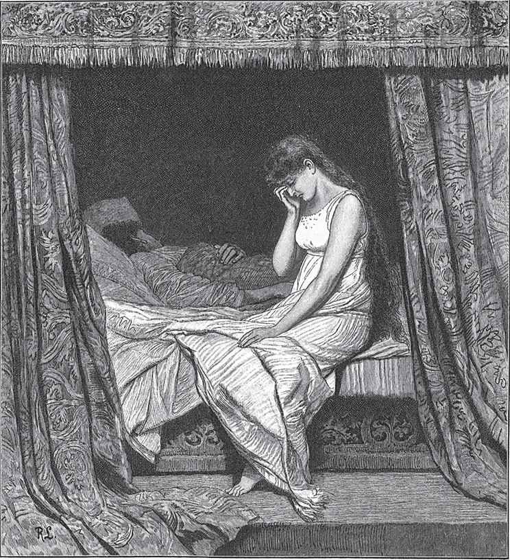

## Die kluge Bauerntochter

Es war einmal ein armer Bauer, der hatte kein Land, nur ein kleines Häuschen und eine einzige Tochter. Da sagte die Tochter:

— Wir sollten den Herrn König um ein Stückchen <abbr title="das Rodeland — расчищенная под пашню земля, новина">Rodeland</abbr> bitten.

Als der König von ihrer Armut hörte, schenkte er ihnen ein kleines Eckchen Wiese. Das <abbr title="umhacken — вскапывать мотыгой">hackten</abbr> sie und ihr Vater um, denn sie wollten ein wenig Korn und ähnliche Früchte darauf <abbr title="säen — сеять">säen</abbr>. Als sie den Acker fast fertig hatten, fanden sie in der Erde einen <abbr title="der Mörser, die Mörser — ступка">Mörser</abbr> aus reinem Gold.

— Hör zu, — sagte der Vater zu dem Mädchen. — Unser Herr König ist so gnädig gewesen und hat uns diesen Acker geschenkt. Darum müssen wir ihm dafür den Mörser geben.

Die Tochter war aber nicht <abbr title="einverstanden sein mit + Dat. — быть согласным">einverstanden</abbr> und sagte:

— Vater, wenn wir den Mörser haben und den <abbr title="der Stößel, die Stößel — пестик">Stößel</abbr> nicht, dann müssen wir auch den Stößel <abbr title="herbeischaffen — раздобыть, доставить">herbeischaffen</abbr>. Darum schweigt lieber still.

Er wollte ihr aber nicht gehorchen. Er nahm den Mörser, trug ihn zum Herrn König und sagte, den habe er auf der Heide gefunden. Ob der König ihn als Geschenk annehmen wolle? Der König nahm den Mörser und fragte, ob er nicht noch mehr gefunden habe.

— Nein, — antwortete der Bauer.

Da sagte der König, er solle nun auch den Stößel herbeischaffen. Der Bauer sagte, den hätten sie nicht gefunden. Aber das half ihm so viel, als hätte er es in den Wind gesagt: Er wurde ins Gefängnis geworfen und sollte so lange dort sitzen, bis er den Stößel herbeigeschafft hätte.

Die Diener mussten ihm jeden Tag Wasser und Brot bringen, wie man es eben im Gefängnis bekommt. Da hörten sie, wie der Mann immerzu schrie:

— Ach, hätte ich doch auf meine Tochter gehört! Ach, ach, hätte ich doch auf meine Tochter gehört!

Da gingen die Diener zum König und berichteten, dass der Gefangene immerzu schreie: „Ach, hätte ich doch auf meine Tochter gehört!“, und dass er nicht essen und nicht trinken wolle. Da befahl der König den Dienern, sie sollten den Gefangenen zu ihm bringen. Der Herr König fragte ihn, warum er immerzu schreie: „Ach, hätte ich doch auf meine Tochter gehört!“

— Was hat Eure Tochter denn gesagt?

— Ja, sie hat gesagt, ich solle den Mörser nicht bringen, sonst müsse ich auch den Stößel herbeischaffen.

— Wenn Ihr so eine kluge Tochter habt, dann lasst sie einmal herkommen.

Also musste sie vor den König kommen. Er fragte sie, ob sie wirklich so klug sei. Er wolle ihr ein Rätsel <abbr title="ein Rätsel aufgeben — загадать загадку">aufgeben</abbr>. Wenn sie es lösen könne, dann wolle er sie heiraten. Sie sagte sofort Ja, sie wolle es erraten. Da sagte der König:

— Komm zu mir, nicht <abbr title="bekleidet — одетый">bekleidet</abbr>, nicht nackt, nicht geritten, nicht gefahren, nicht auf dem Weg und nicht neben dem Weg. Wenn du das kannst, will ich dich heiraten.

Da ging sie hin und zog sich ganz splitternackt aus – so war sie nicht bekleidet. Dann nahm sie ein großes <abbr title="das Fischernetz, die Fischernetze — рыболовная сеть">Fischernetz</abbr>, setzte sich hinein und wickelte es ganz um sich herum – so war sie nicht nackt. Dann lieh sie sich für Geld einen Esel und band das Fischernetz an den Schwanz des Esels. Der Esel musste sie darin schleppen – so war sie nicht geritten und nicht gefahren. Der Esel musste sie aber in der <abbr title="die Wagenspur, die Wagenspuren — колея">Wagenspur</abbr> schleppen, sodass sie nur mit der großen Zehe die Erde berührte – so war sie nicht auf dem Weg und nicht neben dem Weg.

Als sie so ankam, sagte der König, sie habe das Rätsel gelöst, und alles sei erfüllt. Da ließ er ihren Vater aus dem Gefängnis frei und nahm sie zu sich als seine Gemahlin. Und er <abbr title="anvertrauen — доверять, поручать">vertraute</abbr> ihr das ganze königliche Gut an.

Einige Jahre waren vergangen. Da ritt der Herr König einmal zur <abbr title="die Parade, die Paraden — парад, смотр войск">Parade</abbr>. Es <abbr title="sich zutragen (trug sich zu, hat sich zugetragen) — случаться, происходить">trug sich zu</abbr>, dass vor dem Schloss Bauern mit ihren Wagen standen. Sie hatten Holz verkauft. Manche hatten Ochsen vor den Wagen gespannt, manche Pferde. Ein Bauer hatte drei Pferde, und eines davon bekam ein junges Fohlen. Das Fohlen lief weg und legte sich mitten zwischen zwei Ochsen, die vor einem anderen Wagen standen.

Als die Bauern zusammenkamen, fingen sie an zu <abbr title="sich zanken — ссориться, браниться">zanken</abbr>, mit Sachen zu werfen und zu <abbr title="lärmen — шуметь">lärmen</abbr>. Der Ochsenbauer wollte das Fohlen behalten und sagte, seine Ochsen hätten es bekommen. Der andere sagte: Nein, seine Pferde hätten es bekommen, und es gehöre ihm. Der Streit kam vor den König. Der gab das Urteil: Wo das Fohlen gelegen habe, da solle es bleiben. So bekam es der Ochsenbauer, dem es doch gar nicht gehörte.

Da ging der andere weg, weinte und jammerte über sein Fohlen. Nun hatte er gehört, dass die Frau Königin so gnädig sei, weil sie selbst von armen Bauersleuten <abbr title="abstammen von + Dat. — происходить от">abstammte</abbr>. Er ging zu ihr und bat sie, ob sie ihm nicht helfen könne, sein Fohlen wiederzubekommen. Sie sagte:

— Ja, wenn Ihr mir versprecht, dass Ihr mich nicht verratet, dann will ich es Euch sagen. Morgen früh, wenn der König zur Parade reitet, stellt Euch mitten auf die Straße, wo er vorbeikommen muss. Nehmt ein großes Fischernetz und tut so, als ob Ihr fischt. Fischt immer weiter und <abbr title="ausschütteln — вытряхивать">schüttelt</abbr> das Netz aus, als ob es voll wäre.

Und sie sagte ihm auch, was er antworten sollte, wenn der König ihn fragte.

Am nächsten Tag stand der Bauer also da und fischte auf einem trockenen Platz. Als der König vorbeikam und das sah, schickte er seinen Läufer hin. Der sollte fragen, was der <abbr title="närrisch — чудной, дурацкий">närrische</abbr> Mann da treibe. Da antwortete der Bauer:

— Ich fische.

Der Läufer fragte, wie er denn fischen könne, es sei doch gar kein Wasser da. Da sagte der Bauer:

— So gut, wie zwei Ochsen ein Fohlen bekommen können, so gut kann ich auch auf einem trockenen Platz fischen.

Der Läufer ging hin und brachte dem König die Antwort. Da ließ der König den Bauern zu sich kommen und sagte, das habe er sich nicht selbst ausgedacht. Von wem er das habe? Er solle es sofort gestehen. Der Bauer wollte es aber nicht tun und sagte immer wieder: „Gott bewahre! Ich habe es von mir selbst.“ Da legte man ihn auf ein Bündel Stroh, schlug ihn und quälte ihn so lange, bis er gestand, dass er es von der Frau Königin hatte.

Als der König nach Hause kam, sagte er zu seiner Frau:

— Warum bist du so falsch zu mir? Ich will dich nicht mehr zur Gemahlin. Deine Zeit ist um. Geh dorthin zurück, woher du gekommen bist, in dein Bauernhäuschen!

Doch eines erlaubte er ihr: Sie durfte das Liebste und Beste mitnehmen, das sie kannte, und das sollte ihr Abschied sein. Sie sagte:

— Ja, lieber Mann, wenn du es so befiehlst, will ich es auch tun.

Und sie umarmte ihn, küsste ihn und sagte, sie wolle Abschied von ihm nehmen. Dann ließ sie einen starken Schlaftrunk bringen, um mit ihm zum Abschied zu trinken. Der König nahm einen großen Schluck, sie aber trank nur ein wenig. Bald fiel er in einen tiefen Schlaf. Als sie das sah, rief sie einen Diener. Sie nahm ein schönes weißes <abbr title="das Leinentuch, die Leinentücher — льняное полотно, простыня">Leinentuch</abbr> und wickelte den König darin ein. Die Diener mussten ihn in einen Wagen vor die Tür tragen, und sie fuhr ihn nach Hause in ihr Häuschen.

Dort legte sie ihn in ihr kleines Bett, und er schlief Tag und Nacht in einem fort. Als er aufwachte, sah er sich um und sagte:

— Ach Gott, wo bin ich denn?

Er rief seine Diener, aber es war keiner da. Endlich trat seine Frau an das Bett und sagte:

— Lieber Herr König, Ihr habt mir befohlen, ich solle das Liebste und Beste aus dem Schloss mitnehmen. Nun habe ich nichts Besseres und Lieberes als dich, darum habe ich dich mitgenommen.

Dem König stiegen die Tränen in die Augen, und er sagte:

— Liebe Frau, du sollst mein sein und ich dein.

Und er nahm sie wieder mit ins königliche Schloss und ließ sich noch einmal mit ihr trauen. Und sie leben ganz bestimmt noch bis zum heutigen Tag.

---

### Neue Wörter

- **das Rodeland** — расчищенная под пашню земля, новина
- **umhacken** — вскапывать мотыгой
- **säen** — сеять
- **der Mörser, die Mörser** — ступка
- **einverstanden sein mit + Dat.** — быть согласным
- **der Stößel, die Stößel** — пестик
- **herbeischaffen** — раздобыть, доставить
- **ein Rätsel aufgeben** — загадать загадку
- **bekleidet** — одетый
- **das Fischernetz, die Fischernetze** — рыболовная сеть
- **die Wagenspur, die Wagenspuren** — колея
- **anvertrauen** — доверять, поручать
- **die Parade, die Paraden** — парад, смотр войск
- **sich zutragen (trug sich zu, hat sich zugetragen)** — случаться, происходить
- **sich zanken** — ссориться, браниться
- **lärmen** — шуметь
- **abstammen von + Dat.** — происходить от
- **ausschütteln** — вытряхивать
- **närrisch** — чудной, дурацкий
- **das Leinentuch, die Leinentücher** — льняное полотно, простыня

[← Zurück](kapitel-93.md) · [Inhalt](README.md)
