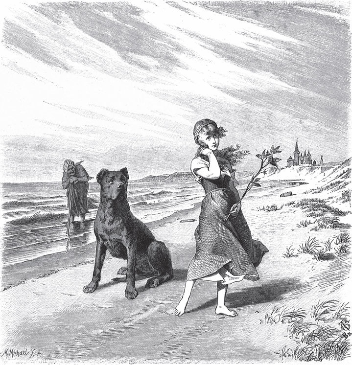

## Die drei Vögelchen

Es ist wohl tausend Jahre her oder noch länger, da gab es hier im Land lauter kleine Könige. Einer von ihnen wohnte auf dem Keuterberg und ging sehr gern auf die Jagd. Einmal ritt er mit seinen Jägern vom Schloss hinaus. Unten am Berg hüteten drei Mädchen ihre Kühe. Als sie den König mit den vielen Leuten sahen, rief die älteste den beiden anderen Mädchen zu und zeigte auf den König:

— Hallo! Hallo! Wenn ich den nicht kriege, dann will ich keinen!

Da antwortete die zweite von der anderen Seite des Berges und zeigte auf den Mann, der rechts neben dem König ging:

— Hallo! Hallo! Wenn ich den nicht kriege, dann will ich keinen!

Da rief die jüngste und zeigte auf den Mann, der links ging:

— Hallo! Hallo! Wenn ich den nicht kriege, dann will ich keinen!

Das waren aber die beiden <abbr title="der Minister, die Minister — министр">Minister</abbr>. Der König hatte alles gehört. Als er von der Jagd nach Hause gekommen war, ließ er die drei Mädchen zu sich kommen und fragte sie, was sie gestern am Berg gesagt hätten. Das wollten sie nicht sagen. Da fragte der König die älteste, ob sie ihn wohl zum Mann haben wolle. Sie sagte Ja, und ihre beiden Schwestern heirateten die beiden Minister. Denn alle drei waren schön und hatten klare Gesichter, besonders die Königin. Sie hatte Haare wie Flachs.

Die beiden Schwestern bekamen aber keine Kinder. Einmal musste der König verreisen. Da ließ er die Schwestern zur Königin kommen, um sie <abbr title="aufmuntern — подбадривать, развлекать">aufzumuntern</abbr>, denn sie war gerade <abbr title="schwanger — беременная">schwanger</abbr>. Sie bekam einen kleinen Jungen, der hatte einen <abbr title="knallrot — ярко-красный">knallroten</abbr> Stern auf der Haut, als er auf die Welt kam. Da sagten die beiden Schwestern zueinander, sie wollten den hübschen Jungen ins Wasser werfen.

Als sie ihn hineingeworfen hatten – ich glaube, es war die Weser –, flog ein Vögelchen in die Höhe und sang:

„Tom Daude bereit,

up wietern Bescheid,

tom Lilienstrus:

wacker Junge, bist du's?“

Das heißt:

„Zum Tode bereit,

auf weiteren <abbr title="der Bescheid, die Bescheide — весть, решение">Bescheid</abbr>,

zum <abbr title="der Lilienstrauß, die Lilienstrauße — букет лилий">Lilienstrauß</abbr>:

<abbr title="wacker — славный, бравый">wackrer</abbr> Junge, bist du's?“

Als die beiden das hörten, bekamen sie Todesangst und machten, dass sie fortkamen. Als der König nach Hause kam, sagten sie ihm, die Königin habe einen Hund bekommen. Da sagte der König:

— <abbr title="Was Gott tut, das ist wohlgetan. — Что Бог ни делает, всё к лучшему">Was Gott tut, das ist wohlgetan</abbr>.

Am Wasser wohnte aber ein Fischer. Der fischte den kleinen Jungen wieder heraus, als er gerade noch lebendig war. Und weil seine Frau keine Kinder hatte, <abbr title="aufziehen (zog auf, hat aufgezogen) — растить, воспитывать">zogen</abbr> sie ihn auf.

Nach einem Jahr war der König wieder verreist, und die Königin bekam wieder einen Jungen. Den nahmen die beiden falschen Schwestern und warfen ihn auch ins Wasser. Da flog das Vögelchen wieder in die Höhe und sang:

„Zum Tode bereit,

auf weiteren Bescheid,

zum Lilienstrauß:

wackrer Junge, bist du's?“

Und als der König zurückkam, sagten sie ihm, die Königin habe wieder einen Hund bekommen. Und er sagte wieder:

— Was Gott tut, das ist wohlgetan.

Aber der Fischer zog auch diesen Jungen aus dem Wasser und zog ihn auf.

Dann verreiste der König wieder, und die Königin bekam ein kleines Mädchen. Das warfen die falschen Schwestern auch ins Wasser. Da flog das Vögelchen wieder in die Höhe und sang:

„Zum Tode bereit,

auf weiteren Bescheid,

zum Lilienstrauß:

wackres Mädchen, bist du's?“

Und als der König nach Hause kam, sagten sie ihm, die Königin habe eine Katze bekommen. Da wurde der König böse und ließ seine Frau ins Gefängnis werfen. Darin musste sie viele lange Jahre sitzen.

Die Kinder waren unterdessen <abbr title="heranwachsen (wuchs heran, ist herangewachsen) — подрастать">herangewachsen</abbr>. Einmal ging der älteste mit anderen Jungen hinaus zum Fischen. Da wollten ihn die anderen Jungen nicht bei sich haben und sagten:

— Du Findelkind, geh du deiner Wege!

Da wurde er ganz betrübt und fragte den alten Fischer, ob das wahr sei. Der erzählte ihm, dass er einmal gefischt und ihn aus dem Wasser gezogen habe. Da sagte der Junge, er wolle fort und seinen Vater suchen. Der Fischer bat ihn, er möge doch bleiben. Aber er ließ sich gar nicht <abbr title="halten (hielt, hat gehalten) — удерживать">halten</abbr>, bis der Fischer es ihm endlich erlaubte.

Da machte er sich auf den Weg und ging mehrere Tage hintereinander. Endlich kam er an ein großes, gewaltiges Wasser. Davor stand eine alte Frau und fischte.

— Guten Tag, Mutter, — sagte der Junge.

— Großen Dank.

— Du wirst wohl lange fischen müssen, bis du einen Fisch fängst.

— Und du wirst wohl lange suchen müssen, bis du deinen Vater findest, — sagte die Frau. — Wie willst du denn über das Wasser kommen?

— Ja, das mag Gott wissen.

Da nahm die alte Frau ihn auf den Rücken und trug ihn hindurch. Er suchte lange Zeit, aber er konnte seinen Vater nicht finden.

Als ungefähr ein Jahr vergangen war, zog auch der zweite aus und wollte seinen Bruder suchen. Er kam an das Wasser, und es ging ihm ebenso wie seinem Bruder.

Nun war nur noch die Tochter allein zu Hause. Sie jammerte so sehr nach ihren Brüdern, dass sie zuletzt auch den Fischer bat, er möge sie ziehen lassen, sie wolle ihre Brüder suchen. Da kam auch sie an das große Wasser und sagte zu der alten Frau:

— Guten Tag, Mutter.

— Großen Dank.

— Gott helfe Euch bei Eurem Fischen!

Als die alte Frau das hörte, wurde sie ganz freundlich. Sie trug das Mädchen über das Wasser, gab ihm eine Rute und sagte zu ihm:

— Nun geh immer auf diesem Weg weiter, meine Tochter. Wenn du an einem großen schwarzen Hund vorbeikommst, dann musst du still und mutig an ihm vorbeigehen, ohne zu lachen und ohne ihn anzusehen. Dann kommst du an ein großes, offenes Schloss. Auf der Schwelle musst du die Rute fallen lassen und <abbr title="geradewegs — прямиком">geradewegs</abbr> durch das Schloss gehen und auf der anderen Seite wieder hinaus. Dort ist ein alter Brunnen, aus dem ist ein großer Baum gewachsen. Daran hängt ein Vogel in einem Käfig. Den nimm herunter. Dann nimm noch ein Glas Wasser aus dem Brunnen und geh mit diesen beiden Dingen denselben Weg wieder zurück. Auf der Schwelle nimm die Rute auch wieder mit. Und wenn du dann wieder an dem Hund vorbeikommst, dann schlag ihn ins Gesicht. Aber pass auf, dass du ihn triffst! Und dann komm nur wieder zu mir zurück.

Das Mädchen fand alles genau so, wie die Frau es gesagt hatte. Und auf dem Rückweg fand sie die beiden Brüder, die die halbe Welt durchsucht hatten. Sie gingen zusammen bis dahin, wo der schwarze Hund am Weg lag. Den schlug sie ins Gesicht, und da wurde er zu einem schönen Prinzen. Der ging mit ihnen bis an das Wasser. Dort stand noch die alte Frau. Sie freute sich sehr, dass sie alle wieder da waren, und trug sie alle über das Wasser. Dann ging auch sie fort, denn nun war sie erlöst.

Die anderen aber gingen alle zu dem alten Fischer, und alle waren froh, dass sie sich wiedergefunden hatten. Den Vogel aber hängten sie an die Wand.

Der zweite Sohn konnte aber zu Hause keine Ruhe finden. Er nahm einen <abbr title="der Bogen, die Bögen — лук (оружие)">Bogen</abbr> und ging auf die Jagd. Als er müde war, nahm er seine Flöte und spielte ein Stückchen. Der König war aber auch auf der Jagd und hörte das. Er ging hin, und als er den Jungen <abbr title="antreffen (traf an, hat angetroffen) — заставать, встречать">antraf</abbr>, sagte er:

— Wer hat dir erlaubt, hier zu jagen?

— Oh, niemand.

— Zu wem gehörst du denn?

— Ich bin der Sohn des Fischers.

— Der hat doch keine Kinder.

— Wenn du es nicht glauben willst, dann komm mit.

Das tat der König und fragte den Fischer. Der erzählte ihm alles. Und das Vögelchen an der Wand fing an zu singen:

„Die Mutter sitzt allein

wohl in dem <abbr title="das Kerkerlein (уменьш. от der Kerker) — темница">Kerkerlein</abbr>.

O König, edles Blut,

das sind deine Kinder gut.

Die falschen Schwestern beide,

die taten den Kindern Leide,

wohl in des Wassers Grund,

wo sie der Fischer fund.“

Da erschraken sie alle. Der König nahm den Vogel, den Fischer und die drei Kinder mit sich ins Schloss. Er ließ das Gefängnis aufschließen und holte seine Frau wieder heraus. Sie war aber ganz kränklich und elend geworden. Da gab ihr die Tochter von dem Wasser aus dem Brunnen zu trinken, und sie wurde wieder frisch und gesund. Die beiden falschen Schwestern aber wurden verbrannt, und die Tochter heiratete den Prinzen.

---

### Neue Wörter

- **der Minister, die Minister** — министр
- **aufmuntern** — подбадривать, развлекать
- **schwanger** — беременная
- **knallrot** — ярко-красный
- **der Bescheid, die Bescheide** — весть, решение
- **der Lilienstrauß, die Lilienstrauße** — букет лилий
- **wacker** — славный, бравый
- **Was Gott tut, das ist wohlgetan.** — Что Бог ни делает, всё к лучшему
- **aufziehen (zog auf, hat aufgezogen)** — растить, воспитывать
- **heranwachsen (wuchs heran, ist herangewachsen)** — подрастать
- **halten (hielt, hat gehalten)** — удерживать
- **geradewegs** — прямиком
- **der Bogen, die Bögen** — лук (оружие)
- **antreffen (traf an, hat angetroffen)** — заставать, встречать
- **das Kerkerlein (уменьш. от der Kerker)** — темница

[← Zurück](kapitel-95.md) · [Inhalt](README.md)
