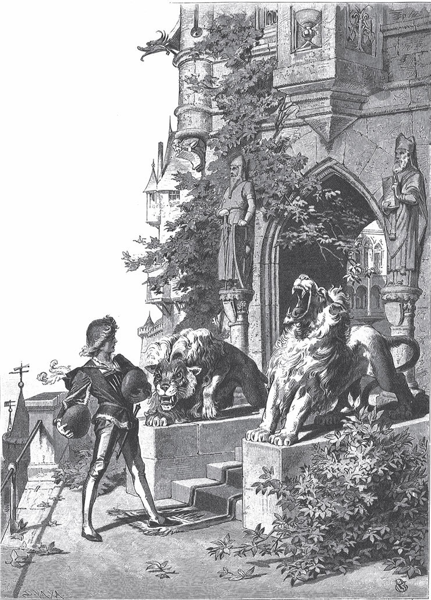

## Das Wasser des Lebens

Es war einmal ein König, der war krank, und niemand glaubte, dass er <abbr title="mit dem Leben davonkommen (kam davon, ist davongekommen) — остаться в живых">mit dem Leben davonkommen</abbr> würde. Er hatte aber drei Söhne. Die waren darüber sehr betrübt, gingen hinunter in den Schlossgarten und weinten. Da begegnete ihnen ein alter Mann und fragte sie nach ihrem Kummer. Sie sagten ihm, ihr Vater sei so krank, dass er wohl sterben werde, denn nichts wolle ihm helfen. Da sagte der Alte:

— Ich weiß noch ein Mittel, das ist das Wasser des Lebens. Wenn er davon trinkt, wird er wieder gesund. Es ist aber schwer zu finden.

— Ich werde es schon finden, — sagte der älteste.

Er ging zum kranken König und bat ihn um die Erlaubnis, auszuziehen und das Wasser des Lebens zu suchen, denn nur das könne ihn heilen.

— Nein, — sagte der König, — die Gefahr dabei ist zu groß. Lieber will ich sterben.

Aber der Sohn bat so lange, bis der König einwilligte. Der Prinz dachte in seinem Herzen: „Wenn ich das Wasser bringe, bin ich meinem Vater der liebste Sohn und erbe das Reich.“

Also machte er sich auf den Weg. Als er eine Zeit lang geritten war, stand ein Zwerg auf dem Weg. Der rief ihn an und sagte:

— Wohin so schnell?

— Dummer <abbr title="der Knirps, die Knirpse — коротышка, малявка">Knirps</abbr>, — sagte der Prinz ganz stolz, — das brauchst du nicht zu wissen.

Und er ritt weiter. Das kleine Männchen aber war zornig geworden und hatte einen bösen Wunsch ausgesprochen. Bald danach geriet der Prinz in eine <abbr title="die Bergschlucht, die Bergschluchten — горное ущелье">Bergschlucht</abbr>. Je weiter er ritt, desto enger rückten die Berge zusammen. Endlich wurde der Weg so eng, dass er keinen Schritt weiterkonnte. Es war nicht möglich, das Pferd zu wenden oder aus dem Sattel zu steigen. Er saß da wie eingesperrt.

Der kranke König wartete lange auf ihn, aber er kam nicht. Da sagte der zweite Sohn:

— Vater, lasst mich ausziehen und das Wasser suchen.

Und er dachte bei sich: „Wenn mein Bruder tot ist, dann <abbr title="zufallen (fiel zu, ist zugefallen) — доставаться">fällt</abbr> das Reich mir zu.“ Der König wollte ihn am Anfang auch nicht gehen lassen, aber endlich gab er nach. Der Prinz ritt also auf demselben Weg, den sein Bruder <abbr title="einen Weg einschlagen (schlug ein, hat eingeschlagen) — избрать путь">eingeschlagen</abbr> hatte. Auch er begegnete dem Zwerg. Der hielt ihn an und fragte, wohin er so eilig wolle.

— Kleiner Knirps, — sagte der Prinz, — das brauchst du nicht zu wissen.

Und er ritt fort, ohne sich weiter umzusehen. Aber der Zwerg verwünschte ihn, und er geriet wie der andere in eine Bergschlucht und konnte weder vorwärts noch rückwärts. So geht es den Hochmütigen.

Als auch der zweite Sohn nicht zurückkam, <abbr title="sich anbieten (bot sich an, hat sich angeboten) — вызываться, предлагать себя">bot</abbr> sich der jüngste an, auszuziehen und das Wasser zu holen. Und der König musste ihn endlich gehen lassen. Als er dem Zwerg begegnete und dieser fragte, wohin er so eilig wolle, hielt er an, gab ihm <abbr title="Rede und Antwort stehen — давать объяснения, отвечать">Rede und Antwort</abbr> und sagte:

— Ich suche das Wasser des Lebens, denn mein Vater ist todkrank.

— Weißt du auch, wo es zu finden ist?

— Nein, — sagte der Prinz.

— Weil du dich benommen hast, wie es sich gehört, und nicht übermütig wie deine falschen Brüder, will ich dir <abbr title="die Auskunft, die Auskünfte — справка, сведения">Auskunft</abbr> geben. Ich sage dir, wie du zum Wasser des Lebens kommst. Es quillt aus einem Brunnen im Hof eines verwünschten Schlosses. Aber du kommst nicht hinein, wenn ich dir nicht eine eiserne Rute und zwei kleine Laibe Brot gebe. Mit der Rute schlag dreimal an das eiserne Tor des Schlosses, dann springt es auf. Drinnen liegen zwei Löwen, die ihren Rachen aufreißen. Wenn du aber jedem ein Brot hineinwirfst, dann werden sie still. Dann beeil dich und hol von dem Wasser des Lebens, bevor es zwölf schlägt. Sonst schlägt das Tor wieder zu, und du bist eingesperrt.

Der Prinz dankte ihm, nahm die Rute und das Brot und machte sich auf den Weg. Als er ankam, war alles so, wie der Zwerg gesagt hatte. Beim dritten Schlag mit der Rute sprang das Tor auf. Und als er die Löwen mit dem Brot besänftigt hatte, trat er in das Schloss und kam in einen großen, schönen Saal. Darin saßen verwünschte Prinzen. Denen zog er die Ringe von den Fingern. Dann lagen dort ein Schwert und ein Brot, die nahm er mit.

Weiter kam er in ein Zimmer, in dem eine schöne Jungfrau stand. Sie freute sich, als sie ihn sah, küsste ihn und sagte, er habe sie erlöst. Er solle ihr ganzes Reich bekommen, und wenn er in einem Jahr wiederkomme, solle ihre Hochzeit gefeiert werden. Dann sagte sie ihm auch, wo der Brunnen mit dem Wasser des Lebens sei. Er müsse sich aber beeilen und daraus schöpfen, bevor es zwölf schlage.

Da ging er weiter und kam endlich in ein Zimmer, wo ein schönes, frisch <abbr title="beziehen (bezog, hat bezogen) — застилать (постель)">bezogenes</abbr> Bett stand. Und weil er müde war, wollte er erst ein wenig ausruhen. Also legte er sich hin und schlief ein. Als er aufwachte, schlug es Viertel vor zwölf. Da sprang er ganz erschrocken auf, lief zu dem Brunnen und schöpfte daraus mit einem Becher, der daneben stand. Dann eilte er, damit er hinauskam. Gerade als er durch das eiserne Tor hinausging, schlug es zwölf, und das Tor schlug so heftig zu, dass es ihm noch ein Stück von der Ferse abriss.

Er aber war froh, dass er das Wasser des Lebens bekommen hatte. Er machte sich auf den Heimweg und kam wieder an dem Zwerg vorbei. Als dieser das Schwert und das Brot sah, sagte er:

— Damit hast du großen Reichtum gewonnen. Mit dem Schwert kannst du ganze Heere schlagen, und das Brot wird niemals alle.

Der Prinz wollte aber nicht ohne seine Brüder zu seinem Vater nach Hause kommen und sagte:

— Lieber Zwerg, kannst du mir nicht sagen, wo meine zwei Brüder sind? Sie sind früher als ich <abbr title="aufbrechen (brach auf, ist aufgebrochen) — отправляться в путь">aufgebrochen</abbr>, um das Wasser des Lebens zu suchen, und sind nicht wiedergekommen.

— Sie <abbr title="feststecken — застрять">stecken</abbr> zwischen zwei Bergen fest, — sagte der Zwerg. — Dorthin habe ich sie verwünscht, weil sie so übermütig waren.

Da bat der Prinz so lange, bis der Zwerg sie wieder freiließ. Aber er warnte ihn und sagte:

— Hüte dich vor ihnen, sie haben ein böses Herz.

Als seine Brüder kamen, freute er sich und erzählte ihnen, wie es ihm ergangen war: dass er das Wasser des Lebens gefunden und einen Becher voll mitgenommen habe, und dass er eine schöne Prinzessin erlöst habe. Die wolle ein Jahr lang auf ihn warten, dann solle Hochzeit sein, und er bekomme ein großes Reich.

Danach ritten sie zusammen fort und kamen in ein Land, in dem Hunger und Krieg waren. Der König dort glaubte schon, er müsse zugrunde gehen, so groß war die Not. Da ging der Prinz zu ihm und gab ihm das Brot. Damit <abbr title="speisen — кормить">speiste</abbr> der König sein ganzes Reich und machte alle satt. Dann gab ihm der Prinz auch das Schwert. Damit schlug der König die Heere seiner Feinde und konnte nun in Ruhe und Frieden leben. Da nahm der Prinz sein Brot und sein Schwert wieder zurück, und die drei Brüder ritten weiter. Sie kamen noch in zwei andere Länder, in denen Hunger und Krieg herrschten. Jedes Mal gab der Prinz den Königen sein Brot und sein Schwert, und so hatte er nun drei Reiche gerettet.

Danach gingen sie auf ein Schiff und fuhren über das Meer. Während der Fahrt sprachen die beiden älteren miteinander:

— Der jüngste hat das Wasser des Lebens gefunden und wir nicht. Dafür wird ihm unser Vater das Reich geben, das uns zusteht, und er wird uns unser Glück wegnehmen.

Da wurden sie <abbr title="rachsüchtig — мстительный">rachsüchtig</abbr> und verabredeten miteinander, dass sie ihn verderben wollten. Sie warteten, bis er einmal fest eingeschlafen war. Dann gossen sie das Wasser des Lebens aus seinem Becher und nahmen es für sich. Ihm aber gossen sie bitteres <abbr title="das Meerwasser — морская вода">Meerwasser</abbr> hinein.

Als sie nun zu Hause ankamen, brachte der jüngste dem kranken König seinen Becher, damit er daraus trinken und gesund werden sollte. Kaum hatte der König aber ein wenig von dem bitteren Meerwasser getrunken, da wurde er noch kränker als vorher. Und während er darüber jammerte, kamen die beiden älteren Söhne und beschuldigten den jüngsten, er habe ihn <abbr title="vergiften — отравить">vergiften</abbr> wollen. Sie aber brächten ihm das richtige Wasser des Lebens. Und sie reichten es ihm. Kaum hatte er davon getrunken, da fühlte er, wie seine Krankheit verschwand. Er wurde stark und gesund wie in seinen jungen Tagen.

Danach gingen die beiden zu dem jüngsten, verspotteten ihn und sagten:

— Du hast zwar das Wasser des Lebens gefunden, aber du hast die Mühe gehabt und wir den Lohn. Du hättest klüger sein und die Augen offen halten sollen. Wir haben es dir genommen, während du auf dem Meer eingeschlafen warst. Und in einem Jahr holt sich einer von uns die schöne Königstochter. Aber hüte dich, etwas davon zu verraten! Der Vater glaubt dir sowieso nicht. Und wenn du ein einziges Wort sagst, dann sollst du noch obendrein dein Leben verlieren. Wenn du aber schweigst, dann soll es dir geschenkt sein.

Der alte König war zornig auf seinen jüngsten Sohn und glaubte, er habe ihm <abbr title="jemandem nach dem Leben trachten — покушаться на чью-л. жизнь">nach dem Leben getrachtet</abbr>. Also ließ er den Hof versammeln und das Urteil über ihn sprechen: Er sollte heimlich erschossen werden.

Als der Prinz einmal auf die Jagd ritt und nichts Böses ahnte, musste der Jäger des Königs mitgehen. Draußen, als sie ganz allein im Wald waren, sah der Jäger so traurig aus, dass der Prinz zu ihm sagte:

— Lieber Jäger, was fehlt dir?

— Ich kann es nicht sagen und soll es doch tun, — antwortete der Jäger.

— Sag heraus, was es ist, ich will es dir verzeihen.

— Ach, — sagte der Jäger, — ich soll Euch totschießen. Der König hat es mir befohlen.

Da erschrak der Prinz und sagte:

— Lieber Jäger, lass mich leben! Ich gebe dir mein königliches Kleid, gib mir dafür dein einfaches.

— Das will ich gern tun, — sagte der Jäger. — Ich hätte sowieso nicht auf Euch schießen können.

Da tauschten sie die Kleider. Der Jäger ging nach Hause, der Prinz aber ging weiter in den Wald hinein.

Nach einiger Zeit kamen zu dem alten König drei Wagen mit Gold und Edelsteinen für seinen jüngsten Sohn. Sie kamen von den drei Königen, die mit dem Schwert des Prinzen ihre Feinde geschlagen und mit seinem Brot ihr Land ernährt hatten. Sie wollten sich dankbar zeigen. Da dachte der alte König: „Sollte mein Sohn unschuldig gewesen sein?“ Und er sagte zu seinen Leuten:

— Wäre er doch noch am Leben! Wie leid tut es mir, dass ich ihn habe töten lassen!

— Er lebt noch, — sagte der Jäger. — Ich <abbr title="es nicht übers Herz bringen — не решиться, не хватить духу">brachte es nicht übers Herz</abbr>, Euren Befehl <abbr title="ausführen — выполнять, исполнять">auszuführen</abbr>.

Und er erzählte dem König, wie alles gekommen war. Da <abbr title="jemandem fällt ein Stein vom Herzen — у кого-л. камень с души свалился">fiel</abbr> dem König ein Stein vom Herzen. Er ließ in allen Reichen verkünden, sein Sohn dürfe wiederkommen und solle in Gnaden aufgenommen werden.

Die Königstochter aber ließ vor ihrem Schloss eine Straße bauen, die war ganz golden und glänzend. Sie sagte ihren Leuten: Wer auf der Straße geradewegs zu ihr geritten komme, der sei der Richtige, den sollten sie hereinlassen. Wer aber neben der Straße komme, der sei nicht der Richtige, und den sollten sie auch nicht hereinlassen.

Als das Jahr fast vorbei war, dachte der älteste, er wolle sich beeilen, zur Königstochter gehen und sich als ihr Erlöser ausgeben. Dann bekäme er sie zur Gemahlin und das Reich dazu. Also ritt er fort. Als er vor das Schloss kam und die schöne goldene Straße sah, dachte er: „Es wäre <abbr title="jammerschade — очень жаль">jammerschade</abbr>, wenn du darauf reiten würdest.“ Er <abbr title="lenken — направлять, править (конём)">lenkte</abbr> sein Pferd zur Seite und ritt rechts daneben. Als er aber vor das Tor kam, sagten die Leute zu ihm, er sei nicht der Richtige, er solle wieder fortgehen.

Bald danach machte sich der zweite Prinz auf den Weg. Als er zur goldenen Straße kam und das Pferd schon einen Fuß daraufgesetzt hatte, dachte er: „Es wäre jammerschade, da könnte etwas <abbr title="abtreten (trat ab, hat abgetreten) — стаптывать, стирать (ногами)">abgetreten</abbr> werden.“ Er lenkte zur Seite und ritt links daneben. Als er aber vor das Tor kam, sagten die Leute, er sei nicht der Richtige, er solle wieder fortgehen.

Als nun das Jahr ganz vorbei war, wollte der dritte aus dem Wald fort zu seiner Liebsten reiten und bei ihr sein Leid vergessen. Also machte er sich auf den Weg. Er dachte immer nur an sie und wäre gern schon bei ihr gewesen, sodass er die goldene Straße gar nicht bemerkte. Da ritt sein Pferd mitten darüber. Als er vor das Tor kam, wurde es geöffnet, und die Königstochter empfing ihn mit Freude. Sie sagte, er sei ihr Erlöser und der Herr des Königreichs. Und die Hochzeit wurde mit großer <abbr title="die Glückseligkeit — блаженство, счастье">Glückseligkeit</abbr> gefeiert.

Als die Hochzeit vorbei war, erzählte sie ihm, dass sein Vater ihn zu sich gerufen und ihm verziehen habe. Da ritt er zu ihm und erzählte ihm alles: wie seine Brüder ihn betrogen hatten und dass er trotzdem dazu geschwiegen hatte. Der alte König wollte sie bestrafen, aber sie hatten sich auf ein Schiff gesetzt, waren über das Meer davongefahren und kamen ihr Leben lang nicht wieder.

---

### Neue Wörter

- **mit dem Leben davonkommen (kam davon, ist davongekommen)** — остаться в живых
- **der Knirps, die Knirpse** — коротышка, малявка
- **die Bergschlucht, die Bergschluchten** — горное ущелье
- **zufallen (fiel zu, ist zugefallen)** — доставаться
- **einen Weg einschlagen (schlug ein, hat eingeschlagen)** — избрать путь
- **sich anbieten (bot sich an, hat sich angeboten)** — вызываться, предлагать себя
- **Rede und Antwort stehen** — давать объяснения, отвечать
- **die Auskunft, die Auskünfte** — справка, сведения
- **beziehen (bezog, hat bezogen)** — застилать (постель)
- **aufbrechen (brach auf, ist aufgebrochen)** — отправляться в путь
- **feststecken** — застрять
- **speisen** — кормить
- **rachsüchtig** — мстительный
- **das Meerwasser** — морская вода
- **vergiften** — отравить
- **jemandem nach dem Leben trachten** — покушаться на чью-л. жизнь
- **es nicht übers Herz bringen** — не решиться, не хватить духу
- **ausführen** — выполнять, исполнять
- **jemandem fällt ein Stein vom Herzen** — у кого-л. камень с души свалился
- **jammerschade** — очень жаль
- **lenken** — направлять, править (конём)
- **abtreten (trat ab, hat abgetreten)** — стаптывать, стирать (ногами)
- **die Glückseligkeit** — блаженство, счастье

[← Zurück](kapitel-96.md) · [Inhalt](README.md)
