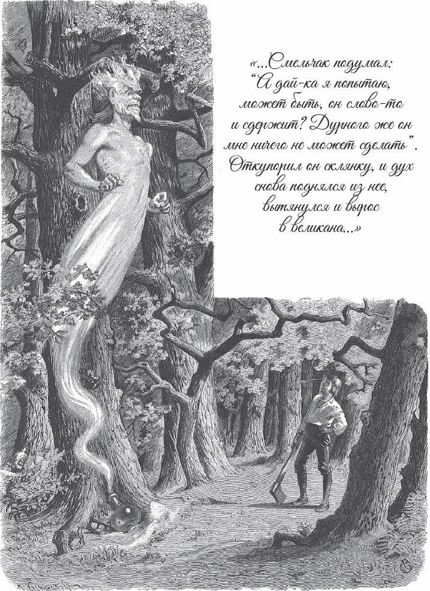

## Der Geist im Glas

Es war einmal ein armer <abbr title="der Holzhacker, die Holzhacker — дровосек">Holzhacker</abbr>, der vom Morgen bis spät in die Nacht arbeitete. Als er endlich ein wenig Geld gespart hatte, sagte er zu seinem Sohn:

— Du bist mein einziges Kind. Das Geld, das ich mit so viel Schweiß verdient habe, will ich für deine <abbr title="die Ausbildung, die Ausbildungen — образование, обучение">Ausbildung</abbr> <abbr title="ausgeben (gab aus, hat ausgegeben) — тратить">ausgeben</abbr>. Wenn du etwas Ordentliches lernst, kannst du mich ernähren, wenn ich alt bin, wenn meine Glieder steif geworden sind und ich zu Hause sitzen muss.

Also ging der Junge auf eine hohe Schule und lernte so fleißig, dass seine Lehrer ihn lobten. Er blieb eine Zeit lang dort. Er hatte schon ein paar Klassen <abbr title="etwas hinter sich haben — иметь что-то позади">hinter sich</abbr>, aber er war noch nicht in allem perfekt – da war das bisschen Geld, das der Vater gespart hatte, <abbr title="verbrauchen — израсходовать">verbraucht</abbr>. Er musste wieder nach Hause zurückkehren.

— Ach, — sagte der Vater traurig, — ich kann dir nichts mehr geben. In diesen teuren Zeiten verdiene ich keinen Heller mehr als das tägliche Brot.

— Lieber Vater, — antwortete der Sohn, — macht Euch darüber keine Sorgen. Wenn Gott es so will, dann wird es schon gut für mich sein. Ich werde mich damit <abbr title="sich abfinden mit + Dat. (fand ab, hat abgefunden) — смириться с">abfinden</abbr>.

Als der Vater in den Wald gehen wollte, um mit dem <abbr title="das Holzspalten — колка дров">Holzspalten</abbr> und <abbr title="aufstapeln — складывать в штабель">Aufstapeln</abbr> etwas Geld zu verdienen, sagte der Sohn:

— Ich komme mit und helfe Euch.

— Ach, mein Sohn, — sagte der Vater, — das wird zu <abbr title="anstrengend — утомительный, тяжёлый">anstrengend</abbr> für dich. Du bist an harte Arbeit nicht gewöhnt, du hältst das nicht aus. Außerdem habe ich nur eine Axt und kein Geld für eine zweite.

— Geht doch zum Nachbarn, — antwortete der Sohn. — Er leiht Euch seine Axt, bis ich mir selbst eine verdient habe.

Da borgte der Vater beim Nachbarn eine Axt, und am nächsten Morgen, als es dämmerte, gingen die beiden zusammen in den Wald. Der Sohn half dem Vater und war ganz munter und frisch dabei. Als die Sonne hoch über ihnen stand, sagte der Vater:

— Jetzt wollen wir eine <abbr title="die Rast — привал, отдых">Rast</abbr> machen und zu Mittag essen. Danach geht es noch einmal so gut.

Der Sohn nahm sein Brot in die Hand und sagte:

— Ruht Euch nur aus, Vater. Ich bin nicht müde. Ich will ein bisschen im Wald herumgehen und <abbr title="das Vogelnest, die Vogelnester — птичье гнездо">Vogelnester</abbr> suchen.

— Ach, du Dummkopf, — sagte der Vater, — was willst du da herumlaufen? Danach bist du müde und kannst den Arm nicht mehr heben. Bleib hier und setz dich zu mir.

Aber der Sohn ging in den Wald. Er aß sein Brot, war ganz fröhlich und sah in die grünen Zweige hinauf, ob er vielleicht ein Nest entdeckte. So ging er hin und her, bis er endlich zu einer großen, gewaltigen Eiche kam. Sie war sicher schon viele hundert Jahre alt, und nicht einmal fünf Menschen hätten sie mit den Armen <abbr title="umfassen — обхватить">umfassen</abbr> können. Er blieb stehen, sah sie an und dachte: «Da haben bestimmt viele Vögel ihre Nester hineingebaut.»

Plötzlich glaubte er, eine Stimme zu hören. Er horchte und hörte, wie es mit einem ganz dumpfen Ton rief:

— Lass mich heraus, lass mich heraus!

Er sah sich <abbr title="ringsum — вокруг">ringsum</abbr> um, konnte aber nichts entdecken. Es kam ihm so vor, als ob die Stimme von unten aus der Erde käme. Da rief er:

— Wo bist du?

Die Stimme antwortete:

— Ich stecke da unten bei den Wurzeln der Eiche. Lass mich heraus, lass mich heraus!

Der Schüler begann, unter dem Baum die Erde <abbr title="wegräumen — убирать, расчищать">wegzuräumen</abbr> und bei den Wurzeln zu suchen. Endlich entdeckte er in einer kleinen Höhle eine <abbr title="die Glasflasche, die Glasflaschen — стеклянная бутылка">Glasflasche</abbr>. Er hob sie hoch und hielt sie gegen das Licht. Da sah er ein Ding, das wie ein Frosch aussah. Es sprang in der Flasche auf und ab.

— Lass mich heraus, lass mich heraus! — rief es wieder.

Der Schüler dachte an nichts Böses und zog den <abbr title="der Korken, die Korken — пробка">Korken</abbr> aus der Flasche. Sofort stieg ein Geist heraus und begann zu wachsen. Er wuchs so schnell, dass er nach wenigen Augenblicken als ein entsetzlicher Kerl, so groß wie der halbe Baum, vor dem Schüler stand.

— Weißt du, — rief er mit einer fürchterlichen Stimme, — was dein Lohn dafür ist, dass du mich herausgelassen hast?

— Nein, — antwortete der Schüler ohne Furcht. — Wie soll ich das wissen?

— Dann will ich es dir sagen, — rief der Geist. — Ich muss dir dafür den Hals brechen!

— Das hättest du mir früher sagen sollen, — antwortete der Schüler, — dann hätte ich dich drin stecken lassen. Aber mein Kopf bleibt schön fest auf meinem Hals. Darüber müssen erst noch mehr Leute <abbr title="mitreden — иметь право голоса">mitreden</abbr>.

— Mehr Leute hin, mehr Leute her, — rief der Geist, — du sollst deinen <abbr title="verdient — заслуженный">verdienten</abbr> Lohn bekommen! Glaubst du, man hat mich aus Gnade so lange da <abbr title="einschließen (schloss ein, hat eingeschlossen) — запирать">eingeschlossen</abbr>? Nein, das war meine Strafe! Ich bin der <abbr title="großmächtig — всемогущий, великий">großmächtige</abbr> Merkurius. Wer mich freilässt, dem muss ich den Hals brechen.

— Langsam, langsam, — antwortete der Schüler, — so schnell geht das nicht. Zuerst muss ich wissen, ob du wirklich in der kleinen Flasche gesessen hast und ob du der richtige Geist bist. Wenn du wieder hineinpasst, dann glaube ich es. Danach kannst du mit mir machen, was du willst.

Der Geist sagte voller Hochmut:

— Das ist doch keine Kunst!

Er zog sich zusammen und machte sich so dünn und klein, wie er am Anfang gewesen war. So kroch er durch dieselbe Öffnung und durch den Hals der Flasche wieder hinein. Kaum war er drin, da drückte der Schüler den Korken wieder fest auf die Flasche. Er warf sie unter die Wurzeln der Eiche an ihren alten Platz – und der Geist war betrogen.

Nun wollte der Schüler zu seinem Vater zurückgehen. Aber der Geist rief ganz kläglich:

— Ach, lass mich doch heraus, lass mich doch heraus!

— Nein, — antwortete der Schüler, — nicht noch einmal. Wer mir einmal nach dem Leben getrachtet hat, den lasse ich nicht frei, wenn ich ihn wieder gefangen habe.

— Wenn du mich befreist, — rief der Geist, — dann gebe ich dir so viel, dass du dein ganzes Leben lang genug hast.

— Nein, — antwortete der Schüler, — du würdest mich betrügen wie beim ersten Mal.

— Du verspielst dein Glück, — sagte der Geist. — Ich will dir nichts tun, sondern dich reichlich belohnen.

Der Schüler dachte: «Ich will es wagen. Vielleicht hält er Wort. Und etwas antun kann er mir ja doch nicht.»

Er zog den Korken heraus, und der Geist stieg wie beim letzten Mal heraus, <abbr title="sich dehnen — растягиваться">dehnte sich</abbr> aus und wurde groß wie ein Riese.

— Jetzt sollst du deinen Lohn haben, — sagte er und gab dem Schüler einen kleinen Lappen, ganz wie ein <abbr title="das Pflaster, die Pflaster — пластырь">Pflaster</abbr>. — Wenn du mit dem einen Ende über eine Wunde streichst, dann heilt sie. Und wenn du mit dem anderen Ende über <abbr title="der Stahl — сталь">Stahl</abbr> und Eisen streichst, dann wird es in Silber verwandelt.

— Das muss ich erst ausprobieren, — sagte der Schüler. Er ging zu einem Baum, <abbr title="ritzen — надрезать, царапать">ritzte</abbr> mit seiner Axt die <abbr title="die Rinde, die Rinden — кора">Rinde</abbr> und strich mit dem einen Ende des Pflasters darüber. Sofort schloss sich die Rinde wieder und war geheilt.

— Na, es <abbr title="stimmen — быть верным">stimmt</abbr> also, — sagte er zum Geist. — Jetzt können wir uns trennen.

Der Geist dankte ihm für seine Befreiung, und der Schüler dankte dem Geist für sein Geschenk und ging zurück zu seinem Vater.

— Wo bist du herumgelaufen? — fragte der Vater. — Warum hast du die Arbeit vergessen? Ich habe ja gleich gesagt, dass du nichts <abbr title="etwas zustande bringen — сделать, справиться с чем-то">zustande bringst</abbr>.

— <abbr title="zufrieden sein — быть довольным; здесь: успокойтесь">Seid zufrieden</abbr>, Vater, ich will es <abbr title="nachholen — наверстать">nachholen</abbr>.

— Ja, nachholen! — sagte der Vater zornig. — So geht das nicht.

— Passt auf, Vater! Den Baum da haue ich gleich um, dass es nur so kracht.

Er nahm sein Pflaster, strich damit über die Axt und machte einen gewaltigen Hieb. Aber weil das Eisen in Silber verwandelt war, <abbr title="sich verbiegen (verbog, hat verbogen) — гнуться">bog sich</abbr> die <abbr title="die Schneide, die Schneiden — лезвие">Schneide</abbr> <abbr title="sich umbiegen (bog um, hat umgebogen) — загнуться">um</abbr>.

— Ei, Vater, seht doch, was für eine schlechte Axt Ihr mir gegeben habt! Sie ist ganz schief geworden.

Da erschrak der Vater und sagte:

— Ach, was hast du gemacht! Jetzt muss ich die Axt bezahlen und weiß nicht, womit. Das ist also der <abbr title="der Nutzen — польза">Nutzen</abbr>, den ich von deiner Arbeit habe!

— Seid nicht böse, — antwortete der Sohn, — die Axt bezahle ich schon.

— Oh, du Dummkopf, — rief der Vater, — wovon willst du sie bezahlen? Du hast nichts außer dem, was ich dir gebe. Du hast nur <abbr title="der Studententrick, die Studententricks — студенческие штучки">Studententricks</abbr> im Kopf, aber vom Holzhacken <abbr title="verstehen von + Dat. — разбираться в">verstehst</abbr> du nichts.

Nach einer Weile sagte der Schüler:

— Vater, ich kann sowieso nicht mehr arbeiten. Wir wollen lieber <abbr title="der Feierabend — конец рабочего дня">Feierabend</abbr> machen.

— Ach was, — antwortete der Vater, — meinst du, ich lege die Hände in den Schoß wie du? Ich muss noch arbeiten. Aber du kannst <abbr title="sich nach Hause packen — убираться домой">dich</abbr> nach Hause packen.

— Vater, ich bin zum ersten Mal hier im Wald. Ich kenne den Weg allein nicht. Kommt doch mit mir.

Weil der Zorn des Vaters <abbr title="verfliegen (verflog, ist verflogen) — улетучиться, пройти">verflogen</abbr> war, ließ er sich endlich überreden und ging mit ihm nach Hause. Dort sagte er zum Sohn:

— Geh und verkauf die kaputte Axt und sieh, was du dafür bekommst. Den Rest muss ich verdienen, um sie dem Nachbarn zu bezahlen.

Der Sohn nahm die Axt und trug sie in die Stadt zu einem Goldschmied. Der prüfte sie, legte sie auf die <abbr title="die Waage, die Waagen — весы">Waage</abbr> und sagte:

— Sie ist vierhundert Taler wert. So viel habe ich nicht <abbr title="bar — наличными">bar</abbr>.

Der Schüler sagte:

— Gebt mir, was Ihr habt. Den Rest leihe ich Euch.

Der Goldschmied gab ihm dreihundert Taler und blieb ihm hundert <abbr title="schuldig bleiben — остаться должным">schuldig</abbr>. Dann ging der Schüler nach Hause und sagte:

— Vater, ich habe Geld. Geht und fragt, was der Nachbar für die Axt haben will.

— Das weiß ich schon, — antwortete der Alte. — Einen Taler und sechs Groschen.

— Dann gebt ihm zwei Taler und zwölf Groschen. Das ist das <abbr title="das Doppelte — двойная сумма, вдвое больше">Doppelte</abbr>, und das ist genug. Seht Ihr, ich habe Geld im Überfluss.

Und er gab dem Vater hundert Taler und sagte:

— Es soll Euch nie an etwas fehlen. Lebt jetzt bequem.

— Mein Gott, — sagte der Alte, — wie bist du zu diesem Reichtum gekommen?

Da erzählte ihm der Sohn, wie alles geschehen war und wie er, im Vertrauen auf sein Glück, einen so reichen Fang gemacht hatte. Mit dem übrigen Geld ging er wieder auf die hohe Schule und lernte weiter. Und weil er mit seinem Pflaster alle Wunden heilen konnte, wurde er der berühmteste Doktor auf der ganzen Welt.

---

### Neue Wörter

- **der Holzhacker, die Holzhacker** — дровосек
- **die Ausbildung, die Ausbildungen** — образование, обучение
- **ausgeben (gab aus, hat ausgegeben)** — тратить
- **etwas hinter sich haben** — иметь что-то позади
- **verbrauchen** — израсходовать
- **sich abfinden mit + Dat. (fand ab, hat abgefunden)** — смириться с
- **das Holzspalten** — колка дров
- **aufstapeln** — складывать в штабель
- **anstrengend** — утомительный, тяжёлый
- **die Rast** — привал, отдых
- **das Vogelnest, die Vogelnester** — птичье гнездо
- **umfassen** — обхватить
- **ringsum** — вокруг
- **wegräumen** — убирать, расчищать
- **die Glasflasche, die Glasflaschen** — стеклянная бутылка
- **der Korken, die Korken** — пробка
- **mitreden** — иметь право голоса
- **verdient** — заслуженный
- **einschließen (schloss ein, hat eingeschlossen)** — запирать
- **großmächtig** — всемогущий, великий
- **sich dehnen** — растягиваться
- **das Pflaster, die Pflaster** — пластырь
- **der Stahl** — сталь
- **ritzen** — надрезать, царапать
- **die Rinde, die Rinden** — кора
- **stimmen** — быть верным
- **etwas zustande bringen** — сделать, справиться с чем-то
- **zufrieden sein** — быть довольным; здесь: успокойтесь
- **nachholen** — наверстать
- **sich verbiegen (verbog, hat verbogen)** — гнуться
- **die Schneide, die Schneiden** — лезвие
- **sich umbiegen (bog um, hat umgebogen)** — загнуться
- **der Nutzen** — польза
- **der Studententrick, die Studententricks** — студенческие штучки
- **verstehen von + Dat.** — разбираться в
- **der Feierabend** — конец рабочего дня
- **sich nach Hause packen** — убираться домой
- **verfliegen (verflog, ist verflogen)** — улетучиться, пройти
- **die Waage, die Waagen** — весы
- **bar** — наличными
- **schuldig bleiben** — остаться должным
- **das Doppelte** — двойная сумма, вдвое больше

[← Zurück](kapitel-98.md) · [Inhalt](README.md) · [Weiter →](kapitel-100.md)
