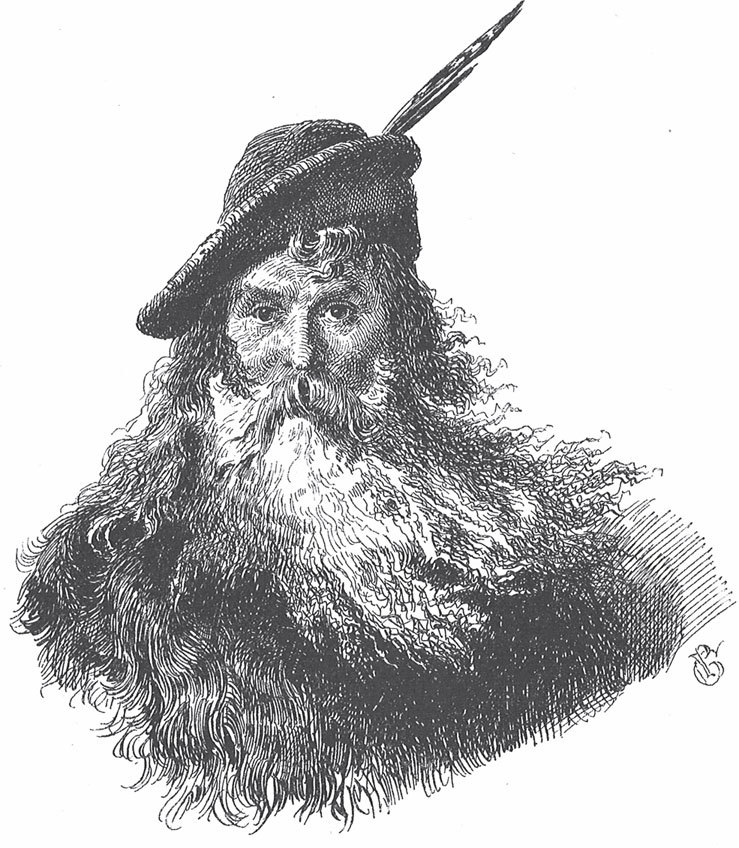

## Der Bärenhäuter

Es war einmal ein junger Kerl, der ließ sich als Soldat <abbr title="sich anwerben lassen (warb an, hat angeworben) — завербоваться">anwerben</abbr>. Er war tapfer und stand immer ganz vorne, wenn <abbr title="die Kugeln fliegen — пули летят (в бою)">die Kugeln flogen</abbr>. Solange der Krieg dauerte, ging alles gut. Aber als <abbr title="Frieden schließen (schloss, hat geschlossen) — заключить мир">Frieden geschlossen</abbr> war, wurde er entlassen, und der Hauptmann sagte, er könne gehen, wohin er wolle. Seine Eltern waren tot, und er hatte keine <abbr title="die Heimat — родина, родной дом">Heimat</abbr> mehr. Da ging er zu seinen Brüdern und bat sie, ihn so lange zu versorgen, bis wieder Krieg wäre. Aber die Brüder waren hartherzig und sagten:

— Was sollen wir mit dir? Wir können dich nicht gebrauchen. Sieh zu, wie du dich durchschlägst.

Der Soldat hatte nichts mehr als sein Gewehr. Das nahm er auf die Schulter und wollte in die Welt hinausziehen. Er kam auf eine große Heide, auf der nichts zu sehen war als ein Kreis von Bäumen. Darunter setzte er sich ganz traurig hin und <abbr title="nachdenken über + Akk. (dachte nach, hat nachgedacht) — размышлять о">dachte</abbr> über sein Schicksal nach.

«Ich habe kein Geld», dachte er. «Ich habe nichts gelernt außer dem <abbr title="das Kriegshandwerk — военное ремесло">Kriegshandwerk</abbr>. Und jetzt, wo Frieden ist, braucht man mich nicht mehr. Ich sehe schon, ich muss verhungern.»

Auf einmal hörte er ein Brausen, und als er sich umsah, stand ein fremder Mann vor ihm. Er trug einen grünen Rock und sah recht <abbr title="stattlich — статный, видный">stattlich</abbr> aus, aber er hatte einen hässlichen <abbr title="der Pferdefuß, die Pferdefüße — конское копыто (у чёрта)">Pferdefuß</abbr>.

— Ich weiß schon, was dir fehlt, — sagte der Mann. — Geld und Gut sollst du haben, so viel du nur <abbr title="verprassen — промотать, прокутить">verprassen</abbr> kannst. Aber vorher muss ich wissen, ob du keine Angst hast. Ich will mein Geld ja nicht umsonst ausgeben.

— Ein Soldat und Angst? Wie passt das zusammen? — antwortete er. — Du kannst mich auf die Probe stellen.

— Wohlan, — antwortete der Mann, — sieh hinter dich.

Der Soldat drehte sich um und sah einen großen Bären, der brummend auf ihn <abbr title="zutraben auf + Akk. — бежать рысцой к">zutrabte</abbr>.

— Oho, — rief der Soldat, — dich will ich an der Nase kitzeln, dass dir die Lust zum Brummen vergeht!

Er zielte und schoss dem Bären auf die <abbr title="die Schnauze, die Schnauzen — морда">Schnauze</abbr>, sodass er zusammenbrach und sich nicht mehr rührte.

— Ich sehe wohl, — sagte der Fremde, — dass es dir nicht an Mut fehlt. Aber da ist noch eine Bedingung, die musst du erfüllen.

— Wenn es meiner Seele nicht schadet, — antwortete der Soldat, denn er merkte wohl, wen er vor sich hatte. — Sonst <abbr title="sich einlassen auf + Akk. (ließ ein, hat eingelassen) — ввязываться во что-то">lasse</abbr> ich mich auf nichts ein.

— Das wirst du selbst sehen, — antwortete der <abbr title="der Grünrock — «зелёный кафтан» (о чёрте)">Grünrock</abbr>. — In den nächsten sieben Jahren darfst du dich nicht waschen, dir Bart und Haare nicht kämmen, die Nägel nicht schneiden und kein Vaterunser beten. Dann gebe ich dir einen Rock und einen Mantel, die musst du in dieser Zeit tragen. Wenn du in diesen sieben Jahren stirbst, gehörst du mir. Bleibst du aber am Leben, dann bist du frei und dazu reich für dein ganzes Leben.

Der Soldat dachte an die große Not, in der er war. Und weil er schon so oft dem Tod ins Auge gesehen hatte, wollte er es auch jetzt wagen und willigte ein. Der Teufel zog den grünen Rock aus, gab ihn dem Soldaten und sagte:

— Wenn du diesen Rock am <abbr title="der Leib, die Leiber — тело">Leib</abbr> hast und in die Tasche greifst, dann wirst du die Hand immer voller Geld haben.

Dann zog er dem Bären das Fell ab und sagte:

— Das soll dein Mantel sein und auch dein Bett. Denn darauf musst du schlafen, und in ein anderes Bett darfst du nicht. Und wegen dieser Kleidung sollst du «Bärenhäuter» heißen.

Darauf verschwand der Teufel.

Der Soldat zog den Rock an, griff sofort in die Tasche und sah, dass die Sache stimmte. Dann hängte er sich die <abbr title="die Bärenhaut, die Bärenhäute — медвежья шкура">Bärenhaut</abbr> um, zog in die Welt hinaus, war guter Dinge und ließ nichts aus, was ihm guttat und dem Geld wehtat. Im ersten Jahr ging es noch einigermaßen. Aber im zweiten sah er schon aus wie ein Ungeheuer. Die Haare bedeckten ihm fast das ganze Gesicht, sein Bart sah aus wie ein Stück grober <abbr title="der Filz — войлок">Filz</abbr>, seine Finger hatten Krallen, und sein Gesicht war so schmutzig, dass <abbr title="die Kresse — кресс-салат">Kresse</abbr> darauf gewachsen wäre, wenn man sie hineingesät hätte. Wer ihn sah, lief weg. Aber weil er überall den Armen Geld gab, damit sie dafür beteten, dass er in den sieben Jahren nicht starb, und weil er alles gut bezahlte, fand er doch immer noch eine Unterkunft.

Im vierten Jahr kam er in ein Wirtshaus. Der Wirt wollte ihn nicht aufnehmen. Er wollte ihm nicht einmal einen Platz im Stall geben, weil er fürchtete, seine Pferde würden <abbr title="scheuen — пугаться, шарахаться (о лошади)">scheuen</abbr>. Doch als der Bärenhäuter in die Tasche griff und eine Handvoll Dukaten herausholte, wurde der Wirt <abbr title="weich werden — смягчиться">weich</abbr> und gab ihm ein Zimmer im <abbr title="das Hinterhaus, die Hinterhäuser — флигель, задний дом">Hinterhaus</abbr>. Aber der Bärenhäuter musste versprechen, sich nicht sehen zu lassen, damit das Haus keinen schlechten <abbr title="der Ruf — репутация">Ruf</abbr> bekam.

Als der Bärenhäuter am Abend allein saß und sich von Herzen wünschte, die sieben Jahre wären schon vorbei, hörte er im <abbr title="das Nebenzimmer, die Nebenzimmer — соседняя комната">Nebenzimmer</abbr> ein lautes Jammern. Er hatte ein mitleidiges Herz. Er öffnete die Tür und sah einen alten Mann, der heftig weinte und die Hände über dem Kopf zusammenschlug. Der Bärenhäuter trat näher, aber der Mann sprang auf und wollte fliehen. Erst als er eine menschliche Stimme hörte, beruhigte er sich. Der Bärenhäuter redete ihm freundlich zu, bis der Alte ihm den Grund für seinen Kummer erzählte: Sein Vermögen war nach und nach <abbr title="schwinden (schwand, ist geschwunden) — таять, исчезать">geschwunden</abbr>. Er und seine Töchter mussten hungern, und er war so arm, dass er nicht einmal den Wirt bezahlen konnte. Deshalb sollte er ins Gefängnis.

— Wenn das Eure einzige Sorge ist, — sagte der Bärenhäuter, — Geld habe ich genug.

Er ließ den Wirt kommen, bezahlte ihn und steckte dem Unglücklichen noch einen Beutel voll Gold in die Tasche.

Als der alte Mann sich von seinen Sorgen erlöst sah, wusste er nicht, wie er seine Dankbarkeit zeigen sollte.

— Komm mit mir, — sagte er zu ihm. — Meine Töchter sind wahre Wunder an Schönheit. <abbr title="wählen — выбирать">Wähle</abbr> dir eine von ihnen zur Frau. Wenn sie hört, was du für mich getan hast, wird sie nicht Nein sagen. Du siehst freilich ein wenig seltsam aus, aber sie wird dich schon wieder in Ordnung bringen.

Das gefiel dem Bärenhäuter, und er ging mit. Als die älteste Tochter ihn sah, <abbr title="sich entsetzen — ужаснуться">entsetzte sich</abbr> sie so sehr vor seinem Gesicht, dass sie aufschrie und weglief. Die zweite blieb zwar stehen und betrachtete ihn von Kopf bis Fuß, aber dann sagte sie:

— Wie kann ich einen Mann nehmen, der keine menschliche Gestalt mehr hat? Da gefiel mir der <abbr title="rasiert — бритый">rasierte</abbr> Bär noch besser, der einmal hier zu sehen war und sich für einen Menschen ausgab. Der trug wenigstens einen <abbr title="der Husarenpelz, die Husarenpelze — гусарский ментик">Husarenpelz</abbr> und weiße Handschuhe. Wenn er nur hässlich wäre, könnte ich mich an ihn <abbr title="sich gewöhnen an + Akk. — привыкнуть к">gewöhnen</abbr>.

Die jüngste aber sagte:

— Lieber Vater, das muss ein guter Mann sein, der Euch aus der Not geholfen hat. Wenn Ihr ihm dafür eine Braut versprochen habt, dann muss Euer Wort gehalten werden.

Schade, dass das Gesicht des Bärenhäuters von Schmutz und Haaren bedeckt war. Sonst hätte man sehen können, wie ihm das Herz im Leib lachte, als er diese Worte hörte. Er nahm einen Ring von seinem Finger, brach ihn entzwei und gab ihr die eine Hälfte. Die andere behielt er für sich. In ihre Hälfte schrieb er seinen Namen und in seine Hälfte ihren Namen, und er bat sie, ihr Stück gut aufzubewahren. Dann nahm er Abschied und sagte:

— Ich muss noch drei Jahre wandern. Wenn ich nicht zurückkomme, bist du frei, denn dann bin ich tot. Aber bitte Gott, dass er mich am Leben <abbr title="erhalten (erhielt, hat erhalten) — сохранять">erhält</abbr>.

Die arme Braut zog sich ganz schwarz an, und wenn sie an ihren Bräutigam dachte, kamen ihr die Tränen in die Augen. Von ihren Schwestern bekam sie nichts als <abbr title="Hohn und Spott — насмешки и издевательства">Hohn und Spott</abbr>.

— <abbr title="sich in Acht nehmen — остерегаться">Nimm dich in Acht</abbr>, — sagte die älteste. — Wenn du ihm die Hand gibst, schlägt er dir mit der Tatze darauf.

— Hüte dich, — sagte die zweite. — Bären lieben <abbr title="das Süße — сладкое">Süßes</abbr>, und wenn du ihm gefällst, frisst er dich auf.

— Du musst immer tun, was er will, — fing die älteste wieder an, — sonst fängt er an zu brummen.

Und die zweite <abbr title="fortfahren (fuhr fort, hat fortgefahren) — продолжать">fuhr fort</abbr>:

— Aber die Hochzeit wird lustig sein. Bären tanzen ja gut.

Die Braut schwieg und ließ sich nicht beirren. Der Bärenhäuter aber zog in der Welt herum, von einem Ort zum anderen. Er tat Gutes, wo er konnte, und gab den Armen reichlich, damit sie für ihn beteten.

Endlich, als der letzte Tag der sieben Jahre anbrach, ging er wieder hinaus auf die Heide und setzte sich unter den Kreis von Bäumen. Bald <abbr title="sausen — свистеть, шуметь">sauste</abbr> der Wind, und der Teufel stand vor ihm und sah ihn missmutig an. Dann warf er ihm seinen alten Rock hin und verlangte seinen grünen zurück.

— So weit sind wir noch nicht, — antwortete der Bärenhäuter. — Erst sollst du mich sauber machen.

Ob der Teufel wollte oder nicht, er musste Wasser holen, den Bärenhäuter waschen, ihm die Haare kämmen und die Nägel schneiden. Danach sah er aus wie ein tapferer Krieger und war viel schöner als je zuvor.

Als der Teufel endlich abgezogen war, war dem Bärenhäuter ganz leicht ums Herz. Er ging in die Stadt, zog einen prächtigen <abbr title="der Samtrock, die Samtröcke — бархатный кафтан">Samtrock</abbr> an, setzte sich in einen Wagen mit vier <abbr title="der Schimmel, die Schimmel — белая лошадь">Schimmeln</abbr> davor und fuhr zum Haus seiner Braut. Niemand erkannte ihn. Der Vater hielt ihn für einen vornehmen <abbr title="der Oberst, die Obersten — полковник">Oberst</abbr> und führte ihn in das Zimmer, wo seine Töchter saßen. Er musste sich zwischen die beiden älteren setzen. Sie schenkten ihm Wein ein, legten ihm die besten Bissen auf den Teller und meinten, sie hätten noch nie einen schöneren Mann auf der Welt gesehen. Die Braut aber saß ihm im schwarzen Kleid gegenüber, hob die Augen nicht und sagte kein Wort.

Als er endlich den Vater fragte, ob er ihm eine seiner Töchter zur Frau geben wolle, sprangen die beiden älteren auf und liefen in ihre Kammer, um sich prächtige Kleider anzuziehen. Denn jede <abbr title="sich einbilden — воображать">bildete sich ein</abbr>, sie wäre die <abbr title="die Auserwählte — избранница">Auserwählte</abbr>. Sobald der Fremde mit seiner Braut allein war, holte er den halben Ring hervor und warf ihn in einen Becher mit Wein, den er ihr über den Tisch reichte. Sie nahm ihn. Aber als sie getrunken hatte und den halben Ring auf dem Grund liegen sah, klopfte ihr das Herz. Sie holte die andere Hälfte, die sie an einem Band um den Hals trug, und hielt sie daran. Und es zeigte sich, dass beide Teile genau zusammenpassten. Da sagte er:

— Ich bin dein <abbr title="verlobt — обручённый, помолвленный">verlobter</abbr> Bräutigam, den du als Bärenhäuter gesehen hast. Aber durch Gottes Gnade habe ich meine menschliche Gestalt wiederbekommen und bin wieder sauber geworden.

Er ging auf sie zu, umarmte sie und gab ihr einen Kuss. In diesem Augenblick kamen die beiden Schwestern herausgeputzt herein. Als sie sahen, dass der schöne Mann der jüngsten gehörte, und hörten, dass das der Bärenhäuter war, liefen sie voller Zorn und Wut hinaus. Die eine <abbr title="sich ertränken — утопиться">ertränkte sich</abbr> im Brunnen, die andere <abbr title="sich erhängen — повеситься">erhängte sich</abbr> an einem Baum.

Am Abend klopfte jemand an die Tür. Als der Bräutigam öffnete, war es der Teufel im grünen Rock. Er sagte:

— Siehst du, jetzt habe ich zwei Seelen statt deiner einen.

---

### Neue Wörter

- **sich anwerben lassen (warb an, hat angeworben)** — завербоваться
- **die Kugeln fliegen** — пули летят (в бою)
- **Frieden schließen (schloss, hat geschlossen)** — заключить мир
- **die Heimat** — родина, родной дом
- **nachdenken über + Akk. (dachte nach, hat nachgedacht)** — размышлять о
- **das Kriegshandwerk** — военное ремесло
- **stattlich** — статный, видный
- **der Pferdefuß, die Pferdefüße** — конское копыто (у чёрта)
- **verprassen** — промотать, прокутить
- **zutraben auf + Akk.** — бежать рысцой к
- **die Schnauze, die Schnauzen** — морда
- **sich einlassen auf + Akk. (ließ ein, hat eingelassen)** — ввязываться во что-то
- **der Grünrock** — «зелёный кафтан» (о чёрте)
- **der Leib, die Leiber** — тело
- **die Bärenhaut, die Bärenhäute** — медвежья шкура
- **der Filz** — войлок
- **die Kresse** — кресс-салат
- **scheuen** — пугаться, шарахаться (о лошади)
- **weich werden** — смягчиться
- **das Hinterhaus, die Hinterhäuser** — флигель, задний дом
- **der Ruf** — репутация
- **das Nebenzimmer, die Nebenzimmer** — соседняя комната
- **schwinden (schwand, ist geschwunden)** — таять, исчезать
- **wählen** — выбирать
- **sich entsetzen** — ужаснуться
- **rasiert** — бритый
- **der Husarenpelz, die Husarenpelze** — гусарский ментик
- **sich gewöhnen an + Akk.** — привыкнуть к
- **erhalten (erhielt, hat erhalten)** — сохранять
- **Hohn und Spott** — насмешки и издевательства
- **sich in Acht nehmen** — остерегаться
- **das Süße** — сладкое
- **fortfahren (fuhr fort, hat fortgefahren)** — продолжать
- **sausen** — свистеть, шуметь
- **der Samtrock, die Samtröcke** — бархатный кафтан
- **der Schimmel, die Schimmel** — белая лошадь
- **der Oberst, die Obersten** — полковник
- **sich einbilden** — воображать
- **die Auserwählte** — избранница
- **verlobt** — обручённый, помолвленный
- **sich ertränken** — утопиться
- **sich erhängen** — повеситься

[← Zurück](kapitel-100.md) · [Inhalt](README.md) · [Weiter →](kapitel-102.md)
