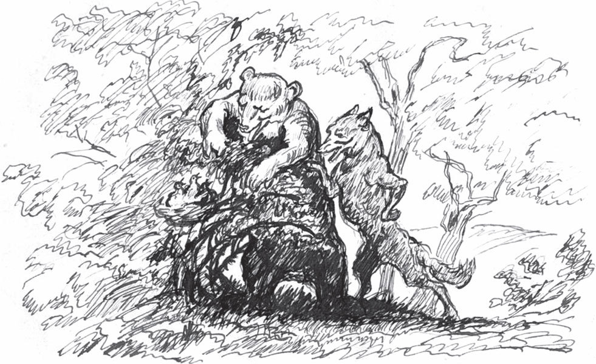

## Der Zaunkönig und der Bär

Einmal im Sommer gingen der Bär und der Wolf im Wald spazieren. Da hörte der Bär einen Vogel, der wunderschön sang, und sagte:

— Bruder Wolf, was ist das für ein Vogel, der so schön singt?

— Das ist der König der Vögel, — sagte der Wolf, — vor dem müssen wir uns verneigen.

Es war aber der <abbr title="der Zaunkönig, die Zaunkönige — крапивник (птичка)">Zaunkönig</abbr>.

— Wenn das so ist, — sagte der Bär, — dann möchte ich auch gern seinen königlichen Palast sehen. Komm und führ mich hin.

— So einfach, wie du denkst, geht das nicht, — sagte der Wolf. — Du musst warten, bis die Frau Königin kommt.

Bald darauf kam die Frau Königin mit Futter im Schnabel, und der Herr König auch. Sie wollten ihre Jungen füttern. Der Bär wäre am liebsten sofort <abbr title="hinterhergehen (ging hinterher, ist hinterhergegangen) — идти следом">hinterhergegangen</abbr>, aber der Wolf hielt ihn am Ärmel fest und sagte:

— Nein, du musst warten, bis Herr und Frau Königin wieder fort sind.

Sie merkten sich also das Loch, in dem das Nest war, und trabten wieder davon. Aber der Bär hatte keine Ruhe. Er wollte den königlichen Palast sehen und ging nach einer kurzen Weile wieder hin. Da waren König und Königin tatsächlich ausgeflogen. Er guckte hinein und sah fünf oder sechs Junge, die darin lagen.

— Das soll der königliche Palast sein? — rief der Bär. — Das ist ein erbärmlicher Palast! Und ihr seid auch keine <abbr title="das Königskind, die Königskinder — королевское дитя">Königskinder</abbr>, ihr seid <abbr title="unehrlich — бесчестный; здесь: незаконнорождённый, «безродный»">unehrliche</abbr> Kinder!

Als die jungen Zaunkönige das hörten, wurden sie furchtbar böse und schrien:

— Nein, das sind wir nicht! Unsere Eltern sind ehrliche Leute! Bär, das wird noch mit dir ausgemacht!

Da bekamen der Bär und der Wolf Angst. Sie kehrten um und setzten sich in ihre Höhlen. Die jungen Zaunkönige aber schrien und lärmten weiter. Als ihre Eltern wieder Futter brachten, sagten sie:

— Wir rühren kein <abbr title="das Fliegenbeinchen, die Fliegenbeinchen — мушиная лапка">Fliegenbeinchen</abbr> an, und wenn wir verhungern müssten, bis ihr ausgemacht habt, ob wir ehrliche Kinder sind oder nicht. Der Bär war hier und hat uns <abbr title="beschimpfen — ругать, оскорблять">beschimpft</abbr>.

Da sagte der alte König:

— Seid nur ruhig, das wird ausgemacht.

Dann flog er mit der Frau Königin zur Höhle des Bären und rief hinein:

— Alter <abbr title="der Brummbär, die Brummbären — ворчун-медведь, Топтыгин">Brummbär</abbr>, warum hast du meine Kinder beschimpft? Das wird dir schlecht bekommen! Das wollen wir in einem blutigen Krieg ausmachen!

So wurde dem Bären der Krieg <abbr title="erklären — объявлять (войну)">erklärt</abbr>. Er rief alle <abbr title="vierbeinig — четвероногий">vierbeinigen</abbr> Tiere zusammen: Ochse, Esel, <abbr title="das Rind, die Rinder — корова, бык (крупный рогатый скот)">Rind</abbr>, Hirsch, Reh und alles, was sonst noch auf der Erde lebt. Der Zaunkönig aber rief alles zusammen, was in der Luft fliegt: nicht nur die Vögel, große und kleine, sondern auch die Mücken, <abbr title="die Hornisse, die Hornissen — шершень">Hornissen</abbr>, Bienen und Fliegen mussten kommen.

Als nun die Zeit kam, in der der Krieg beginnen sollte, schickte der Zaunkönig <abbr title="der Kundschafter, die Kundschafter — лазутчик, разведчик">Kundschafter</abbr> aus. Sie sollten herausfinden, wer der <abbr title="der Oberbefehlshaber, die Oberbefehlshaber — главнокомандующий">Oberbefehlshaber</abbr> des Feindes war. Die Mücke war die listigste von allen. Sie schwirrte im Wald herum, wo der Feind sich <abbr title="sich versammeln — собираться">versammelte</abbr>, und setzte sich endlich unter ein Blatt auf genau dem Baum, unter dem die <abbr title="die Parole, die Parolen — пароль, лозунг">Parole</abbr> ausgegeben wurde. Dort stand der Bär. Er rief den Fuchs zu sich und sagte:

— Fuchs, du bist das schlaueste von allen Tieren. Du sollst General sein und uns <abbr title="anführen — возглавлять, вести">anführen</abbr>.

— Gut, — sagte der Fuchs, — aber was für Zeichen wollen wir verabreden?

Niemand wusste es. Da sagte der Fuchs:

— Ich habe einen schönen, langen, <abbr title="buschig — пушистый">buschigen</abbr> Schwanz. Der sieht fast aus wie ein roter <abbr title="der Federbusch, die Federbüsche — султан из перьев, плюмаж">Federbusch</abbr>. Wenn ich den Schwanz hoch halte, dann läuft die Sache gut, und ihr müsst <abbr title="drauflos — вперёд, напролом">drauflos</abbr> marschieren. Lasse ich ihn aber hängen, dann lauft, so schnell ihr könnt.

Als die Mücke das gehört hatte, flog sie wieder nach Hause und verriet dem Zaunkönig alles <abbr title="haarklein — во всех подробностях">haarklein</abbr>.

Als der Tag anbrach, an dem die Schlacht stattfinden sollte – hu! –, da kamen die vierbeinigen Tiere mit Getöse herangerannt, dass die Erde bebte. Auch der Zaunkönig kam mit seiner <abbr title="die Armee, die Armeen — армия">Armee</abbr> durch die Luft heran. Die <abbr title="surren — жужжать">surrte</abbr>, schrie und schwirrte, dass einem <abbr title="jemandem wird angst und bange — становится страшно">angst und bange</abbr> wurde. Und so gingen die beiden Seiten aufeinander los.

Der Zaunkönig aber schickte die Hornisse hinunter. Sie sollte sich dem Fuchs unter den Schwanz setzen und aus Leibeskräften stechen. Als der Fuchs den ersten Stich bekam, zuckte er so, dass er ein Bein hob. Aber er ertrug es und hielt den Schwanz noch hoch. Beim zweiten Stich musste er ihn einen Augenblick sinken lassen. Beim dritten aber konnte er sich nicht mehr halten. Er schrie auf und <abbr title="klemmen — зажимать">klemmte</abbr> den Schwanz zwischen die Beine. Als die Tiere das sahen, glaubten sie, alles wäre verloren, und fingen an zu laufen, jedes in seine Höhle. So hatten die Vögel die Schlacht gewonnen.

Da flogen der Herr König und die Frau Königin nach Hause zu ihren Kindern und riefen:

— Kinder, freut euch! Esst und trinkt nach Herzenslust, wir haben den Krieg gewonnen!

Aber die jungen Zaunkönige sagten:

— Noch essen wir nicht. Erst soll der Bär vor das Nest kommen und <abbr title="um Verzeihung bitten (bat, hat gebeten) — просить прощения">um Verzeihung bitten</abbr> und sagen, dass wir ehrliche Kinder sind.

Da flog der Zaunkönig vor die Höhle des Bären und rief:

— Brummbär, du sollst vor das Nest zu meinen Kindern gehen und um Verzeihung bitten und sagen, dass sie ehrliche Kinder sind. Sonst werden dir die Rippen im Leib zertreten!

Da kroch der Bär in größter Angst hin und bat um Verzeihung. Erst jetzt waren die jungen Zaunkönige zufrieden. Sie setzten sich zusammen, aßen und tranken und feierten fröhlich bis spät in die Nacht.

---

### Neue Wörter

- **der Zaunkönig, die Zaunkönige** — крапивник (птичка)
- **hinterhergehen (ging hinterher, ist hinterhergegangen)** — идти следом
- **das Königskind, die Königskinder** — королевское дитя
- **unehrlich** — бесчестный; здесь: незаконнорождённый, «безродный»
- **das Fliegenbeinchen, die Fliegenbeinchen** — мушиная лапка
- **beschimpfen** — ругать, оскорблять
- **der Brummbär, die Brummbären** — ворчун-медведь, Топтыгин
- **erklären** — объявлять (войну)
- **vierbeinig** — четвероногий
- **das Rind, die Rinder** — корова, бык (крупный рогатый скот)
- **die Hornisse, die Hornissen** — шершень
- **der Kundschafter, die Kundschafter** — лазутчик, разведчик
- **der Oberbefehlshaber, die Oberbefehlshaber** — главнокомандующий
- **sich versammeln** — собираться
- **die Parole, die Parolen** — пароль, лозунг
- **anführen** — возглавлять, вести
- **buschig** — пушистый
- **der Federbusch, die Federbüsche** — султан из перьев, плюмаж
- **drauflos** — вперёд, напролом
- **haarklein** — во всех подробностях
- **die Armee, die Armeen** — армия
- **surren** — жужжать
- **jemandem wird angst und bange** — становится страшно
- **klemmen** — зажимать
- **um Verzeihung bitten (bat, hat gebeten)** — просить прощения

[← Zurück](kapitel-101.md) · [Inhalt](README.md) · [Weiter →](kapitel-103.md)
