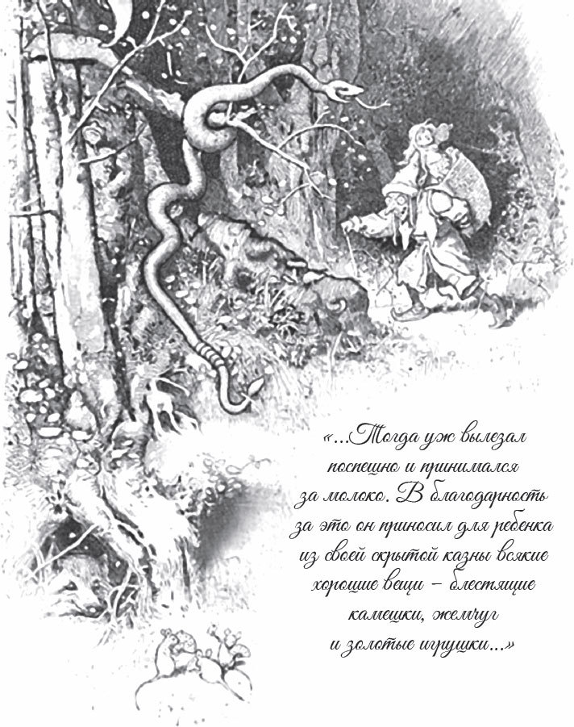

## Märchen von der Unke

### I.

Es war einmal ein kleines Kind. Jeden Nachmittag gab ihm seine Mutter ein <abbr title="das Schüsselchen, die Schüsselchen — мисочка">Schüsselchen</abbr> mit Milch und <abbr title="das Brötchenstückchen, die Brötchenstückchen — кусочки булки">Brötchenstückchen</abbr>, und das Kind setzte sich damit hinaus auf den Hof. Wenn es aber zu essen anfing, kam die <abbr title="die Hausunke, die Hausunken — домашняя жаба (жерлянка), дух-хранитель дома">Hausunke</abbr> aus einem <abbr title="der Mauerritz, die Mauerritze — трещина в стене">Mauerritz</abbr> <abbr title="hervorkriechen (kroch hervor, ist hervorgekrochen) — выползать">hervorgekrochen</abbr>, senkte ihr Köpfchen in die Milch und aß mit. Das Kind hatte seine Freude daran. Und wenn es mit seinem Schüsselchen dasaß und die <abbr title="die Unke, die Unken — жаба, жерлянка">Unke</abbr> nicht gleich kam, dann rief es ihr zu:

> «Unke, Unke, komm geschwind,  
> komm herbei, du kleines Ding,  
> sollst dein Bröckchen haben,  
> an der Milch dich <abbr title="sich laben an + Dat. — услаждаться, подкрепляться">laben</abbr>.»

Dann kam die Unke herbeigelaufen und ließ es sich gut schmecken. Sie zeigte sich auch dankbar: Aus ihrem geheimen Schatz brachte sie dem Kind allerlei schöne Dinge, glänzende Steine, Perlen und goldenes Spielzeug. Die Unke trank aber nur die Milch und ließ die Brocken liegen. Da nahm das Kind einmal sein Löffelchen, schlug ihr damit sanft auf den Kopf und sagte:

— Ding, iss auch Brocken!

Die Mutter, die in der Küche stand, hörte, dass das Kind mit jemandem sprach. Und als sie sah, dass es mit seinem Löffelchen nach einer Unke schlug, lief sie mit einem <abbr title="das Holzscheit, die Holzscheite — полено">Holzscheit</abbr> hinaus und tötete das gute Tier.

Von da an veränderte sich das Kind. Solange die Unke mit ihm gegessen hatte, war es groß und stark geworden. Jetzt aber verlor es seine schönen roten Backen und <abbr title="abmagern — худеть, чахнуть">magerte ab</abbr>. Bald fing in der Nacht der <abbr title="der Totenvogel, die Totenvögel — сыч (птица, предвещающая смерть)">Totenvogel</abbr> an zu schreien, und das <abbr title="das Rotkehlchen, die Rotkehlchen — малиновка">Rotkehlchen</abbr> sammelte Zweiglein und Blätter für einen <abbr title="der Totenkranz, die Totenkränze — погребальный венок">Totenkranz</abbr>. Und bald danach lag das Kind auf der Bahre.

### II.

Ein <abbr title="das Waisenkind, die Waisenkinder — сирота">Waisenkind</abbr> saß an der Stadtmauer und spann. Da sah es, wie eine Unke unten aus einer Öffnung in der Mauer herauskam. Schnell breitete es sein blaues <abbr title="das Seidentuch, die Seidentücher — шёлковый платок">Seidentuch</abbr> neben sich aus. Solche Tücher lieben die Unken sehr, und nur auf sie gehen sie. Sobald die Unke das Tuch sah, kehrte sie um, kam wieder und trug ein kleines goldenes <abbr title="das Krönchen, die Krönchen — коронка, маленькая корона">Krönchen</abbr> herbei. Sie legte es auf das Tuch und ging dann wieder fort. Das Mädchen nahm die Krone. Sie glitzerte und war aus feinem, zartem Goldgespinst. Es dauerte nicht lange, da kam die Unke zum zweiten Mal. Als sie aber die Krone nicht mehr sah, kroch sie an die Wand und schlug vor Leid ihr Köpfchen so lange dagegen, wie sie nur noch Kräfte hatte, bis sie endlich tot dalag. Hätte das Mädchen die Krone liegen lassen, dann hätte die Unke wohl noch mehr von ihren Schätzen aus der Höhle herbeigetragen.

### III.

Die Unke ruft: «Huhu, huhu.» Das Kind sagt: «Komm herut!» – das heißt: «Komm heraus!»

Die Unke kommt heraus. Da fragt das Kind nach seinem Schwesterchen:

— Hast du Rotstrümpfchen nicht gesehen?

Die Unke sagt: «Ne, ik og nit: wie du denn? Huhu, huhu, huhu.» – das heißt: «Nein, ich auch nicht. Wie du denn? Huhu, huhu, huhu.»

---

### Neue Wörter

- **das Schüsselchen, die Schüsselchen** — мисочка
- **das Brötchenstückchen, die Brötchenstückchen** — кусочки булки
- **die Hausunke, die Hausunken** — домашняя жаба (жерлянка), дух-хранитель дома
- **der Mauerritz, die Mauerritze** — трещина в стене
- **hervorkriechen (kroch hervor, ist hervorgekrochen)** — выползать
- **die Unke, die Unken** — жаба, жерлянка
- **sich laben an + Dat.** — услаждаться, подкрепляться
- **das Holzscheit, die Holzscheite** — полено
- **abmagern** — худеть, чахнуть
- **der Totenvogel, die Totenvögel** — сыч (птица, предвещающая смерть)
- **das Rotkehlchen, die Rotkehlchen** — малиновка
- **der Totenkranz, die Totenkränze** — погребальный венок
- **das Waisenkind, die Waisenkinder** — сирота
- **das Seidentuch, die Seidentücher** — шёлковый платок
- **das Krönchen, die Krönchen** — коронка, маленькая корона

[← Zurück](kapitel-104.md) · [Inhalt](README.md) · [Weiter →](kapitel-106.md)
