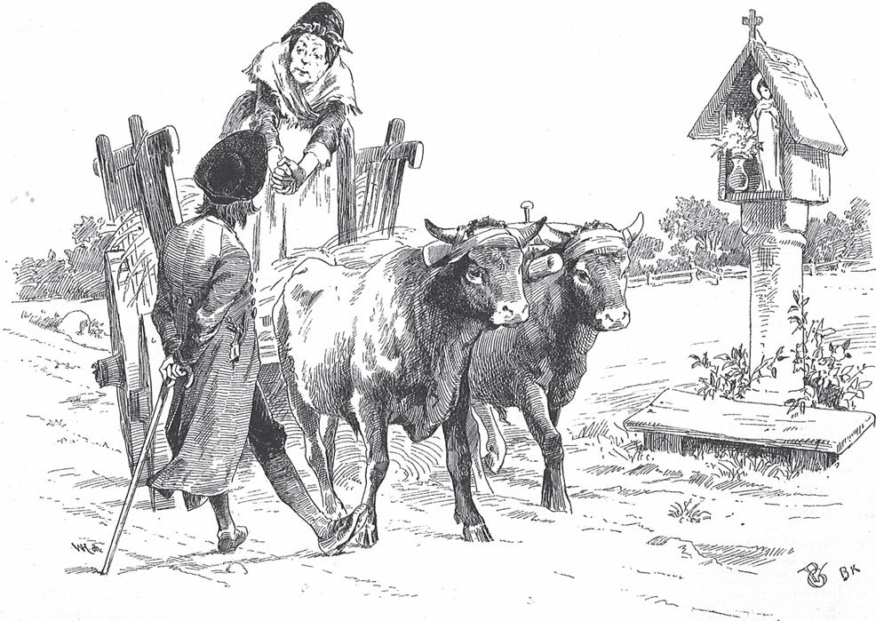
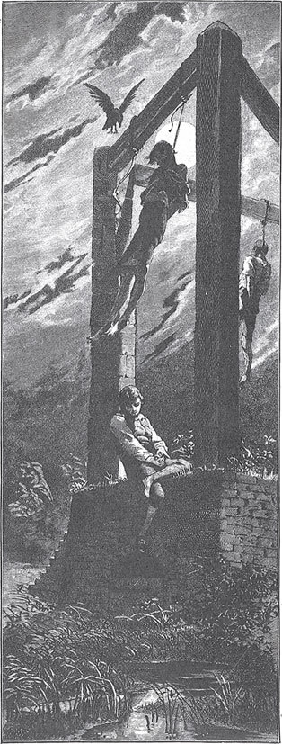

## Die beiden Wanderer

Berg und Tal begegnen sich nicht, wohl aber die Menschenkinder, besonders die guten und die bösen. So trafen sich auch einmal ein Schuster und ein Schneider auf der Wanderschaft. Der Schneider war ein kleiner, hübscher Kerl und immer lustig und guter Dinge. Er sah den Schuster von der anderen Seite herankommen. An seinem <abbr title="das Felleisen, die Felleisen — котомка (дорожный мешок подмастерья)">Felleisen</abbr> erkannte er, was für ein Handwerk der andere hatte, und rief ihm ein <abbr title="das Spottliedchen, die Spottliedchen — насмешливая песенка">Spottliedchen</abbr> zu:

> «Nähe mir die Naht,  
> ziehe mir den <abbr title="der Draht, die Drähte — дратва (сапожная нить)">Draht</abbr>,  
> streich ihn rechts und links mit Pech,  
> schlag, schlag mir fest den <abbr title="der Zweck, die Zwecke (alt: die Zwecke = der Schuhnagel) — сапожный гвоздик">Zweck</abbr>.»

Aber der Schuster verstand keinen Spaß. Er verzog das Gesicht, als hätte er Essig getrunken, und machte Anstalten, das Schneiderlein am Kragen zu packen. Der kleine Kerl aber fing an zu lachen, reichte ihm seine Flasche und sagte:

— Es war nicht böse gemeint. Trink mal und schluck deinen Ärger hinunter.

Der Schuster nahm einen gewaltigen Schluck, und das Gewitter auf seinem Gesicht begann sich zu <abbr title="sich verziehen (verzog, hat verzogen) — рассеиваться (о тучах)">verziehen</abbr>. Er gab dem Schneider die Flasche zurück und sagte:

— Ich habe ihr ordentlich <abbr title="einer Sache zusprechen (sprach zu, hat zugesprochen) — налегать на что-то (о еде, питье)">zugesprochen</abbr>. Man redet ja vom vielen Trinken, aber nicht vom großen Durst. Wollen wir zusammen wandern?

— Mir ist es recht, — antwortete der Schneider, — wenn du nur Lust hast, in eine große Stadt zu gehen, wo es genug Arbeit gibt.

— Genau dahin wollte ich auch, — antwortete der Schuster. — In einem kleinen Nest ist nichts zu verdienen, und auf dem Land gehen die Leute lieber <abbr title="barfuß — босиком">barfuß</abbr>.

Sie wanderten also zusammen weiter und setzten immer einen Fuß vor den anderen wie die <abbr title="das Wiesel, die Wiesel — ласка (зверёк)">Wiesel</abbr> im Schnee.

Zeit hatten beide genug, aber wenig zu beißen und zu brechen. Wenn sie in eine Stadt kamen, gingen sie herum und besuchten die Meister ihres Handwerks. Weil das Schneiderlein so frisch und munter aussah und so hübsche rote Backen hatte, gab ihm jeder gern etwas. Und wenn er Glück hatte, gab ihm die Tochter des Meisters unter der Haustür auch noch einen Kuss auf den Weg. Wenn er dann wieder mit dem Schuster zusammentraf, hatte er immer mehr in seinem Bündel. Der <abbr title="griesgrämig — угрюмый, брюзгливый">griesgrämige</abbr> Schuster zog ein schiefes Gesicht und meinte:

— Je größer der Schelm, desto größer das Glück.

Aber der Schneider fing an zu lachen und zu singen und teilte alles, was er bekam, mit seinem Kameraden. Wenn ein paar Groschen in seiner Tasche klimperten, ließ er sich Essen auftragen und schlug vor Freude auf den Tisch, dass die Gläser tanzten. Bei ihm hieß es: «<abbr title="wie gewonnen, so zerronnen; leicht verdient, leicht vertan — легко пришло, легко ушло">Leicht verdient, leicht vertan</abbr>.»

Als sie eine Zeit lang gewandert waren, kamen sie zu einem großen Wald, durch den der Weg zur Königsstadt führte. Es führten aber zwei Fußwege hindurch. Der eine dauerte sieben Tage, der andere nur zwei, aber keiner von ihnen wusste, welcher der kürzere war. Die beiden Wanderer setzten sich unter eine Eiche und berieten, wie sie vorsorgen und für wie viele Tage sie Brot mitnehmen sollten. Der Schuster sagte:

— Man muss weiter denken, als man geht. Ich nehme für sieben Tage Brot mit.

— Was? — sagte der Schneider. — Für sieben Tage Brot auf dem Rücken schleppen wie ein <abbr title="das Lasttier, die Lasttiere — вьючное животное">Lasttier</abbr> und sich nicht mal umsehen können? Ich halte mich an Gott und kümmere mich um nichts. Das Geld in meiner Tasche ist im Sommer so gut wie im Winter. Aber das Brot wird in der heißen Zeit trocken und obendrein <abbr title="schimmelig — заплесневелый">schimmelig</abbr>. Mein Rock reicht auch nicht weiter als bis zu den <abbr title="der Knöchel, die Knöchel — лодыжка">Knöcheln</abbr>. Warum sollen wir den richtigen Weg nicht finden? Brot für zwei Tage, und damit gut.

Jeder kaufte sich also sein Brot, und dann gingen sie auf gut Glück in den Wald hinein.

Im Wald war es so still wie in einer Kirche. Kein Wind wehte, kein Bach rauschte, kein Vogel sang, und durch die dichten, <abbr title="belaubt — покрытый листвой">belaubten</abbr> Äste drang kein Sonnenstrahl. Der Schuster sprach kein Wort. Das schwere Brot drückte ihn auf dem Rücken, sodass ihm der Schweiß über sein mürrisches, finsteres Gesicht lief. Der Schneider aber war ganz munter. Er sprang umher, pfiff auf einem Blatt oder sang ein Liedchen und dachte: «Gott im Himmel muss sich freuen, dass ich so lustig bin.»

Zwei Tage ging das so. Aber als der Wald am dritten Tag kein Ende nehmen wollte und der Schneider sein Brot aufgegessen hatte, da rutschte ihm das Herz doch eine Elle tiefer. Trotzdem verlor er nicht den Mut, sondern verließ sich auf Gott und auf sein Glück. Am dritten Abend legte er sich hungrig unter einen Baum, und am nächsten Morgen stand er hungrig wieder auf. So ging es auch am vierten Tag. Wenn der Schuster sich auf einen <abbr title="umgestürzt — поваленный">umgestürzten</abbr> Baum setzte und seine Mahlzeit <abbr title="verzehren — съедать, поглощать">verzehrte</abbr>, blieb dem Schneider nichts als das Zusehen. Bat er um ein Stückchen Brot, lachte der andere höhnisch und sagte:

— Du warst immer so lustig, da kannst du auch einmal ausprobieren, wie es ist, wenn man nicht lustig ist. Die Vögel, die morgens zu früh singen, holt abends der <abbr title="der Habicht, die Habichte — ястреб">Habicht</abbr>.

Kurz, er kannte keine <abbr title="die Barmherzigkeit — милосердие">Barmherzigkeit</abbr>.

Am fünften Morgen aber konnte der arme Schneider nicht mehr aufstehen und vor <abbr title="die Schwäche — слабость">Schwäche</abbr> kaum ein Wort herausbringen. Seine Backen waren weiß und seine Augen rot. Da sagte der Schuster zu ihm:

— Ich will dir heute ein Stück Brot geben. Aber dafür steche ich dir dein rechtes Auge aus.

Der unglückliche Schneider wollte doch so gern am Leben bleiben und konnte sich nicht anders helfen. Er weinte noch einmal mit beiden Augen und hielt sie dann hin. Und der Schuster, der ein Herz aus Stein hatte, stach ihm mit einem scharfen Messer das rechte Auge aus. Da fiel dem Schneider ein, was seine Mutter früher immer gesagt hatte, wenn er in der Speisekammer genascht hatte: «Essen, so viel man mag, und leiden, was man muss.»

Als er sein teuer bezahltes Brot gegessen hatte, <abbr title="sich auf die Beine machen — отправиться, двинуться в путь">machte</abbr> er sich wieder auf die Beine, vergaß sein Unglück und tröstete sich damit, dass er mit einem Auge immer noch genug sehen konnte. Aber am sechsten Tag meldete sich der Hunger von Neuem und fraß ihm fast das Herz auf. Am Abend fiel er neben einem Baum zu Boden, und am siebten Morgen konnte er sich vor Schwäche nicht mehr erheben, und der Tod saß ihm schon im <abbr title="der Nacken, die Nacken — затылок, загривок">Nacken</abbr>. Da sagte der Schuster:

— Ich will Barmherzigkeit <abbr title="üben — проявлять (милосердие)">üben</abbr> und dir noch einmal Brot geben. Umsonst bekommst du es aber nicht: Dafür steche ich dir auch das andere Auge aus.

Da erkannte der Schneider, wie <abbr title="leichtsinnig — легкомысленный">leichtsinnig</abbr> er gelebt hatte. Er bat den lieben Gott um Verzeihung und sagte:

— Tu, was du musst, ich will leiden, was ich muss. Aber <abbr title="bedenken (bedachte, hat bedacht) — учитывать, помнить">bedenke</abbr>, dass unser Herrgott nicht jeden Augenblick richtet, und dass eine andere Stunde kommt, in der die böse Tat vergolten wird, die du an mir <abbr title="verüben — совершать (злодеяние)">verübst</abbr> und die ich nicht verdient habe. In guten Tagen habe ich mit dir geteilt, was ich hatte. Mein Handwerk ist so, dass ein Stich den anderen vertreiben muss. Wenn ich keine Augen mehr habe und nicht mehr nähen kann, dann muss ich betteln gehen. Lass mich nur nicht allein hier liegen, wenn ich blind bin, sonst muss ich verschmachten.

Aber der Schuster, der Gott aus seinem Herzen vertrieben hatte, nahm das Messer und stach ihm auch das linke Auge aus. Dann gab er ihm ein Stück Brot zu essen, reichte ihm einen Stock und führte ihn hinter sich her.

Als die Sonne unterging, kamen sie aus dem Wald. Vor dem Wald auf dem Feld stand ein Galgen. Dorthin führte der Schuster den blinden Schneider, ließ ihn liegen und ging seiner Wege. Vor Müdigkeit, Schmerz und Hunger schlief der Unglückliche ein und schlief die ganze Nacht. Als der Tag dämmerte, wachte er auf, wusste aber nicht, wo er lag. Am Galgen hingen zwei arme Sünder, und auf dem Kopf jedes von ihnen saß eine Krähe. Da fing der eine an zu sprechen:

— Bruder, bist du wach?

— Ja, ich bin wach, — antwortete der zweite.

— Dann will ich dir etwas sagen, — fing der erste wieder an. — Der Tau, der heute Nacht über uns vom Galgen heruntergefallen ist, gibt jedem, der sich damit wäscht, die Augen zurück. Wenn das die Blinden wüssten! Wie mancher könnte wieder sehen, der nicht glaubt, dass das möglich ist.

Als der Schneider das hörte, nahm er sein Taschentuch, drückte es auf das Gras, und als es vom Tau <abbr title="feucht — влажный">feucht</abbr> war, wusch er sich damit die <abbr title="die Augenhöhle, die Augenhöhlen — глазница">Augenhöhlen</abbr>. Sofort ging in Erfüllung, was der Gehenkte gesagt hatte: Ein Paar frische, gesunde Augen füllte die Höhlen. Es dauerte nicht lange, da sah der Schneider die Sonne hinter den Bergen aufsteigen. Vor ihm in der <abbr title="die Ebene, die Ebenen — равнина">Ebene</abbr> lag die große Königsstadt mit ihren prächtigen Toren und hundert Türmen, und die goldenen Kugeln und Kreuze auf den Spitzen fingen an zu glühen. Er konnte jedes Blatt an den Bäumen <abbr title="unterscheiden (unterschied, hat unterschieden) — различать">unterscheiden</abbr>, er sah die Vögel, die vorbeiflogen, und die Mücken, die in der Luft tanzten. Er holte eine Nähnadel aus der Tasche, und als er den Faden <abbr title="einfädeln — вдевать нитку">einfädeln</abbr> konnte, so gut wie früher, da sprang ihm das Herz vor Freude. Er warf sich auf die Knie, dankte Gott für die Gnade, die ihm erwiesen worden war, und sprach sein <abbr title="das Morgengebet, die Morgengebete — утренняя молитва">Morgengebet</abbr>. Er vergaß auch nicht, für die armen Sünder zu beten, die da hingen wie der <abbr title="der Klöppel, die Klöppel — язык колокола">Klöppel</abbr> in der Glocke und die der Wind gegeneinanderschlug. Dann nahm er sein Bündel auf den Rücken, vergaß bald das <abbr title="das Herzeleid — сердечная боль, горе">Herzeleid</abbr>, das er <abbr title="ausstehen (stand aus, hat ausgestanden) — вытерпеть">ausgestanden</abbr> hatte, und ging singend und pfeifend weiter.

Das Erste, was ihm begegnete, war ein braunes Fohlen, das frei auf dem Feld herumsprang. Er packte es an der Mähne und wollte <abbr title="sich hinaufschwingen (schwang hinauf, hat hinaufgeschwungen) — вскочить (на коня)">sich hinaufschwingen</abbr> und in die Stadt reiten. Aber das Fohlen bat um seine Freiheit:

— Ich bin noch zu jung, — sagte es. — Sogar ein leichter Schneider wie du bricht mir den Rücken entzwei. Lass mich laufen, bis ich stark geworden bin. Vielleicht kommt eine Zeit, in der ich es dir lohnen kann.

— Lauf nur, — sagte der Schneider. — Ich sehe, du bist auch so ein <abbr title="der Springinsfeld — попрыгунчик, ветрогон">Springinsfeld</abbr>.

Er gab ihm noch einen Schlag mit der Gerte über den Rücken, sodass es vor Freude mit den Hinterbeinen <abbr title="ausschlagen (schlug aus, hat ausgeschlagen) — брыкаться, лягаться">ausschlug</abbr>, über Hecken und Gräben sprang und ins Feld hineinjagte.

Aber das Schneiderlein hatte seit gestern nichts gegessen.

— Die Sonne, — sagte er, — füllt mir zwar die Augen, aber das Brot nicht den Mund. Das Erste, was mir begegnet und halbwegs <abbr title="essbar — съедобный">essbar</abbr> ist, muss <abbr title="herhalten müssen (hielt her, hat hergehalten) — поплатиться, пойти в дело">herhalten</abbr>.

Da schritt ein <abbr title="der Storch, die Störche — аист">Storch</abbr> ganz ernsthaft über die Wiese.

— Halt, halt! — rief der Schneider und packte ihn am Bein. — Ich weiß nicht, ob man dich essen kann, aber mein Hunger lässt mir keine lange Wahl. Ich muss dir den Kopf abschneiden und dich braten.

— Tu das nicht, — antwortete der Storch. — Ich bin ein <abbr title="heilig — священный, святой">heiliger</abbr> Vogel, dem niemand ein Leid <abbr title="zufügen — причинять">zufügt</abbr>, und ich bringe den Menschen großen Nutzen. Wenn du mir mein Leben lässt, kann ich es dir ein andermal vergelten.

— Dann zieh ab, Vetter <abbr title="der Langbein — длинноногий">Langbein</abbr>, — sagte der Schneider.

Der Storch erhob sich, ließ die langen Beine hängen und flog <abbr title="gemächlich — неспешно">gemächlich</abbr> davon.

«Was soll daraus werden?», sagte der Schneider zu sich selbst. «Mein Hunger wird immer größer und mein Magen immer leerer. Was mir jetzt in den Weg kommt, das ist verloren.»

Da sah er auf einem Teich ein paar junge Enten schwimmen.

— Ihr kommt ja wie gerufen, — sagte er, packte eine davon und wollte ihr den Hals <abbr title="umdrehen — свернуть (шею)">umdrehen</abbr>.

Da fing eine alte Ente, die im Schilf saß, laut an zu kreischen. Sie schwamm mit weit aufgerissenem Schnabel herbei und bat ihn flehentlich, <abbr title="sich erbarmen + Gen. — сжалиться над">sich</abbr> ihrer lieben Kinder zu erbarmen.

— Denkst du nicht daran, — sagte sie, — wie deine Mutter jammern würde, wenn dich einer wegholen und dir den Garaus machen wollte?

— Sei nur still, — sagte der gutmütige Schneider, — du sollst deine Kinder behalten.

Und er setzte die Gefangene wieder ins Wasser.

Als er sich umdrehte, stand er vor einem alten Baum, der halb hohl war, und sah die wilden Bienen hinaus- und hineinfliegen.

— Da finde ich gleich den Lohn für meine gute Tat, — sagte der Schneider. — Der Honig wird mich <abbr title="stärken — подкреплять">stärken</abbr>.

Aber die Bienenkönigin kam heraus, drohte ihm und sagte:

— Wenn du mein Volk anrührst und mein Nest <abbr title="zerstören — разрушать">zerstörst</abbr>, dann sollen dir unsere Stacheln wie zehntausend glühende Nadeln in die Haut fahren. Wenn du uns aber in Ruhe lässt und deiner Wege gehst, dann wollen wir dir ein andermal dafür einen <abbr title="einen Dienst leisten — оказать услугу">Dienst</abbr> leisten.

Das Schneiderlein sah, dass auch hier nichts zu machen war.

— Drei Schüsseln leer, — sagte er, — und auf der vierten nichts – das ist eine schlechte Mahlzeit.

Er schleppte sich also mit seinem <abbr title="ausgehungert — изголодавшийся">ausgehungerten</abbr> Magen in die Stadt. Und weil es gerade zu Mittag läutete, war im Gasthaus schon für ihn gekocht, und er konnte sich gleich zu Tisch setzen. Als er satt war, sagte er:

— Jetzt will ich auch arbeiten.

Er ging in der Stadt herum, suchte einen Meister und fand auch bald eine gute Stelle. Und weil er sein Handwerk <abbr title="von Grund auf — основательно, досконально">von Grund auf</abbr> gelernt hatte, dauerte es nicht lange, bis er berühmt wurde. Jeder wollte seinen neuen Rock von dem kleinen Schneider machen lassen. Jeden Tag wuchs sein Ansehen.

— Besser kann ich in meiner Kunst nicht werden, — sagte er, — und doch geht es jeden Tag besser.

Endlich machte ihn der König zu seinem <abbr title="der Hofschneider, die Hofschneider — придворный портной">Hofschneider</abbr>.

Aber wie es in der Welt so geht: Am selben Tag war sein früherer Kamerad, der Schuster, <abbr title="der Hofschuster, die Hofschuster — придворный сапожник">Hofschuster</abbr> geworden. Als er den Schneider sah und bemerkte, dass er wieder zwei gesunde Augen hatte, quälte ihn das Gewissen. «Bevor er sich an mir rächt», dachte er, «muss ich ihm eine <abbr title="die Grube, die Gruben — яма">Grube</abbr> graben.» Aber <abbr title="wer anderen eine Grube gräbt, fällt selbst hinein — не рой другому яму — сам в неё попадёшь">wer anderen eine Grube gräbt, fällt selbst hinein</abbr>.

Am Abend, als er Feierabend gemacht hatte und es dunkel geworden war, schlich er sich zum König und sagte:

— Herr König, der Schneider ist ein übermütiger Mensch. Er hat <abbr title="sich rühmen — хвастаться">sich gerühmt</abbr>, er könne die goldene Krone wieder herbeischaffen, die vor langer Zeit verloren gegangen ist.

— Das wäre mir sehr lieb, — sagte der König. Er ließ den Schneider am nächsten Morgen zu sich rufen und befahl ihm, die Krone wieder herbeizuschaffen oder die Stadt für immer zu verlassen.

«Oho», dachte der Schneider, «nur ein Schelm gibt mehr, als er hat. Wenn der mürrische König von mir verlangt, was kein Mensch <abbr title="leisten — выполнить, осилить">leisten</abbr> kann, dann warte ich nicht bis morgen, sondern wandere gleich heute wieder aus der Stadt hinaus.»

Er schnürte also sein Bündel. Aber als er aus dem Tor heraus war, tat es ihm doch leid, dass er sein Glück aufgeben und der Stadt, in der es ihm so gut gegangen war, den Rücken kehren sollte. Er kam zu dem Teich, wo er die Enten kennengelernt hatte. Da saß gerade die Alte, der er ihre Jungen gelassen hatte, am Ufer und putzte sich mit dem Schnabel. Sie erkannte ihn sofort und fragte, warum er den Kopf so hängen lasse.

— Du wirst dich nicht wundern, wenn du hörst, was mir passiert ist, — antwortete der Schneider und erzählte ihr sein Schicksal.

— Wenn es weiter nichts ist, — sagte die Ente, — da wissen wir <abbr title="Rat wissen — знать, что делать">Rat</abbr>. Die Krone ist ins Wasser gefallen und liegt unten auf dem Grund. Die haben wir schnell wieder heraufgeholt. Breite nur in der Zwischenzeit dein Taschentuch am Ufer aus.

Sie tauchte mit ihren zwölf Jungen unter, und nach fünf Minuten war sie wieder oben. Sie saß mitten in der Krone, die auf ihren Flügeln ruhte, und die zwölf Jungen schwammen rundherum, hatten ihre Schnäbel daruntergeschoben und halfen tragen. Sie schwammen ans Land und legten die Krone auf das Tuch. Du glaubst nicht, wie prächtig die Krone war! Wenn die Sonne darauf schien, glänzte sie wie hunderttausend <abbr title="der Karfunkelstein, die Karfunkelsteine — карбункул, рубин">Karfunkelsteine</abbr>. Der Schneider band sein Tuch an den vier <abbr title="der Zipfel, die Zipfel — кончик, уголок">Zipfeln</abbr> zusammen und trug die Krone zum König. Der freute sich so sehr, dass er dem Schneider eine goldene Kette um den Hals hängte.

Als der Schuster sah, dass sein erster Streich <abbr title="misslingen (misslang, ist misslungen) — не удаваться">misslungen</abbr> war, dachte er sich einen zweiten aus. Er trat vor den König und sagte:

— Herr König, der Schneider ist wieder so übermütig geworden. Er behauptet, er könne das ganze königliche Schloss mit allem, was darin ist, <abbr title="lose und fest — всё движимое и недвижимое">lose und fest</abbr>, innen und außen, in <abbr title="das Wachs — воск">Wachs</abbr> <abbr title="nachbilden — воспроизводить, лепить копию">nachbilden</abbr>.

Der König ließ den Schneider kommen und befahl ihm, das ganze königliche Schloss mit allem, was darin sei, lose und fest, innen und außen, in Wachs nachzubilden. Und wenn er das nicht schaffe oder auch nur ein Nagel an der Wand fehle, dann solle er sein Leben lang unter der Erde gefangen sitzen.

«Es wird immer schlimmer», dachte der Schneider, «das hält kein Mensch aus.» Er warf sein Bündel auf den Rücken und wanderte fort. Als er zu dem hohlen Baum kam, setzte er sich hin und ließ den Kopf hängen. Die Bienen kamen herausgeflogen, und die Bienenkönigin fragte ihn, ob er einen steifen Hals habe, weil er den Kopf so schief halte.

— Ach nein, — antwortete der Schneider, — mich <abbr title="bedrücken — угнетать, тяготить">bedrückt</abbr> etwas anderes.

Und er erzählte, was der König von ihm gefordert hatte. Die Bienen fingen an, untereinander zu <abbr title="summen — жужжать">summen</abbr> und zu brummen, und die Bienenkönigin sagte:

— Geh nur wieder nach Hause. Aber komm morgen um diese Zeit wieder und bring ein großes Tuch mit, dann wird alles gut.

Da kehrte er wieder um. Die Bienen aber flogen zum königlichen Schloss, direkt in die offenen Fenster hinein, krochen in allen Ecken herum und sahen sich alles <abbr title="aufs Genaueste — самым тщательным образом">aufs Genaueste</abbr> an. Dann flogen sie zurück und bildeten das Schloss in Wachs nach, und zwar so schnell, dass man meinte, es wüchse einem vor den Augen. Schon am Abend war alles fertig. Als der Schneider am nächsten Morgen kam, stand das ganze prächtige <abbr title="das Gebäude, die Gebäude — здание">Gebäude</abbr> da. Es fehlte kein Nagel an der Wand und kein Ziegel auf dem Dach. Dabei war es zart und schneeweiß und roch süß wie Honig. Der Schneider packte es vorsichtig in sein Tuch und brachte es dem König. Der konnte sich gar nicht genug wundern. Er stellte es in seinem größten Saal auf und schenkte dem Schneider dafür ein großes steinernes Haus.

Aber der Schuster gab nicht auf. Er ging zum dritten Mal zum König und sagte:

— Herr König, der Schneider hat gehört, dass auf dem Schlosshof kein Wasser <abbr title="sprudeln — бить ключом">sprudeln</abbr> will. Da hat er sich gerühmt, er könne es mitten im Hof <abbr title="mannshoch — в человеческий рост">mannshoch</abbr> aufsteigen lassen, und es solle hell sein wie Kristall.

Da ließ der König den Schneider holen und sagte:

— Wenn morgen in meinem Hof kein <abbr title="der Wasserstrahl, die Wasserstrahlen — струя воды">Wasserstrahl</abbr> springt, wie du versprochen hast, dann soll dich der <abbr title="der Henker, die Henker — палач">Henker</abbr> auf demselben Hof <abbr title="jemanden einen Kopf kürzer machen — отрубить голову">einen Kopf kürzer machen</abbr>.

Der arme Schneider überlegte nicht lange und eilte zum Tor hinaus. Und weil es diesmal um sein Leben ging, rollten ihm die Tränen über die Backen. Während er so voller Trauer dahinging, kam das Fohlen herangesprungen, dem er einmal die Freiheit geschenkt hatte. Inzwischen war aus ihm ein hübscher <abbr title="der Braune, die Braunen — гнедой конь">Brauner</abbr> geworden.

— Jetzt kommt die Stunde, — sagte es zu ihm, — in der ich dir deine gute Tat vergelten kann. Ich weiß schon, was dir fehlt, aber dir soll bald geholfen werden. Steig nur auf, mein Rücken kann zwei von deiner Sorte tragen.

Da bekam der Schneider wieder Mut. Er sprang mit einem Satz auf, und das Pferd rannte im vollen <abbr title="der Galopp — галоп">Galopp</abbr> in die Stadt hinein und direkt auf den Schlosshof. Da jagte es dreimal rundherum, schnell wie der Blitz, und beim dritten Mal stürzte es zu Boden. In diesem Augenblick aber krachte es furchtbar: Ein Stück Erde sprang in der Mitte des Hofes wie eine <abbr title="die Kanonenkugel, die Kanonenkugeln — пушечное ядро">Kanonenkugel</abbr> in die Luft und über das Schloss hinaus, und gleich dahinter stieg ein Wasserstrahl auf, so hoch wie Ross und Reiter. Das Wasser war so klar wie Kristall, und die Sonnenstrahlen fingen an, darauf zu tanzen. Als der König das sah, stand er vor Verwunderung auf, ging hin und umarmte das Schneiderlein vor den Augen aller Leute.

Aber das Glück dauerte nicht lange. Der König hatte Töchter genug, eine schöner als die andere, aber keinen Sohn. Da ging der boshafte Schuster zum vierten Mal zum König und sagte:

— Herr König, der Schneider lässt nicht von seinem Übermut ab. Jetzt hat er sich gerühmt, wenn er wolle, könne er dem Herrn König einen Sohn durch die Luft herbeitragen lassen.

Der König ließ den Schneider rufen und sagte:

— Wenn du mir <abbr title="innerhalb + Gen. — в течение">innerhalb</abbr> von neun Tagen einen Sohn bringen lässt, dann sollst du meine älteste Tochter zur Frau haben.

«Der Lohn ist freilich groß», dachte das Schneiderlein, «dafür würde man schon etwas mehr tun. Aber die Kirschen hängen mir zu hoch. Wenn ich danach klettere, bricht unter mir der Ast, und ich falle hinunter.»

Er ging nach Hause, setzte sich mit <abbr title="kreuzen — скрещивать">gekreuzten</abbr> Beinen auf seinen Arbeitstisch und überlegte, was zu tun sei.

— Es geht nicht, — rief er endlich, — ich muss fort. Hier kann ich doch nicht in Ruhe leben.

Er schnürte sein Bündel und eilte zum Tor hinaus. Als er auf die Wiesen kam, sah er seinen alten Freund, den Storch. Der ging da wie ein <abbr title="der Philosoph, die Philosophen — философ">Philosoph</abbr> auf und ab, blieb manchmal stehen, nahm einen Frosch genauer <abbr title="in Augenschein nehmen — рассмотреть, осмотреть">in Augenschein</abbr> und verschluckte ihn schließlich. Der Storch kam heran und begrüßte ihn.

— Ich sehe, — fing er an, — du hast deinen Ranzen auf dem Rücken. Warum willst du die Stadt verlassen?

Der Schneider erzählte ihm, was der König von ihm verlangt hatte und was er nicht erfüllen konnte, und jammerte über sein <abbr title="das Missgeschick, die Missgeschicke — невезение, злоключение">Missgeschick</abbr>.

— <abbr title="sich keine grauen Haare wachsen lassen — не переживай из-за этого">Lass dir darüber keine grauen Haare wachsen</abbr>, — sagte der Storch. — Ich will dir aus der Not helfen. Schon lange bringe ich die <abbr title="das Wickelkind, die Wickelkinder — младенец в пелёнках">Wickelkinder</abbr> in die Stadt, da kann ich auch einmal einen kleinen Prinzen aus dem Brunnen holen. Geh nach Hause und <abbr title="sich verhalten (verhielt, hat verhalten) — вести себя">verhalte dich</abbr> ruhig. Heute in neun Tagen geh in das königliche Schloss, dann komme ich.

Das Schneiderlein ging nach Hause und war zur rechten Zeit im Schloss. Nicht lange danach kam der Storch herangeflogen und klopfte ans Fenster. Der Schneider öffnete ihm, und Vetter Langbein stieg vorsichtig herein und ging mit <abbr title="würdevoll — величавый, важный">würdevollen</abbr> Schritten über den glatten <abbr title="der Marmorboden, die Marmorböden — мраморный пол">Marmorboden</abbr>. Im Schnabel aber hatte er ein Kind, so schön wie ein Engel, das seine Händchen nach der Königin ausstreckte. Er legte es ihr in den Schoß, und sie <abbr title="herzen — ласкать, обнимать">herzte</abbr> und küsste es und war vor Freude außer sich. Bevor der Storch wieder wegflog, nahm er seine <abbr title="die Reisetasche, die Reisetaschen — дорожная сумка">Reisetasche</abbr> von der Schulter und <abbr title="überreichen — вручать">überreichte</abbr> sie der Königin. Darin steckten <abbr title="die Tüte, die Tüten — кулёк, пакетик">Tüten</abbr> mit bunten Zuckererbsen, die unter die kleinen Prinzessinnen verteilt wurden. Die älteste aber bekam nichts davon, sondern bekam den lustigen Schneider zum Mann.

— Mir ist geradeso, — sagte der Schneider, — als hätte ich das <abbr title="das große Los ziehen — вытянуть главный выигрыш">große Los</abbr> gezogen. Meine Mutter hatte doch recht. Sie sagte immer: Wer auf Gott <abbr title="vertrauen auf + Akk. — доверять, уповать на">vertraut</abbr> und nur Glück hat, dem kann es nicht fehlen.

Der Schuster musste die Schuhe machen, in denen das Schneiderlein auf dem Hochzeitsfest tanzte. Danach wurde ihm befohlen, die Stadt für immer zu verlassen. Der Weg zum Wald führte ihn zu dem Galgen. Müde von Zorn, Wut und der Hitze des Tages warf er sich hin. Als er die Augen zumachte und schlafen wollte, <abbr title="herabstürzen — ринуться вниз">stürzten</abbr> die beiden Krähen mit lautem Geschrei von den Köpfen der Gehenkten herab und <abbr title="aushacken — выклевать">hackten</abbr> ihm die Augen aus. Wie <abbr title="wahnsinnig — обезумевший">wahnsinnig</abbr> rannte er in den Wald und muss dort verschmachtet sein, denn niemand hat ihn je wiedergesehen oder etwas von ihm gehört.

---

### Neue Wörter

- **das Felleisen, die Felleisen** — котомка (дорожный мешок подмастерья)
- **das Spottliedchen, die Spottliedchen** — насмешливая песенка
- **der Draht, die Drähte** — дратва (сапожная нить)
- **der Zweck, die Zwecke (alt: die Zwecke = der Schuhnagel)** — сапожный гвоздик
- **sich verziehen (verzog, hat verzogen)** — рассеиваться (о тучах)
- **einer Sache zusprechen (sprach zu, hat zugesprochen)** — налегать на что-то (о еде, питье)
- **barfuß** — босиком
- **das Wiesel, die Wiesel** — ласка (зверёк)
- **griesgrämig** — угрюмый, брюзгливый
- **wie gewonnen, so zerronnen; leicht verdient, leicht vertan** — легко пришло, легко ушло
- **das Lasttier, die Lasttiere** — вьючное животное
- **schimmelig** — заплесневелый
- **der Knöchel, die Knöchel** — лодыжка
- **belaubt** — покрытый листвой
- **umgestürzt** — поваленный
- **verzehren** — съедать, поглощать
- **der Habicht, die Habichte** — ястреб
- **die Barmherzigkeit** — милосердие
- **die Schwäche** — слабость
- **sich auf die Beine machen** — отправиться, двинуться в путь
- **der Nacken, die Nacken** — затылок, загривок
- **üben** — проявлять (милосердие)
- **leichtsinnig** — легкомысленный
- **bedenken (bedachte, hat bedacht)** — учитывать, помнить
- **verüben** — совершать (злодеяние)
- **feucht** — влажный
- **die Augenhöhle, die Augenhöhlen** — глазница
- **die Ebene, die Ebenen** — равнина
- **unterscheiden (unterschied, hat unterschieden)** — различать
- **einfädeln** — вдевать нитку
- **das Morgengebet, die Morgengebete** — утренняя молитва
- **der Klöppel, die Klöppel** — язык колокола
- **das Herzeleid** — сердечная боль, горе
- **ausstehen (stand aus, hat ausgestanden)** — вытерпеть
- **sich hinaufschwingen (schwang hinauf, hat hinaufgeschwungen)** — вскочить (на коня)
- **der Springinsfeld** — попрыгунчик, ветрогон
- **ausschlagen (schlug aus, hat ausgeschlagen)** — брыкаться, лягаться
- **essbar** — съедобный
- **herhalten müssen (hielt her, hat hergehalten)** — поплатиться, пойти в дело
- **der Storch, die Störche** — аист
- **heilig** — священный, святой
- **zufügen** — причинять
- **der Langbein** — длинноногий
- **gemächlich** — неспешно
- **umdrehen** — свернуть (шею)
- **sich erbarmen + Gen.** — сжалиться над
- **stärken** — подкреплять
- **zerstören** — разрушать
- **einen Dienst leisten** — оказать услугу
- **ausgehungert** — изголодавшийся
- **von Grund auf** — основательно, досконально
- **der Hofschneider, die Hofschneider** — придворный портной
- **der Hofschuster, die Hofschuster** — придворный сапожник
- **die Grube, die Gruben** — яма
- **wer anderen eine Grube gräbt, fällt selbst hinein** — не рой другому яму — сам в неё попадёшь
- **sich rühmen** — хвастаться
- **leisten** — выполнить, осилить
- **Rat wissen** — знать, что делать
- **der Karfunkelstein, die Karfunkelsteine** — карбункул, рубин
- **der Zipfel, die Zipfel** — кончик, уголок
- **misslingen (misslang, ist misslungen)** — не удаваться
- **lose und fest** — всё движимое и недвижимое
- **das Wachs** — воск
- **nachbilden** — воспроизводить, лепить копию
- **bedrücken** — угнетать, тяготить
- **summen** — жужжать
- **aufs Genaueste** — самым тщательным образом
- **das Gebäude, die Gebäude** — здание
- **sprudeln** — бить ключом
- **mannshoch** — в человеческий рост
- **der Wasserstrahl, die Wasserstrahlen** — струя воды
- **der Henker, die Henker** — палач
- **jemanden einen Kopf kürzer machen** — отрубить голову
- **der Braune, die Braunen** — гнедой конь
- **der Galopp** — галоп
- **die Kanonenkugel, die Kanonenkugeln** — пушечное ядро
- **innerhalb + Gen.** — в течение
- **kreuzen** — скрещивать
- **der Philosoph, die Philosophen** — философ
- **in Augenschein nehmen** — рассмотреть, осмотреть
- **das Missgeschick, die Missgeschicke** — невезение, злоключение
- **sich keine grauen Haare wachsen lassen** — не переживай из-за этого
- **das Wickelkind, die Wickelkinder** — младенец в пелёнках
- **sich verhalten (verhielt, hat verhalten)** — вести себя
- **würdevoll** — величавый, важный
- **der Marmorboden, die Marmorböden** — мраморный пол
- **herzen** — ласкать, обнимать
- **die Reisetasche, die Reisetaschen** — дорожная сумка
- **überreichen** — вручать
- **die Tüte, die Tüten** — кулёк, пакетик
- **das große Los ziehen** — вытянуть главный выигрыш
- **vertrauen auf + Akk.** — доверять, уповать на
- **herabstürzen** — ринуться вниз
- **aushacken** — выклевать
- **wahnsinnig** — обезумевший

[← Zurück](kapitel-106.md) · [Inhalt](README.md) · [Weiter →](kapitel-108.md)
