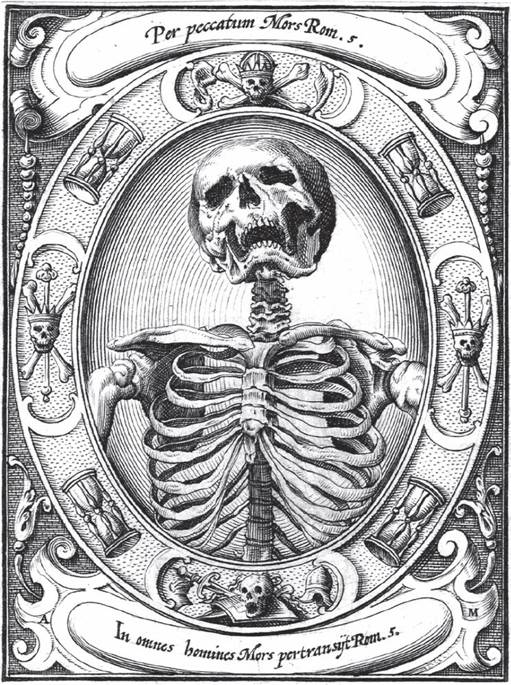

## Das Totenhemdchen

Es war einmal eine Mutter, die hatte einen kleinen Jungen von sieben Jahren. Er war so schön und lieblich, dass niemand ihn ansehen konnte, ohne ihn gern zu haben. Und sie liebte ihn mehr als alles auf der Welt. Da geschah es, dass er plötzlich krank wurde, und der liebe Gott nahm ihn zu sich. Darüber konnte die Mutter sich nicht trösten, und sie weinte Tag und Nacht.

Bald darauf, nachdem man ihn begraben hatte, erschien das Kind nachts an den Plätzen, wo es früher im Leben gesessen und gespielt hatte. Wenn die Mutter weinte, dann weinte es auch, und wenn der Morgen kam, war es verschwunden. Aber die Mutter wollte gar nicht aufhören zu weinen. Da kam es eines Nachts in seinem weißen <abbr title="das Totenhemdchen, die Totenhemdchen — погребальная рубашечка, саван">Totenhemdchen</abbr>, in dem man es in den Sarg gelegt hatte, und mit dem kleinen Kranz auf dem Kopf. Es setzte sich zu ihren Füßen auf das Bett und sagte:

— Ach, Mutter, hör doch auf zu weinen! Sonst kann ich in meinem Sarg nicht einschlafen. Denn mein Totenhemdchen wird nicht trocken von deinen Tränen, die alle darauf fallen.

Als die Mutter das hörte, erschrak sie und weinte nicht mehr. In der nächsten Nacht kam das Kind wieder. Es hielt ein kleines Licht in der Hand und sagte:

— Siehst du, jetzt ist mein Hemdchen bald trocken, und ich habe Ruhe in meinem Grab.

Da vertraute die Mutter dem lieben Gott ihr Leid an und ertrug es still und geduldig. Und das Kind kam nicht wieder, sondern schlief in seinem kleinen Bett unter der Erde.

---

### Neue Wörter

- **das Totenhemdchen, die Totenhemdchen** — погребальная рубашечка, саван

[← Zurück](kapitel-108.md) · [Inhalt](README.md) · [Weiter →](kapitel-110.md)
