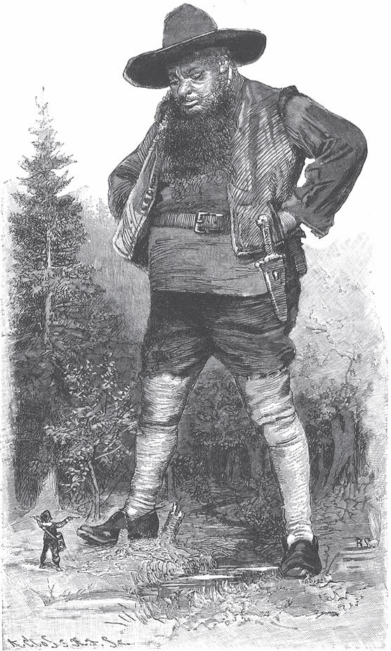

## Der gelernte Jäger

Es war einmal ein junger Bursche, der hatte das <abbr title="das Schlosserhandwerk — слесарное ремесло">Schlosserhandwerk</abbr> gelernt. Er sagte zu seinem Vater, er wollte jetzt in die Welt gehen und sein Glück versuchen.

— Ja, — sagte der Vater, — damit bin ich einverstanden.

Und er gab ihm etwas Geld für die Reise. So zog der Bursche herum und suchte Arbeit. Nach einer Zeit gelang ihm die Schlosserarbeit nicht mehr, und sie gefiel ihm auch nicht mehr. Stattdessen bekam er Lust auf die Jagd. Da begegnete ihm auf seiner Wanderschaft ein Jäger in grüner Kleidung. Der fragte, woher er käme und wohin er wollte. Der Bursche sagte, er wäre ein <abbr title="der Schlossergeselle, die Schlossergesellen — подмастерье слесаря">Schlossergeselle</abbr>, aber das Handwerk gefiele ihm nicht mehr. Er hätte Lust auf die Jagd. Ob der Jäger ihn als <abbr title="der Lehrling, die Lehrlinge — ученик (ремесла)">Lehrling</abbr> nehmen wollte?

— O ja, wenn du mit mir gehen willst.

Da ging der junge Bursche mit. Er <abbr title="sich verdingen — наняться">verdingte sich</abbr> für einige Jahre bei ihm und lernte die Jagd. Danach wollte er sein Glück anderswo versuchen. Der Jäger gab ihm als Lohn nichts außer einer <abbr title="die Windbüchse, die Windbüchsen — духовое ружьё">Windbüchse</abbr>. Aber diese Büchse hatte eine besondere Eigenschaft: Wenn er damit schoss, traf er <abbr title="unfehlbar — безошибочно, без промаха">unfehlbar</abbr>.

Er ging fort und kam in einen sehr großen Wald, dessen Ende er an einem Tag nicht finden konnte. Als es Abend wurde, setzte er sich auf einen hohen Baum, um vor den wilden Tieren sicher zu sein. Gegen Mitternacht schien es ihm, als ob in der Ferne ein kleines Licht schimmerte. Er sah durch die Äste dorthin und merkte sich, wo es war. Aber zuerst nahm er seinen Hut und warf ihn in Richtung des Lichts hinunter. Der Hut sollte ihm als Zeichen dienen, wenn er unten war. Dann kletterte er hinunter, ging zu seinem Hut, setzte ihn wieder auf und ging geradeaus weiter.

Je weiter er ging, desto größer wurde das Licht. Als er nahe herankam, sah er, dass es ein gewaltiges Feuer war. Daneben saßen drei Riesen, die hatten einen Ochsen am Spieß und brieten ihn. Da sagte der eine:

— Ich muss doch mal probieren, ob das Fleisch bald fertig ist.

Er riss ein Stück ab und wollte es in den Mund stecken, aber der Jäger schoss es ihm aus der Hand.

— Na so was, — sagte der Riese, — da weht mir der Wind das Stück aus der Hand.

Und er nahm sich ein anderes. Gerade als er <abbr title="hineinbeißen (biss hinein, hat hineingebissen) — откусить">hineinbeißen</abbr> wollte, schoss es ihm der Jäger wieder weg. Da gab der Riese dem, der neben ihm saß, eine Ohrfeige und rief zornig:

— Was reißt du mir mein Stück weg?

— Ich habe es nicht weggerissen, — sagte der andere. — Das hat dir bestimmt ein <abbr title="der Scharfschütze, die Scharfschützen — меткий стрелок, снайпер">Scharfschütze</abbr> weggeschossen.

Der Riese nahm sich das dritte Stück, aber auch das konnte er nicht in der Hand behalten: Der Jäger schoss es ihm heraus. Da sagten die Riesen:

— Das muss ein guter <abbr title="der Schütze, die Schützen — стрелок">Schütze</abbr> sein, der einem den Bissen vor dem Maul wegschießt. So einer wäre nützlich für uns.

Und sie riefen laut:

— Komm her, du Scharfschütze, setz dich zu uns ans Feuer und iss dich satt! Wir tun dir nichts. Aber wenn du nicht kommst und wir dich <abbr title="mit Gewalt — силой">mit Gewalt</abbr> holen müssen, dann bist du verloren.

Da trat der Bursche näher und sagte, er wäre ein gelernter Jäger. Worauf er mit seiner Büchse zielte, das träfe er auch ganz sicher. Da sagten sie, wenn er mit ihnen ginge, sollte er es gut haben. Und sie erzählten ihm: Vor dem Wald wäre ein großes Wasser, dahinter stünde ein Turm, und in dem Turm säße eine schöne Königstochter. Die wollten sie gern rauben.

— Ja, — sagte er, — das habe ich schnell erledigt.

Sie sagten weiter:

— Aber da ist noch etwas. Dort liegt ein kleiner Hund. Der fängt sofort an zu bellen, wenn sich jemand <abbr title="sich nähern — приближаться">nähert</abbr>. Und sobald er bellt, wacht am königlichen Hof alles auf. Deshalb können wir nicht hinein. Traust du dich, den Hund totzuschießen?

— Ja, — sagte er, — das ist für mich ein kleiner Spaß.

Danach setzte er sich in ein Schiff und fuhr über das Wasser. Als er fast am Ufer war, kam der kleine Hund gelaufen und wollte bellen. Aber er griff nach seiner Windbüchse und schoss ihn tot. Als die Riesen das sahen, freuten sie sich und glaubten, sie hätten die Königstochter schon sicher. Aber der Jäger wollte erst sehen, wie die Sache <abbr title="stehen (stand, hat gestanden) — обстоять">stand</abbr>. Er sagte, sie sollten draußen bleiben, bis er sie riefe.

Dann ging er in das Schloss. Dort war es <abbr title="mäuschenstill — тихо-тихо, ни звука">mäuschenstill</abbr>, und alle schliefen. Als er das erste Zimmer öffnete, hing dort ein Säbel an der Wand. Er war aus reinem Silber, und darauf waren ein goldener Stern und der Name des Königs. Daneben lag auf einem Tisch ein <abbr title="versiegelt — запечатанный">versiegelter</abbr> Brief. Er brach ihn auf und las: Wer diesen Säbel hätte, der könnte alles töten, was ihm <abbr title="in den Weg kommen — попасться на пути">in den Weg</abbr> käme. Da nahm er den Säbel von der Wand, hängte ihn sich um und ging weiter.

So kam er in das Zimmer, wo die Königstochter lag und schlief. Sie war so schön, dass er stehen blieb, sie betrachtete und den <abbr title="den Atem anhalten — затаить дыхание">Atem anhielt</abbr>. Er dachte bei sich: «Wie darf ich eine unschuldige Jungfrau in die Gewalt der wilden Riesen bringen? Die haben Böses im Sinn.»

Er sah sich weiter um. Unter dem Bett standen ein Paar Pantoffeln. Auf dem rechten stand der Name ihres Vaters mit einem Stern, auf dem linken ihr eigener Name mit einem Stern. Sie hatte auch ein großes Halstuch um, aus Seide, mit Gold bestickt: auf der rechten Seite der Name ihres Vaters, auf der linken ihr Name, alles in goldenen Buchstaben. Da nahm der Jäger eine Schere, schnitt den rechten Zipfel ab und steckte ihn in seinen Ranzen. Dann nahm er auch den rechten Pantoffel mit dem Namen des Königs und steckte ihn hinein. Die Jungfrau lag immer noch da und schlief. Sie war ganz in ihr Hemd <abbr title="einnähen — зашить">eingenäht</abbr>. Da schnitt er auch ein kleines Stück von dem Hemd ab und steckte es zu den anderen Sachen. Aber das alles tat er, ohne sie anzurühren.

Dann ging er fort und ließ sie ungestört schlafen. Als er wieder ans Tor kam, standen die Riesen noch draußen. Sie warteten auf ihn und dachten, er würde die Königstochter bringen. Er rief ihnen aber zu, sie sollten hereinkommen, die Jungfrau wäre schon in seiner Gewalt. Die Tür könnte er ihnen nicht öffnen, aber es gäbe ein Loch, durch das sie kriechen müssten. Nun kam der erste näher. Da wickelte der Jäger sich die Haare des Riesen um die Hand, zog den Kopf herein und hieb ihn mit seinem Säbel <abbr title="mit einem Streich — одним ударом">mit einem Streich</abbr> ab. Dann zog er ihn ganz herein. Danach rief er den zweiten und hieb auch ihm den Kopf ab, und zuletzt auch dem dritten. Er war froh, dass er die schöne Jungfrau von ihren Feinden befreit hatte. Er schnitt den Riesen die Zungen heraus und steckte sie in seinen Ranzen. Dann dachte er: «Ich will nach Hause zu meinem Vater gehen und ihm zeigen, was ich schon getan habe. Danach will ich in der Welt herumziehen. Das Glück, das Gott mir <abbr title="bescheren — даровать, преподнести">bescheren</abbr> will, wird mich schon finden.»

Als der König im Schloss aufwachte, erblickte er die drei Riesen, die tot dort lagen. Er ging in die Schlafkammer seiner Tochter, weckte sie und fragte, wer wohl die Riesen getötet hätte.

— Lieber Vater, ich weiß es nicht, — sagte sie. — Ich habe geschlafen.

Als sie aufstand und ihre Pantoffeln anziehen wollte, war der rechte weg. Als sie ihr Halstuch betrachtete, war es durchgeschnitten, und der rechte Zipfel fehlte. Und als sie ihr Hemd ansah, fehlte ein kleines Stück. Der König ließ den ganzen Hof <abbr title="zusammenkommen (kam zusammen, ist zusammengekommen) — собираться">zusammenkommen</abbr>, Soldaten und alle, die da waren, und fragte, wer seine Tochter befreit und die Riesen getötet hätte. Nun hatte er einen Hauptmann, der war <abbr title="einäugig — одноглазый">einäugig</abbr> und ein hässlicher Mensch. Der sagte, er hätte es getan. Da sagte der alte König, wenn er das vollbracht hätte, dann sollte er auch seine Tochter heiraten. Die Jungfrau aber sagte:

— Lieber Vater, bevor ich den heirate, gehe ich lieber in die Welt, so weit mich meine Beine tragen.

Da sagte der König: Wenn sie ihn nicht heiraten wollte, dann sollte sie die königlichen Kleider ausziehen, Bauernkleider anziehen und fortgehen. Sie sollte zu einem <abbr title="der Töpfer, die Töpfer — гончар">Töpfer</abbr> gehen und einen Handel mit <abbr title="das Tongeschirr — глиняная посуда">Tongeschirr</abbr> anfangen. Da zog sie ihre königlichen Kleider aus, ging zu einem Töpfer und lieh sich einen Vorrat an Tongeschirr. Sie versprach ihm, sie würde es bezahlen, wenn sie am Abend alles verkauft hätte. Nun sagte der König, sie sollte sich damit an eine Ecke setzen und es verkaufen. Dann bestellte er einige Bauernwagen, die mitten hindurchfahren sollten, damit alles in tausend Stücke ginge. Als die Königstochter ihre Ware auf die Straße gestellt hatte, kamen die Wagen und zerbrachen alles in lauter Scherben. Sie fing an zu weinen und sagte:

— Ach Gott, wie soll ich jetzt den Töpfer bezahlen?

Damit hatte der König sie zwingen wollen, den Hauptmann zu heiraten. Stattdessen ging sie wieder zum Töpfer und fragte ihn, ob er ihr noch einmal etwas leihen wollte. Er antwortete: Nein, sie sollte erst das Erste bezahlen. Da ging sie zu ihrem Vater, schrie und jammerte und sagte, sie wollte in die Welt hinausgehen. Da sagte er:

— Ich lasse dir draußen im Wald ein kleines Haus bauen. Darin sollst du <abbr title="dein Leben lang — всю жизнь">dein Leben lang</abbr> sitzen und für jeden kochen. Aber du darfst kein Geld nehmen.

Als das Häuschen fertig war, hängte man ein Schild vor die Tür. Darauf stand: «Heute umsonst, morgen für Geld.» Dort saß sie lange Zeit, und es <abbr title="sich herumsprechen (sprach sich herum, hat sich herumgesprochen) — распространиться (о слухе)">sprach sich herum</abbr>, dass dort eine Jungfrau säße, die umsonst kochte, und dass das auf einem Schild vor der Tür stünde. Das hörte auch der Jäger und dachte: «Das wäre etwas für dich. Du bist ja arm und hast kein Geld.»

Er nahm also seine Windbüchse und seinen Ranzen, in dem noch alles steckte, was er damals im Schloss als Beweis mitgenommen hatte. Er ging in den Wald und fand auch das Häuschen mit dem Schild «Heute umsonst, morgen für Geld». Er hatte aber den Degen umgehängt, mit dem er den drei Riesen die Köpfe abgehauen hatte. So trat er in das Häuschen und ließ sich etwas zu essen geben. Er freute sich über das schöne Mädchen, denn es war wirklich <abbr title="bildschön — прекрасный, писаная красавица">bildschön</abbr>. Sie fragte, woher er käme und wohin er wollte.

— Ich reise in der Welt herum, — sagte er.

Da fragte sie ihn, woher er den Degen hätte, denn darauf stünde ja der Name ihres Vaters. Er fragte, ob sie die Tochter des Königs wäre.

— Ja, — antwortete sie.

— Mit diesem Säbel, — sagte er, — habe ich drei Riesen die Köpfe abgehauen.

Als Beweis holte er ihre Zungen aus dem Ranzen. Dann zeigte er ihr auch den Pantoffel, den Zipfel vom Halstuch und das Stück vom Hemd. Da war sie voller Freude und sagte, er wäre derjenige, der sie gerettet hätte. Danach gingen sie zusammen zum alten König und holten ihn her. Sie führte ihn in ihre Kammer und sagte ihm, der Jäger wäre der Richtige, der sie von den Riesen befreit hätte. Als der alte König alle Beweise sah, konnte er nicht mehr zweifeln. Er sagte, er wäre froh, dass er jetzt wüsste, wie alles zugegangen wäre. Und der Jäger sollte sie nun auch zur Gemahlin haben. Darüber freute sich die Jungfrau von Herzen.

Dann kleideten sie ihn so, als ob er ein fremder Herr wäre, und der König ließ ein Festmahl veranstalten. Als sie zu Tisch gingen, saß der Hauptmann links von der Königstochter, der Jäger aber rechts. Der Hauptmann dachte, das wäre ein fremder Herr, der zu Besuch gekommen war. Als sie gegessen und getrunken hatten, sagte der alte König zum Hauptmann, er wollte ihm ein Rätsel aufgeben:

— Wenn einer sagt, er hätte drei Riesen getötet, und man fragt ihn, wo die Zungen der Riesen sind, und er muss nachsehen, und in ihren Köpfen sind keine – wie kann das sein?

Da sagte der Hauptmann:

— Sie hatten wohl keine.

— Nein, — sagte der König, — jedes Tier hat eine Zunge.

Und er fragte weiter, was so einer verdient hätte.

— Der <abbr title="gehören — следовать, полагаться">gehört</abbr> in Stücke zerrissen, — antwortete der Hauptmann.

Da sagte der König, er hätte sich selbst sein Urteil gesprochen. Der Hauptmann wurde <abbr title="gefangen nehmen — взять под стражу">gefangen genommen</abbr> und dann in vier Stücke zerrissen. Die Königstochter aber wurde mit dem Jäger verheiratet. Danach holte er seinen Vater und seine Mutter zu sich, und sie lebten <abbr title="in Freude — в радости">in Freude</abbr> bei ihrem Sohn. Und nach dem Tod des alten Königs bekam er das Reich.

---

### Neue Wörter

- **das Schlosserhandwerk** — слесарное ремесло
- **der Schlossergeselle, die Schlossergesellen** — подмастерье слесаря
- **der Lehrling, die Lehrlinge** — ученик (ремесла)
- **sich verdingen** — наняться
- **die Windbüchse, die Windbüchsen** — духовое ружьё
- **unfehlbar** — безошибочно, без промаха
- **hineinbeißen (biss hinein, hat hineingebissen)** — откусить
- **der Scharfschütze, die Scharfschützen** — меткий стрелок, снайпер
- **der Schütze, die Schützen** — стрелок
- **mit Gewalt** — силой
- **sich nähern** — приближаться
- **stehen (stand, hat gestanden)** — обстоять
- **mäuschenstill** — тихо-тихо, ни звука
- **versiegelt** — запечатанный
- **in den Weg kommen** — попасться на пути
- **den Atem anhalten** — затаить дыхание
- **einnähen** — зашить
- **mit einem Streich** — одним ударом
- **bescheren** — даровать, преподнести
- **zusammenkommen (kam zusammen, ist zusammengekommen)** — собираться
- **einäugig** — одноглазый
- **der Töpfer, die Töpfer** — гончар
- **das Tongeschirr** — глиняная посуда
- **dein Leben lang** — всю жизнь
- **sich herumsprechen (sprach sich herum, hat sich herumgesprochen)** — распространиться (о слухе)
- **bildschön** — прекрасный, писаная красавица
- **gehören** — следовать, полагаться
- **gefangen nehmen** — взять под стражу
- **in Freude** — в радости

[← Zurück](kapitel-110.md) · [Inhalt](README.md) · [Weiter →](kapitel-112.md)
