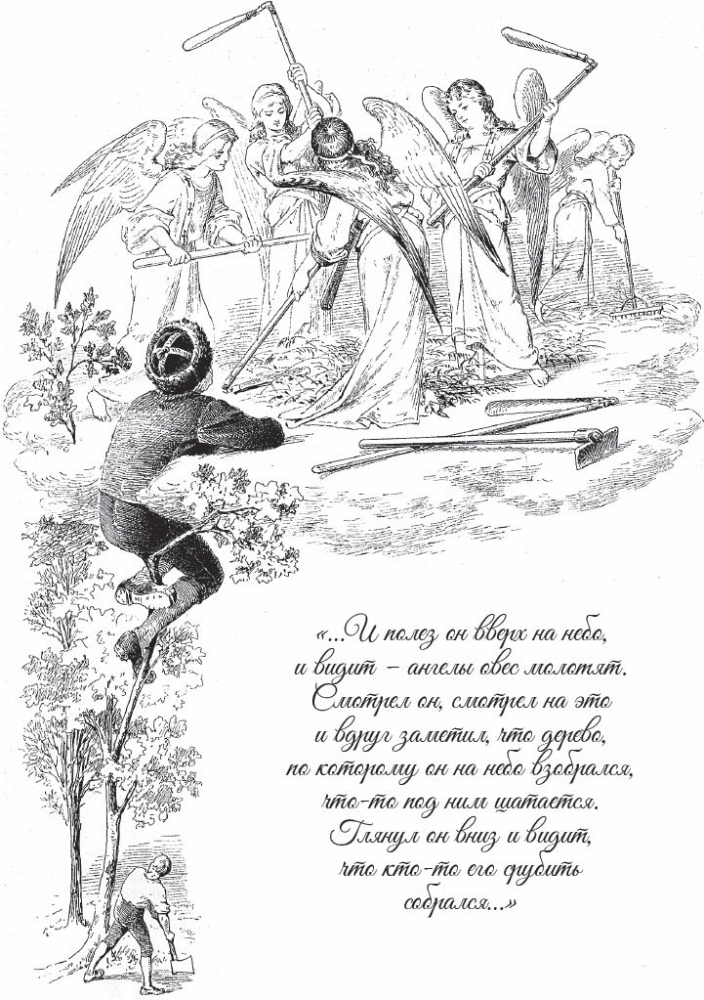

## Der Dreschflegel vom Himmel

Einmal zog ein Bauer mit zwei Ochsen hinaus, um zu pflügen. Als er auf den Acker kam, fingen den beiden Tieren die Hörner an zu wachsen. Sie wuchsen immer weiter, und als er nach Hause wollte, waren sie so groß, dass er mit den Ochsen nicht durch das Tor kam. Zum Glück kam gerade ein Metzger vorbei. Dem überließ er sie, und sie machten folgendes Geschäft: Der Bauer sollte dem Metzger ein <abbr title="das Maß, die Maße — мера (сыпучих тел)">Maß</abbr> <abbr title="der Rübsamen — семена репы, сурепицы">Rübsamen</abbr> bringen, und der Metzger wollte ihm dafür für jedes Korn einen <abbr title="der Brabanter Taler — брабантский талер (монета)">Brabanter Taler</abbr> zahlen. Das nenne ich gut verkauft!

Der Bauer ging also nach Hause und trug das Maß Rübsamen auf dem Rücken zum Metzger. Unterwegs aber verlor er ein Körnchen aus dem Sack. Der Metzger zahlte ihm genau, was vereinbart war. Hätte der Bauer das Korn nicht verloren, dann hätte er einen Brabanter Taler mehr gehabt.

Inzwischen aber war aus dem Korn ein Baum gewachsen, und als der Bauer auf dem Rückweg vorbeikam, reichte er bis an den Himmel. Da dachte der Bauer: «Wenn sich schon die Gelegenheit bietet, musst du doch nachsehen, was die Engel da oben machen, und ihnen einmal in die Augen schauen.» Also stieg er hinauf. Oben sah er, dass die Engel Hafer <abbr title="dreschen (drosch, hat gedroschen) — молотить">droschen</abbr>, und schaute ihnen dabei zu.

Während er so schaute, merkte er, dass der Baum, auf dem er stand, zu wackeln anfing. Er sah hinunter und sah, dass gerade einer den Baum umhauen wollte. «Wenn du da <abbr title="hinunterstürzen (stürzte hinunter, ist hinuntergestürzt) — свалиться вниз, рухнуть">hinunterstürzt</abbr>, das wäre eine böse Sache», dachte er. In seiner Not wusste er sich nicht besser zu helfen: Er nahm die <abbr title="die Spreu — мякина, полова">Spreu</abbr> vom Hafer, die dort <abbr title="haufenweise — кучами">haufenweise</abbr> lag, und drehte daraus einen Strick. Außerdem griff er nach einer Hacke und einem Dreschflegel, die dort im Himmel herumlagen, und <abbr title="sich herunterlassen — спуститься">ließ sich</abbr> an dem Seil herunter.

Unten auf der Erde landete er aber genau in einem tiefen, tiefen Loch. Da war es ein echtes Glück, dass er die Hacke hatte. Denn damit hackte er sich eine Treppe, stieg nach oben und brachte den Dreschflegel als Beweis mit. So konnte niemand mehr an seiner Geschichte zweifeln.

---

### Neue Wörter

- **das Maß, die Maße** — мера (сыпучих тел)
- **der Rübsamen** — семена репы, сурепицы
- **der Brabanter Taler** — брабантский талер (монета)
- **dreschen (drosch, hat gedroschen)** — молотить
- **hinunterstürzen (stürzte hinunter, ist hinuntergestürzt)** — свалиться вниз, рухнуть
- **die Spreu** — мякина, полова
- **haufenweise** — кучами
- **sich herunterlassen** — спуститься

[← Zurück](kapitel-111.md) · [Inhalt](README.md) · [Weiter →](kapitel-113.md)
