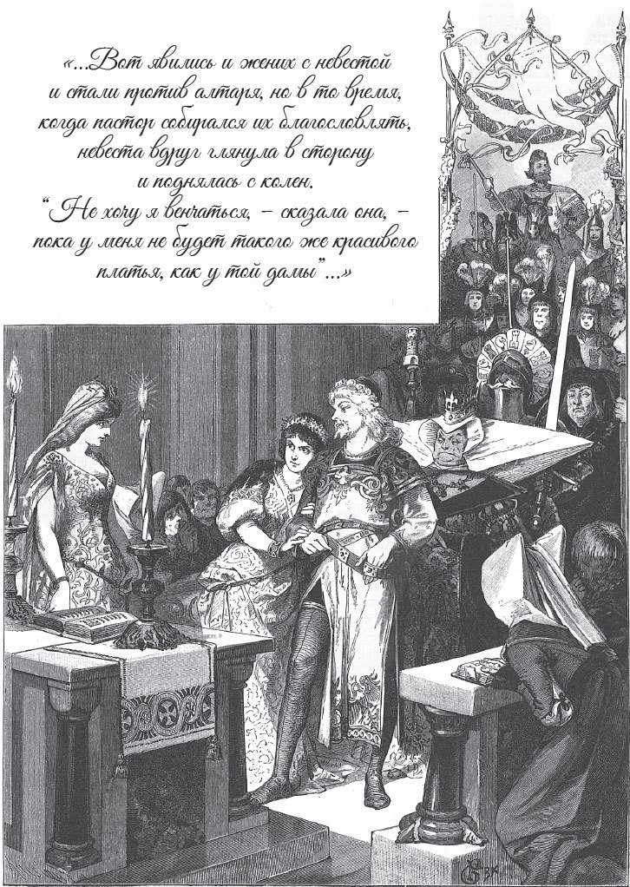

## Die beiden Königskinder

Es war einmal ein König, der hatte einen kleinen Jungen bekommen. In seinem <abbr title="das Sternzeichen, die Sternzeichen — знак судьбы, предзнаменование">Sternzeichen</abbr> hatte gestanden, dass er von einem Hirsch getötet werden sollte, wenn er sechzehn Jahre alt wäre. Als er nun so groß geworden war, gingen die Jäger einmal mit ihm auf die Jagd. Im Wald kam der Königssohn von den anderen weg. Auf einmal sah er einen großen Hirsch. Den wollte er schießen, aber er konnte ihn nicht treffen. Zuletzt lief der Hirsch so lange vor ihm her, bis sie ganz aus dem Wald heraus waren. Da stand plötzlich statt des Hirsches ein großer, langer Mann da und sagte:

— Na, das ist gut, dass ich dich habe! Ich habe schon sechs Paar gläserne <abbr title="der Schlittschuh, die Schlittschuhe — конёк">Schlittschuhe</abbr> hinter dir <abbr title="kaputtjagen — загнать до износа">kaputtgejagt</abbr> und konnte dich nicht kriegen.

Dann nahm er ihn mit sich und schleppte ihn durch ein großes Wasser bis vor ein großes Königsschloss. Dort musste er mit an den Tisch und etwas essen. Als sie zusammen gegessen hatten, sagte der König:

— Ich habe drei Töchter. Bei der ältesten musst du eine Nacht wachen, von abends neun Uhr bis morgens sechs. Und jedes Mal, wenn die Glocke schlägt, komme ich selbst und rufe dich. Wenn du mir dann keine Antwort gibst, wirst du morgen umgebracht. Wenn du mir aber immer antwortest, dann sollst du sie zur Frau haben.

Als die jungen Leute in die Schlafkammer kamen, stand dort ein steinerner <abbr title="der Christophorus — св. Христофор (статуя)">Christophorus</abbr>. Da sagte die Königstochter zu ihm:

— Um neun Uhr kommt mein Vater, und dann jede Stunde, bis es drei schlägt. Wenn er fragt, dann gebt Ihr ihm Antwort statt des Königssohns.

Da nickte der steinerne Christophorus mit dem Kopf, zuerst ganz schnell und dann immer langsamer, bis er zuletzt wieder still stand.

Am nächsten Morgen sagte der König zu ihm:

— Du hast deine Sache gut gemacht. Aber meine Tochter kann ich dir nicht geben. Du müsstest erst noch eine Nacht bei der zweiten Tochter wachen. Dann will ich mir überlegen, ob du meine älteste Tochter zur Frau haben kannst. Aber ich komme jede Stunde selbst. Und wenn ich dich rufe, dann antworte mir. Wenn ich dich rufe und du antwortest nicht, dann soll dein Blut für mich fließen.

Da gingen die beiden in die Schlafkammer. Dort stand ein noch größerer steinerner Christophorus. Zu dem sagte die Königstochter:

— Wenn mein Vater fragt, dann antworte du.

Da nickte der große steinerne Christophorus wieder mit dem Kopf, zuerst ganz schnell und dann immer langsamer, bis er zuletzt wieder still stand. Und der Königssohn legte sich auf die Türschwelle, legte die Hand unter den Kopf und schlief ein.

Am nächsten Morgen sagte der König zu ihm:

— Du hast deine Sache zwar gut gemacht. Aber meine Tochter kann ich dir nicht geben. Du müsstest sonst noch eine Nacht bei der jüngsten Königstochter wachen. Dann will ich mir überlegen, ob du meine zweite Tochter zur Frau haben kannst. Aber ich komme jede Stunde selbst. Und wenn ich dich rufe, dann antworte mir. Wenn ich dich rufe und du antwortest nicht, dann soll dein Blut für mich fließen.

Da gingen sie wieder zusammen in ihre Schlafkammer. Dort stand ein noch viel größerer und viel längerer Christophorus als bei den ersten beiden. Zu dem sagte die Königstochter:

— Wenn mein Vater ruft, dann antworte du.

Da nickte der große, lange steinerne Christophorus wohl eine halbe Stunde lang mit dem Kopf, bis der Kopf zuletzt wieder still stand. Und der Königssohn legte sich auf die Türschwelle und schlief ein.

Am nächsten Morgen sagte der König:

— Du hast zwar gut gewacht, aber ich kann dir meine Tochter noch nicht geben. Ich habe einen großen Wald. Wenn du mir den von heute Morgen sechs Uhr bis abends sechs Uhr abhackst, dann will ich es mir überlegen.

Und er gab ihm eine gläserne Axt, einen gläsernen Keil und eine gläserne <abbr title="die Holzhacke, die Holzhacken — колотушка, топорик (для дров)">Holzhacke</abbr> mit. Als er in den Wald kam, schlug er einmal zu, da war die Axt entzwei. Dann nahm er den Keil und schlug einmal mit der Holzhacke darauf, da war alles so klein wie Sand. Da war er so betrübt und glaubte, jetzt müsste er sterben. Er setzte sich hin und weinte.

Als es Mittag war, sagte der König:

— Eine von euch Mädchen muss ihm etwas zu essen bringen.

— Nein, — sagten die beiden ältesten, — wir bringen ihm nichts. Bei der er zuletzt gewacht hat, die kann ihm auch etwas bringen.

Da musste die jüngste hingehen und ihm etwas zu essen bringen. Als sie in den Wald kam, fragte sie ihn, wie es ihm ginge.

— Oh, — sagte er, — es geht mir ganz schlecht.

Da sagte sie, er sollte herkommen und erst ein bisschen essen.

— Nein, — sagte er, — das kann ich nicht. Ich muss ja doch sterben, essen will ich nicht mehr.

Da redete sie ihm so lange gut zu, er möchte es doch versuchen, bis er kam und etwas aß. Als er gegessen hatte, sagte sie:

— Ich will dich erst ein bisschen lausen, dann wirst du auf andere Gedanken kommen.

Während sie ihn lauste, wurde er so müde, dass er einschlief. Da nahm sie ihr Tuch, band einen Knoten hinein, schlug damit dreimal auf die Erde und sagte:

— Arweggers, herut! — das heißt: Arbeiter, heraus!

Sofort kamen viele <abbr title="das Erdmännchen, die Erdmännchen — гномик, земляной человечек">Erdmännchen</abbr> hervor und fragten, was die Königstochter befehle. Da sagte sie:

— In drei Stunden muss der große Wald abgehackt und alles Holz in Haufen <abbr title="stapeln — складывать штабелями">gestapelt</abbr> sein.

Da gingen die Erdmännchen herum und <abbr title="aufbieten (bot auf, hat aufgeboten) — созвать, мобилизовать">boten</abbr> ihre ganze Verwandtschaft auf, damit sie ihnen bei der Arbeit hülfen. Sie fingen sofort an, und als die drei Stunden um waren, war alles fertig. Dann kamen sie wieder zur Königstochter und sagten es ihr. Da nahm sie wieder ihr weißes Tuch und sagte:

— Arbeiter, nach Hause!

Da waren sie alle wieder weg. Als der Königssohn aufwachte, war er sehr froh. Da sagte sie:

— Wenn es sechs geschlagen hat, dann komm nach Hause.

Das tat er auch, und der König fragte:

— Hast du den Wald abgehackt?

— Ja, — sagte der Königssohn.

Als sie dann am Tisch saßen, sagte der König:

— Ich kann dir meine Tochter noch nicht zur Frau geben. Du musst erst noch etwas für sie tun.

Da fragte er, was das denn sein sollte.

— Ich habe einen großen Teich, — sagte der König. — Zu dem musst du morgen früh gehen und ihn <abbr title="ausschlämmen — очистить от ила">ausschlämmen</abbr>, sodass er so blank ist wie ein Spiegel. Und es müssen allerlei Fische darin sein.

Am nächsten Morgen gab ihm der König eine gläserne Schaufel und sagte:

— Um sechs Uhr muss der Teich fertig sein.

Da ging er los. Als er zum Teich kam, stach er mit der Schaufel in den Sumpf, da brach sie ab. Dann stach er mit der Hacke in den Sumpf, und auch die war kaputt. Da wurde er ganz betrübt. Am Mittag brachte die jüngste Tochter ihm etwas zu essen und fragte, wie es ihm ginge. Da sagte der Königssohn, es ginge ihm ganz schlecht, er würde wohl seinen Kopf verlieren müssen.

— Das Werkzeug ist mir wieder zerbrochen.

— Oh, — sagte sie, — komm und iss erst etwas, dann kommst du auf andere Gedanken.

— Nein, — sagte er, — essen kann ich nicht, ich bin viel zu betrübt.

Da redete sie ihm gut zu, bis er kam und etwas aß. Dann lauste sie ihn wieder, und er schlief ein. Sie nahm noch einmal ein Tuch, machte einen Knoten hinein, klopfte mit dem Knoten dreimal auf die Erde und sagte:

— Arbeiter, heraus!

Sofort kamen viele Erdmännchen und fragten alle, was sie wünschte. In drei Stunden müssten sie den Teich ganz ausgeschlämmt haben, sagte sie. Er müsste so blank sein, dass man sich darin spiegeln könnte, und es müssten allerlei Fische darin sein. Da gingen die Erdmännchen hin und boten ihre Verwandtschaft auf, damit sie ihnen hülfen. Und nach zwei Stunden war alles fertig. Da kamen sie wieder und sagten:

— Wir haben getan, was uns befohlen wurde.

Da nahm die Königstochter das Tuch, schlug wieder dreimal auf die Erde und sagte:

— Arbeiter, nach Hause!

Da waren sie alle wieder weg. Als der Königssohn aufwachte, war der Teich fertig. Da ging auch die Königstochter weg und sagte, wenn es sechs wäre, sollte er nach Hause kommen. Als er nach Hause kam, fragte der König:

— Hast du den Teich fertig?

— Ja, — sagte der Königssohn.

Das wäre schön. Als sie wieder am Tisch saßen, sagte der König:

— Du hast den Teich zwar fertig, aber ich kann dir meine Tochter noch nicht geben. Du musst erst noch eine Sache tun.

— Was ist das denn? — fragte der Königssohn.

Er hätte einen großen Berg, sagte der König, darauf wüchsen lauter <abbr title="der Dornbusch, die Dornbüsche — терновый куст">Dornbüsche</abbr>. Die müssten alle abgehackt werden. Und oben auf dem Berg müsste er ein großes Schloss bauen, so prächtig, wie es sich ein Mensch nur denken könnte. Und alle Möbel und alles Gerät, die in ein Schloss gehörten, müssten darin sein. Als er am nächsten Morgen aufstand, gab ihm der König eine gläserne Axt und einen gläsernen <abbr title="der Bohrer, die Bohrer — бурав, сверло">Bohrer</abbr> mit.

— Aber um sechs Uhr muss alles fertig sein.

Als er mit der Axt in den ersten Dornbusch hieb, ging sie so klein entzwei, dass die Stücke rund um ihn herumflogen. Und den Bohrer konnte er auch nicht gebrauchen. Da war er ganz betrübt und wartete auf seine Liebste, ob sie nicht käme und ihm aus der Not hülfe. Als es Mittag war, kam sie und brachte etwas zu essen. Da ging er ihr entgegen, erzählte ihr alles, aß etwas, ließ sich von ihr lausen und schlief ein. Da nahm sie wieder den Knoten, schlug damit auf die Erde und sagte:

— Arbeiter, heraus!

Da kamen wieder viele Erdmännchen und fragten, was sie wünschte. Da sagte sie:

— In drei Stunden müsst ihr das ganze Gebüsch abhacken. Und oben auf dem Berg muss ein Schloss stehen, so prächtig, wie es sich einer nur denken kann, und alle Möbel und alles Gerät müssen darin sein.

Da gingen sie hin und boten ihre Verwandtschaft auf, damit sie hülfen. Und als die Zeit um war, war alles fertig. Da kamen sie zur Königstochter und sagten es ihr. Die Königstochter nahm das Tuch, schlug dreimal damit auf die Erde und sagte:

— Arbeiter, nach Hause!

Da waren sie sofort alle wieder weg. Als der Königssohn aufwachte und alles sah, war er so froh wie ein Vogel in der Luft. Als es sechs geschlagen hatte, gingen sie zusammen nach Hause. Da sagte der König:

— Ist das Schloss auch fertig?

— Ja, — sagte der Königssohn.

Als sie am Tisch saßen, sagte der König:

— Meine jüngste Tochter kann ich dir nicht geben, bevor die beiden ältesten geheiratet haben.

Da wurden der Königssohn und die Königstochter ganz betrübt, und der Königssohn wusste sich gar nicht mehr zu helfen. Da kam er einmal in der Nacht zu der Königstochter und lief mit ihr fort. Als sie ein Stück weit weg waren, sah sich die Tochter einmal um und sah ihren Vater hinter sich.

— Oh, — sagte sie, — was sollen wir machen? Mein Vater ist hinter uns und will uns zurückholen. Ich mache dich gleich zu einem Dornbusch und mich zu einer Rose, und ich will mich immer mitten im Busch schützen.

Als der Vater an die Stelle kam, stand dort ein Dornbusch mit einer Rose daran. Da wollte er die Rose abbrechen. Aber die Dornen stachen ihn in die Finger, sodass er wieder nach Hause gehen musste. Da fragte seine Frau, warum er sie nicht mitgebracht hätte. Er sagte, er wäre schon fast bei ihnen gewesen. Aber auf einmal hätte er sie <abbr title="aus den Augen verlieren — потерять из виду">aus den Augen verloren</abbr>, und da hätten ein Dornbusch und eine Rose gestanden.

— Hättest du nur die Rose abgebrochen, — sagte die Königin, — der Busch wäre schon von selbst mitgekommen.

Da ging er wieder los und wollte die Rose holen. Inzwischen aber waren die beiden schon weit über das Feld, und der König lief hinter ihnen her. Da sah sich die Tochter wieder um und sah ihren Vater kommen. Da sagte sie:

— Oh, was sollen wir jetzt machen? Ich mache dich gleich zu einer Kirche und mich zum Pfarrer. Dann will ich auf der <abbr title="die Kanzel, die Kanzeln — кафедра (в церкви)">Kanzel</abbr> stehen und predigen.

Als der König an die Stelle kam, stand dort eine Kirche, und auf der Kanzel stand ein Pfarrer und predigte. Da hörte er sich die Predigt an und ging wieder nach Hause. Da fragte die Königin, warum er sie nicht mitgebracht hätte. Da sagte er:

— Nein, ich bin so lange hinter ihnen hergelaufen. Und als ich dachte, ich wäre bald bei ihnen, da stand dort eine Kirche, und auf der Kanzel stand ein Pfarrer und predigte.

— Du hättest nur den Pfarrer bringen sollen, — sagte die Frau, — die Kirche wäre schon von selbst gekommen. Es hilft nichts mehr, wenn ich dich schicke. Ich muss selbst hingehen.

Als sie eine Weile unterwegs war und die beiden von fern sah, sah sich die Königstochter um, sah ihre Mutter kommen und sagte:

— Jetzt haben wir Pech, jetzt kommt meine Mutter selbst! Ich mache dich gleich zu einem Teich und mich zu einem Fisch.

Als die Mutter an die Stelle kam, war dort ein großer Teich, und in der Mitte sprang ein Fisch herum, guckte mit dem Kopf aus dem Wasser und war ganz fröhlich. Sie wollte den Fisch gern fangen, aber sie konnte ihn einfach nicht kriegen. Da wurde sie ganz böse und trank den ganzen Teich aus, um den Fisch zu bekommen. Aber davon wurde ihr so übel, dass sie sich <abbr title="sich übergeben (übergab, hat übergeben) — рвать, стошнить">übergeben</abbr> musste, und sie spuckte den ganzen Teich wieder aus. Da sagte sie:

— Ich sehe wohl, dass alles nichts mehr hilft.

Die beiden sollten nun wieder zu ihr kommen. Da gingen sie auch wieder hin, und die Königin gab der Tochter drei <abbr title="die Walnuss, die Walnüsse — грецкий орех">Walnüsse</abbr> und sagte:

— Damit kannst du dir helfen, wenn du in deiner größten Not bist.

Und dann gingen die jungen Leute wieder zusammen fort. Als sie wohl zehn Stunden gegangen waren, kamen sie zu dem Schloss, aus dem der Königssohn stammte, und daneben lag ein Dorf. Als sie dort ankamen, sagte der Königssohn:

— Bleib hier, meine Liebste. Ich will erst auf das Schloss gehen, und dann komme ich mit dem Wagen und den Dienern und hole dich ab.

Als er auf das Schloss kam, freuten sich alle sehr, dass sie den Königssohn wiederhatten. Da erzählte er, er hätte eine Braut, und die wäre jetzt im Dorf. Sie wollten mit dem Wagen hinfahren und sie holen. Da spannten sie auch gleich die Pferde an, und viele Diener setzten sich auf den Wagen. Als der Königssohn einsteigen wollte, gab ihm seine Mutter einen Kuss. Da hatte er alles vergessen, was geschehen war und was er tun wollte. Da befahl die Mutter, sie sollten die Pferde wieder ausspannen, und dann gingen alle wieder ins Haus.

Das Mädchen aber saß im Dorf und wartete und wartete und dachte, er würde sie abholen, aber es kam keiner. Da verdingte sich die Königstochter in der Mühle, die zum Schloss gehörte. Dort musste sie jeden Nachmittag am Wasser sitzen und Gefäße <abbr title="scheuern — чистить, драить">scheuern</abbr>. Einmal kam die Königin vom Schloss herunter und ging am Wasser spazieren. Sie sah das <abbr title="hübsch — хорошенький, миловидный">hübsche</abbr> Mädchen dort sitzen und sagte:

— Was ist das für ein hübsches Mädchen! Wie gut es mir gefällt!

Da sahen es alle an, aber kein Mensch <abbr title="kennen (kannte, hat gekannt) — знать">kannte</abbr> es. So ging wohl eine lange Zeit vorbei, und das Mädchen diente dem Müller ehrlich und treu. Inzwischen hatte die Königin eine Frau für ihren Sohn gesucht, die kam von ganz weit her aus der Welt. Als die Braut ankam, sollten die beiden sofort getraut werden. Es liefen so viele Leute zusammen, die alles sehen wollten. Da sagte das Mädchen zu dem Müller, er möchte ihr doch auch <abbr title="der Urlaub — отпуск, разрешение отлучиться">Urlaub</abbr> geben. Da sagte der Müller:

— Geh nur hin.

Als es losgehen wollte, öffnete es eine von den drei Walnüssen. Darin lag ein wunderschönes Kleid. Das zog es an, ging damit in die Kirche und stellte sich vor den Altar. Auf einmal kamen die Braut und der Bräutigam und setzten sich vor den Altar. Und als der Pfarrer sie segnen wollte, sah die Braut zur Seite und sah das Mädchen dort stehen. Da stand sie wieder auf und sagte, sie würde sich nicht trauen lassen, bevor sie nicht auch so ein schönes Kleid hätte wie diese Dame. Da gingen sie wieder nach Hause und ließen die Dame fragen, ob sie das Kleid wohl verkaufen würde. Nein, verkaufen würde sie es nicht, aber verdienen könnte man es sich wohl. Da fragten sie, was sie denn tun sollten. Da sagte sie: Wenn sie nachts vor der Tür des Königssohns schlafen dürfte, dann würde sie es tun. Da sagten sie Ja, das sollte sie nur tun.

Nun mussten die Diener dem Königssohn einen Schlaftrunk geben. Und das Mädchen legte sich auf die Schwelle und wimmerte die ganze Nacht: Sie hätte den Wald für ihn abhacken lassen, sie hätte den Teich für ihn ausschlämmen lassen, sie hätte das Schloss für ihn bauen lassen, sie hätte ihn zum Dornbusch gemacht, dann zur Kirche und zuletzt zum Teich, und er hätte sie so schnell vergessen. Der Königssohn hatte nichts davon gehört. Aber die Diener waren aufgewacht und hatten zugehört und wussten nicht, was es bedeuten sollte.

Als sie am nächsten Morgen aufgestanden waren, zog die Braut das Kleid an und fuhr mit dem Bräutigam zur Kirche. Inzwischen öffnete das hübsche Mädchen die zweite Walnuss. Darin war ein noch schöneres Kleid. Das zog es wieder an, ging damit in die Kirche und stellte sich vor den Altar. Und da ging es genauso wie beim vorigen Mal. Das Mädchen lag wieder eine Nacht vor der Schwelle, die zum Zimmer des Königssohns führte, und die Diener sollten ihm wieder einen Schlaftrunk geben. Aber die Diener kamen und gaben ihm etwas, das ihn wach hielt, und damit legte er sich ins Bett. Und die Müllersmagd vor der Türschwelle wimmerte wieder so sehr und sagte, was sie getan hätte. Das hörte der Königssohn alles und wurde ganz betrübt, und es fiel ihm alles wieder ein, was vergangen war. Da wollte er zu ihr gehen, aber seine Mutter hatte die Tür abgeschlossen.

Am nächsten Morgen aber ging er sofort zu seiner Liebsten und erzählte ihr alles, wie es ihm ergangen war. Sie möchte ihm doch nicht böse sein, dass er sie so lange vergessen hätte. Da öffnete die Königstochter die dritte Walnuss. Darin war ein noch viel schöneres Kleid. Das zog sie an und fuhr mit ihrem Bräutigam zur Kirche. Da kamen so viele Kinder, die gaben ihnen Blumen und hielten ihnen bunte Bänder vor die Füße. Und sie ließen sich segnen und feierten eine fröhliche Hochzeit. Aber die falsche Mutter und die Braut mussten fort.

Und wer das zuletzt erzählt hat, dem ist der Mund noch warm.

---

### Neue Wörter

- **das Sternzeichen, die Sternzeichen** — знак судьбы, предзнаменование
- **der Schlittschuh, die Schlittschuhe** — конёк
- **kaputtjagen** — загнать до износа
- **der Christophorus** — св. Христофор (статуя)
- **die Holzhacke, die Holzhacken** — колотушка, топорик (для дров)
- **das Erdmännchen, die Erdmännchen** — гномик, земляной человечек
- **stapeln** — складывать штабелями
- **aufbieten (bot auf, hat aufgeboten)** — созвать, мобилизовать
- **ausschlämmen** — очистить от ила
- **der Dornbusch, die Dornbüsche** — терновый куст
- **der Bohrer, die Bohrer** — бурав, сверло
- **aus den Augen verlieren** — потерять из виду
- **die Kanzel, die Kanzeln** — кафедра (в церкви)
- **sich übergeben (übergab, hat übergeben)** — рвать, стошнить
- **die Walnuss, die Walnüsse** — грецкий орех
- **scheuern** — чистить, драить
- **hübsch** — хорошенький, миловидный
- **kennen (kannte, hat gekannt)** — знать
- **der Urlaub** — отпуск, разрешение отлучиться

[← Zurück](kapitel-112.md) · [Inhalt](README.md) · [Weiter →](kapitel-114.md)
