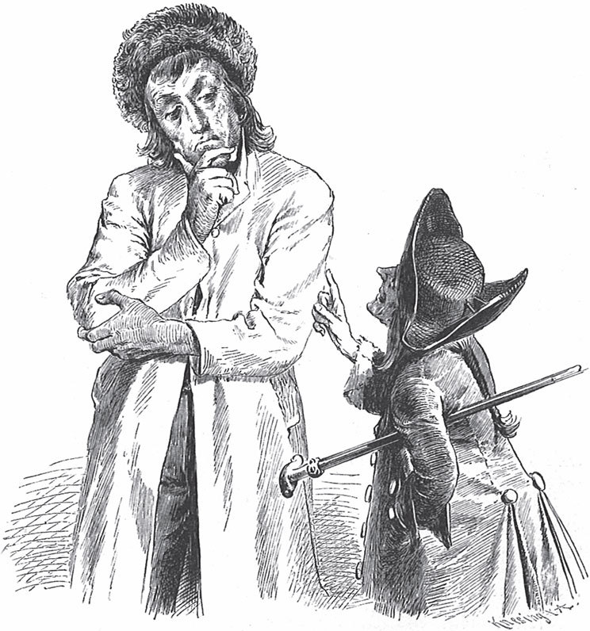

## Das blaue Licht

Es war einmal ein Soldat, der hatte dem König viele Jahre treu gedient. Als aber der Krieg zu Ende war, konnte der Soldat wegen der vielen Wunden, die er bekommen hatte, nicht weiter dienen. Da sagte der König zu ihm:

— Du kannst nach Hause gehen, ich brauche dich nicht mehr. Geld bekommst du keins mehr, denn Lohn bekommt nur, wer mir dafür <abbr title="Dienste leisten — оказывать услуги, служить">Dienste leistet</abbr>.

Da wusste der Soldat nicht, wovon er leben sollte. Voller Sorgen ging er fort, und er ging den ganzen Tag, bis er abends in einen Wald kam. Als die Dunkelheit hereinbrach, sah er ein Licht. Er näherte sich ihm und kam zu einem Haus, in dem eine Hexe wohnte.

— Gib mir doch ein Nachtlager und ein bisschen zu essen und zu trinken, — sagte er zu ihr, — sonst verhungere ich.

— Oho! — antwortete sie. — Wer gibt einem <abbr title="herumstreunend — бродячий">herumstreunenden</abbr> Soldaten etwas? Aber ich will barmherzig sein und dich aufnehmen, wenn du tust, was ich verlange.

— Was verlangst du? — fragte der Soldat.

— Dass du mir morgen meinen Garten <abbr title="umgraben (grub um, hat umgegraben) — перекопать">umgräbst</abbr>.

Der Soldat war einverstanden und arbeitete am nächsten Tag mit aller Kraft, aber bis zum Abend wurde er nicht fertig.

— Ich sehe wohl, — sagte die Hexe, — dass du heute nicht mehr kannst. Ich will dich noch eine Nacht behalten. Dafür sollst du mir morgen eine Fuhre Holz spalten und klein machen.

Dafür brauchte der Soldat den ganzen Tag, und am Abend machte ihm die Hexe den Vorschlag, noch eine Nacht zu bleiben.

— Morgen sollst du mir nur eine kleine Arbeit tun. Hinter meinem Haus ist ein alter, <abbr title="ausgetrocknet — высохший">ausgetrockneter</abbr> Brunnen. Da ist mir mein Licht hineingefallen. Es brennt blau und erlischt nie. Das sollst du mir wieder heraufholen.

Am nächsten Tag führte ihn die Alte zu dem Brunnen und ließ ihn in einem Korb hinunter. Er fand das blaue Licht und gab ihr ein Zeichen, dass sie ihn wieder hinaufziehen sollte. Sie zog ihn auch nach oben. Aber als er nahe am Rand war, streckte sie die Hand hinunter und wollte ihm das blaue Licht abnehmen.

— Nein, — sagte er, denn er merkte ihre bösen Gedanken, — das Licht gebe ich dir erst, wenn ich mit beiden Füßen auf der Erde stehe.

Da geriet die Hexe <abbr title="in Wut geraten — прийти в ярость">in Wut</abbr>, ließ ihn wieder in den Brunnen hinunterfallen und ging fort.

Der arme Soldat fiel, ohne sich zu verletzen, auf den feuchten Boden, und das blaue Licht brannte weiter. Aber was konnte ihm das helfen? Er sah wohl, dass er dem Tod nicht entkommen würde. Eine Weile saß er ganz traurig da. Dann griff er zufällig in seine Tasche und fand seine <abbr title="die Tabakspfeife, die Tabakspfeifen — курительная трубка">Tabakspfeife</abbr>, die noch halb gestopft war. «Das soll dein letztes Vergnügen sein», dachte er, zog sie heraus, zündete sie an dem blauen Licht an und fing an zu rauchen. Als der Rauch in der Höhle herumgezogen war, stand auf einmal ein kleines schwarzes Männchen vor ihm und fragte:

— Herr, was befiehlst du?

— Was habe ich dir zu befehlen? — erwiderte der Soldat ganz verwundert.

— Ich muss alles tun, — sagte das Männchen, — was du verlangst.

— Gut, — sagte der Soldat, — dann hilf mir zuerst aus dem Brunnen.

Das Männchen nahm ihn an der Hand und führte ihn durch einen unterirdischen Gang. Aber es vergaß nicht, das blaue Licht mitzunehmen. Unterwegs zeigte es ihm die Schätze, die die Hexe gesammelt und dort versteckt hatte, und der Soldat nahm so viel Gold, wie er tragen konnte. Als er oben war, sagte er zu dem Männchen:

— Jetzt geh hin, fessle die alte Hexe und bring sie vor das Gericht.

Es dauerte nicht lange, da kam sie auf einem wilden <abbr title="der Kater, die Kater — кот">Kater</abbr> mit furchtbarem Geschrei schnell wie der Wind vorbeigeritten. Und wieder dauerte es nicht lange, da war das Männchen zurück.

— Alles ist erledigt, — sagte es, — und die Hexe hängt schon am Galgen. Herr, was befiehlst du weiter?

— Im Augenblick nichts, — antwortete der Soldat. — Du kannst nach Hause gehen. Sei nur sofort <abbr title="zur Stelle sein — быть на месте, тут как тут">zur Stelle</abbr>, wenn ich dich rufe.

— Du musst nichts anderes tun, — sagte das Männchen, — als deine Pfeife an dem blauen Licht anzuzünden. Dann stehe ich sofort vor dir.

Danach verschwand es vor seinen Augen.

Der Soldat kehrte in die Stadt zurück, aus der er gekommen war. Er ging in den besten Gasthof und ließ sich schöne Kleider machen. Dann befahl er dem Wirt, ihm ein Zimmer so prächtig wie möglich einzurichten. Als es fertig war und der Soldat <abbr title="einziehen (zog ein, ist eingezogen) — въехать, поселиться">eingezogen</abbr> war, rief er das schwarze Männchen und sagte:

— Ich habe dem König treu gedient. Aber er hat mich fortgeschickt und hungern lassen. Dafür will ich mich jetzt rächen.

— Was soll ich tun? — fragte der Kleine.

— Spät am Abend, wenn die Königstochter im Bett liegt, bring sie schlafend hierher. Sie soll mir als Magd dienen.

Das Männchen sagte:

— Für mich ist das eine leichte Sache, aber für dich eine gefährliche. Wenn das <abbr title="herauskommen (kam heraus, ist herausgekommen) — обнаружиться">herauskommt</abbr>, wird es dir schlecht ergehen.

Als es zwölf geschlagen hatte, sprang die Tür auf, und das Männchen trug die Königstochter herein.

— Aha, bist du da? — rief der Soldat. — <abbr title="frisch an die Arbeit! — живо за работу!">Frisch an die Arbeit</abbr>! Geh, hol den Besen und fege die Stube.

Als sie fertig war, befahl er ihr, zu seinem Sessel zu kommen. Er streckte ihr die Füße entgegen und sagte:

— Zieh mir die Stiefel aus.

Dann warf er sie ihr ins Gesicht, und sie musste sie aufheben, putzen und blank machen. Sie tat aber alles, was er ihr befahl, ohne <abbr title="der Widerstand — сопротивление">Widerstand</abbr>, stumm und mit halb geschlossenen Augen. Beim ersten <abbr title="der Hahnenschrei — крик петуха">Hahnenschrei</abbr> trug das Männchen sie wieder ins königliche Schloss und in ihr Bett zurück.

Als die Königstochter am nächsten Morgen aufgestanden war, ging sie zu ihrem Vater und erzählte ihm, sie hätte einen seltsamen Traum gehabt:

— Ich wurde blitzschnell durch die Straßen getragen und in das Zimmer eines Soldaten gebracht. Dem musste ich als Magd dienen und ihn bedienen und alle niedrige Arbeit tun, die Stube fegen und die Stiefel putzen. Es war nur ein Traum, und doch bin ich so müde, als ob ich wirklich alles getan hätte.

— Der Traum könnte wahr gewesen sein, — sagte der König. — Ich will dir einen Rat geben. Steck dir die Tasche voller Erbsen und mach ein kleines Loch hinein. Wenn du wieder abgeholt wirst, fallen sie heraus und hinterlassen eine Spur auf der Straße.

Während der König das sagte, stand das Männchen unsichtbar daneben und hörte alles mit an. Als es nachts die schlafende Königstochter wieder durch die Straßen trug, fielen zwar einzelne Erbsen aus der Tasche. Aber sie konnten keine Spur machen, denn das listige Männchen hatte vorher in allen Straßen Erbsen verstreut. Und die Königstochter musste wieder bis zum Hahnenschrei als Magd arbeiten.

Am nächsten Morgen schickte der König seine Leute los, die die Spur suchen sollten. Aber es war vergeblich. Denn in allen Straßen saßen die armen Kinder, sammelten Erbsen auf und sagten:

— Heute Nacht hat es Erbsen geregnet.

— Wir müssen uns etwas anderes ausdenken, — sagte der König. — Behalte deine Schuhe an, wenn du dich ins Bett legst. Und bevor du von dort zurückkommst, versteck einen davon. Ich werde ihn schon finden.

Das schwarze Männchen hörte den Plan. Und als der Soldat am Abend verlangte, es sollte die Königstochter wieder herbeitragen, riet es ihm ab. Gegen diese List wüsste es kein Mittel, sagte es. Und wenn man den Schuh bei ihm fände, könnte es ihm schlecht ergehen.

— Tu, was ich dir sage, — erwiderte der Soldat.

Und so musste die Königstochter auch in der dritten Nacht wie eine Magd arbeiten. Aber bevor sie zurückgetragen wurde, versteckte sie einen Schuh unter dem Bett.

Am nächsten Morgen ließ der König in der ganzen Stadt den Schuh seiner Tochter suchen. Man fand ihn bei dem Soldaten. Der Soldat selbst hatte sich auf die Bitte des Kleinen schon durch das Stadttor davongemacht, aber er wurde bald eingeholt und ins Gefängnis geworfen. Bei der <abbr title="die Flucht — бегство">Flucht</abbr> hatte er das Wichtigste vergessen, das blaue Licht und das Gold, und er hatte nur noch einen Dukaten in der Tasche.

Als er nun mit Ketten beladen am Fenster seines Gefängnisses stand, sah er einen seiner Kameraden vorbeigehen. Er klopfte an die Scheibe, und als der Kamerad herankam, sagte er:

— Sei so gut und hol mir das kleine Bündel, das ich im Gasthof liegen gelassen habe. Ich gebe dir dafür einen Dukaten.

Der Kamerad lief hin und brachte ihm, was er wollte. Sobald der Soldat wieder allein war, zündete er seine Pfeife an und ließ das schwarze Männchen kommen.

— Hab keine Furcht, — sagte es zu seinem Herrn. — Geh hin, wohin sie dich führen, und lass alles geschehen. Nimm nur das blaue Licht mit.

Am nächsten Tag wurde über den Soldaten <abbr title="Gericht halten über + Akk. — судить">Gericht gehalten</abbr>. Und obwohl er nichts Böses getan hatte, verurteilte ihn der Richter doch zum Tod. Als er nun hinausgeführt wurde, bat er den König um eine letzte Gnade.

— Was für eine? — fragte der König.

— Dass ich auf dem Weg noch eine Pfeife rauchen darf.

— Du kannst drei rauchen, — antwortete der König, — aber glaub nicht, dass ich dir das Leben schenke.

Da zog der Soldat seine Pfeife heraus und zündete sie an dem blauen Licht an. Und als ein paar <abbr title="der Rauchring, die Rauchringe — колечко дыма">Rauchringe</abbr> aufgestiegen waren, stand schon das Männchen da. Es hatte einen kleinen Knüppel in der Hand und sagte:

— Was befiehlt mein Herr?

— Schlag mir die falschen Richter und ihre <abbr title="der Häscher, die Häscher — стражник, сыщик">Häscher</abbr> zu Boden. Und verschone auch den König nicht, der mich so schlecht behandelt hat.

Da fuhr das Männchen wie der Blitz im <abbr title="der Zickzack — зигзаг">Zickzack</abbr> hin und her. Und wen es mit seinem Knüppel nur berührte, der fiel schon zu Boden und wagte nicht mehr, sich zu rühren. Da bekam der König Angst und <abbr title="sich aufs Bitten verlegen — перейти к мольбам">verlegte sich aufs Bitten</abbr>. Und nur um sein Leben zu behalten, gab er dem Soldaten das Reich und seine Tochter zur Frau.

---

### Neue Wörter

- **Dienste leisten** — оказывать услуги, служить
- **herumstreunend** — бродячий
- **umgraben (grub um, hat umgegraben)** — перекопать
- **ausgetrocknet** — высохший
- **in Wut geraten** — прийти в ярость
- **die Tabakspfeife, die Tabakspfeifen** — курительная трубка
- **der Kater, die Kater** — кот
- **zur Stelle sein** — быть на месте, тут как тут
- **einziehen (zog ein, ist eingezogen)** — въехать, поселиться
- **herauskommen (kam heraus, ist herausgekommen)** — обнаружиться
- **frisch an die Arbeit!** — живо за работу!
- **der Widerstand** — сопротивление
- **der Hahnenschrei** — крик петуха
- **die Flucht** — бегство
- **Gericht halten über + Akk.** — судить
- **der Rauchring, die Rauchringe** — колечко дыма
- **der Häscher, die Häscher** — стражник, сыщик
- **der Zickzack** — зигзаг
- **sich aufs Bitten verlegen** — перейти к мольбам

[← Zurück](kapitel-115.md) · [Inhalt](README.md) · [Weiter →](kapitel-117.md)
